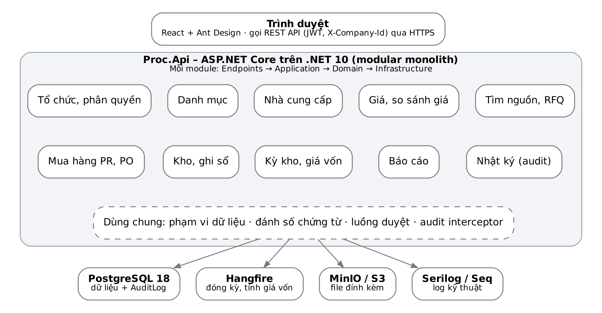
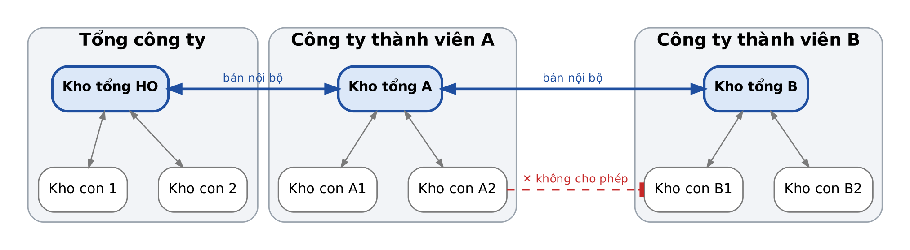
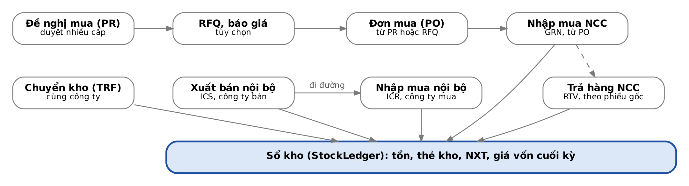
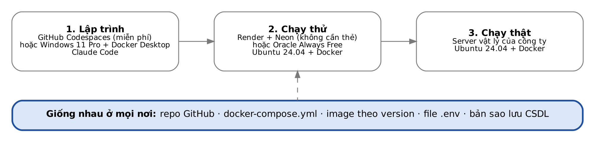

# Thiết kế hệ thống Quản lý Mua sắm – Đấu thầu – Kho tập đoàn

Phiên bản tài liệu 1.1 · cập nhật 28/10/2026 · người lập: Đặng Vĩnh Lập.
Đây là **bản gốc** của thiết kế; mọi thay đổi nghiệp vụ cập nhật tại đây (xem mục 16).

| Phiên bản | Ngày | Nội dung thay đổi |
| --- | --- | --- |
| 1.0 | 28/10/2026 | Mục 1–13: nghiệp vụ, công nghệ, kiến trúc, kho, master data, chứng từ, kỳ kho và giá vốn, giá và đấu thầu, phân quyền, form, báo cáo, CSDL, lộ trình |
| 1.1 | 28/10/2026 | Chốt PostgreSQL + Ubuntu + Docker; thêm mục 14 (hạ tầng), 15 (GitHub Codespaces), 16 (quy tắc Claude Code), 17 (giao diện kiểu Windows XP); ví dụ số giá vốn |

## 1. Phân tích nghiệp vụ và các quyết định cần chốt

Điểm then chốt của hệ thống: mỗi công ty thành viên là **một pháp nhân độc lập**, nên mọi luân chuyển hàng giữa hai công ty là **một giao dịch mua bán** (có giá bán, có hóa đơn), không phải phiếu chuyển kho. Chỉ chuyển kho *trong cùng một công ty* mới là luân chuyển nội bộ theo giá vốn.

### 1.1 Hệ quả thiết kế từ yêu cầu

- **Dữ liệu tách theo pháp nhân (multi-company).** Mọi bảng giao dịch có `CompanyId`. Tồn kho, giá vốn, kỳ kho đều tính riêng theo từng công ty. Tổng công ty cũng là một công ty (pháp nhân) trong hệ thống.
- **Master data dùng chung, giá và tồn riêng.** Danh mục hàng hóa, nhà cung cấp, đơn vị tính quản lý tập trung ở tổng công ty để so sánh giá được. Giá mua, hợp đồng, tồn kho thì gắn với từng công ty.
- **Bán nội bộ = 2 chứng từ liên kết.** Công ty A lập *Phiếu xuất bán nội bộ* (ghi doanh thu theo giá bán nội bộ, giá vốn theo bình quân của A). Hệ thống tự sinh *Phiếu nhập mua nội bộ* ở trạng thái chờ tại công ty B; B xác nhận nhận hàng thì mới ghi tăng tồn, giá nhập = giá bán nội bộ. Giữa hai bước là **hàng đi đường**.
- **Không có vòng lặp giá vốn.** Giá nhập của B là giá bán nội bộ (đã biết), không phụ thuộc giá vốn của A. Nhờ vậy mỗi công ty tính giá vốn độc lập, đóng kỳ độc lập.
- **Ràng buộc kho cứng trong code.** Liên công ty chỉ đi *kho tổng → kho tổng*. Kho con chỉ chuyển trong cùng công ty. Kiểm tra ở cả tầng nghiệp vụ lẫn ràng buộc dữ liệu.
- **Kỳ kho là khóa sổ.** Chứng từ chỉ được ghi sổ khi ngày chứng từ thuộc kỳ đang mở. Đóng kỳ thì tính giá vốn, chốt số dư, sinh tồn đầu kỳ sau.

### 1.2 Phạm vi chức năng (module)

| Module | Nội dung chính |
| --- | --- |
| Tổ chức và phân quyền | Công ty, kho, người dùng, vai trò, phạm vi dữ liệu (công ty / kho / nhóm hàng), audit log |
| Danh mục (master data) | Hàng hóa, nhóm hàng, ĐVT và quy đổi, nhà cung cấp, nhóm NCC, thuế, tiền tệ, lý do nhập xuất |
| Nhà cung cấp và giá | Hồ sơ NCC, NCC – sản phẩm/dịch vụ – công ty, bảng giá, lịch sử giá, so sánh giá, đánh giá NCC |
| Tìm nguồn và đấu thầu | Danh sách tìm NCC cho sản phẩm (sourcing list), RFQ/yêu cầu báo giá, bảng so sánh báo giá, chọn thầu |
| Mua hàng | PR (đề nghị mua), duyệt PR, PO (đơn mua), theo dõi giao hàng, hợp đồng khung |
| Kho | Nhập mua NCC, xuất trả NCC, chuyển kho nội bộ, xuất bán nội bộ, nhập mua nội bộ, điều chỉnh/kiểm kê, xuất dùng (tùy chọn) |
| Kỳ kho và giá vốn | Kỳ năm, kỳ tháng, đóng/mở kỳ, tính giá vốn bình quân, số dư đầu kỳ |
| Báo cáo | Nhập – xuất – tồn, thẻ kho, sổ chi tiết, so sánh giá, mua hàng theo NCC, giao dịch nội bộ, log người dùng |

### 1.3 Các điểm cần chốt trước khi code

Cột *Đề xuất* là phương án mặc định; chỉ cần sửa nếu công ty có quy định khác.

| # | Câu hỏi | Đề xuất mặc định |
| --- | --- | --- |
| 1 | Phương pháp tính giá vốn | Bình quân gia quyền **cuối kỳ tháng**, tính theo **công ty × mặt hàng** (mọi kho trong công ty chung một giá vốn) |
| 2 | Giá bán nội bộ lấy từ đâu | Bảng giá nội bộ do tổng công ty ban hành; nếu không có thì gợi ý = giá vốn kỳ đã đóng gần nhất × (1 + % markup) |
| 3 | Có quản lý lô, hạn dùng, serial không | Thiết kế sẵn cột `LotNo`, `ExpiryDate`; bật/tắt theo từng mặt hàng |
| 4 | Tiền tệ | VND là tiền hạch toán; PO ngoại tệ lưu thêm `CurrencyCode`, `ExchangeRate` |
| 5 | Thuế GTGT | Lưu thuế suất và tiền thuế trên dòng chứng từ; giá vốn không gồm VAT được khấu trừ |
| 6 | Kết nối kế toán (MISA, Fast, SAP…) | Giai đoạn sau: xuất file/API chứng từ đã ghi sổ; hệ thống này không làm sổ cái |
| 7 | Quy trình duyệt | Duyệt nhiều cấp, cấu hình theo công ty, loại chứng từ, ngưỡng giá trị |
| 8 | Hóa đơn điện tử cho bán nội bộ | Chỉ lưu số/ngày hóa đơn và đính kèm; phát hành hóa đơn ở hệ thống HĐĐT hiện có |
| 9 | Quy mô | Thiết kế cho ~50 công ty, ~500 người dùng, ~100.000 mã hàng, vài triệu dòng giao dịch/năm |

## 2. Lựa chọn công nghệ

Chốt: **ASP.NET Core trên .NET 10 (LTS) + PostgreSQL 18 + React/TypeScript**, đóng gói Docker, chạy trên Ubuntu Server. .NET 10 phát hành ngày 11/11/2025, là bản LTS được hỗ trợ đến 14/11/2028; .NET 8 và .NET 9 hết hỗ trợ ngày 10/11/2026 nên không dùng cho dự án mới.

### 2.1 PostgreSQL hay SQL Server?

| Tiêu chí | PostgreSQL 18 | SQL Server 2025 |
| --- | --- | --- |
| Chi phí bản quyền | Miễn phí, không giới hạn core/dung lượng | Express miễn phí (50 GB/CSDL, 4 core, ~1,4 GB bộ nhớ đệm); Standard tính phí theo core |
| Chạy trên máy ARM (gói cloud miễn phí) | Có | Không (image chính thức chỉ x86_64) |
| Hỗ trợ trong .NET | EF Core + Npgsql rất tốt | EF Core tốt nhất, công cụ SSMS quen thuộc |
| Kiểu số tiền/số lượng | `numeric` chính xác | `decimal` chính xác |
| Vận hành | Linux/Docker, nhẹ, phổ biến trên cloud | Tốt nhất khi đã có hạ tầng Windows + license |

**Quyết định:** dùng **PostgreSQL** để chuyển máy dễ dàng (cloud ↔ server vật lý, ARM ↔ x86) và không phát sinh license. Code dùng EF Core nên nếu sau này bắt buộc chuyển sang SQL Server chỉ cần đổi provider; tránh SQL đặc thù ngoài thư mục `Infrastructure/Reports`.

### 2.2 Ngăn xếp công nghệ

| Lớp | Công nghệ | Lý do |
| --- | --- | --- |
| Backend API | ASP.NET Core Web API (.NET 10) | LTS, hiệu năng cao, đúng yêu cầu dot net |
| Truy cập dữ liệu | EF Core 10 (ghi), Dapper (báo cáo nặng) | EF cho nghiệp vụ, SQL thuần cho NXT hàng triệu dòng |
| Kiểm tra dữ liệu | FluentValidation | Quy tắc rõ ràng, test được |
| Xác thực | ASP.NET Core Identity + JWT (hoặc Keycloak nếu cần SSO/AD) | Đăng nhập, khóa tài khoản, 2FA |
| Job nền | Hangfire (lưu trên PostgreSQL) | Đóng kỳ, tính giá vốn, gửi mail duyệt |
| Log | Serilog → Seq; bảng `AuditLog` riêng trong CSDL | Log kỹ thuật tách khỏi log nghiệp vụ |
| Xuất file | ClosedXML (Excel), QuestPDF (in phiếu, PO) | Thư viện .NET, không phụ thuộc Office |
| Frontend | React 19 + TypeScript + Vite + Ant Design + TanStack Query | Form/bảng nhập liệu phong phú, có locale tiếng Việt |
| Lưới nhập liệu | Component `DataGrid` dùng chung (Ant Design Table hoặc AG Grid Community) | Nhập dòng chứng từ nhanh như Excel |
| Lưu file đính kèm | MinIO (S3) hoặc thư mục mạng | Báo giá, hợp đồng, hóa đơn |
| Triển khai | Docker Compose, Caddy (HTTPS tự động), GitHub Actions | Dễ dựng môi trường dev/test/prod |
| Kiểm thử | xUnit + PostgreSQL thật (database `procurement_test`), Playwright cho UI | Test giá vốn trên DB thật, so giao diện với ảnh mẫu |

## 3. Kiến trúc phần mềm

Kiến trúc **modular monolith**: một ứng dụng ASP.NET Core duy nhất, chia thành các module nghiệp vụ tách biệt, dùng chung một CSDL. Với quy mô vài trăm người dùng, cách này nhanh làm, dễ triển khai và giữ được giao dịch (transaction) toàn vẹn khi ghi sổ kho.



Module chỉ gọi nhau qua interface của lớp Application, không truy cập thẳng bảng của module khác. Khi cần tách dịch vụ (ví dụ cổng NCC bên ngoài), tách nguyên một module ra là xong.

### 3.1 Các lớp (Clean Architecture)

| Lớp | Chứa gì | Không được |
| --- | --- | --- |
| Domain | Entity, value object, enum, quy tắc nghiệp vụ thuần (kiểm tra chuyển kho, trạng thái chứng từ, công thức giá vốn) | Tham chiếu EF Core, HTTP |
| Application | Command/Query theo use case, validator, DTO, interface (repository, `ICurrentUserScope`, `IClock`) | Viết SQL trực tiếp |
| Infrastructure | EF Core DbContext, migrations, Dapper báo cáo, interceptor audit, Hangfire job, lưu file, gửi mail | Chứa quy tắc nghiệp vụ |
| Api | Endpoint, xác thực, phân quyền, middleware lỗi, OpenAPI | Logic nghiệp vụ |
| Web | React SPA: AppShell, ListPage, DataGrid, DocumentForm; client sinh từ OpenAPI | Tự tính giá, tồn |

### 3.2 Nguyên tắc xuyên suốt

- **Ghi sổ là nguyên tử:** lưu chứng từ, ghi sổ kho, cập nhật tồn, ghi audit trong cùng một transaction.
- **Chứng từ có vòng đời:** Nháp → Chờ duyệt → Đã duyệt → Đã ghi sổ → (Bỏ ghi sổ / Hủy). Chỉ trạng thái *Đã ghi sổ* mới ảnh hưởng tồn kho.
- **Khóa lạc quan** (`xmin`/`RowVersion`) trên chứng từ và tồn kho để hai người không ghi đè nhau.
- **Client sinh tự động** từ OpenAPI để tránh lệch kiểu dữ liệu giữa backend và frontend.
- **Thời gian:** lưu UTC, hiển thị giờ Việt Nam (UTC+7); ngày chứng từ là kiểu `date`, không có giờ.

## 4. Mô hình tổ chức và quy tắc kho

Tập đoàn gồm nhiều công ty (kể cả tổng công ty), mỗi công ty có **đúng một kho tổng** và nhiều kho con. Luân chuyển hàng chỉ có hai đường hợp lệ.



| Loại luân chuyển | Từ → Đến | Chứng từ | Giá | Ảnh hưởng giá vốn |
| --- | --- | --- | --- | --- |
| Chuyển kho nội bộ | Mọi kho ↔ mọi kho, **cùng công ty** | 1 phiếu TRF (sinh 2 dòng sổ: xuất kho đi, nhập kho đến) | Giá vốn công ty | Không đổi |
| Bán nội bộ | Kho tổng công ty X → kho tổng công ty Y | Phiếu xuất bán nội bộ (ICS) tại X + phiếu nhập mua nội bộ (ICR) tại Y | Giá bán nội bộ | X: xuất theo giá vốn X; Y: nhập theo giá bán |
| Không cho phép | Kho con công ty X → bất kỳ kho nào của công ty Y | — | — | — |

Muốn đưa hàng từ kho con A1 sang kho con B1, người dùng làm 3 bước: chuyển A1 → kho tổng A, bán nội bộ kho tổng A → kho tổng B, chuyển kho tổng B → B1. Giao diện có thể có nút *Điều chuyển nhanh* sinh sẵn cả chuỗi chứng từ nhưng vẫn giữ đủ 3 bước trong sổ.

**Ràng buộc dữ liệu:** `WarehouseType` ∈ {Main, Sub}; unique index `(CompanyId) WHERE WarehouseType = 'Main'`; kho con phải có `ParentWarehouseId` cùng `CompanyId`.

## 5. Master data (danh mục)

Master data chia hai tầng: **dùng chung toàn tập đoàn** (do tổng công ty quản lý, để so sánh giá được) và **riêng từng công ty** (kho, giá, tồn). Mọi danh mục có `Code` duy nhất, `IsActive`, `CreatedBy/At`, `UpdatedBy/At`, và không xóa cứng khi đã phát sinh giao dịch.

### 5.1 Danh mục tổ chức

| Danh mục | Trường chính | Ghi chú |
| --- | --- | --- |
| Công ty (`Company`) | Mã, tên, tên viết tắt, MST, địa chỉ, người đại diện, `IsHeadOffice`, tiền tệ hạch toán, ngày bắt đầu dùng hệ thống | Tổng công ty cũng là một bản ghi, `IsHeadOffice = true` |
| Kho (`Warehouse`) | Mã, tên, `CompanyId`, `WarehouseType` (Main/Sub), `ParentWarehouseId`, địa chỉ, thủ kho, cho phép tồn âm (mặc định không) | Mỗi công ty đúng **một** kho tổng |
| Bộ phận (`Department`) | Mã, tên, `CompanyId`, trưởng bộ phận | Dùng cho PR, phân bổ chi phí |
| Người dùng (`User`) | Tên đăng nhập, họ tên, email, công ty mặc định, trạng thái, 2FA | Một người có thể thuộc nhiều công ty |

### 5.2 Danh mục hàng hóa – dịch vụ (dùng chung)

| Danh mục | Trường chính | Ghi chú |
| --- | --- | --- |
| Nhóm hàng (`ItemCategory`) | Mã, tên, `ParentId` (cây nhiều cấp), tài khoản kho mặc định | Dùng để phân quyền theo nhóm hàng |
| Hàng hóa/dịch vụ (`Item`) | Mã, tên, tên tiếng Anh, `ItemType` (Hàng tồn kho / Dịch vụ / Tài sản / Vật tư tiêu hao), nhóm hàng, ĐVT cơ sở, quy cách, thương hiệu, xuất xứ, mã vạch, thuế suất VAT mặc định, quản lý lô (Y/N), quản lý hạn dùng (Y/N), tồn tối thiểu/tối đa, ảnh, thông số kỹ thuật | Chỉ `ItemType = Hàng tồn kho` mới đi qua kho |
| Đơn vị tính (`Uom`) | Mã, tên | Cái, hộp, thùng, kg… |
| Quy đổi ĐVT (`ItemUomConversion`) | `ItemId`, ĐVT, hệ số về ĐVT cơ sở | 1 thùng = 24 hộp; tồn kho luôn lưu theo ĐVT cơ sở |
| Thuộc tính mở rộng | Bộ thuộc tính theo nhóm hàng (key–value) | Tránh phải sửa bảng khi thêm thông số |

### 5.3 Danh mục nhà cung cấp (dùng chung)

| Danh mục | Trường chính | Ghi chú |
| --- | --- | --- |
| Nhóm NCC (`SupplierGroup`) | Mã, tên | Trong nước, nhập khẩu, nội bộ… |
| Nhà cung cấp (`Supplier`) | Mã, tên, MST (duy nhất), địa chỉ, điện thoại, email, website, người liên hệ (bảng con), tài khoản ngân hàng (bảng con), điều khoản thanh toán, ngành hàng cung cấp, trạng thái (Tiềm năng / Đã duyệt / Tạm ngưng / Danh sách đen), xếp hạng, hồ sơ pháp lý đính kèm | Công ty thành viên cũng được tạo thành NCC nội bộ, liên kết `CompanyId` |
| NCC áp dụng cho công ty (`SupplierCompany`) | `SupplierId`, `CompanyId`, mã NCC tại công ty, ngày bắt đầu, trạng thái | Trả lời: NCC nào đang bán cho công ty nào |
| NCC – Sản phẩm/Dịch vụ (`SupplierItem`) | `SupplierId`, `ItemId`, mã hàng của NCC, ĐVT mua, MOQ, lead time (ngày), là NCC ưu tiên | Trả lời: NCC nào đang bán sản phẩm gì |

### 5.4 Danh mục hệ thống và tham số

| Danh mục | Trường chính |
| --- | --- |
| Tiền tệ, tỷ giá | Mã tiền, tỷ giá theo ngày |
| Thuế suất | Mã, % (0, 5, 8, 10, không chịu thuế) |
| Điều khoản thanh toán / giao hàng | Mã, tên, số ngày |
| Lý do nhập/xuất | Mã, tên, loại chứng từ áp dụng |
| Đánh số chứng từ (`DocumentNumbering`) | Loại chứng từ, công ty, định dạng (`PO-{CTY}-{YYMM}-{0000}`); số hiện tại ở bảng `DocumentSequence` theo kỳ |
| Cấu hình duyệt (`ApprovalRule`) | Loại chứng từ, công ty, ngưỡng giá trị, các cấp duyệt, người/vai trò duyệt |
| Tham số công ty | Phương pháp giá vốn, cho tồn âm, % markup nội bộ mặc định |

### 5.5 Đánh số chứng từ

- **Mẫu số** gồm chữ cố định (A–Z, 0–9, `- / . _`, phần tiền tố nằm luôn trong mẫu) và các mã: `{CTY}` mã công ty,
  `{YYYY}`/`{YY}` năm, `{MM}` tháng, `{YYMM}` năm 2 số + tháng, `{0000}` số thứ tự (3–10 chữ số; vượt thì nới rộng, không cắt).
  Mẫu dài tối đa 40 ký tự, có đúng một nhóm số; có tháng thì phải có năm (để số không lặp giữa các năm).
- **Mẫu mặc định** khi công ty chưa cấu hình: `{LOẠI}-{CTY}-{YYMM}-{0000}`, ví dụ `PO-BHA-2610-0001`.
  Loại chứng từ: PR, RFQ, PO, CTR, GRN, RTV, TRF, ICS, ICR, ADJ (khai báo một nơi trong code).
- **Năm/tháng lấy theo ngày chứng từ**, không theo ngày nhập máy. Số thứ tự đếm lại theo **kỳ suy từ mẫu**: có tháng → mỗi tháng;
  chỉ có năm → mỗi năm; không có ngày → liên tục. Bộ đếm `DocumentSequence` khóa theo (công ty, loại, kỳ).
- **Cấp số khi lưu chứng từ**, trong cùng giao dịch, bằng một câu `INSERT … ON CONFLICT DO UPDATE … RETURNING`:
  không trùng khi nhiều người lưu cùng lúc; lưu lỗi thì số được trả lại (không nhảy số).
- Đổi mẫu không đổi số đã cấp. Ràng buộc duy nhất (CompanyId, DocType, số) ở bảng chứng từ (mục 12.2) là lớp chặn cuối,
  phòng khi đổi qua lại giữa các mẫu sinh ra số đã dùng.
- Màn hình **Hệ thống → Đánh số chứng từ** (quyền xem/sửa tham số hệ thống) theo công ty đang làm việc: xem mẫu, số gần nhất
  và số kế tiếp của tháng này; sửa mẫu hoặc để trống để về mẫu mặc định.

### 5.6 Quản lý danh mục công ty và kho

| Quy tắc | Lý do |
| --- | --- |
| Thêm, sửa, ngừng dùng công ty chỉ khi đang làm việc ở **tổng công ty** (quyền `System.Company.Manage`); ở công ty thành viên chỉ xem được công ty mình | Danh mục tổ chức do tổng công ty quản lý; mỗi công ty là pháp nhân độc lập, không thấy công ty khác |
| Mã công ty không đổi sau khi tạo; mã số thuế 10 chữ số hoặc 10 chữ số + "-" + 3 chữ số, không trùng giữa các công ty | Mã nằm trong số chứng từ đã cấp; mỗi pháp nhân một mã số thuế |
| Thêm công ty là tạo luôn **kho tổng** của công ty đó | Mỗi công ty luôn có đúng một kho tổng (mục 4) |
| Người thêm công ty được gán các vai trò mình đang có ở tổng công ty tại công ty mới (phạm vi nhóm hàng như ở tổng công ty, mọi kho) | Gán quyền chỉ làm tại công ty đang làm việc (mục 9.5); không gán thì không ai vào được công ty mới. Không cấp thêm quyền nào người đó chưa có |
| Tổng công ty không ngừng dùng được; công ty ngừng dùng thì không ai chọn làm việc được nữa | Tổng công ty giữ danh mục dùng chung và tài khoản quản trị |
| Kho: thấy và sửa kho của công ty đang làm việc trong phạm vi kho được phép (quyền `Organization.Warehouse.Manage`); mã và loại kho không đổi | Mã kho nằm trên chứng từ; loại kho quyết định đường luân chuyển hợp lệ |
| Thêm kho phụ hoặc đổi kho cha cần phạm vi **mọi kho** của công ty | Kho mới nằm ngoài danh sách kho được gán; người bị giới hạn chỉ thấy một phần cây kho nên không kiểm tra được vòng lặp |
| Kho cha cùng công ty, đang dùng, không phải chính kho đó hay kho con cháu của nó | Không cho kho phụ treo sang công ty khác (mục 4), cây kho không thành vòng |
| Kho tổng không ngừng dùng được; kho còn kho con đang dùng thì ngừng kho con trước | Kho tổng là kênh duy nhất của ICS/ICR; không để nhánh kho treo dưới kho đã ngừng |
| Cho phép tồn âm bật/tắt theo từng kho, mặc định không | CLAUDE.md mục 4 |

### 5.7 Quản lý danh mục hàng hóa (đơn vị tính, nhóm hàng, hàng hóa)

| Quy tắc | Lý do |
| --- | --- |
| Thêm, sửa đơn vị tính, nhóm hàng, hàng hóa chỉ khi làm việc ở **tổng công ty**; công ty thành viên chỉ xem | Danh mục dùng chung toàn tập đoàn để so sánh giá được (mục 5) |
| Hàng hóa và nhóm hàng chỉ thấy trong **phạm vi nhóm hàng** của người xem (global query filter trên `Item` theo `CategoryId`) | Phân quyền theo nhóm hàng (mục 9.2) |
| Mã ĐVT 1–10 chữ/số; mã nhóm 2–20 chữ/số; mã hàng 2–30 ký tự chữ không dấu, số, `- . _ /`. Không đổi sau khi tạo | Mã nằm trên chứng từ, phân quyền, báo cáo |
| Trùng mã với bản ghi ngoài phạm vi: chỉ mục duy nhất trong CSDL chặn, API trả 409 kèm thông báo tiếng Việt | Kiểm tra trùng trước khi lưu đi qua filter nên không thấy bản ghi ngoài phạm vi |
| Thêm nhóm gốc, đổi nhóm cha, sửa đơn vị tính cần phạm vi **mọi nhóm hàng** | Người bị giới hạn chỉ thấy một phần cây/một phần hàng nên không kiểm tra được vòng lặp hay "còn hàng đang dùng" |
| Nhóm cha đang dùng, không tạo vòng; ngừng nhóm thì nhóm con và hàng trong nhóm phải ngừng/chuyển trước | Cây nhóm hàng không có nhánh treo |
| Ngừng ĐVT khi không còn hàng đang dùng nó làm ĐVT cơ sở hay ĐVT quy đổi | Hàng đang dùng phải lập được chứng từ |
| Chỉ hàng tồn kho mới bật lô, hạn dùng, tồn tối thiểu/tối đa (số lượng numeric(18,4), tối thiểu ≤ tối đa) | Chỉ hàng tồn kho đi qua kho (mục 5.2) |
| Quy đổi ĐVT: 1 ĐVT quy đổi = hệ số × ĐVT cơ sở, hệ số > 0, numeric(18,6); không trùng ĐVT cơ sở, mỗi ĐVT một dòng | Tồn kho luôn lưu theo ĐVT cơ sở; 6 chữ số thập phân để quy đổi g → kg |
| Thuế suất mặc định: KCT, 0, 5, 8, 10 (%) | Danh mục thuế suất đầy đủ (mục 5.4) làm sau, giữ đúng các mã này |
| Tìm hàng: mỗi lần tối đa 5.000 dòng; tìm theo mã, tên, tên tiếng Anh, mã vạch, có dấu hay không dấu (cột `SearchText`); lọc nhóm gồm nhóm con | Danh mục tới ~100.000 mã (mục 1.3) |

### 5.8 Quản lý nhóm NCC và nhà cung cấp

| Quy tắc | Lý do |
| --- | --- |
| Thêm, sửa nhóm NCC và NCC chỉ khi làm việc ở **tổng công ty**; mọi công ty có quyền `MasterData.Supplier.View` đều xem được | Danh mục dùng chung để so sánh giá (mục 5). NCC áp dụng cho công ty nào (`SupplierCompany`) làm ở lát sau |
| Mã NCC 2–30 ký tự chữ không dấu, số, `- . _ /`, không đổi sau khi tạo | Mã nằm trên chứng từ |
| Mã số thuế không trùng giữa các NCC. NCC trong nước: 10 hoặc 10-3 chữ số; NCC nước ngoài: mã thuế nước sở tại 3–20 ký tự | Một pháp nhân một NCC |
| Trạng thái: Tiềm năng (mặc định) → Đã duyệt / Tạm ngưng / Danh sách đen; Tạm ngưng và Danh sách đen **bắt buộc ghi lý do** | Người mua sau biết vì sao không đặt hàng được (chặn lập PO làm ở giai đoạn mua hàng) |
| Xếp hạng 1–5 sao; điều khoản thanh toán là chữ tự do cho tới khi có danh mục điều khoản (mục 5.4) | |
| Người liên hệ (tối đa một người chính) và tài khoản ngân hàng (tối đa một tài khoản mặc định, số tài khoản bỏ khoảng trắng, không trùng trong cùng NCC) là bảng con, sửa theo Id | Nhật ký thao tác chỉ ghi dòng thật sự thay đổi |
| NCC nội bộ liên kết một công ty thành viên; mỗi công ty tối đa một NCC nội bộ | Dùng cho mua bán liên công ty ICS/ICR (mục 6.3) |
| Ngừng dùng nhóm NCC khi không còn NCC nào (trừ danh sách đen) trong nhóm | NCC đang giao dịch luôn thuộc nhóm đang dùng |

### 5.9 NCC áp dụng cho công ty và NCC – sản phẩm

| Quy tắc | Lý do |
| --- | --- |
| `SupplierCompany` có `CompanyId` (tự lọc theo công ty đang làm việc). **Mỗi công ty tự khai báo** NCC mình mua tại công ty đang làm việc, cần quyền `MasterData.Supplier.Manage` ở công ty đó (không cần ở tổng công ty) | Mỗi công ty là pháp nhân độc lập, tự chọn NCC |
| Mã NCC tại công ty (tối đa 30 ký tự) duy nhất trong công ty; dùng để khớp với mã đối tượng trong phần mềm kế toán của công ty | |
| NCC ở danh sách đen không áp dụng (bật "đang giao dịch") được cho công ty nào | Mục 5.8 |
| Danh sách NCC có cột "Mua tại …" và bộ lọc "NCC … đang mua" theo công ty đang làm việc. Tổng công ty **chưa** xem được NCC áp dụng ở công ty khác (cần báo cáo hợp nhất có quyền `*.ViewAllCompanies`, mục 9.2) | Không truy vấn vượt filter công ty |
| `SupplierItem` dùng chung, thêm/sửa/xóa ở tổng công ty, lọc theo phạm vi nhóm hàng của mặt hàng; sửa **từng dòng** (không thay cả danh sách) | Người bị giới hạn nhóm hàng không thấy hết các dòng nên không được ghi đè cả danh sách |
| Mỗi (NCC, mặt hàng) một dòng; ĐVT mua phải là ĐVT cơ sở hoặc ĐVT quy đổi của mặt hàng; MOQ > 0 (numeric(18,4)); thời gian giao 0–365 ngày | Nhập kho phải quy đổi được về ĐVT cơ sở |
| Mỗi mặt hàng tối đa **một NCC ưu tiên**; chọn NCC ưu tiên mới thì NCC cũ tự bỏ (cùng giao dịch) | Gợi ý NCC mặc định khi lập PR/PO |
| Xóa dòng NCC – sản phẩm được (chưa có chứng từ tham chiếu); nhật ký thao tác giữ giá trị cũ | |

### 5.10 Nhập/xuất danh mục bằng Excel

Áp dụng cho: đơn vị tính, nhóm hàng, hàng hóa, nhóm NCC, nhà cung cấp (thư viện ClosedXML).

| Quy tắc | Lý do |
| --- | --- |
| **Xuất Excel** = toàn bộ danh mục trong phạm vi người xem, cùng định dạng file nhập (tiêu đề tiếng Việt, cột bắt buộc có dấu `*`, sheet "Hướng dẫn"); cột mã để dạng Text | Xuất ra, sửa, nhập lại được ngay; không mất số 0 đầu của mã số thuế, số tài khoản |
| **Nhập theo mã**: mã đã có thì cập nhật, chưa có thì thêm; không xóa bản ghi (ngừng dùng bằng cột "Còn dùng") | |
| Mỗi dòng đi qua đúng dịch vụ và validator của màn hình nhập tay (quy tắc nghiệp vụ, phạm vi, chỉ ở tổng công ty) | Không có đường tắt bỏ qua quy tắc |
| **Kiểm tra thử** chạy đủ như nhập thật trong một giao dịch rồi rollback; **Nhập thật** chỉ commit khi **không có lỗi nào** – một dòng lỗi thì cả file không lưu | Không để danh mục nhập dở dang |
| Lỗi báo theo số dòng và mã; hai dòng trùng mã là lỗi; tối đa 5.000 dòng và 10 MB mỗi file | Nhập từng dòng qua dịch vụ nên file quá lớn chạy lâu |
| Đọc cột theo tiêu đề (đổi thứ tự cột không sao); số nhận cả kiểu 1.234,5 và 1234.5; Có/Không nhận cả không dấu | |
| Nhóm hàng: nhóm cha đứng trên nhóm con (file xuất đã theo thứ tự cây) | |
| Hàng hóa: tối đa 3 ĐVT quy đổi trên file; cập nhật mà để trống cả 3 cột quy đổi thì giữ quy đổi cũ; thông số kỹ thuật không có trên file nên giữ nguyên | Tránh nhập file thiếu cột làm mất dữ liệu |
| NCC: một người liên hệ chính và một tài khoản ngân hàng, **chỉ dùng khi thêm NCC mới**; cập nhật giữ nguyên người liên hệ, tài khoản | Bảng con nhiều dòng sửa ở màn hình NCC |

## 6. Chứng từ nghiệp vụ và luồng xử lý

PR, RFQ, PO là chứng từ **mua hàng** (không đổi tồn); các phiếu nhập/xuất là chứng từ **kho**, khi ghi sổ mới sinh dòng trong sổ kho và thay đổi tồn.



### 6.1 Ảnh hưởng ghi sổ của từng chứng từ

| Chứng từ | Mã | Kho | Sổ kho khi ghi sổ | Giá ghi sổ | Kiểm tra bắt buộc |
| --- | --- | --- | --- | --- | --- |
| Nhập mua từ NCC | GRN | Kho tổng hoặc kho con | + nhập | Đơn giá mua trước VAT + chi phí phân bổ | NCC đã duyệt; SL không vượt PO + dung sai % |
| Xuất trả NCC | RTV | Kho đã nhập | − xuất | Giá nhập gốc (đích danh) | Có phiếu nhập gốc; SL ≤ còn trả được; đủ tồn |
| Chuyển kho nội bộ | TRF | Hai kho cùng công ty | − kho đi, + kho đến | Giá vốn công ty (chốt khi đóng kỳ) | Cùng `CompanyId`; đủ tồn kho đi |
| Xuất bán nội bộ | ICS | Kho tổng công ty bán | − xuất | Giá vốn công ty bán; doanh thu = giá bán nội bộ | Kho tổng → kho tổng; khác công ty; có giá bán |
| Nhập mua nội bộ | ICR | Kho tổng công ty mua | + nhập | Giá bán nội bộ trên ICS | Sinh từ ICS; ngày nhập thuộc kỳ mở của công ty mua |
| Điều chỉnh / kiểm kê | ADJ | Bất kỳ | ± | Nhập: giá nhập tay; xuất: giá vốn | Có biên bản kiểm kê, quyền riêng |

### 6.2 Luồng mua từ nhà cung cấp

1. Bộ phận lập **PR** → duyệt theo ngưỡng giá trị.
2. Phòng mua gộp PR (có thể nhiều PR, nhiều công ty nếu mua tập trung) → nếu chưa có giá hợp đồng thì mở **RFQ**, ngược lại lấy giá từ bảng giá.
3. Lập **PO** → duyệt → gửi NCC (PDF/email).
4. Hàng về: thủ kho lập **GRN** từ PO, nhập SL thực nhận, lô, hạn dùng → ghi sổ. PO cập nhật SL đã nhận; đủ thì đóng PO.
5. Hàng lỗi: lập **RTV** tham chiếu GRN.

### 6.3 Luồng bán nội bộ giữa hai công ty

1. (Tùy chọn) Công ty B lập **đơn đặt hàng nội bộ** gửi công ty A, hoặc tra cứu tồn tập đoàn rồi yêu cầu.
2. Công ty A lập **ICS** từ kho tổng A, giá lấy từ bảng giá nội bộ → duyệt → ghi sổ (trừ tồn A).
3. Hệ thống tự sinh **ICR** ở trạng thái *Chờ nhận* tại công ty B, liên kết hai chiều với ICS; gửi thông báo cho thủ kho B.
4. Thủ kho B kiểm hàng, xác nhận ICR (ngày nhận, SL thực nhận) → ghi sổ (tăng tồn kho tổng B theo giá bán nội bộ).
5. Chênh lệch SL sinh biên bản; A lập phiếu nhập lại hàng trả về hoặc điều chỉnh hóa đơn.
6. A không được bỏ ghi sổ ICS khi B đã xác nhận ICR.

## 7. Kỳ kho, đóng/mở kỳ và giá vốn

Mỗi công ty có lịch kỳ riêng: **kỳ năm** chứa 12 **kỳ tháng**. Chứng từ kho chỉ được ghi sổ khi ngày chứng từ rơi vào kỳ tháng đang mở của công ty đó. Đóng kỳ tháng = tính giá vốn thực tế + chốt số dư; đóng kỳ năm = đã đóng đủ 12 tháng + chuyển số dư sang năm mới.

### 7.1 Trạng thái kỳ

| Trạng thái | Ý nghĩa | Ai được làm |
| --- | --- | --- |
| Chưa mở (`NotOpened`) | Kỳ tương lai, chưa nhận chứng từ | — |
| Đang mở (`Open`) | Được lập, sửa, ghi sổ chứng từ | Người dùng có quyền |
| Đang tính giá (`Costing`) | Đang chạy tính giá vốn, khóa ghi sổ tạm thời | Hệ thống (job nền) |
| Đã đóng (`Closed`) | Đã có giá vốn thực tế, số dư cuối kỳ; không sửa được chứng từ | Kế toán kho trưởng |
| Khóa vĩnh viễn (`Locked`) | Sau quyết toán/kiểm toán, không mở lại được | Admin tổng công ty |

Cho phép **nhiều kỳ tháng mở cùng lúc** (ví dụ tháng 10 chưa đóng thì tháng 11 vẫn nhập liệu), nhưng đóng phải **tuần tự**: tháng N chỉ đóng khi tháng N−1 đã đóng.

### 7.2 Quy trình đóng kỳ tháng

1. **Kiểm tra trước đóng:** không còn chứng từ nháp/chờ duyệt trong kỳ; không còn phiếu bán nội bộ mà bên nhận chưa xác nhận (cảnh báo, cho phép xử lý hàng đi đường); không có tồn âm; kỳ trước đã đóng.
2. **Chuyển trạng thái `Costing`**, khóa ghi sổ kỳ này.
3. **Tính giá vốn** cho từng mặt hàng của công ty theo công thức 7.3.
4. **Cập nhật giá vốn** vào toàn bộ dòng xuất trong kỳ: xuất bán nội bộ, xuất chuyển kho nội bộ (nhập kho đích cùng giá), xuất điều chỉnh, xuất dùng. Phiếu trả NCC giữ giá đích danh.
5. **Chốt số dư** cuối kỳ theo công ty × kho × mặt hàng (× lô) vào bảng `StockPeriodBalance`; số dư cuối kỳ = số dư đầu kỳ tháng sau.
6. **Chuyển trạng thái `Closed`**, ghi log người đóng, thời điểm, số mặt hàng đã tính.

### 7.3 Công thức giá vốn bình quân gia quyền cuối kỳ

Tính theo công ty × mặt hàng, trên số lượng ở ĐVT cơ sở:

> **Giá vốn đơn vị kỳ = (Giá trị tồn đầu kỳ + Giá trị nhập trong kỳ có giá) ÷ (SL tồn đầu kỳ + SL nhập trong kỳ có giá)**

- **Nhập có giá** (tham gia công thức): nhập mua NCC (giá trước VAT + chi phí mua phân bổ), nhập mua nội bộ (giá bán nội bộ), nhập điều chỉnh có giá, trừ đi xuất trả NCC theo giá đích danh.
- **Không tham gia** công thức: chuyển kho trong cùng công ty (chỉ đổi vị trí, giá vốn công ty không đổi).
- **Chênh lệch làm tròn** dồn vào dòng xuất cuối cùng trong kỳ để giá trị tồn cuối = SL tồn × đơn giá khớp.
- **SL tồn = 0 nhưng giá trị ≠ 0:** sinh bút toán điều chỉnh giá trị tự động, có log.

**Ví dụ kiểm thử:** tồn đầu 100 × 10.000; nhập 50 × 13.000; trả NCC 10 từ lô 13.000; xuất 120. Giá vốn = (1.000.000 + 650.000 − 130.000) ÷ (100 + 50 − 10) = 1.520.000 ÷ 140 ≈ 10.857,14 đ/đơn vị; tồn cuối 20 đơn vị.

### 7.4 Mở lại kỳ

- Chỉ mở lại kỳ **đã đóng gần nhất** (muốn mở tháng 8 khi tháng 9 đã đóng thì phải mở tháng 9 trước).
- Bắt buộc nhập lý do; ghi audit log; gửi thông báo cho kế toán.
- Mở lại kỳ của công ty A **không** ảnh hưởng giá nhập của công ty B (vì B nhận theo giá bán nội bộ). Nếu A sửa giá bán nội bộ, phải lập phiếu điều chỉnh giá liên kết cho cả hai bên.

### 7.5 Giá vốn tạm tính trong kỳ

Khi kỳ đang mở, phiếu xuất hiển thị **giá vốn tạm tính** = giá vốn kỳ đã đóng gần nhất (hoặc bình quân di động tới thời điểm xuất). Đây chỉ là số tham khảo để định giá bán nội bộ; số chính thức là số sau đóng kỳ.

### 7.6 Lịch kỳ và mở kỳ

| Quy tắc | Lý do |
| --- | --- |
| Bảng `InventoryPeriod` có `CompanyId`: mỗi công ty một lịch kỳ riêng, tự lọc theo công ty đang làm việc | Mỗi công ty là pháp nhân độc lập, đóng kỳ độc lập |
| **Tạo lịch năm** sinh kỳ năm (Month = 0, trạng thái Đang mở) và 12 kỳ tháng Chưa mở; các năm phải **liền nhau** (năm tiếp theo = năm mới nhất + 1) | Số dư cuối năm này là đầu năm sau, không có năm trống |
| **Mở kỳ tháng tuần tự**: kỳ đầu tiên của công ty tự chọn (không trước tháng chứa ngày bắt đầu dùng hệ thống); các kỳ sau phải liền sau kỳ đã mở gần nhất; không mở ngược về trước | Không có kỳ trống giữa các kỳ đã nhận chứng từ; vẫn cho nhiều kỳ mở cùng lúc (mục 7.1) |
| Quyền `Inventory.Period.Open` (tạo lịch, mở kỳ) tách khỏi `Inventory.Period.Close` / `Reopen` (đóng, mở lại – giai đoạn 3) | Mở kỳ là việc thường xuyên của kế toán kho; đóng/mở lại là việc của kế toán kho trưởng |
| Ghi sổ kiểm tra ngày chứng từ thuộc kỳ tháng **Đang mở**; báo rõ "chưa có lịch / chưa mở / đang tính giá / đã đóng" | CLAUDE.md mục 4 |
| Dev/test (`Seed:DemoOpenCurrentPeriod`) tạo sẵn lịch năm hiện tại và mở tháng hiện tại cho công ty mẫu; server thật không tạo sẵn | Thử ghi sổ ngay trên dữ liệu mẫu |

## 8. Quản lý giá, so sánh giá, tìm nguồn và đấu thầu

Giá mua có ba nguồn — **bảng giá/hợp đồng**, **báo giá RFQ**, **giá thực mua trên PO/phiếu nhập** — và tất cả đổ về một bảng lịch sử giá chung để so sánh giữa các công ty và nhà cung cấp.

### 8.1 Dữ liệu giá

| Bảng | Trường chính | Dùng để |
| --- | --- | --- |
| Bảng giá NCC (`PriceList` + dòng) | NCC, công ty áp dụng (trống = toàn tập đoàn), hiệu lực từ–đến, tiền tệ, mặt hàng, ĐVT, đơn giá, bậc số lượng, chiết khấu, VAT, điều kiện giao hàng | Giá thỏa thuận/hợp đồng khung |
| Lịch sử giá (`PriceHistory`) | Mặt hàng, NCC, công ty, ngày, nguồn (PriceList/Quotation/PO/Receipt), số chứng từ, đơn giá quy về ĐVT cơ sở và VND | So sánh và vẽ xu hướng giá |
| Bảng giá nội bộ (`InternalPriceList`) | Công ty bán, công ty mua (hoặc tất cả), mặt hàng, giá, hiệu lực | Giá xuất bán nội bộ |

### 8.2 So sánh giá

- **Theo mặt hàng:** liệt kê mọi NCC đang bán mặt hàng, giá hiện hành, giá thấp nhất/cao nhất/bình quân 12 tháng, công ty nào đang mua của ai, với giá bao nhiêu. Tô màu công ty mua cao hơn mức thấp nhất tập đoàn quá X%.
- **Theo công ty:** công ty thành viên đang dùng những NCC nào, cho nhóm hàng/dịch vụ nào, doanh số mua theo kỳ.
- **Theo NCC:** NCC đang bán gì cho công ty nào, giá có khác nhau giữa các công ty không (phát hiện chênh giá cùng một NCC).
- Mọi giá quy về **ĐVT cơ sở, trước VAT, VND** trước khi so sánh.

### 8.3 Danh sách tìm nguồn (sourcing list)

Phiếu tìm NCC cho một sản phẩm cụ thể: mặt hàng (hoặc mô tả nếu chưa có mã), yêu cầu kỹ thuật, số lượng dự kiến, công ty cần, hạn chót, người phụ trách. Bảng con là các NCC ứng viên với trạng thái *Đã liên hệ → Đã gửi RFQ → Đã báo giá → Đạt / Không đạt*, ghi chú, hồ sơ năng lực. NCC chưa có trong danh mục được thêm ở trạng thái *Tiềm năng*.

### 8.4 RFQ và đấu thầu

1. Tạo **RFQ** từ PR hoặc từ sourcing list: danh sách mặt hàng, số lượng, hạn nộp, tiêu chí đánh giá (giá, chất lượng, thời gian giao, thanh toán, bảo hành) và trọng số.
2. Gửi cho ≥ 3 NCC (tham số cấu hình); nhập báo giá của từng NCC (nhập tay hoặc import Excel; giai đoạn sau có cổng NCC tự nhập).
3. **Bảng so sánh báo giá** tự động: mặt hàng × NCC, đánh dấu giá thấp nhất, chấm điểm theo trọng số.
4. Hội đồng/người duyệt chọn NCC trúng thầu (có thể tách theo dòng hàng), ghi lý do nếu không chọn giá thấp nhất.
5. Sinh **PO** hoặc **bảng giá/hợp đồng khung** từ kết quả; giá trúng thầu ghi vào lịch sử giá.

## 9. Phân quyền và ghi log

Phân quyền có hai chiều độc lập: **quyền chức năng** (được làm gì) và **phạm vi dữ liệu** (được thấy dữ liệu nào: công ty, kho, nhóm hàng). Một yêu cầu chỉ được thực hiện khi thỏa cả hai.

### 9.1 Quyền chức năng (RBAC)

- Quyền dạng `Module.Đối tượng.Hành động`, ví dụ `Purchase.PO.Create`, `Purchase.PO.Approve`, `Inventory.Period.Close`, `Inventory.Period.Reopen`, `Report.Stock.View`, `Report.Price.ViewAllCompanies`.
- Vai trò (`Role`) = tập quyền. Vai trò mẫu: Quản trị hệ thống, Ban mua hàng tập đoàn, Trưởng mua hàng công ty, Nhân viên mua hàng, Thủ kho, Kế toán kho, Người đề nghị (PR), Người duyệt, Xem báo cáo.
- Gán vai trò **theo công ty**: một người có thể là Thủ kho ở công ty A nhưng chỉ Xem báo cáo ở công ty B (`UserCompanyRole`).
- Danh mục quyền khai báo **một nơi trong code** (`src/Proc.Domain/Organization/Permissions.cs`); khi khởi động, bảng `Permission` được đồng bộ theo danh mục này và vai trò `ADMIN` (Quản trị hệ thống) luôn có đủ mọi quyền. Quyền của vai trò lưu ở `RolePermission`; quyền tại một công ty = hợp quyền của mọi vai trò người dùng có ở công ty đó.

### 9.2 Phạm vi dữ liệu

| Bảng | Ý nghĩa |
| --- | --- |
| `UserCompanyRole` | Người dùng – công ty – vai trò |
| `UserWarehouseScope` | Kho được phép (trống = tất cả kho của công ty đã gán) |
| `UserItemCategoryScope` | Nhóm hàng được phép **tại từng công ty** (có cột `CompanyId`, giống phạm vi kho), kế thừa xuống nhóm con (trống = tất cả) |

Mỗi request mang **công ty đang làm việc** (header `X-Company-Id`, chọn ở thanh menu trên cùng). Lớp `ICurrentUserScope` nạp phạm vi một lần mỗi request; EF Core **global query filter** tự thêm điều kiện công ty, kho, nhóm hàng vào truy vấn.

- Header chỉ tới công ty người dùng không có vai trò nào → từ chối ngay (403), không chạy tiếp với phạm vi sai.
- Mọi entity có `CompanyId` (cài `ICompanyOwned`) **tự động** được gắn filter công ty, để bảng giao dịch thêm sau không thể quên lọc.
- Chưa nạp phạm vi (ví dụ quên gọi) thì filter **không trả dòng nào** – mặc định từ chối, không mặc định cho xem hết.
- Endpoint khai báo quyền bằng `RequirePermission(...)`: chưa chọn công ty → 400, thiếu quyền → 403, kèm thông báo tiếng Việt.
- Giao diện ẩn menu, cây điều hướng, ô lệnh với màn hình không có quyền và chặn mở thẳng đường dẫn; API vẫn kiểm tra lại. Báo cáo Dapper bắt buộc nhận tham số phạm vi từ cùng service này. Lệnh ghi kiểm tra lại phạm vi ở tầng application (không tin client). Người dùng tổng công ty có quyền `*.ViewAllCompanies` để xem báo cáo hợp nhất và so sánh giá toàn tập đoàn.

### 9.3 Ghi log toàn bộ thao tác của một tài khoản

| Loại log | Ghi gì | Lưu ở |
| --- | --- | --- |
| Log nghiệp vụ (`AuditLog`) | Người dùng, công ty, thời điểm, IP, trình duyệt, loại đối tượng, ID, số chứng từ, hành động (Tạo/Sửa/Xóa/Gửi duyệt/Duyệt/Từ chối/Ghi sổ/Bỏ ghi sổ/Hủy/In/Xuất), giá trị cũ và mới (JSON diff), `CorrelationId` | Bảng CSDL, chỉ INSERT, chặn UPDATE/DELETE bằng quyền DB + trigger |
| Log truy cập (`AccessLog`) | Đăng nhập/đăng xuất, đăng nhập sai, đổi mật khẩu, đổi công ty làm việc | Bảng CSDL |
| Log kỹ thuật | Lỗi, hiệu năng, request | Serilog → Seq |

- Ghi tự động bằng **EF Core `SaveChangesInterceptor`**: duyệt `ChangeTracker`, sinh diff cho entity có đánh dấu `[Auditable]`, kể cả dòng chi tiết chứng từ.
- Các hành động không thay đổi dữ liệu (in, xuất Excel, xem báo cáo giá) ghi bằng một filter của API.
- Màn hình **Nhật ký người dùng**: lọc theo tài khoản, khoảng ngày, công ty, loại chứng từ, hành động; bấm một dòng để xem so sánh trước/sau; xuất Excel.
- Phân vùng bảng `AuditLog` theo tháng (PostgreSQL partitioning) để giữ nhiều năm mà vẫn truy vấn nhanh.
  Phân vùng tên `AuditLog_yyyy_MM` (tháng theo UTC), tạo sẵn tháng hiện tại và 2 tháng tới khi khởi động API;
  phân vùng mặc định `AuditLog_default` hứng dòng ngoài các tháng đã tạo để việc ghi nhật ký không bao giờ lỗi.
- Ghi gì: entity `[Auditable]` ghi mọi trường khi tạo/xóa, chỉ trường đổi giá trị khi sửa. Không ghi `Id` (đã có
  ở cột mã bản ghi) và cột CreatedAt/By, UpdatedAt/By (trùng thông tin của chính dòng nhật ký). Tài khoản: mã băm mật
  khẩu chỉ ghi `***`; bỏ qua số lần nhập sai, mã bảo mật, cột chuẩn hóa.
- Chặn UPDATE/DELETE bằng trigger ở cả `AuditLog` và `AccessLog` (kể cả chủ bảng). Thu quyền UPDATE/DELETE
  của tài khoản ứng dụng làm khi dựng server thật (mục 14).
- Phạm vi xem (quyền `System.Log.View`): nhật ký thao tác của **công ty đang làm việc**; nhật ký truy cập của người
  có vai trò ở công ty đang làm việc và sự kiện gắn với công ty đó. Làm việc ở **tổng công ty** thì thấy toàn bộ
  nhật ký truy cập, kể cả đăng nhập sai bằng tên không tồn tại.
- Mỗi lần tìm tối đa 366 ngày và 2.000 dòng mới nhất; nhiều hơn thì báo người dùng thu hẹp khoảng ngày.

### 9.4 Đăng nhập

| Quy tắc | Giá trị |
| --- | --- |
| Cách đăng nhập | ASP.NET Core Identity (bảng `User`, `UserClaim`, `UserLogin`, `UserToken`) + JWT; chưa bật 2FA, có sẵn chỗ bật sau |
| Mật khẩu | Tối thiểu 8 ký tự, có chữ thường và chữ số |
| Khóa tạm | Sai mật khẩu 5 lần liên tiếp thì khóa 15 phút; đang khóa thì mật khẩu đúng cũng không vào được |
| Thông báo khi sai | Sai tên hay sai mật khẩu đều báo cùng một câu, để không dò được tài khoản nào tồn tại |
| Thời hạn phiên | Token 8 giờ (một ngày làm việc); phiên lưu trong tab trình duyệt, đóng trình duyệt là phải đăng nhập lại |
| Nội dung token | Chỉ chứa định danh người dùng; công ty và vai trò đọc từ CSDL mỗi lần, nên quản trị gỡ quyền hay ngừng tài khoản là có hiệu lực ngay |
| Công ty làm việc | Chỉ chọn được công ty có ít nhất một dòng `UserCompanyRole` với công ty và vai trò đang hoạt động; tổng công ty đứng đầu danh sách |
| Tài khoản đầu tiên | Tạo từ cấu hình `Seed` khi khởi động: dev/test tạo sẵn `admin` và 4 công ty mẫu; server thật đặt mật khẩu qua biến môi trường rồi đổi ngay sau lần đăng nhập đầu |

### 9.5 Quản lý người dùng và vai trò

- Màn hình **Người dùng** và **Vai trò và phân quyền** theo khuôn danh sách + ngăn kéo chi tiết (mục 10.9).
- Vai trò, kho, nhóm hàng của một người được gán **tại công ty đang làm việc**; muốn gán ở công ty khác thì đổi công ty làm việc. Nhờ vậy kho, nhóm hàng chọn được luôn đi qua global query filter như mọi truy vấn khác.
- Tên đăng nhập không đổi sau khi tạo; tài khoản không xóa, chỉ ngừng dùng (giữ nhật ký thao tác).
- **Chống tự nâng quyền** (người có quyền quản lý không tự cấp cho mình hay tài khoản phụ quyền cao hơn):

| Quy tắc | Lý do |
| --- | --- |
| Chỉ gán **hoặc gỡ** vai trò mà mọi quyền của nó nằm trong quyền của người thao tác tại công ty đó | Không cấp được quyền mình không có; người ít quyền không hạ quyền được người nhiều quyền hơn |
| Chỉ cấp kho, nhóm hàng trong phạm vi của người thao tác; người thao tác bị giới hạn thì không cấp "tất cả" | Phạm vi cũng là quyền |
| Không tự sửa phân quyền, tự ngừng dùng hay tự đặt lại mật khẩu của mình (đổi mật khẩu qua menu người dùng) | Tránh tự khóa mình hoặc tự nâng quyền |
| Sửa thông tin, ngừng dùng, đặt lại mật khẩu chỉ khi người thao tác có quyền quản lý người dùng **và** đủ quyền của các vai trò người kia giữ, ở **mọi** công ty người kia được gán | Các thao tác này có hiệu lực ở mọi công ty: quản lý BHA không được đặt lại mật khẩu của quản trị tổng công ty rồi đăng nhập thay |
| Vai trò dùng chung mọi công ty; chỉ cấp được quyền mình có, chỉ sửa được vai trò có quyền nằm trong quyền của mình; mã vai trò không đổi | Cùng lý do như trên |
| Vai trò `ADMIN` không sửa, không ngừng dùng được | Luôn có đủ mọi quyền (mục 9.1) |

## 10. Thiết kế form nhập liệu

Mọi form chứng từ dùng **một khuôn chung** (`DocumentForm`): thanh công cụ trên cùng, phần đầu phiếu 2–3 cột, lưới dòng chi tiết nhập như Excel, chân phiếu tổng tiền, tab phụ (đính kèm, lịch sử duyệt, nhật ký). Phong cách hiển thị theo mục 17.

### 10.1 Khuôn chung của form chứng từ

- **Thanh công cụ:** Lưu nháp · Gửi duyệt · Duyệt / Từ chối · Ghi sổ · Bỏ ghi sổ · Hủy · Sao chép · In · Xuất Excel · Đính kèm. Nút hiện/ẩn theo trạng thái và quyền.
- **Thanh trạng thái phiếu:** Nháp → Chờ duyệt → Đã duyệt → Đã ghi sổ / Đã hủy, kèm số chứng từ, người tạo, kỳ kho.
- **Lưới dòng:** gõ mã hoặc tên để tìm hàng (chỉ hiện hàng thuộc nhóm được phép); Enter sang ô tiếp; dán từ Excel; ô tính toán chỉ đọc; hiện tồn khả dụng ngay trên dòng.
- **Phím tắt:** F2 thêm dòng, F3 tìm hàng, Ctrl+S lưu, Ctrl+Enter gửi duyệt.
- **Lập từ chứng từ khác:** nút *Lấy từ PR / PO / RFQ* để kéo dòng sang, giữ liên kết dòng nguồn (theo dõi SL còn lại).

### 10.2 Đề nghị mua hàng (PR)

| Phần | Trường |
| --- | --- |
| Đầu phiếu | Số PR (tự sinh), ngày, công ty, bộ phận đề nghị, người đề nghị, mục đích sử dụng, ngày cần hàng, kho nhận dự kiến, mức ưu tiên, ghi chú |
| Dòng | Mã hàng (hoặc mô tả hàng mới chưa có mã), ĐVT, SL đề nghị, tồn hiện tại (chỉ đọc), đơn giá tham khảo (giá mua gần nhất, chỉ đọc), thành tiền dự kiến, NCC đề xuất, ngày cần, ghi chú |
| Chân | Tổng giá trị dự kiến, luồng duyệt |

### 10.3 Đơn mua hàng (PO)

| Phần | Trường |
| --- | --- |
| Đầu phiếu | Số PO, ngày, công ty, NCC (chỉ NCC đã duyệt và được áp dụng cho công ty), người liên hệ NCC, hợp đồng/bảng giá áp dụng, tiền tệ, tỷ giá, điều khoản thanh toán, điều khoản giao hàng, ngày giao dự kiến, kho nhận (mặc định kho tổng), địa chỉ giao, PR nguồn, RFQ nguồn |
| Dòng | Mã hàng, mô tả, ĐVT mua, SL, đơn giá (tự lấy từ bảng giá; sửa được kèm cảnh báo nếu cao hơn giá thấp nhất tập đoàn), % CK, tiền CK, % VAT, tiền VAT, thành tiền, ngày giao, SL đã nhận (chỉ đọc), SL còn lại (chỉ đọc) |
| Chân | Tiền hàng, chiết khấu, VAT, tổng thanh toán, bằng chữ |

### 10.4 Phiếu nhập mua từ NCC (GRN)

| Phần | Trường |
| --- | --- |
| Đầu phiếu | Số phiếu, ngày nhập (quyết định kỳ kho), công ty, kho nhập, NCC, PO (một hoặc nhiều PO của cùng NCC), số hóa đơn, ký hiệu, ngày hóa đơn, số phiếu giao hàng, người giao, ghi chú |
| Dòng | Mã hàng, ĐVT, SL theo PO (chỉ đọc), SL thực nhận, SL quy đổi ĐVT cơ sở (chỉ đọc), đơn giá, thành tiền, VAT, số lô, hạn dùng, vị trí kho con (nếu nhập thẳng kho con) |
| Chi phí mua | Bảng phụ: vận chuyển, bốc xếp, bảo hiểm…; tiêu thức phân bổ (theo giá trị / số lượng / trọng lượng) vào giá nhập từng dòng |

### 10.5 Phiếu xuất trả hàng NCC (RTV)

| Phần | Trường |
| --- | --- |
| Đầu phiếu | Số phiếu, ngày, công ty, kho xuất, NCC, phiếu nhập gốc (bắt buộc), lý do trả, số hóa đơn điều chỉnh |
| Dòng | Mã hàng, lô, SL đã nhập (chỉ đọc), SL trả (≤ SL đã nhập − đã trả), đơn giá = giá nhập gốc (chỉ đọc), thành tiền, VAT |

### 10.6 Phiếu chuyển kho nội bộ (TRF – cùng công ty)

| Phần | Trường |
| --- | --- |
| Đầu phiếu | Số phiếu, ngày, công ty, kho xuất, kho nhập (chỉ hiện kho cùng công ty), người giao, người nhận, lý do, cần xác nhận nhận hàng (Y/N) |
| Dòng | Mã hàng, ĐVT, lô, tồn khả dụng tại kho xuất (chỉ đọc), SL chuyển, SL thực nhận (nhập lúc xác nhận) |
| Lưu ý | **Không có cột đơn giá nhập tay**; giá vốn hiển thị tạm tính, chốt khi đóng kỳ |

### 10.7 Phiếu xuất bán nội bộ (ICS – liên công ty)

| Phần | Trường |
| --- | --- |
| Đầu phiếu | Số phiếu, ngày, công ty bán, kho xuất (**chỉ kho tổng**), công ty mua, kho nhận (**chỉ kho tổng** của công ty mua, chỉ đọc), đơn đặt hàng nội bộ (nếu có), bảng giá nội bộ áp dụng, số hóa đơn, ngày hóa đơn, phương tiện vận chuyển |
| Dòng | Mã hàng, ĐVT, lô, tồn khả dụng, SL xuất, giá bán nội bộ (tự lấy từ bảng giá nội bộ), % VAT, thành tiền, giá vốn tạm tính (chỉ người có quyền thấy), lãi gộp tạm tính |
| Liên kết | Số phiếu nhập mua nội bộ bên nhận, trạng thái bên nhận (Chờ nhận / Đã nhận đủ / Nhận thiếu) |

### 10.8 Phiếu nhập mua nội bộ (ICR – bên nhận)

Do hệ thống sinh từ phiếu xuất bán nội bộ; bên nhận chỉ chọn ngày nhập, nhập SL thực nhận, lô, ghi chú chênh lệch rồi **Xác nhận**. Đơn giá = giá bán nội bộ, không sửa được. Nhận thiếu thì sinh biên bản chênh lệch để hai bên xử lý.

### 10.9 Form danh mục

Dạng **danh sách + ngăn kéo (drawer) chi tiết**: lưới có lọc, tìm kiếm, xuất/nhập Excel; bấm đúp dòng mở chi tiết với các tab. Ví dụ form NCC có tab: Thông tin chung · Người liên hệ · Ngân hàng · Công ty áp dụng · Sản phẩm/dịch vụ cung cấp · Bảng giá · Đánh giá · Tài liệu · Lịch sử giao dịch.

## 11. Báo cáo

Mọi báo cáo lọc theo phạm vi quyền của người xem, có lọc công ty/kho/nhóm hàng/kỳ, xuất Excel và PDF.

| Nhóm | Báo cáo | Nội dung chính |
| --- | --- | --- |
| Kho | Nhập – Xuất – Tồn | Theo công ty/kho/mặt hàng: tồn đầu, nhập, xuất, tồn cuối (SL + giá trị), giá vốn kỳ; tách nhập mua / nhập nội bộ / chuyển kho |
| Kho | Thẻ kho, sổ chi tiết vật tư | Từng phát sinh theo thời gian, tồn lũy kế |
| Kho | Tồn hiện tại, dưới mức tối thiểu, chậm luân chuyển, sắp hết hạn | Cảnh báo đặt hàng, điều chuyển |
| Kho | Hàng đi đường nội bộ | Phiếu bán nội bộ chưa được bên nhận xác nhận |
| Tồn tập đoàn | Tồn một mặt hàng ở mọi công ty | Gợi ý điều chuyển nội bộ thay vì mua mới |
| Mua hàng | PR chưa xử lý, PO chưa nhận đủ, mua hàng theo NCC/công ty/nhóm hàng | Theo dõi tiến độ, chi tiêu |
| Giá | So sánh giá theo mặt hàng, chênh giá giữa công ty, xu hướng giá, tiết kiệm từ đấu thầu | Mục 8.2 |
| NCC | NCC đang bán cho công ty nào, mặt hàng/dịch vụ gì; đánh giá NCC (đúng hạn, chất lượng, trả hàng) | Mục 5.3 |
| Nội bộ | Mua bán nội bộ giữa các công ty, đối chiếu công nợ nội bộ hai chiều | Phục vụ loại trừ khi hợp nhất |
| Kiểm soát | Nhật ký người dùng, chứng từ sửa sau ghi sổ, lịch sử đóng/mở kỳ | Mục 9.3 |

**Hiệu năng:** NXT kỳ đã đóng đọc từ `StockPeriodBalance` (đã chốt); kỳ đang mở = số dư kỳ trước + tổng hợp `StockLedger` trong kỳ. Không bao giờ cộng dồn từ đầu.

## 12. Lược đồ CSDL chính

Trái tim của kho là bảng **`StockLedger`** (sổ kho): mỗi dòng chứng từ khi ghi sổ sinh một hoặc hai dòng ledger (+ nhập, − xuất). Tồn kho, NXT, thẻ kho, giá vốn đều tính từ đây; chứng từ chỉ là nguồn.

### 12.1 Bảng giao dịch

| Bảng | Cột chính |
| --- | --- |
| `PurchaseRequest`, `PurchaseRequestLine` | Id, CompanyId, No, Date, DepartmentId, Status · ItemId, Qty, UomId, NeededDate, EstPrice |
| `Rfq`, `RfqLine`, `RfqSupplier`, `Quotation`, `QuotationLine` | Id, CompanyId, Deadline, Criteria · ItemId, Qty · SupplierId · Price, LeadTime, Score, IsAwarded |
| `PurchaseOrder`, `PurchaseOrderLine` | Id, CompanyId, SupplierId, No, Date, CurrencyCode, Rate, Status · ItemId, Qty, Price, Discount, VatRate, ReceivedQty, SourcePrLineId |
| `InventoryDocument` | Id, CompanyId, DocType, No, Date, PeriodId, FromWarehouseId, ToWarehouseId, SupplierId, CounterCompanyId, LinkedDocumentId, InvoiceNo, Status, PostedAt, PostedBy |
| `InventoryDocumentLine` | Id, DocumentId, ItemId, UomId, Qty, BaseQty, UnitPrice, Amount, VatRate, VatAmount, UnitCost, CostAmount, LotNo, ExpiryDate, SourceLineId |
| `StockLedger` | Id, CompanyId, WarehouseId, ItemId, LotNo, PeriodId, PostingDate, DocumentId, DocumentLineId, DocType, Direction (+1/−1), BaseQty, UnitCost, Amount, IsCostFinal |
| `StockOnHand` | CompanyId, WarehouseId, ItemId, LotNo, Qty, ReservedQty, RowVersion – tồn tức thời, cập nhật cùng transaction ghi sổ |
| `InventoryPeriod` | Id, CompanyId, Year, Month (0 = kỳ năm), StartDate, EndDate, Status, ClosedAt, ClosedBy |
| `StockPeriodBalance` | PeriodId, CompanyId, WarehouseId, ItemId, LotNo, OpenQty, OpenAmount, InQty, InAmount, OutQty, OutAmount, CloseQty, CloseAmount |
| `ItemPeriodCost` | PeriodId, CompanyId, ItemId, UnitCost, CalculatedAt |
| `ApprovalRequest`, `ApprovalStep` | DocType, DocId, Level, ApproverId, Status, Comment, ActedAt |
| `AuditLog`, `AccessLog` | Mục 9.3 |

Mã loại chứng từ (`DocType`): PR, PO, GRN (nhập mua NCC), RTV (trả NCC), TRF_OUT/TRF_IN (chuyển kho), ICS (xuất bán nội bộ), ICR (nhập mua nội bộ), ADJ_IN/ADJ_OUT (điều chỉnh, kiểm kê), ISS (xuất dùng).

### 12.2 Quy tắc toàn vẹn

- Ghi sổ một chứng từ trong **một transaction**: kiểm tra kỳ mở → kiểm tra tồn (khóa dòng `StockOnHand` bằng `SELECT … FOR UPDATE` hoặc `RowVersion`) → ghi `StockLedger` → cập nhật `StockOnHand` → đổi trạng thái → ghi audit.
- Chứng từ đã ghi sổ **không sửa trực tiếp**: phải *Bỏ ghi sổ* khi kỳ còn mở, hoặc lập chứng từ điều chỉnh khi kỳ đã đóng.
- Kiểu số: số lượng `numeric(18,4)`, đơn giá `numeric(19,6)`, tiền `numeric(19,2)`. Không dùng double/float.
- Ràng buộc kho trong CSDL: trigger/check bảo đảm ICS/ICR chỉ dùng kho Main, TRF chỉ giữa hai kho cùng `CompanyId`.
  Bảng `Warehouse` có khóa (`Id`, `CompanyId`); kho cha của kho Sub và `UserWarehouseScope` trỏ tới khóa kép này, nên CSDL tự chặn ghép kho với công ty khác. Mỗi công ty tối đa một kho Main (chỉ mục duy nhất có điều kiện).
- Khóa chính dùng `uuid` v7 (sắp xếp theo thời gian); số chứng từ là cột riêng, duy nhất theo (CompanyId, DocType, No).

## 13. Lộ trình triển khai với Claude Code

Cách làm: tài liệu này nằm trong repo (`docs/design.md`), `CLAUDE.md` chứa các quy tắc bất biến (mục 16), và Claude Code được giao **từng lát dọc (vertical slice)** nhỏ, mỗi lát có test, commit và push trước khi sang lát sau.

### 13.1 Cấu trúc solution

```
procurement-system/
├─ CLAUDE.md                       # quy tắc cho Claude Code (mục 16)
├─ CHANGELOG.md                    # nhật ký phiên bản
├─ Directory.Build.props           # số phiên bản <Version>
├─ docker-compose.dev.yml          # PostgreSQL cho môi trường lập trình
├─ docker-compose.yml              # chạy thật: app, db, caddy, seq, backup (mục 14.2)
├─ Dockerfile, Caddyfile, .env.example
├─ .devcontainer/                  # cấu hình GitHub Codespaces (mục 15)
├─ docs/
│  ├─ design.md                    # tài liệu thiết kế này
│  ├─ ui-guide.md                  # đặc tả giao diện (mục 17)
│  └─ mau-*.png                    # ảnh mẫu màn hình
├─ db/scripts/                     # script SQL theo phiên bản
├─ db/backup.sh                    # sao lưu hằng đêm (container backup)
├─ src/
│  ├─ Proc.Api/                    # ASP.NET Core host, auth, middleware, endpoints
│  ├─ Proc.Application/            # use case: Organization, MasterData, Suppliers, Pricing,
│  │                               #   Sourcing, Purchasing, Inventory, Periods, Reports, Audit
│  ├─ Proc.Domain/                 # entity, value object, quy tắc nghiệp vụ, enum
│  ├─ Proc.Infrastructure/         # EF Core, migrations, Dapper reports, interceptors, Hangfire
│  └─ Proc.Web/                    # React + TS + Vite + Ant Design
└─ tests/
   ├─ Proc.Domain.Tests/           # test thuần cho giá vốn, quy tắc kho
   └─ Proc.IntegrationTests/       # test trên database procurement_test
```

### 13.2 Lộ trình theo giai đoạn

| Giai đoạn | Phạm vi | Kết quả nghiệm thu |
| --- | --- | --- |
| 0. Nền tảng | Solution, Docker, DB, auth JWT, công ty làm việc, phân quyền RBAC + phạm vi, audit interceptor, AppShell/ListPage/DataGrid, đánh số chứng từ | Đăng nhập, đổi công ty, thấy đúng dữ liệu theo quyền; log ghi đủ; giao diện giống ảnh mẫu |
| 1. Master data | Công ty, kho, nhóm hàng, hàng hóa, ĐVT, NCC, NCC–công ty, NCC–sản phẩm, import Excel | Nhập được danh mục thật của 2–3 công ty thí điểm |
| 2. Kho lõi | Kỳ kho, nhập mua NCC, trả NCC, chuyển kho nội bộ, StockLedger, StockOnHand, thẻ kho, tồn hiện tại | Test: không tồn âm, không ghi sổ kỳ đóng, chuyển kho đúng ràng buộc |
| 3. Giá vốn và đóng kỳ | Tính bình quân cuối kỳ, đóng/mở kỳ, StockPeriodBalance, báo cáo NXT | Số liệu khớp bảng Excel đối chiếu của kế toán trên dữ liệu mẫu |
| 4. Nội bộ | Bảng giá nội bộ, xuất bán nội bộ, nhập mua nội bộ, hàng đi đường, đối chiếu nội bộ | Hai công ty đóng kỳ độc lập, số liệu nội bộ khớp hai chiều |
| 5. Mua hàng | PR, duyệt nhiều cấp, PO, nhập từ PO, theo dõi PO | Luồng PR → PO → nhập kho chạy hết |
| 6. Giá và đấu thầu | Bảng giá NCC, lịch sử giá, so sánh giá, sourcing list, RFQ, so sánh báo giá, chọn thầu | Màn hình so sánh giá toàn tập đoàn |
| 7. Hoàn thiện | Báo cáo còn lại, in phiếu PDF, dashboard, tối ưu hiệu năng, xuất dữ liệu sang kế toán | Phát hành 1.0.0, go-live thí điểm |

### 13.3 Prompt mẫu cho Claude Code

1. **Khởi tạo:** "Đọc CLAUDE.md và docs/design.md. Lập kế hoạch rồi tạo solution theo mục 13.1: các project Proc.Api, Proc.Application, Proc.Domain, Proc.Infrastructure (.NET 10), Proc.Web (React + TypeScript + Vite + Ant Design) và 2 project test. Kết nối PostgreSQL theo chuỗi trong CLAUDE.md, thêm health check, một test tích hợp trên database procurement_test. Chưa viết nghiệp vụ. Chạy dotnet build và dotnet test, sau đó commit và push."
2. **Giao diện khung:** "Đọc CLAUDE.md, docs/ui-guide.md và xem ảnh docs/mau-man-hinh-danh-sach.png. Làm 3 component dùng chung AppShell, ListPage, DataGrid. Dựng màn hình Danh sách đơn mua hàng (PO) bằng dữ liệu giả, chụp màn hình bằng Playwright, so với ảnh mẫu và sửa đến khi bố cục giống."
3. **Phân quyền:** "Cài đặt mục 9: User/Role/Permission/UserCompanyRole/UserWarehouseScope/UserItemCategoryScope, ICurrentUserScope, global query filter, header X-Company-Id. Viết test chứng minh user công ty A không đọc được dữ liệu công ty B."
4. **Ghi sổ kho:** "Cài đặt InventoryDocument GRN và TRF theo mục 6 và 12. Hàm Post/Unpost trong một transaction, khóa StockOnHand. Test: chuyển từ kho Sub công ty A sang kho công ty B phải bị từ chối; ghi sổ vào kỳ Closed phải bị từ chối."
5. **Giá vốn:** "Cài đặt CostingService theo mục 7.3, viết test với ví dụ số trong mục 7.3 và kiểm tra đơn giá kỳ, giá trị tồn cuối."
6. **Form:** "Tạo component DocumentForm theo mục 10.1, rồi dùng nó cho phiếu chuyển kho mục 10.6."

Mẹo: yêu cầu Claude Code lập kế hoạch trước cho mỗi giai đoạn, duyệt kế hoạch rồi mới cho viết code.

## 14. Hạ tầng, triển khai và vận hành

Chốt: **Ubuntu Server 24.04 LTS + Docker Engine + Docker Compose**, CSDL **PostgreSQL 18** chạy trong container. Cùng một bộ cấu hình chạy trên môi trường lập trình, môi trường chạy thử và server vật lý; chuyển máy = cài Docker, chép cấu hình, khôi phục bản sao lưu.



### 14.1 Phần mềm hệ thống

| Thành phần | Lựa chọn | Vì sao |
| --- | --- | --- |
| Hệ điều hành | Ubuntu Server 24.04 LTS | Miễn phí, tài liệu nhiều nhất, hỗ trợ bảo mật dài hạn |
| Container | Docker Engine + Compose plugin | Miễn phí trên Linux; một lệnh `docker compose up -d` dựng cả hệ thống |
| HTTPS, tên miền | Caddy | Tự xin và gia hạn chứng chỉ SSL, cấu hình vài dòng |
| Ứng dụng | 1 image .NET 10 chứa API + giao diện React đã build | Ít container, dễ nâng cấp và quay lại theo version |
| CSDL | PostgreSQL 18 (image chính thức), dữ liệu trên volume riêng | Không tốn license, chạy được cả máy ARM lẫn x86 |
| Sao lưu | `pg_dump` mỗi đêm + đẩy bản sao ra ngoài; sau này nâng lên pgBackRest | Khôi phục được trên mọi máy |
| Quản trị bằng giao diện | Portainer CE (container), pgAdmin 4 (CSDL), Seq (log) | Đội quen Windows quản trị qua web, ít phải gõ lệnh |
| Cập nhật bảo mật | `unattended-upgrades` cho Ubuntu; build lại image hằng tháng qua CI | Tự vá lỗi hệ điều hành |

Không chạy máy chủ chính thức trên Windows 11 Pro: bản quyền Windows bản client giới hạn số thiết bị kết nối, máy tự khởi động lại khi cập nhật, và là điểm hỏng duy nhất. Nếu công ty bắt buộc dùng Windows Server, tạo máy ảo Ubuntu trong Hyper-V và triển khai y như trên.

### 14.2 docker-compose.yml (chạy thật)

File `docker-compose.yml` ở gốc repo, cấu hình trong `.env` (mẫu `.env.example`, không đưa lên Git):

| Dịch vụ | Image | Việc |
| --- | --- | --- |
| `proxy` | `caddy:2` | Mở cổng 80/443; `SITE_ADDRESS` là tên miền thì tự cấp HTTPS, `:80` thì chỉ HTTP nội bộ (`Caddyfile`) |
| `app` | `${APP_IMAGE}:${APP_VERSION}` (build từ `Dockerfile`) | API + giao diện React đã build, cổng 8080; không tự chạy migration; chỉ tạo Tổng công ty, kho tổng và tài khoản quản trị nếu chưa có |
| `db` | `postgres:18` | Dữ liệu trên volume `pg_data`; thư mục `db/scripts` gắn vào `/db/scripts` để chạy script nâng cấp |
| `seq` | `datalust/seq` | Log kỹ thuật; chỉ mở ở `127.0.0.1:5341`, xem từ xa qua SSH tunnel |
| `backup` | `postgres:18` + `db/backup.sh` | `pg_dump` mỗi ngày lúc `BACKUP_TIME` vào `./backups`, giữ `BACKUP_KEEP_DAYS` ngày |

Mật khẩu, khóa JWT chỉ nằm trong `.env`. App đứng sau Caddy nên bật forwarded headers để nhật ký truy cập ghi IP thật của người dùng; khóa Data Protection lưu trên volume `app_keys`. Quay lại bản cũ: đổi `APP_VERSION` rồi `docker compose up -d` (CSDL quay lại theo mục 16.4). Image build cho cả `linux/amd64` và `linux/arm64` khi có CI.

### 14.3 Môi trường chạy thử miễn phí

| Lựa chọn | Miễn phí gì | Cần thẻ | Phù hợp |
| --- | --- | --- | --- |
| GitHub Codespaces | 120 core-hours/tháng (~60 giờ máy 2 nhân), 15 GB lưu trữ, tài khoản cá nhân | Không | **Lập trình và chạy test hằng ngày** (mục 15) |
| Render + Neon | Web service Docker miễn phí (ngủ sau 15 phút, ~1 phút để thức); PostgreSQL miễn phí lâu dài ở Neon | Không | Bản demo cho người dùng nghiệp vụ xem thử |
| Oracle Cloud Always Free | Máy ARM 2 OCPU / 12 GB RAM (giảm từ 4/24 từ 15/06/2026), 200 GB đĩa | Có (chỉ xác minh) | Máy test chạy lâu dài |
| AWS Free plan | Credit 100 USD + 100 USD, tối đa 6 tháng | Có | Thử trên máy x86 |

Lưu ý: chỉ dùng dữ liệu mẫu trên môi trường miễn phí; giới hạn gói miễn phí thay đổi thường xuyên, cần kiểm tra lại khi đăng ký.

### 14.4 Chạy thật trên server vật lý

| Hạng mục | Đề xuất (~50 công ty, ~500 người dùng) |
| --- | --- |
| CPU | 8 nhân x86_64 |
| RAM | 32 GB |
| Đĩa | 2 × SSD 1 TB chạy RAID 1 |
| Điện, mạng | UPS, IP nội bộ cố định, tên miền nội bộ hoặc công khai |
| Sao lưu | NAS hoặc máy thứ hai ở phòng khác, thêm một bản trên cloud |

Các bước chuyển lên server thật:

1. Cài Ubuntu Server 24.04, Docker Engine, Compose plugin; tường lửa chỉ mở cổng 80, 443, 22.
2. Chép thư mục triển khai (`docker-compose.yml`, `Caddyfile`, `.env` của môi trường thật).
3. `docker compose pull` để lấy đúng version image.
4. Khởi động riêng `db`, khôi phục bản sao lưu (hoặc chạy migration tạo CSDL trống và import danh mục thật).
5. `docker compose up -d`, kiểm tra đăng nhập, số tồn, báo cáo mẫu.
6. Trỏ tên miền sang IP server mới; bật job sao lưu và cảnh báo.

### 14.5 Lịch vận hành

| Tần suất | Việc cần làm |
| --- | --- |
| Hằng ngày | Sao lưu tự động lúc đêm; nhận cảnh báo nếu job lỗi |
| Hằng tuần | Xem dung lượng đĩa, log lỗi trên Seq |
| Hằng tháng | Cập nhật image vá bảo mật; khôi phục thử một bản sao lưu lên máy test |
| Mỗi lần phát hành | Sao lưu CSDL trước; chạy migration; gắn version image; giữ image cũ để quay lại khi lỗi (mục 16.4) |

## 15. Môi trường lập trình: GitHub, máy Windows và Codespaces

**Môi trường đang dùng (từ 29/10/2026): lập trình trực tiếp trên máy Windows 11 Pro**, thư mục `D:\Project\procurement-system`, PostgreSQL 18 cài trực tiếp (database `procurement` và `procurement_test`, user `proc`), Claude Code chạy trong PowerShell. Không cần Docker trên máy dev. Code vẫn lưu trên GitHub; Codespaces bên dưới chỉ là phương án dự phòng.

Cài đặt một lần trên Windows (PowerShell quyền admin): `winget install -e --id Git.Git`, `Microsoft.DotNet.SDK.10`, `OpenJS.NodeJS.LTS`, `Microsoft.VisualStudioCode`, `PostgreSQL.PostgreSQL.18`; Claude Code: `irm https://claude.ai/install.ps1 | iex`. Mỗi lần làm việc: mở PowerShell → `cd D:\Project\procurement-system` → `claude`.


Code được lưu trên **GitHub** (repo `procurement-system`, nên để **Private**) và lập trình trong **GitHub Codespaces**: máy ảo Linux chạy ngay trong trình duyệt, có sẵn .NET 10, Node.js, Docker, PostgreSQL và Claude Code. Không cần thẻ tín dụng.

### 15.1 Ba nơi chứa code

| Nơi | Là gì | Khi nào GitHub có thay đổi |
| --- | --- | --- |
| Codespace | Bản làm việc trên máy ảo; Claude Code sửa file ở đây | Chưa |
| Commit | Điểm lưu có ghi chú, vẫn nằm trong Codespace | Chưa |
| Push | Đẩy commit lên GitHub | **Có** – repo được cập nhật |

Claude Code tự commit và push theo quy tắc trong `CLAUDE.md` (mục 16). Thay đổi chưa push chỉ nằm trong Codespace và có thể mất nếu Codespace bị xóa.

### 15.2 Các file cấu hình Codespaces

| File | Nội dung |
| --- | --- |
| `.devcontainer/devcontainer.json` | Máy ảo Ubuntu + .NET 10 + Node LTS + Docker; mở cổng 5000 (API), 5173 (Web), 5432 (PostgreSQL); tự chạy `docker-compose.dev.yml` khi khởi động |
| `.devcontainer/post-create.sh` | Cài Claude Code (`curl -fsSL https://claude.ai/install.sh \| bash`) và công cụ `dotnet-ef` |
| `docker-compose.dev.yml` | PostgreSQL 18: database `procurement`, user `proc`, mật khẩu `proc_dev_only` (chỉ dùng cho dev) |
| `.gitignore` | Bỏ qua bin/obj, node_modules, file `.env` |

**Lưu ý khi tải lên GitHub bằng trình duyệt:** trang Upload không nhận thư mục có tên bắt đầu bằng dấu chấm (`.devcontainer`). Cách làm: **Add file → Create new file**, gõ tên kèm đường dẫn `.devcontainer/devcontainer.json`, dán nội dung, commit; làm tương tự cho `post-create.sh`.

### 15.3 Các bước bắt đầu

1. Tạo tài khoản GitHub, tạo repo `procurement-system` (Private).
2. Đưa vào repo: `.devcontainer/` (2 file), `docker-compose.dev.yml`, `.gitignore`, `CLAUDE.md`, `docs/design.md`, `docs/ui-guide.md`, `docs/mau-man-hinh-danh-sach.png`.
3. Bấm **Code → Codespaces → Create codespace on main**; lần đầu mất 5–10 phút.
4. Mở Terminal, kiểm tra `dotnet --version` (10.x) và `docker ps` (container postgres đang chạy).
5. Gõ `claude`, đăng nhập bằng tài khoản Claude (cần gói Pro/Max hoặc tài khoản Claude Console).
6. Dán prompt khởi tạo ở mục 13.3.

### 15.4 Sửa file trực tiếp trên GitHub

- Mở file → bấm biểu tượng **bút chì** (chỉ hiện khi đang ở nhánh `main`, không phải một commit cũ).
- Hoặc mở thẳng địa chỉ `https://github.com/<tài-khoản>/procurement-system/edit/main/<đường-dẫn-file>`.
- Lưu = **Commit changes…** → **Commit changes**. Nếu Codespace đang mở, gõ `git pull` để lấy bản mới.

### 15.5 Tiết kiệm giờ miễn phí

- Dừng Codespace khi không dùng: github.com/codespaces → ⋯ → **Stop codespace**.
- Đặt **Settings → Codespaces → Default idle timeout** = 30 phút.
- Theo dõi số giờ đã dùng ở **Settings → Billing**.

## 16. Quy tắc làm việc với Claude Code (CLAUDE.md)

`CLAUDE.md` được Claude Code tự đọc ở **mỗi phiên**; mọi yêu cầu muốn áp dụng lâu dài đều ghi vào đây. `docs/design.md` là bản đặc tả chi tiết, được đọc khi cần.

### 16.1 Vai trò của các tài liệu

| File | Vai trò | Khi nào cập nhật |
| --- | --- | --- |
| `CLAUDE.md` | Luật bất biến, ngắn gọn | Khi đổi cách làm việc, công nghệ, quy ước |
| `docs/design.md` | Đặc tả nghiệp vụ, form, CSDL, lộ trình | Khi đổi quy tắc nghiệp vụ, thêm chức năng/chứng từ, đổi cấu trúc dữ liệu quan trọng |
| `docs/ui-guide.md` | Đặc tả giao diện | Khi đổi phong cách, thêm mẫu màn hình |
| `CHANGELOG.md` | Nhật ký phiên bản | Mỗi lần phát hành |

Sửa lỗi nhỏ, đổi nhãn, đổi màu **không** cần cập nhật `design.md`. Khi đổi nghiệp vụ, giao gộp cho Claude Code: *"Đổi quy tắc …, cập nhật docs/design.md mục …, rồi sửa code và viết test."* Từ khi có repo, **`docs/design.md` trong repo là bản gốc**; tài liệu này (Word) dùng để đọc, trình duyệt và chia sẻ.

### 16.2 File CLAUDE.md

Nội dung đầy đủ nằm trong file `CLAUDE.md` ở thư mục gốc repo (không chép lại ở đây để tránh hai bản lệch nhau). Các nhóm quy tắc: Giao tiếp · Công nghệ · Kiến trúc · Quy tắc nghiệp vụ bất biến · Quy ước hiển thị · Ghi chú trong code · Cách làm việc với Git · Quản lý phiên bản · Giao diện.


### 16.3 Ghi chú tiếng Việt trong code

Quy tắc tại mục *Ghi chú trong code* của `CLAUDE.md`. Ví dụ ghi chú đúng yêu cầu:

```
/// <summary>
/// Ghi sổ phiếu chuyển kho nội bộ: trừ tồn kho đi, cộng tồn kho đến trong cùng một transaction.
/// </summary>
/// <exception cref="BusinessRuleException">Khi hai kho khác công ty hoặc kỳ kho đã đóng.</exception>
public async Task PostTransferAsync(Guid documentId) { ... }

// Kho Sub không được chuyển sang công ty khác – xem design.md mục 4.
```

Nếu thấy Claude Code quên, nhắc: *"Kiểm tra lại CLAUDE.md và bổ sung ghi chú tiếng Việt cho các file vừa sửa."*

### 16.4 Phiên bản và quay lại bản cũ

| Thứ cần lưu | Cách lưu | Dùng khi quay lại |
| --- | --- | --- |
| Code | Git tag theo số phiên bản (`v0.3.0`) | Lấy lại đúng code của bản đó |
| Nhật ký thay đổi | `CHANGELOG.md` | Biết bản nào đổi gì, chọn bản cần quay về |
| Cấu trúc CSDL | EF Core migration có hàm `Down()` + script SQL theo phiên bản | Gỡ thay đổi bảng/cột |
| Dữ liệu | Sao lưu CSDL trước mỗi lần nâng cấp (mục 14.5) | Khôi phục dữ liệu nếu bản mới làm hỏng |

Quy ước số phiên bản: **PATCH** (0.3.0 → 0.3.1) sửa lỗi; **MINOR** (0.3.1 → 0.4.0) thêm chức năng; **MAJOR** (0.x → 1.0.0) thay đổi lớn, 1.0.0 là bản chạy thật đầu tiên.

Câu lệnh mẫu khi có sự cố:

- *"Liệt kê các phiên bản đã phát hành và tóm tắt thay đổi của từng bản."*
- *"Bản 0.5.0 bị lỗi tính giá vốn. Quay về phiên bản 0.4.0 theo quy trình trong CLAUDE.md."*
- *"Gỡ riêng thay đổi 'duyệt 2 cấp cho phiếu bán nội bộ' của bản 0.5.0, giữ các thay đổi khác."*

Danh sách phiên bản xem trên GitHub ở mục **Tags** của repo.

## 17. Đặc tả giao diện (docs/ui-guide.md)

Giao diện theo **phong cách ứng dụng desktop kiểu Windows XP**: dày thông tin, thao tác nhanh bằng bàn phím, có thanh menu, thanh công cụ, cây điều hướng, thanh trạng thái; vẽ phẳng, sạch như ảnh mẫu (không gradient xanh Luna đậm, không bo góc lớn, không đổ bóng). Ảnh mẫu lưu tại `docs/mau-man-hinh-danh-sach.png`; mọi màn hình danh sách phải giống ảnh này về bố cục.

### 17.1 Khung ứng dụng (AppShell) – cố định cho mọi trang

| Vùng | Kích thước | Nội dung |
| --- | --- | --- |
| Thanh menu trên cùng | Cao 28px | Nhóm chức năng theo module (Hằng ngày, Mua hàng, Kho, Giá và NCC, Đấu thầu, Báo cáo, Hệ thống); bên phải: công ty đang làm việc (đổi được), thông báo, ngôn ngữ, người dùng |
| Thanh công cụ | Cao 32px | Ô lệnh "Ô lệnh – tên màn hình" (gõ mã như PO, PR, NXT rồi Enter để mở nhanh); nút Lưu, Quay lại, Trang chủ, Hủy, In, Tìm kiếm |
| Cây điều hướng trái | Rộng 240px, kéo đổi được, thu gọn được | "Thu gọn tất cả"; nhóm Ghim; nhóm theo module; mỗi mục có biểu tượng, tên, số đếm (đỏ nếu cần chú ý); mục đang mở nền xanh đậm chữ trắng |
| Vùng nội dung | Phần còn lại | Màn hình danh sách hoặc chứng từ |
| Thanh trạng thái | Cao 22px | Trái: thông báo hệ thống; phải: tên màn hình, người dùng, ngày làm việc, INS |

### 17.2 Mẫu màn hình danh sách (ListPage + DataGrid)

1. Tiêu đề màn hình (đậm, 18px) + bộ chọn mẫu hiển thị (Chuẩn, mẫu đã lưu) + dòng "Tổng N bản ghi".
2. Hàng nút lệnh: nút chính "+ Tạo mới" (xanh, duy nhất có màu đậm); nút phụ Xuất CSV, Xuất Excel, Nhập CSV/Excel.
3. Tab kiểu Windows: Danh sách | Tổng hợp | Phân tích.
4. Khung bộ lọc: ô Tìm kiếm (có dấu hoặc không dấu đều tìm được), các ô lọc nghiệp vụ, Nhóm theo, nút Cột (chọn cột hiển thị), Xóa bộ lọc.
5. Vùng "Kéo tiêu đề cột vào đây để nhóm" (viền đứt nét).
6. Lưới dữ liệu: dòng cao 24px, chữ 12px, kẻ ô mảnh, dòng xen kẽ hơi xám; tiêu đề cột bấm để sắp xếp, kéo đổi độ rộng; cột trạng thái có chấm màu + chữ (xanh lá đã xử lý, xám còn hạn, đỏ quá hạn, cam chờ duyệt); chữ dài cắt "…" và hiện đủ khi rê chuột; bấm đúp hoặc Enter để mở chi tiết; cuộn ảo khi trên 500 dòng.

### 17.3 Màu sắc, chữ và bàn phím

| Thuộc tính | Giá trị |
| --- | --- |
| Font | "Segoe UI", Tahoma, sans-serif; cỡ cơ bản 12px; tiêu đề 18px |
| Nền | Ứng dụng #F3F3F3; nội dung và lưới #FFFFFF; viền #C8C8C8 |
| Màu chính | #1F4FA0 (nút chính, mục chọn, liên kết); dòng chọn trong lưới #DCE8F8 |
| Trạng thái | Thành công #2E8B3E; cảnh báo #D9822B; lỗi/quá hạn #C62828; trung tính #8A8A8A |
| Hình khối | Bo góc 2px; nút và ô nhập cao 26px |
| Bàn phím | F2 thêm dòng, F3 tìm, Ctrl+S lưu, Esc đóng hộp thoại, Ctrl+Enter gửi duyệt, Alt + chữ gạch chân mở menu |

Kỹ thuật: Ant Design với `ConfigProvider` (theme token theo bảng trên, thuật toán compact); component dùng chung `AppShell`, `ListPage`, `DataGrid`, `DocumentForm`. Tính năng kéo cột để nhóm của AG Grid thuộc bản Enterprise (trả phí); nếu không mua, dùng ô "Nhóm theo" hoặc tự viết vùng kéo thả trên lưới miễn phí.

Ảnh mẫu khác (form PO, phiếu kho…) đặt trong `docs/` với tên rõ nghĩa, ví dụ `mau-form-don-mua-hang.png`, và nói khi giao việc: *"Làm màn hình nhập PO giống ảnh docs/mau-form-don-mua-hang.png."*

## Nguồn tham khảo

- .NET and .NET Core Support Policy – Microsoft: https://dotnet.microsoft.com/en-US/platform/support/policy/dotnet-core
- PostgreSQL 18 – PostgreSQL Global Development Group: https://www.postgresql.org/about/news/postgresql-18-rc-1-released-3130/
- SQL Server Express 2025 – giới hạn 50 GB: https://www.bacloud.com/en/blog/234/sql-server-express-2025-free-version-new-features-for-developers.html
- About GitHub Codespaces billing – GitHub Docs: https://docs.github.com/en/billing/concepts/product-billing/github-codespaces
- Oracle Cloud Always Free 2026: https://terminalbytes.com/oracle-cloud-free-tier-changes-2026
- AWS Free Tier credits: https://aws.amazon.com/about-aws/whats-new/2025/07/aws-free-tier-credits-month-free-plan/
- Render free tier: https://justinmckelvey.com/blog/is-render-free
- Claude Code – cài đặt: https://code.claude.com/docs/en/setup.md

