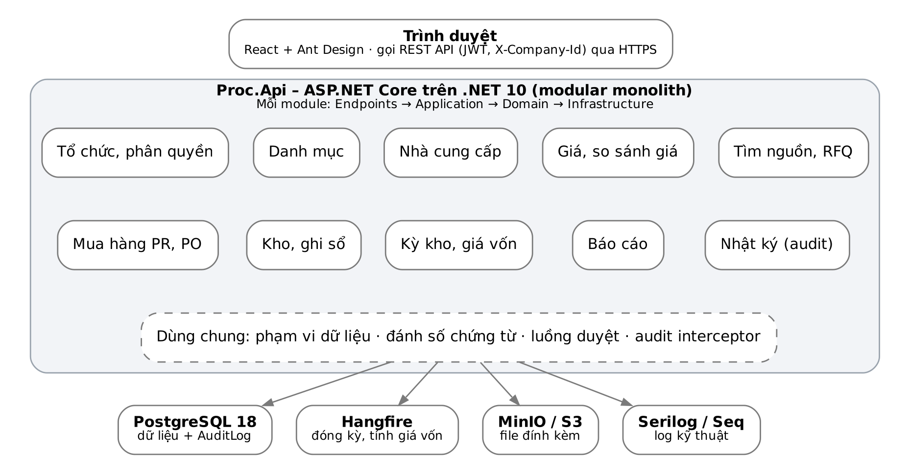
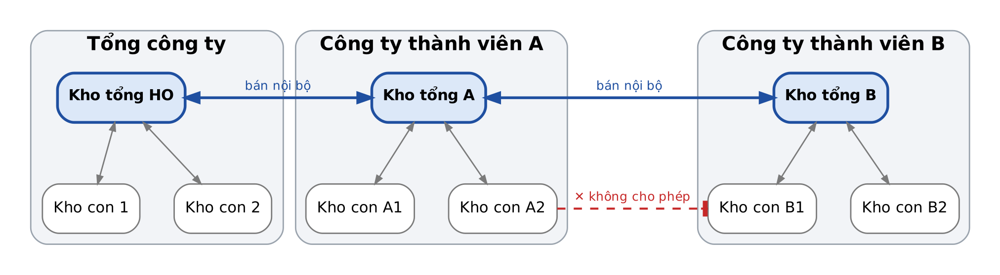
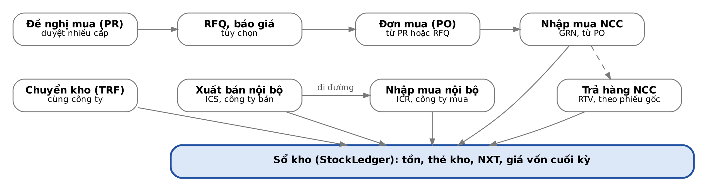
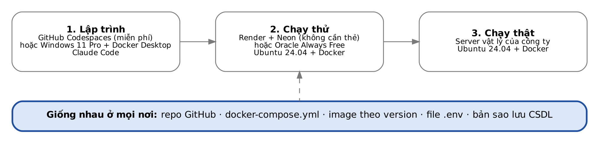

# Thiết kế hệ thống Quản lý Mua sắm – Đấu thầu – Kho tập đoàn

Phiên bản tài liệu 1.2 · cập nhật 31/10/2026 · người lập: Đặng Vĩnh Lập.
Đây là **bản gốc** của thiết kế; mọi thay đổi nghiệp vụ cập nhật tại đây (xem mục 16).

| Phiên bản | Ngày | Nội dung thay đổi |
| --- | --- | --- |
| 1.0 | 28/10/2026 | Mục 1–13: nghiệp vụ, công nghệ, kiến trúc, kho, master data, chứng từ, kỳ kho và giá vốn, giá và đấu thầu, phân quyền, form, báo cáo, CSDL, lộ trình |
| 1.1 | 28/10/2026 | Chốt PostgreSQL + Ubuntu + Docker; thêm mục 14 (hạ tầng), 15 (GitHub Codespaces), 16 (quy tắc Claude Code), 17 (giao diện kiểu Windows XP); ví dụ số giá vốn |
| 1.2 | 31/10/2026 | Mục 17 và docs/ui-guide.md: chuyển giao diện sang SAP Fiori, theme Horizon (giữ React + Ant Design, phông Arial thay "72", lát UI-a theme rồi UI-b bố cục) |
| 1.3 | 01/11/2026 | Mục 17 và docs/ui-style.md: chuyển giao diện sang phong cách ERP desktop cổ điển (component `src/Proc.Web/src/classic/`); màn hình cũ chuyển dần theo lát riêng |

## 1. Phân tích nghiệp vụ và các quyết định cần chốt

Điểm then chốt của hệ thống: mỗi công ty thành viên là **một pháp nhân độc lập**, nên mọi luân chuyển hàng giữa hai công ty là **một giao dịch mua bán** (có giá bán, có hóa đơn), không phải phiếu chuyển kho. Chỉ chuyển kho *trong cùng một công ty* mới là luân chuyển nội bộ theo giá vốn.

### 1.1 Hệ quả thiết kế từ yêu cầu

- **Dữ liệu tách theo pháp nhân (multi-company).** Mọi bảng giao dịch có `CompanyId`. Tồn kho, giá vốn, kỳ kho đều tính riêng theo từng công ty. Tổng công ty cũng là một công ty (pháp nhân) trong hệ thống.
- **Master data dùng chung, giá và tồn riêng.** Danh mục hàng hóa, nhà cung cấp, đơn vị tính quản lý tập trung ở tổng công ty để so sánh giá được. Giá mua, hợp đồng, tồn kho thì gắn với từng công ty.
- **Bán nội bộ = 2 chứng từ liên kết.** Công ty A lập *Phiếu xuất bán nội bộ* (ghi doanh thu theo giá bán nội bộ, giá vốn theo bình quân của A). Hệ thống tự sinh *Phiếu nhập mua nội bộ* ở trạng thái chờ tại công ty B; B xác nhận nhận hàng thì mới ghi tăng tồn, giá nhập = giá bán nội bộ. Giữa hai bước là **hàng đi đường**.
- **Không có vòng lặp giá vốn.** Giá nhập của B là giá bán nội bộ (đã biết), không phụ thuộc giá vốn của A. Nhờ vậy mỗi công ty tính giá vốn độc lập, đóng kỳ độc lập.
- **Ràng buộc kho cứng trong code.** Liên công ty chỉ đi *kho tổng → kho tổng*. Kho con chỉ chuyển trong cùng công ty. Kiểm tra ở cả tầng nghiệp vụ lẫn ràng buộc dữ liệu.
- **Kỳ kho là khóa sổ.** Chứng từ chỉ được ghi sổ khi ngày chứng từ thuộc kỳ đang mở. Đóng kỳ thì tính giá vốn, chốt số dư, sinh tồn đầu kỳ sau.

### 1.2 Phạm vi chức năng (module)

| Module | Nội dung chính |
| --- | --- |
| Tổ chức và phân quyền | Công ty, kho, người dùng, vai trò, phạm vi dữ liệu (công ty / kho / nhóm hàng), audit log |
| Danh mục (master data) | Hàng hóa, nhóm hàng, ĐVT và quy đổi, nhà cung cấp, nhóm NCC, thuế, tiền tệ, lý do nhập xuất |
| Nhà cung cấp và giá | Hồ sơ NCC, NCC – sản phẩm/dịch vụ – công ty, bảng giá, lịch sử giá, so sánh giá, đánh giá NCC |
| Tìm nguồn và đấu thầu | Danh sách tìm NCC cho sản phẩm (sourcing list), RFQ/yêu cầu báo giá, bảng so sánh báo giá, chọn thầu |
| Mua hàng | PR (đề nghị mua), duyệt PR, PO (đơn mua), theo dõi giao hàng, hợp đồng nguyên tắc (mục 18.7) |
| Kho | Nhập mua NCC, xuất trả NCC, chuyển kho nội bộ, xuất bán nội bộ, nhập mua nội bộ, điều chỉnh/kiểm kê, xuất dùng (tùy chọn) |
| Kỳ kho và giá vốn | Kỳ năm, kỳ tháng, đóng/mở kỳ, tính giá vốn bình quân, số dư đầu kỳ |
| Báo cáo | Nhập – xuất – tồn, thẻ kho, sổ chi tiết, so sánh giá, mua hàng theo NCC, giao dịch nội bộ, log người dùng |

### 1.3 Các điểm cần chốt trước khi code

Cột *Đề xuất* là phương án mặc định; chỉ cần sửa nếu công ty có quy định khác.

| # | Câu hỏi | Đề xuất mặc định |
| --- | --- | --- |
| 1 | Phương pháp tính giá vốn | Bình quân gia quyền **cuối kỳ tháng**, tính theo **công ty × mặt hàng** (mọi kho trong công ty chung một giá vốn) |
| 2 | Giá bán nội bộ lấy từ đâu | Bảng giá nội bộ do tổng công ty ban hành; nếu không có thì gợi ý = giá vốn kỳ đã đóng gần nhất × (1 + % markup) |
| 3 | Có quản lý lô, hạn dùng, serial không | Thiết kế sẵn cột `LotNo`, `ExpiryDate`; bật/tắt theo từng mặt hàng |
| 4 | Tiền tệ | VND là tiền hạch toán; PO ngoại tệ lưu thêm `CurrencyCode`, `ExchangeRate` |
| 5 | Thuế GTGT | Lưu thuế suất và tiền thuế trên dòng chứng từ; giá vốn không gồm VAT được khấu trừ |
| 6 | Kết nối kế toán (MISA, Fast, SAP…) | Xuất file Excel chứng từ đã ghi sổ (mục 11.5); hệ thống này không làm sổ cái |
| 7 | Quy trình duyệt | Duyệt nhiều cấp, cấu hình theo công ty, loại chứng từ, ngưỡng giá trị |
| 8 | Hóa đơn điện tử cho bán nội bộ | Chỉ lưu số/ngày hóa đơn và đính kèm; phát hành hóa đơn ở hệ thống HĐĐT hiện có |
| 9 | Quy mô | Thiết kế cho ~50 công ty, ~500 người dùng, ~100.000 mã hàng, vài triệu dòng giao dịch/năm |

## 2. Lựa chọn công nghệ

Chốt: **ASP.NET Core trên .NET 10 (LTS) + PostgreSQL 18 + React/TypeScript**, đóng gói Docker, chạy trên Ubuntu Server. .NET 10 phát hành ngày 11/11/2025, là bản LTS được hỗ trợ đến 14/11/2028; .NET 8 và .NET 9 hết hỗ trợ ngày 10/11/2026 nên không dùng cho dự án mới.

### 2.1 PostgreSQL hay SQL Server?

| Tiêu chí | PostgreSQL 18 | SQL Server 2025 |
| --- | --- | --- |
| Chi phí bản quyền | Miễn phí, không giới hạn core/dung lượng | Express miễn phí (50 GB/CSDL, 4 core, ~1,4 GB bộ nhớ đệm); Standard tính phí theo core |
| Chạy trên máy ARM (gói cloud miễn phí) | Có | Không (image chính thức chỉ x86_64) |
| Hỗ trợ trong .NET | EF Core + Npgsql rất tốt | EF Core tốt nhất, công cụ SSMS quen thuộc |
| Kiểu số tiền/số lượng | `numeric` chính xác | `decimal` chính xác |
| Vận hành | Linux/Docker, nhẹ, phổ biến trên cloud | Tốt nhất khi đã có hạ tầng Windows + license |

**Quyết định:** dùng **PostgreSQL** để chuyển máy dễ dàng (cloud ↔ server vật lý, ARM ↔ x86) và không phát sinh license. Code dùng EF Core nên nếu sau này bắt buộc chuyển sang SQL Server chỉ cần đổi provider; tránh SQL đặc thù ngoài thư mục `Infrastructure/Reports`.

### 2.2 Ngăn xếp công nghệ

| Lớp | Công nghệ | Lý do |
| --- | --- | --- |
| Backend API | ASP.NET Core Web API (.NET 10) | LTS, hiệu năng cao, đúng yêu cầu dot net |
| Truy cập dữ liệu | EF Core 10 (ghi), Dapper (báo cáo nặng) | EF cho nghiệp vụ, SQL thuần cho NXT hàng triệu dòng |
| Kiểm tra dữ liệu | FluentValidation | Quy tắc rõ ràng, test được |
| Xác thực | ASP.NET Core Identity + JWT (hoặc Keycloak nếu cần SSO/AD) | Đăng nhập, khóa tài khoản, 2FA |
| Job nền | Hangfire (lưu trên PostgreSQL) | Đóng kỳ, tính giá vốn, gửi mail duyệt |
| Log | Serilog → Seq; bảng `AuditLog` riêng trong CSDL | Log kỹ thuật tách khỏi log nghiệp vụ |
| Xuất file | ClosedXML (Excel), QuestPDF (in phiếu, PO) | Thư viện .NET, không phụ thuộc Office |
| Frontend | React 19 + TypeScript + Vite + Ant Design + TanStack Query | Form/bảng nhập liệu phong phú, có locale tiếng Việt |
| Lưới nhập liệu | Component `DataGrid` dùng chung (Ant Design Table hoặc AG Grid Community) | Nhập dòng chứng từ nhanh như Excel |
| Lưu file đính kèm | Thư mục trên máy chủ (quyết định Q6 – mục 18.4) | Báo giá, hợp đồng, hóa đơn |
| Triển khai | Docker Compose, Caddy (HTTPS tự động), GitHub Actions | Dễ dựng môi trường dev/test/prod |
| Kiểm thử | xUnit + PostgreSQL thật (database `procurement_test`), Playwright cho UI | Test giá vốn trên DB thật, so giao diện với ảnh mẫu |

## 3. Kiến trúc phần mềm

Kiến trúc **modular monolith**: một ứng dụng ASP.NET Core duy nhất, chia thành các module nghiệp vụ tách biệt, dùng chung một CSDL. Với quy mô vài trăm người dùng, cách này nhanh làm, dễ triển khai và giữ được giao dịch (transaction) toàn vẹn khi ghi sổ kho.



Module chỉ gọi nhau qua interface của lớp Application, không truy cập thẳng bảng của module khác. Khi cần tách dịch vụ (ví dụ cổng NCC bên ngoài), tách nguyên một module ra là xong.

### 3.1 Các lớp (Clean Architecture)

| Lớp | Chứa gì | Không được |
| --- | --- | --- |
| Domain | Entity, value object, enum, quy tắc nghiệp vụ thuần (kiểm tra chuyển kho, trạng thái chứng từ, công thức giá vốn) | Tham chiếu EF Core, HTTP |
| Application | Command/Query theo use case, validator, DTO, interface (repository, `ICurrentUserScope`, `IClock`) | Viết SQL trực tiếp |
| Infrastructure | EF Core DbContext, migrations, Dapper báo cáo, interceptor audit, Hangfire job, lưu file, gửi mail | Chứa quy tắc nghiệp vụ |
| Api | Endpoint, xác thực, phân quyền, middleware lỗi, OpenAPI | Logic nghiệp vụ |
| Web | React SPA: AppShell, ListPage, DataGrid, DocumentForm; client sinh từ OpenAPI | Tự tính giá, tồn |

### 3.2 Nguyên tắc xuyên suốt

- **Ghi sổ là nguyên tử:** lưu chứng từ, ghi sổ kho, cập nhật tồn, ghi audit trong cùng một transaction.
- **Chứng từ có vòng đời:** Nháp → Chờ duyệt → Đã duyệt → Đã ghi sổ → (Bỏ ghi sổ / Hủy). Chỉ trạng thái *Đã ghi sổ* mới ảnh hưởng tồn kho.
- **Khóa lạc quan** (`xmin`/`RowVersion`) trên chứng từ và tồn kho để hai người không ghi đè nhau.
- **Client sinh tự động** từ OpenAPI để tránh lệch kiểu dữ liệu giữa backend và frontend.
- **Thời gian:** lưu UTC, hiển thị giờ Việt Nam (UTC+7); ngày chứng từ là kiểu `date`, không có giờ.

## 4. Mô hình tổ chức và quy tắc kho

Tập đoàn gồm nhiều công ty (kể cả tổng công ty), mỗi công ty có **đúng một kho tổng** và nhiều kho con. Luân chuyển hàng chỉ có hai đường hợp lệ.



| Loại luân chuyển | Từ → Đến | Chứng từ | Giá | Ảnh hưởng giá vốn |
| --- | --- | --- | --- | --- |
| Chuyển kho nội bộ | Mọi kho ↔ mọi kho, **cùng công ty** | 1 phiếu TRF (sinh 2 dòng sổ: xuất kho đi, nhập kho đến) | Giá vốn công ty | Không đổi |
| Bán nội bộ | Kho tổng công ty X → kho tổng công ty Y | Phiếu xuất bán nội bộ (ICS) tại X + phiếu nhập mua nội bộ (ICR) tại Y | Giá bán nội bộ | X: xuất theo giá vốn X; Y: nhập theo giá bán |
| Không cho phép | Kho con công ty X → bất kỳ kho nào của công ty Y | — | — | — |

Muốn đưa hàng từ kho con A1 sang kho con B1, người dùng làm 3 bước: chuyển A1 → kho tổng A, bán nội bộ kho tổng A → kho tổng B, chuyển kho tổng B → B1. Giao diện có thể có nút *Điều chuyển nhanh* sinh sẵn cả chuỗi chứng từ nhưng vẫn giữ đủ 3 bước trong sổ.

**Ràng buộc dữ liệu:** `WarehouseType` ∈ {Main, Sub}; unique index `(CompanyId) WHERE WarehouseType = 'Main'`; kho con phải có `ParentWarehouseId` cùng `CompanyId`.

## 5. Master data (danh mục)

Master data chia hai tầng: **dùng chung toàn tập đoàn** (do tổng công ty quản lý, để so sánh giá được) và **riêng từng công ty** (kho, giá, tồn). Mọi danh mục có `Code` duy nhất, `IsActive`, `CreatedBy/At`, `UpdatedBy/At`, và không xóa cứng khi đã phát sinh giao dịch.

### 5.1 Danh mục tổ chức

| Danh mục | Trường chính | Ghi chú |
| --- | --- | --- |
| Công ty (`Company`) | Mã, tên, tên viết tắt, MST, địa chỉ, người đại diện, `IsHeadOffice`, tiền tệ hạch toán, ngày bắt đầu dùng hệ thống | Tổng công ty cũng là một bản ghi, `IsHeadOffice = true` |
| Kho (`Warehouse`) | Mã, tên, `CompanyId`, `WarehouseType` (Main/Sub), `ParentWarehouseId`, địa chỉ, thủ kho, cho phép tồn âm (mặc định không) | Mỗi công ty đúng **một** kho tổng |
| Bộ phận (`Department`) | Mã, tên, `CompanyId`, trưởng bộ phận, còn dùng | Mỗi công ty một danh mục riêng (màn hình DEPT); PR **bắt buộc** chọn bộ phận; dùng cho ngân sách, phân bổ chi phí – mục 18.5 |
| Người dùng (`User`) | Tên đăng nhập, họ tên, email, công ty mặc định, trạng thái, 2FA | Một người có thể thuộc nhiều công ty |

### 5.2 Danh mục hàng hóa – dịch vụ (dùng chung)

| Danh mục | Trường chính | Ghi chú |
| --- | --- | --- |
| Nhóm hàng (`ItemCategory`) | Mã, tên, `ParentId` (cây nhiều cấp), tài khoản kho mặc định | Dùng để phân quyền theo nhóm hàng |
| Hàng hóa/dịch vụ (`Item`) | Mã, tên, tên tiếng Anh, `ItemType` (Hàng tồn kho / Dịch vụ / Tài sản / Vật tư tiêu hao), nhóm hàng, ĐVT cơ sở, quy cách, thương hiệu, xuất xứ, mã vạch, thuế suất VAT mặc định, quản lý lô (Y/N), quản lý hạn dùng (Y/N), tồn tối thiểu/tối đa, tồn an toàn, điểm đặt hàng lại, vật tư trọng yếu (mục 18.16), ảnh, thông số kỹ thuật | Chỉ `ItemType = Hàng tồn kho` mới đi qua kho |
| Đơn vị tính (`Uom`) | Mã, tên | Cái, hộp, thùng, kg… |
| Quy đổi ĐVT (`ItemUomConversion`) | `ItemId`, ĐVT, hệ số về ĐVT cơ sở | 1 thùng = 24 hộp; tồn kho luôn lưu theo ĐVT cơ sở |
| Thuộc tính mở rộng | Bộ thuộc tính theo nhóm hàng (key–value) | Tránh phải sửa bảng khi thêm thông số |

### 5.3 Danh mục nhà cung cấp (dùng chung)

| Danh mục | Trường chính | Ghi chú |
| --- | --- | --- |
| Nhóm NCC (`SupplierGroup`) | Mã, tên | Trong nước, nhập khẩu, nội bộ… |
| Nhà cung cấp (`Supplier`) | Mã, tên, MST (duy nhất), địa chỉ, điện thoại, email, website, người liên hệ (bảng con), tài khoản ngân hàng (bảng con), điều khoản thanh toán, ngành hàng cung cấp (`SupplierCategory`: chọn nhiều nhóm hàng từ danh mục Nhóm hàng – ô chữ `SupplyScope` cũ ngừng dùng từ 0.20.0, chỉ xem), trạng thái (Tiềm năng / Đã duyệt / Tạm ngưng / Danh sách đen), xếp hạng, hồ sơ pháp lý đính kèm | Công ty thành viên cũng được tạo thành NCC nội bộ, liên kết `CompanyId` |
| NCC áp dụng cho công ty (`SupplierCompany`) | `SupplierId`, `CompanyId`, mã NCC tại công ty, ngày bắt đầu, trạng thái | Trả lời: NCC nào đang bán cho công ty nào |
| NCC – Sản phẩm/Dịch vụ (`SupplierItem`) | `SupplierId`, `ItemId`, mã hàng của NCC, ĐVT mua, MOQ, lead time (ngày), là NCC ưu tiên | Trả lời: NCC nào đang bán sản phẩm gì |

### 5.4 Danh mục hệ thống và tham số

| Danh mục | Trường chính |
| --- | --- |
| Tiền tệ, tỷ giá | Mã tiền, tỷ giá theo ngày |
| Thuế suất | Mã, % (0, 5, 8, 10, không chịu thuế) |
| Điều khoản thanh toán / giao hàng | Mã, tên, số ngày |
| Lý do nhập/xuất | Mã, tên, loại chứng từ áp dụng |
| Đánh số chứng từ (`DocumentNumbering`) | Loại chứng từ, công ty, định dạng (`PO-{CTY}-{YYMM}-{0000}`); số hiện tại ở bảng `DocumentSequence` theo kỳ |
| Cấu hình duyệt (`ApprovalRule`) | Loại chứng từ, công ty, ngưỡng giá trị, các cấp duyệt, người/vai trò duyệt |
| Tham số công ty (`CompanyParameter`) | Phương pháp giá vốn, cho tồn âm, % markup nội bộ mặc định, số NCC tối thiểu khi gửi RFQ, % cảnh báo giá cao trên PO (mục 8.5) |

- Màn hình **Hệ thống → Tham số hệ thống** (SEC, quyền xem/sửa tham số hệ thống) theo công ty đang làm việc, làm từ 31/10/2026 (lát SEC-1):
  - **Số NCC tối thiểu khi gửi RFQ**: sửa được, 1–20, mặc định 3 (mục 8.4 bước 2). Mỗi công ty một giá trị (pháp nhân độc lập);
    công ty chưa sửa thì chưa có dòng `CompanyParameter` và dùng mặc định. Đổi tham số không ảnh hưởng RFQ đã gửi.
  - **Phương pháp giá vốn**: chỉ xem – cố định bình quân gia quyền cuối kỳ tháng (mục 7).
  - **Kho cho phép tồn âm**: chỉ xem – khai báo trên từng kho (màn hình Kho), danh sách theo phạm vi kho của người dùng.
  - **% markup nội bộ mặc định** (lát SEC-2, 01/11/2026): sửa được, 0–1000%, tối đa 4 số lẻ, mặc định 0%. Dùng **gợi ý giá bán nội
    bộ** khi mặt hàng chưa có trong bảng giá nội bộ (mục 1, câu hỏi số 2): giá gợi ý (chưa VAT, theo ĐVT cơ sở) = giá vốn kỳ tháng
    đã đóng gần nhất có giá vốn của mặt hàng đó tại công ty bán × (1 + % markup), làm tròn đồng. Ví dụ 10.857,142857 × 1,1 =
    11.942,857143 → 11.943. Chưa có kỳ đã đóng thì không gợi ý. Gợi ý để lộ giá vốn nên chỉ người có quyền xem bảng giá thấy.
    Gợi ý hiện ở hai nơi, người dùng tự chọn có áp dụng hay không:
    - Bảng giá nội bộ: dưới ô giá, nút "Áp dụng" điền giá gợi ý vào ô (vẫn phải bấm Lưu).
    - Phiếu xuất bán nội bộ (ICS): dòng chưa có giá hiện "Gợi ý …"; "Áp dụng" (cần quyền sửa bảng giá) **thêm giá riêng cho công ty
      mua vào bảng giá nội bộ**, hiệu lực từ ngày phiếu, không hạn. Phiếu ICS vẫn chỉ lấy giá từ bảng giá, không nhập tay.

### 5.5 Đánh số chứng từ

- **Mẫu số** gồm chữ cố định (A–Z, 0–9, `- / . _`, phần tiền tố nằm luôn trong mẫu) và các mã: `{CTY}` mã công ty,
  `{YYYY}`/`{YY}` năm, `{MM}` tháng, `{YYMM}` năm 2 số + tháng, `{0000}` số thứ tự (3–10 chữ số; vượt thì nới rộng, không cắt).
  Mẫu dài tối đa 40 ký tự, có đúng một nhóm số; có tháng thì phải có năm (để số không lặp giữa các năm).
- **Mẫu mặc định** khi công ty chưa cấu hình: `{LOẠI}-{CTY}-{YYMM}-{0000}`, ví dụ `PO-BHA-2610-0001`.
  Loại chứng từ: PR, RFQ, PO, CTR, GRN, RTV, TRF, ICS, ICR, ADJ (khai báo một nơi trong code).
- **Năm/tháng lấy theo ngày chứng từ**, không theo ngày nhập máy. Số thứ tự đếm lại theo **kỳ suy từ mẫu**: có tháng → mỗi tháng;
  chỉ có năm → mỗi năm; không có ngày → liên tục. Bộ đếm `DocumentSequence` khóa theo (công ty, loại, kỳ).
- **Cấp số khi lưu chứng từ**, trong cùng giao dịch, bằng một câu `INSERT … ON CONFLICT DO UPDATE … RETURNING`:
  không trùng khi nhiều người lưu cùng lúc; lưu lỗi thì số được trả lại (không nhảy số).
- Đổi mẫu không đổi số đã cấp. Ràng buộc duy nhất (CompanyId, DocType, số) ở bảng chứng từ (mục 12.2) là lớp chặn cuối,
  phòng khi đổi qua lại giữa các mẫu sinh ra số đã dùng.
- Màn hình **Hệ thống → Đánh số chứng từ** (quyền xem/sửa tham số hệ thống) theo công ty đang làm việc: xem mẫu, số gần nhất
  và số kế tiếp của tháng này; sửa mẫu hoặc để trống để về mẫu mặc định.

### 5.6 Quản lý danh mục công ty và kho

| Quy tắc | Lý do |
| --- | --- |
| Thêm công ty chỉ khi đang làm việc ở **tổng công ty** (quyền `System.Company.Manage`). Sửa, ngừng dùng công ty: ở tổng công ty với quyền đó, hoặc quyền `MasterData.Catalog.EditShared` ("Sửa thông tin danh mục dùng chung") cho **sửa thông tin (trừ mã)** ở bất kỳ công ty nào đang làm việc; mã không bao giờ sửa; mọi lần sửa ghi nhật ký (yêu cầu 31/10/2026) – ở công ty thành viên chỉ thấy (và chỉ sửa được) công ty mình | Danh mục tổ chức do tổng công ty quản lý; mỗi công ty là pháp nhân độc lập, không thấy công ty khác |
| Mã công ty không đổi sau khi tạo; mã số thuế 10 chữ số hoặc 10 chữ số + "-" + 3 chữ số, không trùng giữa các công ty | Mã nằm trong số chứng từ đã cấp; mỗi pháp nhân một mã số thuế |
| Thêm công ty là tạo luôn **kho tổng** của công ty đó | Mỗi công ty luôn có đúng một kho tổng (mục 4) |
| Người thêm công ty được gán các vai trò mình đang có ở tổng công ty tại công ty mới (phạm vi nhóm hàng như ở tổng công ty, mọi kho) | Gán quyền chỉ làm tại công ty đang làm việc (mục 9.5); không gán thì không ai vào được công ty mới. Không cấp thêm quyền nào người đó chưa có |
| Tổng công ty không ngừng dùng được; công ty ngừng dùng thì không ai chọn làm việc được nữa | Tổng công ty giữ danh mục dùng chung và tài khoản quản trị |
| Kho: thấy và sửa kho của công ty đang làm việc trong phạm vi kho được phép (quyền `Organization.Warehouse.Manage`); mã và loại kho không đổi | Mã kho nằm trên chứng từ; loại kho quyết định đường luân chuyển hợp lệ |
| Thêm kho phụ hoặc đổi kho cha cần phạm vi **mọi kho** của công ty | Kho mới nằm ngoài danh sách kho được gán; người bị giới hạn chỉ thấy một phần cây kho nên không kiểm tra được vòng lặp |
| Kho cha cùng công ty, đang dùng, không phải chính kho đó hay kho con cháu của nó | Không cho kho phụ treo sang công ty khác (mục 4), cây kho không thành vòng |
| Kho tổng không ngừng dùng được; kho còn kho con đang dùng thì ngừng kho con trước | Kho tổng là kênh duy nhất của ICS/ICR; không để nhánh kho treo dưới kho đã ngừng |
| Cho phép tồn âm bật/tắt theo từng kho, mặc định không | CLAUDE.md mục 4 |

### 5.7 Quản lý danh mục hàng hóa (đơn vị tính, nhóm hàng, hàng hóa)

| Quy tắc | Lý do |
| --- | --- |
| **Thêm** đơn vị tính, nhóm hàng, hàng hóa chỉ khi làm việc ở **tổng công ty** (tránh tạo trùng từ nhiều công ty). **Sửa**: ở tổng công ty với quyền quản lý danh mục, hoặc quyền `MasterData.Catalog.EditShared` ("Sửa thông tin danh mục dùng chung") cho **sửa thông tin (trừ mã)** ở bất kỳ công ty nào đang làm việc; mã không bao giờ sửa; mọi lần sửa ghi nhật ký (yêu cầu 31/10/2026); không có quyền thì công ty thành viên chỉ xem | Danh mục dùng chung toàn tập đoàn để so sánh giá được (mục 5) |
| Hàng hóa chỉ thấy trong **phạm vi nhóm hàng** của người xem (global query filter trên `Item` theo `CategoryId`). **Danh mục nhóm hàng** (cây tên nhóm) thì ai cũng xem đủ, mỗi nhóm có cờ `IsInScope` (người dùng chốt 07/11/2026, cách A); nhóm ngoài phạm vi chỉ xem: không sửa, không làm nhóm cha, không gán cho mặt hàng (API trả 403 "ngoài phạm vi nhóm hàng của bạn"); ô chọn nhóm của mặt hàng, lọc báo cáo/tồn kho vẫn chỉ hiện nhóm trong phạm vi | Phân quyền theo nhóm hàng (mục 9.2); xem đủ cây để chọn ngành hàng NCC và tránh tạo trùng nhóm |
| **Không trùng tên nhóm hàng trong cùng nhóm cha** (so không dấu, không phân biệt hoa thường, xét cả nhóm ngừng dùng và ngoài phạm vi) – khi thêm, đổi tên, đổi nhóm cha; trùng tên ở nhánh khác thì giao diện chỉ nhắc. Màn hình Nhóm hàng và hộp thoại "Thêm nhóm hàng" ở NCC cảnh báo ngay khi gõ (yêu cầu người dùng 07/11/2026) | Thiếu nhóm thì tạo, nhưng không tạo trùng |
| Mã ĐVT 1–10 chữ/số; mã nhóm 2–20 chữ/số; mã hàng 2–30 ký tự chữ không dấu, số, `- . _ /`. Không đổi sau khi tạo | Mã nằm trên chứng từ, phân quyền, báo cáo |
| Trùng mã với bản ghi ngoài phạm vi: chỉ mục duy nhất trong CSDL chặn, API trả 409 kèm thông báo tiếng Việt | Kiểm tra trùng trước khi lưu đi qua filter nên không thấy bản ghi ngoài phạm vi |
| Thêm nhóm gốc, đổi nhóm cha, sửa đơn vị tính cần phạm vi **mọi nhóm hàng** | Người bị giới hạn chỉ thấy một phần cây/một phần hàng nên không kiểm tra được vòng lặp hay "còn hàng đang dùng" |
| Nhóm cha đang dùng, không tạo vòng; ngừng nhóm thì nhóm con và hàng trong nhóm phải ngừng/chuyển trước | Cây nhóm hàng không có nhánh treo |
| Ngừng ĐVT khi không còn hàng đang dùng nó làm ĐVT cơ sở hay ĐVT quy đổi | Hàng đang dùng phải lập được chứng từ |
| Chỉ hàng tồn kho mới bật lô, hạn dùng, tồn tối thiểu/tối đa (số lượng numeric(18,4), tối thiểu ≤ tối đa) | Chỉ hàng tồn kho đi qua kho (mục 5.2) |
| Quy đổi ĐVT: 1 ĐVT quy đổi = hệ số × ĐVT cơ sở, hệ số > 0, numeric(18,6); không trùng ĐVT cơ sở, mỗi ĐVT một dòng | Tồn kho luôn lưu theo ĐVT cơ sở; 6 chữ số thập phân để quy đổi g → kg |
| Thuế suất mặc định: KCT, 0, 5, 8, 10 (%) | Danh mục thuế suất đầy đủ (mục 5.4) làm sau, giữ đúng các mã này |
| Tìm hàng: mỗi lần tối đa 5.000 dòng; tìm theo mã, tên, tên tiếng Anh, mã vạch, có dấu hay không dấu (cột `SearchText`); lọc nhóm gồm nhóm con | Danh mục tới ~100.000 mã (mục 1.3) |
| Tìm kiểu SAP ECC (02/11/2026): `*` là ký tự đại diện ở mọi ô tìm; ô chọn danh mục gõ `*` + Enter liệt kê toàn bộ (ô chọn hàng tối đa 500 dòng, tìm thường 50) – docs/ui-style.md mục 5b | Người dùng quen F4 của SAP |

### 5.8 Quản lý nhóm NCC và nhà cung cấp

| Quy tắc | Lý do |
| --- | --- |
| **Thêm** nhóm NCC và NCC chỉ khi làm việc ở **tổng công ty**. **Sửa**: ở tổng công ty với quyền `MasterData.Supplier.Manage`, hoặc quyền `MasterData.Catalog.EditShared` ("Sửa thông tin danh mục dùng chung") cho **sửa thông tin (trừ mã)** ở bất kỳ công ty nào đang làm việc; mã không bao giờ sửa; mọi lần sửa ghi nhật ký (yêu cầu 31/10/2026); mọi công ty có quyền `MasterData.Supplier.View` đều xem được | Danh mục dùng chung để so sánh giá (mục 5). NCC áp dụng cho công ty nào (`SupplierCompany`) làm ở lát sau |
| Mã NCC 2–30 ký tự chữ không dấu, số, `- . _ /`, **do hệ thống cấp theo dải đánh số** (mục 5.11), không đổi sau khi tạo | Mã nằm trên chứng từ |
| Mã số thuế không trùng giữa các NCC. NCC trong nước: 10 hoặc 10-3 chữ số; NCC nước ngoài: mã thuế nước sở tại 3–20 ký tự | Một pháp nhân một NCC |
| Trạng thái: Tiềm năng (mặc định) → Đã duyệt / Tạm ngưng / Danh sách đen; Tạm ngưng và Danh sách đen **bắt buộc ghi lý do** | Người mua sau biết vì sao không đặt hàng được (chặn lập PO làm ở giai đoạn mua hàng) |
| Xếp hạng 1–5 sao; điều khoản thanh toán là chữ tự do cho tới khi có danh mục điều khoản (mục 5.4) | |
| Người liên hệ (tối đa một người chính) và tài khoản ngân hàng (tối đa một tài khoản mặc định, số tài khoản bỏ khoảng trắng, không trùng trong cùng NCC) là bảng con, sửa theo Id | Nhật ký thao tác chỉ ghi dòng thật sự thay đổi |
| NCC nội bộ liên kết một công ty thành viên; mỗi công ty tối đa một NCC nội bộ | Dùng cho mua bán liên công ty ICS/ICR (mục 6.3) |
| Ngừng dùng nhóm NCC khi không còn NCC nào (trừ danh sách đen) trong nhóm | NCC đang giao dịch luôn thuộc nhóm đang dùng |

### 5.9 NCC áp dụng cho công ty và NCC – sản phẩm

| Quy tắc | Lý do |
| --- | --- |
| `SupplierCompany` có `CompanyId` (tự lọc theo công ty đang làm việc). **Mỗi công ty tự khai báo** NCC mình mua tại công ty đang làm việc, cần quyền `MasterData.Supplier.Manage` ở công ty đó (không cần ở tổng công ty) | Mỗi công ty là pháp nhân độc lập, tự chọn NCC |
| **Mở rộng NCC cho công ty** (yêu cầu người dùng 07/11/2026): một NCC bán cho nhiều công ty thành viên là bình thường – không tạo NCC mới mà mở rộng NCC sẵn có. Ngăn kéo NCC có tab **Mở rộng cho công ty**: bảng mọi công ty (tổng công ty trước) với tình trạng Đang giao dịch / Ngừng giao dịch / Chưa mở rộng, mã NCC tại công ty, ngày bắt đầu – ai có quyền xem NCC cũng thấy. Nút **Mở rộng cho công ty…** và **Ngừng giao dịch…** mở hộp thoại chọn một, vài hoặc **tất cả** công ty; **chỉ khi đang làm việc ở tổng công ty** và có quyền `MasterData.Supplier.Manage` tại tổng công ty (`GET/PUT /api/suppliers/{id}/extensions`). Công ty chưa có dòng thì tạo `SupplierCompany` (mã tại công ty để trống, ngày bắt đầu theo hộp thoại); đã có thì chỉ đổi trạng thái giao dịch, **giữ mã và ngày** công ty đã khai. Công ty không tồn tại/ngừng dùng hoặc NCC danh sách đen thì từ chối cả lệnh. Cách công ty tự khai báo ở dòng trên vẫn giữ | Danh mục NCC dùng chung do tổng công ty quản lý; công ty thành viên chỉ tự điền mã theo phần mềm kế toán của mình |
| Mã NCC tại công ty (tối đa 30 ký tự) duy nhất trong công ty; dùng để khớp với mã đối tượng trong phần mềm kế toán của công ty | |
| NCC ở danh sách đen không áp dụng (bật "đang giao dịch") được cho công ty nào | Mục 5.8 |
| Danh sách NCC có cột "Mua tại …" và bộ lọc "NCC … đang mua" theo công ty đang làm việc. NCC áp dụng ở công ty khác xem ở tab **Mở rộng cho công ty** của từng NCC (ngoại lệ filter công ty, mục 9.2) | Danh sách vẫn theo filter công ty |
| `SupplierItem` dùng chung, thêm/sửa/xóa ở tổng công ty, lọc theo phạm vi nhóm hàng của mặt hàng; sửa **từng dòng** (không thay cả danh sách) | Người bị giới hạn nhóm hàng không thấy hết các dòng nên không được ghi đè cả danh sách |
| Mỗi (NCC, mặt hàng) một dòng; ĐVT mua phải là ĐVT cơ sở hoặc ĐVT quy đổi của mặt hàng; MOQ > 0 (numeric(18,4)); thời gian giao 0–365 ngày | Nhập kho phải quy đổi được về ĐVT cơ sở |
| Mỗi mặt hàng tối đa **một NCC ưu tiên**; chọn NCC ưu tiên mới thì NCC cũ tự bỏ (cùng giao dịch) | Gợi ý NCC mặc định khi lập PR/PO |
| Xóa dòng NCC – sản phẩm được (chưa có chứng từ tham chiếu); nhật ký thao tác giữ giá trị cũ | |
| **Ngành hàng NCC** (`SupplierCategory`, NCC × nhóm hàng – yêu cầu người dùng 07/11/2026): ô "Ngành hàng cung cấp" ở ngăn kéo NCC chọn nhiều nhóm hàng từ cả danh mục; thiếu nhóm thì nút "Thêm nhóm hàng" (quyền thêm nhóm hàng, ở tổng công ty) tạo ngay rồi tự chọn. Lưu cùng NCC, thay cả danh sách, **không cần duyệt**; thêm nhóm phải đang dùng, nhóm đã ngừng dùng mà NCC vẫn giữ thì để nguyên (ghi "(ngừng dùng)"); tối đa 50 nhóm; mỗi thêm/bỏ ghi nhật ký. Danh sách NCC có cột Ngành hàng và bộ lọc "Ngành hàng (gồm nhóm con)" (`GET /api/suppliers?categoryId=`). Chữ tự do cũ `SupplyScope` hiện để tham khảo, xóa cột ở bản sau. Migration `V0_20_0_NganhHangNcc` (`Down()` mất ngành hàng đã chọn) | Danh mục nhóm hàng ai cũng xem đủ nên lưu NCC thay cả danh sách không làm mất nhóm người khác đã chọn |
| **Mã hàng theo NCC** (không bắt buộc, tối đa 50 ký tự): mã NCC tự đặt, ghi trên báo giá/hóa đơn của họ – gõ tay vì là danh mục của NCC. PO chép mã này vào dòng (`PurchaseOrderLine.SupplierItemCode`) mỗi lần lưu/gửi duyệt khi còn nháp; PO đã gửi giữ mã lúc gửi. Trang PO có cột "Mã hàng NCC", phiếu in PO ghi "– mã NCC: …" sau tên hàng (yêu cầu người dùng 07/11/2026) | NCC nhận ra sản phẩm của họ khi nhận đơn; sửa danh mục sau không làm đổi phiếu đã gửi NCC |
| **ĐVT mua**: hộp thoại tự điền ĐVT cơ sở khi chọn mặt hàng. Lập PO với NCC, chọn mặt hàng thì dòng tự lấy ĐVT mua (ĐVT đã bị gỡ khỏi mặt hàng thì về ĐVT cơ sở); dòng lấy từ PR giữ ĐVT của PR. **PR**: dòng có mặt hàng và NCC đề xuất thì lấy ĐVT mua của NCC đó, cột "Mã hàng NCC". **RFQ**: hộp thoại nhập báo giá của từng NCC có cột "Mã hàng NCC" (ĐVT RFQ dùng chung cho mọi NCC nên không đổi). API tra chung `GET /api/supplier-items/lookup?supplierIds=&itemIds=` – chỉ cần đăng nhập + công ty làm việc (người lập phiếu có thể không có quyền xem danh mục NCC), tối đa 100 NCC, lọc phạm vi nhóm hàng | Đặt đúng đơn vị NCC bán (ví dụ cuộn 100 m thay vì mét) |

### 5.10 Nhập/xuất danh mục bằng Excel

Áp dụng cho: đơn vị tính, nhóm hàng, hàng hóa, nhóm NCC, nhà cung cấp (thư viện ClosedXML).

| Quy tắc | Lý do |
| --- | --- |
| **Xuất Excel** = toàn bộ danh mục trong phạm vi người xem, cùng định dạng file nhập (tiêu đề tiếng Việt, cột bắt buộc có dấu `*`, sheet "Hướng dẫn"); cột mã để dạng Text | Xuất ra, sửa, nhập lại được ngay; không mất số 0 đầu của mã số thuế, số tài khoản |
| **Nhập theo mã**: mã đã có thì cập nhật, chưa có thì thêm; không xóa bản ghi (ngừng dùng bằng cột "Còn dùng") | |
| Mỗi dòng đi qua đúng dịch vụ và validator của màn hình nhập tay (quy tắc nghiệp vụ, phạm vi, chỉ ở tổng công ty) | Không có đường tắt bỏ qua quy tắc |
| **Kiểm tra thử** chạy đủ như nhập thật trong một giao dịch rồi rollback; **Nhập thật** chỉ commit khi **không có lỗi nào** – một dòng lỗi thì cả file không lưu | Không để danh mục nhập dở dang |
| Lỗi báo theo số dòng và mã; hai dòng trùng mã là lỗi; tối đa 5.000 dòng và 10 MB mỗi file | Nhập từng dòng qua dịch vụ nên file quá lớn chạy lâu |
| Đọc cột theo tiêu đề (đổi thứ tự cột không sao); số nhận cả kiểu 1.234,5 và 1234.5; Có/Không nhận cả không dấu | |
| Nhóm hàng: nhóm cha đứng trên nhóm con (file xuất đã theo thứ tự cây) | |
| Hàng hóa: tối đa 3 ĐVT quy đổi trên file; cập nhật mà để trống cả 3 cột quy đổi thì giữ quy đổi cũ; thông số kỹ thuật không có trên file nên giữ nguyên | Tránh nhập file thiếu cột làm mất dữ liệu |
| NCC: một người liên hệ chính và một tài khoản ngân hàng, **chỉ dùng khi thêm NCC mới**; cập nhật giữ nguyên người liên hệ, tài khoản | Bảng con nhiều dòng sửa ở màn hình NCC |
| NCC: cột **Ngành hàng** ghi **mã nhóm hàng**, nhiều mã cách nhau dấu phẩy/chấm phẩy (thay cả danh sách ngành hàng); để trống = giữ nguyên; mã không có thì lỗi theo dòng. Xuất Excel ghi mã nhóm (từ 0.20.0 – trước đây là chữ tự do) | Ngành hàng chọn từ danh mục Nhóm hàng (mục 5.9) |

### 5.11 Đánh số danh mục tự động (yêu cầu 31/10/2026)

| Quy tắc | Lý do |
| --- | --- |
| Mã **nhà cung cấp, nhóm NCC, nhóm hàng, hàng hóa** do hệ thống cấp khi thêm mới theo **dải đánh số** cấu hình ở Hệ thống → Đánh số danh mục (bảng `CatalogNumbering`); người dùng **không tự đặt mã** (API báo lỗi nếu gửi mã). Mã không đổi sau khi tạo | Thống nhất mã toàn tập đoàn, tránh trùng và mã tùy tiện |
| Dải = tiền tố + số thứ tự đủ N chữ số, trong khoảng "từ số – đến số". Ví dụ NCC, 6 chữ số, 1–999.999 → NCC000001. Tiền tố theo quy tắc mã của danh mục (nhóm hàng, nhóm NCC chỉ chữ không dấu và số; NCC, hàng hóa thêm `- . _ /`); mã sinh ra dài nhất không vượt độ dài mã của danh mục | Mã sinh ra luôn hợp lệ |
| Hàng hóa: dải riêng cho từng nhóm hàng, hoặc **một dòng mặc định** cho mọi nhóm chưa có dải riêng, tiền tố dùng ký hiệu `{NHOM}` thay bằng mã nhóm của mặt hàng (ví dụ `{NHOM}-`, 5 chữ số → VT-00001) – mỗi nhóm một bộ đếm | Mã hàng gợi được nhóm hàng |
| Mã kế tiếp = số lớn nhất **đang có** trong dải (mã khớp đúng tiền tố + N chữ số) + 1; chưa có thì là số đầu dải; vượt "đến số" thì báo hết dải, quản trị mở rộng dải. Không lưu bộ đếm riêng nên mã cũ, mã nhập trước khi cấu hình đều được tính, không bao giờ cấp trùng. Hai người thêm cùng lúc: khóa tư vấn (advisory lock) theo danh mục + tiền tố trong giao dịch thêm mới | Không trùng mã kể cả khi thêm đồng thời |
| **Chưa cấu hình dải** cho danh mục (nhóm hàng không có dải riêng lẫn dòng mặc định) thì **không thêm mới được**, báo hướng dẫn vào màn hình Đánh số danh mục. Xóa dải không đổi mã đã cấp | Không có mã "tạm" phải sửa sau |
| Cấu hình dùng chung toàn tập đoàn: xem cần `System.Parameter.View`; thêm/sửa/xóa cần `System.Parameter.Manage` và làm việc ở tổng công ty; mọi thay đổi ghi nhật ký. Mỗi danh mục một dải (hàng hóa thêm mỗi nhóm một dải) | Mục 9 |
| Nhập Excel (mục 5.10): dòng **để trống mã** = thêm mới, hệ thống cấp mã; dòng có mã phải là mã đã có (cập nhật), mã chưa có báo lỗi dòng. Nhóm hàng mới trong file chưa làm nhóm cha được cho dòng khác cùng file | Cùng quy tắc với nhập tay |
| Không áp dụng cho đơn vị tính (CAI, HOP, KG là ký hiệu quen thuộc), công ty và kho (mã ngắn nằm trong số chứng từ, ví dụ PO-**BHA**-…), tên đăng nhập, mã vai trò – các mã này vẫn nhập tay và khóa sau khi tạo | Quyết định của người dùng 31/10/2026 |
| Dải mặc định: NCC + 6 số, GN + 4 số (nhóm NCC), NH + 6 số (nhóm hàng), `{NHOM}-` + 5 số (hàng hóa). Có sẵn trong dữ liệu mẫu dev/test; máy chạy thật được migration `V0_9_0_DaiMaMacDinh` tạo một lần khi nâng cấp, chỉ cho danh mục chưa có dải mặc định (không ghi đè dải đã cấu hình; dải xóa sau đó không bị tạo lại). Quản trị sửa tiền tố/dải cho đúng quy ước công ty trước khi nhập liệu | Nâng cấp xong vẫn thêm được danh mục, không bị chặn vì bảng dải trống |

## 6. Chứng từ nghiệp vụ và luồng xử lý

PR, RFQ, PO là chứng từ **mua hàng** (không đổi tồn); các phiếu nhập/xuất là chứng từ **kho**, khi ghi sổ mới sinh dòng trong sổ kho và thay đổi tồn.



### 6.1 Ảnh hưởng ghi sổ của từng chứng từ

| Chứng từ | Mã | Kho | Sổ kho khi ghi sổ | Giá ghi sổ | Kiểm tra bắt buộc |
| --- | --- | --- | --- | --- | --- |
| Nhập mua từ NCC | GRN | Kho tổng hoặc kho con | + nhập | Đơn giá mua trước VAT + chi phí phân bổ | NCC đã duyệt; SL không vượt PO + dung sai % |
| Xuất trả NCC | RTV | Kho đã nhập | − xuất | Giá nhập gốc (đích danh) | Có phiếu nhập gốc; SL ≤ còn trả được; đủ tồn |
| Chuyển kho nội bộ | TRF | Hai kho cùng công ty | − kho đi, + kho đến | Giá vốn công ty (chốt khi đóng kỳ) | Cùng `CompanyId`; đủ tồn kho đi |
| Xuất bán nội bộ | ICS | Kho tổng công ty bán | − xuất | Giá vốn công ty bán; doanh thu = giá bán nội bộ | Kho tổng → kho tổng; khác công ty; có giá bán |
| Nhập mua nội bộ | ICR | Kho tổng công ty mua | + nhập | Giá bán nội bộ trên ICS | Sinh từ ICS; ngày nhập thuộc kỳ mở của công ty mua |
| Điều chỉnh / kiểm kê | ADJ | Bất kỳ | ± | Nhập: giá nhập tay; xuất: giá vốn | Có biên bản kiểm kê, quyền riêng |

### 6.2 Luồng mua từ nhà cung cấp

1. Bộ phận lập **PR** → duyệt theo ngưỡng giá trị.
2. Phòng mua gộp PR (có thể nhiều PR, nhiều công ty nếu mua tập trung) → nếu chưa có giá hợp đồng thì mở **RFQ**, ngược lại lấy giá từ bảng giá.
3. Lập **PO** → duyệt → gửi NCC (PDF/email).
4. Hàng về: thủ kho lập **GRN** từ PO, nhập SL thực nhận, lô, hạn dùng → ghi sổ. PO cập nhật SL đã nhận; đủ thì đóng PO.
5. Hàng lỗi: lập **RTV** tham chiếu GRN.

### 6.3 Luồng bán nội bộ giữa hai công ty

1. (Tùy chọn) Công ty B lập **đơn đặt hàng nội bộ** gửi công ty A, hoặc tra cứu tồn tập đoàn rồi yêu cầu.
2. Công ty A lập **ICS** từ kho tổng A, giá lấy từ bảng giá nội bộ → duyệt → ghi sổ (trừ tồn A).
3. Hệ thống tự sinh **ICR** ở trạng thái *Chờ nhận* tại công ty B, liên kết hai chiều với ICS; gửi thông báo cho thủ kho B.
4. Thủ kho B kiểm hàng, xác nhận ICR (ngày nhận, SL thực nhận) → ghi sổ (tăng tồn kho tổng B theo giá bán nội bộ).
5. Chênh lệch SL sinh biên bản; A lập phiếu nhập lại hàng trả về hoặc điều chỉnh hóa đơn.
6. A không được bỏ ghi sổ ICS khi B đã xác nhận ICR.

### 6.4 Chứng từ kho ở trạng thái nháp (giai đoạn 2)

| Quy tắc | Lý do |
| --- | --- |
| Một bảng `InventoryDocument` (+ `InventoryDocumentLine`) cho mọi loại phiếu kho, phân biệt bằng `DocType`; trạng thái giai đoạn 2: **Nháp → Đã ghi sổ / Đã hủy** (chưa có bước duyệt) | Bước duyệt nhiều cấp làm cùng giai đoạn mua hàng |
| Số phiếu cấp khi **lưu lần đầu**, trong cùng giao dịch lưu phiếu (mục 5.5); hủy phiếu nháp giữ số, không dùng lại | Không trùng, không nhảy số |
| Phiếu nhập mua NCC (GRN) lập thẳng theo NCC (chưa có PO); NCC phải **Đã duyệt** và **đang áp dụng tại công ty** (mục 5.9); kho nhập trong phạm vi kho của người lập, đang dùng | Mục 6.1 |
| Dòng: chỉ hàng tồn kho; ĐVT là ĐVT cơ sở hoặc quy đổi; lưu cả số lượng theo ĐVT trên phiếu và theo ĐVT cơ sở (hệ số chốt lúc lưu); thành tiền = SL × đơn giá, VAT = thành tiền × thuế suất, làm tròn 2 chữ số (0,5 lên); lô/hạn dùng bắt buộc khi mặt hàng bật quản lý | Tồn kho tính theo ĐVT cơ sở; kiểu số theo CLAUDE.md mục 4 |
| Danh sách, chi tiết chứng từ lọc theo **kho được phép** (filter trên kho nhập/kho xuất). Phiếu có mặt hàng ngoài phạm vi nhóm hàng của người xem: hiện "(ngoài phạm vi)", chỉ xem, không sửa được | Sửa phiếu là thay toàn bộ dòng – không để người bị giới hạn vô tình xóa dòng họ không thấy |
| Ô chọn hàng, chọn NCC trên phiếu dùng API tra cứu riêng (`/api/items/lookup`, `/api/suppliers/lookup`) không đòi quyền xem danh mục | Thủ kho lập phiếu nhưng có thể không có quyền xem danh mục NCC |

### 6.5 Phiếu trả NCC (RTV) và chuyển kho nội bộ (TRF) – giai đoạn 2

| Quy tắc | Lý do |
| --- | --- |
| RTV bắt buộc tham chiếu **một phiếu nhập GRN đã ghi sổ** cùng công ty; kho xuất, NCC lấy theo phiếu nhập; ngày trả không trước ngày nhập | Mục 6.1, 10.5 |
| Mỗi dòng RTV trỏ tới một dòng của phiếu nhập (`SourceLineId`), không trùng dòng; mặt hàng, ĐVT, lô, hạn dùng, đơn giá, thuế suất **chép từ dòng nhập**, người lập chỉ nhập số lượng | Giá xuất trả = giá nhập gốc (đích danh) |
| SL trả ≤ **còn trả được** = SL nhập − tổng SL của các RTV **đã ghi sổ** khác trên cùng dòng nhập (phiếu nháp chưa giữ chỗ); kiểm tra khi lưu và kiểm tra lại khi ghi sổ | Hai phiếu nháp cùng trả một dòng: phiếu ghi sổ sau bị chặn |
| Không bỏ ghi sổ được phiếu nhập khi còn RTV đã ghi sổ tham chiếu nó | Không để RTV trỏ tới phiếu nhập không còn trong sổ |
| TRF: hai kho **khác nhau, cùng công ty**, đều trong phạm vi kho của người lập và đang dùng; dòng không có đơn giá, không VAT | Mục 4; liên công ty dùng ICS/ICR |
| Ghi sổ TRF sinh hai dòng sổ mỗi dòng phiếu (−1 kho đi, +1 kho đến) theo **giá vốn tạm tính** = Σ giá trị tồn ÷ Σ SL tồn của mặt hàng trên **mọi kho của công ty** lúc ghi sổ (0 nếu tồn ≤ 0), đánh dấu chưa chốt (`IsCostFinal = false`), chốt khi đóng kỳ. Ví dụ tồn 10 cái giá trị 500.000 → giá tạm 50.000/cái | Mục 7.5; giá vốn tính theo công ty × mặt hàng nên tính trên mọi kho, kể cả kho ngoài phạm vi của người lập |
| Bỏ ghi sổ đòi người dùng thấy **mọi kho** trên phiếu (TRF có hai kho) | Không cho trừ tồn ở kho mình không được phép |
| Chưa làm ở giai đoạn 2: xác nhận nhận hàng, SL thực nhận của TRF (mục 10.6) | Làm cùng luồng duyệt |

### 6.6 Mua bán nội bộ – cách làm (giai đoạn 4)

| Quy tắc | Lý do |
| --- | --- |
| Bảng giá nội bộ (`InternalPrice`) thuộc **công ty bán**: mặt hàng tồn kho, công ty mua (trống = mọi công ty), giá chưa VAT theo **ĐVT cơ sở**, thuế suất (trống = theo mặt hàng), hiệu lực từ – đến. Cùng mặt hàng, cùng công ty mua không được chồng hiệu lực; giá riêng cho công ty mua thắng giá chung. Quyền xem/sửa: `Pricing.PriceList.View/Manage`; công ty mua không thấy bảng giá của công ty bán | Mục 4, 12 |
| ICS: kho xuất **chỉ kho tổng** đang dùng của công ty bán; công ty mua khác công ty bán, đang hoạt động, có kho tổng đang dùng. Đơn giá, thuế suất do **server** lấy từ bảng giá theo ngày phiếu (giá cơ sở × hệ số ĐVT), không nhận từ client; chưa có giá thì không lưu được | Mục 4, 10.7 |
| Ghi sổ ICS: −1 tại kho tổng bên bán theo giá vốn tạm tính (chưa chốt, đóng kỳ gán giá vốn kỳ – là dòng xuất tiêu hao nhận chênh lệch làm tròn); trong cùng giao dịch sinh **ICR "Chờ nhận"** (nháp) tại công ty mua: số theo mẫu số của công ty mua, kho nhận = kho tổng công ty mua, dòng chép từ ICS (SL gửi, giá bán nội bộ, thuế suất, lô), liên kết hai chiều `LinkedDocumentId` | Mục 6.3 bước 2–3 |
| Bên mua lưu xác nhận: ngày nhận (không trước ngày xuất), SL thực nhận 0 → SL gửi (dòng nhận 0 bị bỏ), lô, ghi chú chênh lệch; giá không sửa. Ghi sổ ICR bằng lệnh ghi sổ chung: +1 tại kho tổng bên mua theo giá bán nội bộ, giá cuối cùng; ICR là **nhập có giá** trong công thức giá vốn (mục 7.3) | Mục 6.3 bước 4, 10.8 |
| Trạng thái nhận: Chờ nhận (ICR nháp) / Đã nhận đủ / Nhận thiếu (so SL cơ sở từng dòng). Biên bản chênh lệch giai đoạn này là ghi chú trên ICR + báo cáo đối chiếu; phiếu nhập lại hàng trả về, điều chỉnh hóa đơn làm sau | Mục 6.3 bước 5 |
| Bên bán bỏ ghi sổ ICS: chặn nếu ICR đã ghi sổ; nếu ICR còn chờ nhận thì ICR bị **hủy** (giữ số), ghi sổ lại ICS sinh ICR mới. Bên mua không hủy được ICR; bỏ ghi sổ ICR được khi kỳ bên mua còn mở | Mục 6.3 bước 6 |
| Đọc chứng từ công ty kia chỉ qua Id liên kết của đúng cặp ICS–ICR (hiện số phiếu, trạng thái nhận, SL gửi) và trong báo cáo hàng đi đường, đối chiếu (chỉ cặp có công ty đang làm việc, số tổng hợp) | Mỗi công ty là pháp nhân độc lập |
| ICR chờ nhận là hàng đi đường: **không chặn** đóng kỳ bên mua (kiểm tra phiếu nháp bỏ qua ICR) | Mục 7.2 bước 1 |
| Báo cáo hàng đi đường: ICS đã ghi sổ mà ICR chưa ghi sổ, cả chiều bán ra (Out) và mua vào (In). Đối chiếu nội bộ theo khoảng ngày ICS: bên này bán – bên kia đã nhận; bên kia bán – bên này đã nhận (giá trị trước VAT). Quyền `Report.Stock.View` | Mục 11 – nhóm Nội bộ |
| Thông báo cho thủ kho bên mua khi có ICR chờ nhận: đã làm (mục 11.6). Chưa làm: đơn đặt hàng nội bộ, duyệt ICS, nút Điều chuyển nhanh kho con → kho con khác công ty | Làm cùng luồng duyệt |

### 6.7 Mua hàng và duyệt – cách làm (giai đoạn 5)

| Quy tắc | Lý do |
| --- | --- |
| Quy trình duyệt (`ApprovalRule`) theo công ty × loại phiếu (PR, PO; từ lát A3 thêm PRL, RFQ, NCC, CTR; lát B4b thêm CTA – phụ lục hợp đồng; lát B5b thêm NDQ – NCC độc quyền; lát C1 thêm POX – chặng ngoại lệ giá của PO; lát C2a thêm POK – cấp duyệt PO khẩn cấp – mục 18.6, 18.7, 18.9, 18.10, 18.11): mỗi cấp có số cấp (1–9), **ngưỡng giá trị** và **vai trò** được duyệt; ngưỡng tăng dần theo cấp. Phiếu phải qua mọi cấp có ngưỡng ≤ tổng giá trị (PR: tổng dự kiến; PO: tổng thanh toán gồm VAT), lần lượt cấp thấp → cao. Quyền sửa quy trình: `System.Parameter.Manage` | Mục 5 (ApprovalRule), 6.2 |
| Công ty chưa cấu hình quy trình cho loại phiếu → **một cấp**, ai có quyền duyệt (`Purchase.PR.Approve` / `Purchase.PO.Approve`) cũng duyệt được. Có cấu hình mà tổng dưới mọi ngưỡng → **duyệt ngay khi gửi** | Không chặn công ty chưa cấu hình; phiếu nhỏ không cần duyệt |
| Người duyệt một cấp: có quyền duyệt loại phiếu **và** được gán vai trò của cấp đó tại công ty; **người lập không tự duyệt** phiếu của mình | Tách người lập – người duyệt (kiểm soát nội bộ) |
| Vòng đời PR/PO: Nháp → (Gửi duyệt) Chờ duyệt → Đã duyệt; **từ chối** (bắt buộc lý do) thì về Nháp kèm lý do, gửi lại là lượt mới; PO nhận đủ → **Đã nhận đủ** (đóng). Lịch sử duyệt (`ApprovalStep`) gộp ApprovalRequest/ApprovalStep của mục 12.1 thành một bảng, lượt gửi phân biệt bằng `Round`; chỉ thêm, ghi kết quả, không xóa | Mục 10.1 thanh trạng thái phiếu |
| PR: bộ phận **chọn từ danh mục bộ phận của công ty, bắt buộc** (mục 18.5; trước lát A2 ghi dạng chữ); dòng có mã hàng; hàng chưa có trong danh mục ghi ở danh sách **hàng mới chưa có mã** (lát C2b, mục 18.12) – không lên PO/RFQ cho tới khi gắn mã; **đơn giá tham khảo do server lấy** = giá nhập gần nhất của công ty (phiếu nhập mua đã ghi sổ, theo ĐVT cơ sở × hệ số ĐVT), chưa từng nhập thì 0; tồn hiện tại chỉ để xem | Mục 10.2 |
| PO: NCC Đã duyệt và đang áp dụng tại công ty (kiểm tra lúc lưu và lúc gửi duyệt); chỉ VND; đơn giá mặc định từ PR, **giá đã duyệt** (kết quả chọn thầu/hợp đồng/bảng giá) áp bằng nút – sửa được nhưng lệch giá phải có lý do và qua chặng duyệt ngoại lệ (lát C1, mục 18.10); chiết khấu %, VAT; dòng có thể lấy từ PR đã duyệt – tổng SL đặt trên các PO chưa hủy không vượt SL đề nghị. In PDF đã làm (mục 10.10); chưa gửi email cho NCC | Mục 10.3 |
| Phiếu nhập mua theo PO: một phiếu theo một PO đã duyệt, cùng NCC; mỗi dòng trỏ một dòng PO (`PurchaseOrderLineId`), mặt hàng và ĐVT theo dòng PO, **đơn giá = giá thực mua sau chiết khấu**, thuế suất theo PO (server gán). SL nhận (đã ghi sổ + phiếu này) ≤ SL đặt × (1 + dung sai %) – dung sai đặt trên PO, mặc định 0%, tối đa 20%. Kiểm tra lúc lưu và lúc ghi sổ | Mục 6.1, 6.2 bước 4 |
| SL đã nhận của PO **tính từ phiếu nhập đã ghi sổ** (không lưu riêng); ghi sổ làm mọi dòng nhận đủ thì PO Đã nhận đủ, bỏ ghi sổ làm thiếu lại thì PO về Đã duyệt | Bỏ ghi sổ không làm lệch số |
| Hủy: PR đã lên PO (chưa hủy) không hủy được; PO đã có phiếu nhập (chưa hủy) không hủy được; hủy khi đang chờ duyệt thì các bước chờ bị bỏ qua | Không để chứng từ trỏ vào chứng từ đã hủy |
| Việc cần làm: danh sách PR/PO đang chờ chính người dùng duyệt ở công ty đang làm việc. Theo dõi giao hàng: dòng PO đã duyệt còn chưa nhận đủ, hạn giao (dòng hoặc đầu phiếu), quá hạn | Mục 3 – nhóm Mua hàng |
| Chưa làm: gộp PR nhiều công ty (mua tập trung), RFQ, hợp đồng khung, ngoại tệ, gửi mail duyệt (cảnh báo giá cao: mục 8.5) | Giai đoạn 6, 7 |

## 7. Kỳ kho, đóng/mở kỳ và giá vốn

Mỗi công ty có lịch kỳ riêng: **kỳ năm** chứa 12 **kỳ tháng**. Chứng từ kho chỉ được ghi sổ khi ngày chứng từ rơi vào kỳ tháng đang mở của công ty đó. Đóng kỳ tháng = tính giá vốn thực tế + chốt số dư; đóng kỳ năm = đã đóng đủ 12 tháng + chuyển số dư sang năm mới.

### 7.1 Trạng thái kỳ

| Trạng thái | Ý nghĩa | Ai được làm |
| --- | --- | --- |
| Chưa mở (`NotOpened`) | Kỳ tương lai, chưa nhận chứng từ | — |
| Đang mở (`Open`) | Được lập, sửa, ghi sổ chứng từ | Người dùng có quyền |
| Đang tính giá (`Costing`) | Đang chạy tính giá vốn, khóa ghi sổ tạm thời | Hệ thống (job nền) |
| Đã đóng (`Closed`) | Đã có giá vốn thực tế, số dư cuối kỳ; không sửa được chứng từ | Kế toán kho trưởng |
| Khóa vĩnh viễn (`Locked`) | Sau quyết toán/kiểm toán, không mở lại được | Admin tổng công ty |

Cho phép **nhiều kỳ tháng mở cùng lúc** (ví dụ tháng 10 chưa đóng thì tháng 11 vẫn nhập liệu), nhưng đóng phải **tuần tự**: tháng N chỉ đóng khi tháng N−1 đã đóng.

### 7.2 Quy trình đóng kỳ tháng

1. **Kiểm tra trước đóng:** không còn chứng từ nháp/chờ duyệt trong kỳ; không còn phiếu bán nội bộ mà bên nhận chưa xác nhận (cảnh báo, cho phép xử lý hàng đi đường); không có tồn âm; kỳ trước đã đóng.
2. **Chuyển trạng thái `Costing`**, khóa ghi sổ kỳ này.
3. **Tính giá vốn** cho từng mặt hàng của công ty theo công thức 7.3.
4. **Cập nhật giá vốn** vào toàn bộ dòng xuất trong kỳ: xuất bán nội bộ, xuất chuyển kho nội bộ (nhập kho đích cùng giá), xuất điều chỉnh, xuất dùng. Phiếu trả NCC giữ giá đích danh.
5. **Chốt số dư** cuối kỳ theo công ty × kho × mặt hàng (× lô) vào bảng `StockPeriodBalance`; số dư cuối kỳ = số dư đầu kỳ tháng sau.
6. **Chuyển trạng thái `Closed`**, ghi log người đóng, thời điểm, số mặt hàng đã tính.

### 7.3 Công thức giá vốn bình quân gia quyền cuối kỳ

Tính theo công ty × mặt hàng, trên số lượng ở ĐVT cơ sở:

> **Giá vốn đơn vị kỳ = (Giá trị tồn đầu kỳ + Giá trị nhập trong kỳ có giá) ÷ (SL tồn đầu kỳ + SL nhập trong kỳ có giá)**

- **Nhập có giá** (tham gia công thức): nhập mua NCC (giá trước VAT + chi phí mua phân bổ), nhập mua nội bộ (giá bán nội bộ), nhập điều chỉnh có giá, trừ đi xuất trả NCC theo giá đích danh.
- **Không tham gia** công thức: chuyển kho trong cùng công ty (chỉ đổi vị trí, giá vốn công ty không đổi).
- **Chênh lệch làm tròn** dồn vào dòng xuất cuối cùng trong kỳ để giá trị tồn cuối = SL tồn × đơn giá khớp.
- **SL tồn = 0 nhưng giá trị ≠ 0:** sinh bút toán điều chỉnh giá trị tự động, có log.

**Ví dụ kiểm thử:** tồn đầu 100 × 10.000; nhập 50 × 13.000; trả NCC 10 từ lô 13.000; xuất 120. Giá vốn = (1.000.000 + 650.000 − 130.000) ÷ (100 + 50 − 10) = 1.520.000 ÷ 140 ≈ 10.857,14 đ/đơn vị; tồn cuối 20 đơn vị.

### 7.4 Mở lại kỳ

- Chỉ mở lại kỳ **đã đóng gần nhất** (muốn mở tháng 8 khi tháng 9 đã đóng thì phải mở tháng 9 trước).
- Bắt buộc nhập lý do; ghi audit log; gửi thông báo cho kế toán.
- Mở lại kỳ của công ty A **không** ảnh hưởng giá nhập của công ty B (vì B nhận theo giá bán nội bộ). Nếu A sửa giá bán nội bộ, phải lập phiếu điều chỉnh giá liên kết cho cả hai bên.

### 7.4a Cách làm đóng/mở kỳ (giai đoạn 3)

| Quy tắc | Lý do |
| --- | --- |
| Đóng kỳ (quyền `Inventory.Period.Close`) chạy ngay trong yêu cầu, không qua job nền: đủ nhanh với số liệu một công ty một tháng; chuyển sang Hangfire khi số dòng sổ kho lớn | Đơn giản, báo lỗi trực tiếp cho người đóng |
| Kiểm tra trước đóng: kỳ Đang mở; kỳ tháng trước đã đóng (trừ khi chưa từng mở – kỳ đầu công ty dùng hệ thống); không còn phiếu kho **nháp** có ngày trong kỳ (mọi kho của công ty) | Mục 7.2 bước 1 |
| Kỳ chuyển **Đang tính giá** và lưu trước (giao dịch riêng); ghi sổ/bỏ ghi sổ khóa dòng kỳ `FOR SHARE` và đọc lại trạng thái trong giao dịch của nó – phiếu đang ghi dở xong trước, phiếu sau bị chặn | Không có phiếu chen vào giữa lúc tính giá |
| Tính giá, gán giá cho dòng sổ chưa chốt, chốt `StockPeriodBalance` (kho × hàng × lô), lưu `ItemPeriodCost`, chuyển Đã đóng trong **một giao dịch**; lỗi (ví dụ tồn cuối kỳ âm) thì hủy cả giao dịch và kỳ về Đang mở | Mục 7.2 bước 3–6 |
| Giá vốn tính trên mọi kho, mọi nhóm hàng của công ty (bỏ qua phạm vi xem của người đóng kỳ, vẫn trong công ty) | Giá vốn theo công ty × mặt hàng (mục 7.3) |
| Nhập có giá giai đoạn này: GRN (+), RTV (−, giá đích danh), ICR (+), **dòng tăng của ADJ** (+, giá nhập tay – mục 18.23). Chuyển kho không tham gia; dòng xuất và nhập của phiếu chuyển nhận cùng giá vốn kỳ nên giá trị công ty không đổi. Mẫu số ≤ 0 thì dùng giá vốn kỳ trước (hoặc 0) | Mục 7.3 |
| Chênh lệch làm tròn dồn vào dòng **xuất tiêu hao** cuối kỳ (không phải trả NCC, không phải chuyển kho). Dòng **giảm của ADJ** (và xuất bán nội bộ) là xuất tiêu hao nên nhận phần chênh lệch này. SL tồn 0 mà còn giá trị thì chưa sinh bút toán điều chỉnh tự động – làm khi có yêu cầu | Mục 7.3 |
| Mở lại kỳ (quyền `Inventory.Period.Reopen`): chỉ kỳ đã đóng gần nhất, bắt buộc lý do (≤ 500 ký tự, lưu ở kỳ và nhật ký thao tác); xóa số dư và giá vốn của kỳ; dòng xuất về tạm tính (giữ số cũ tới lần đóng sau). Gửi thông báo cho người có quyền xuất dữ liệu kế toán (mục 11.6) | Mục 7.4 |
| Tồn đầu của thẻ kho, báo cáo NXT = số dư kỳ đã đóng gần nhất kết thúc trước ngày bắt đầu + sổ kho sau kỳ đó; chưa có kỳ đóng thì cộng từ đầu sổ | Mục 11, đoạn Hiệu năng |

### 7.5 Giá vốn tạm tính trong kỳ

Khi kỳ đang mở, phiếu xuất hiển thị **giá vốn tạm tính** = giá vốn kỳ đã đóng gần nhất (hoặc bình quân di động tới thời điểm xuất). Đây chỉ là số tham khảo để định giá bán nội bộ; số chính thức là số sau đóng kỳ.

### 7.6 Lịch kỳ và mở kỳ

| Quy tắc | Lý do |
| --- | --- |
| Bảng `InventoryPeriod` có `CompanyId`: mỗi công ty một lịch kỳ riêng, tự lọc theo công ty đang làm việc | Mỗi công ty là pháp nhân độc lập, đóng kỳ độc lập |
| **Tạo lịch năm** sinh kỳ năm (Month = 0, trạng thái Đang mở) và 12 kỳ tháng Chưa mở; các năm phải **liền nhau** (năm tiếp theo = năm mới nhất + 1) | Số dư cuối năm này là đầu năm sau, không có năm trống |
| **Mở kỳ tháng tuần tự**: kỳ đầu tiên của công ty tự chọn (không trước tháng chứa ngày bắt đầu dùng hệ thống); các kỳ sau phải liền sau kỳ đã mở gần nhất; không mở ngược về trước | Không có kỳ trống giữa các kỳ đã nhận chứng từ; vẫn cho nhiều kỳ mở cùng lúc (mục 7.1) |
| Quyền `Inventory.Period.Open` (tạo lịch, mở kỳ) tách khỏi `Inventory.Period.Close` / `Reopen` (đóng, mở lại – giai đoạn 3) | Mở kỳ là việc thường xuyên của kế toán kho; đóng/mở lại là việc của kế toán kho trưởng |
| Ghi sổ kiểm tra ngày chứng từ thuộc kỳ tháng **Đang mở**; báo rõ "chưa có lịch / chưa mở / đang tính giá / đã đóng" | CLAUDE.md mục 4 |
| Dev/test (`Seed:DemoOpenCurrentPeriod`) tạo sẵn lịch năm hiện tại và mở tháng hiện tại cho công ty mẫu; server thật không tạo sẵn | Thử ghi sổ ngay trên dữ liệu mẫu |

## 8. Quản lý giá, so sánh giá, tìm nguồn và đấu thầu

Giá mua có ba nguồn — **bảng giá/hợp đồng**, **báo giá RFQ**, **giá thực mua trên PO/phiếu nhập** — và tất cả đổ về một bảng lịch sử giá chung để so sánh giữa các công ty và nhà cung cấp.

### 8.1 Dữ liệu giá

| Bảng | Trường chính | Dùng để |
| --- | --- | --- |
| Bảng giá NCC (`PriceList` + dòng) | NCC, công ty áp dụng (trống = toàn tập đoàn), hiệu lực từ–đến, tiền tệ, mặt hàng, ĐVT, đơn giá, bậc số lượng, chiết khấu, VAT, điều kiện giao hàng | Giá thỏa thuận/hợp đồng khung |
| Lịch sử giá (`PriceHistory`) | Mặt hàng, NCC, công ty, ngày, nguồn (PriceList/Quotation/PO/Receipt), số chứng từ, đơn giá quy về ĐVT cơ sở và VND | So sánh và vẽ xu hướng giá |
| Bảng giá nội bộ (`InternalPriceList`) | Công ty bán, công ty mua (hoặc tất cả), mặt hàng, giá, hiệu lực | Giá xuất bán nội bộ |

### 8.2 So sánh giá

- **Theo mặt hàng:** liệt kê mọi NCC đang bán mặt hàng, giá hiện hành, giá thấp nhất/cao nhất/bình quân 12 tháng, công ty nào đang mua của ai, với giá bao nhiêu. Tô màu công ty mua cao hơn mức thấp nhất tập đoàn quá X%.
- **Theo công ty:** công ty thành viên đang dùng những NCC nào, cho nhóm hàng/dịch vụ nào, doanh số mua theo kỳ.
- **Theo NCC:** NCC đang bán gì cho công ty nào, giá có khác nhau giữa các công ty không (phát hiện chênh giá cùng một NCC).
- Mọi giá quy về **ĐVT cơ sở, trước VAT, VND** trước khi so sánh.

### 8.3 Danh sách tìm nguồn (sourcing list)

Phiếu tìm NCC cho một sản phẩm cụ thể: mặt hàng (hoặc mô tả nếu chưa có mã), yêu cầu kỹ thuật, số lượng dự kiến, công ty cần, hạn chót, người phụ trách. Bảng con là các NCC ứng viên với trạng thái *Đã liên hệ → Đã gửi RFQ → Đã báo giá → Đạt / Không đạt*, ghi chú, hồ sơ năng lực. NCC chưa có trong danh mục được thêm ở trạng thái *Tiềm năng*.

### 8.4 RFQ và đấu thầu

1. Tạo **RFQ** từ PR hoặc từ sourcing list: danh sách mặt hàng, số lượng, hạn nộp, tiêu chí đánh giá (giá, chất lượng, thời gian giao, thanh toán, bảo hành) và trọng số.
2. Gửi cho ≥ 3 NCC (tham số cấu hình); nhập báo giá của từng NCC (nhập tay hoặc import Excel; giai đoạn sau có cổng NCC tự nhập).
3. **Bảng so sánh báo giá** tự động: mặt hàng × NCC, đánh dấu giá thấp nhất, chấm điểm theo trọng số.
4. Hội đồng/người duyệt chọn NCC trúng thầu (có thể tách theo dòng hàng), ghi lý do nếu không chọn giá thấp nhất.
5. Sinh **PO** hoặc **bảng giá/hợp đồng khung** từ kết quả; giá trúng thầu ghi vào lịch sử giá.

### 8.5 Bảng giá NCC, lịch sử giá, so sánh giá – cách làm (giai đoạn 6)

| Quy tắc | Lý do |
| --- | --- |
| Bảng giá NCC (`SupplierPriceList` + dòng) thuộc **công ty lập**; chỉ khi đang làm việc ở **tổng công ty** mới đánh dấu "áp dụng toàn tập đoàn" – mọi công ty đọc được (chỉ xem), chỉ công ty lập sửa/ngừng. Bảng riêng của công ty thành viên công ty khác không thấy | Mục 8.1 "công ty áp dụng (trống = toàn tập đoàn)"; mỗi công ty là pháp nhân độc lập |
| Số bảng giá theo đánh số chứng từ, loại `PRL`. Vòng đời **Nháp → Chờ duyệt → Hiệu lực → Ngừng** (lát B1); bảng đã gửi duyệt/hiệu lực không sửa – muốn đổi giá thì ngừng và lập bảng mới (giữ lịch sử). NCC ở danh sách đen không lập, gửi duyệt hay duyệt được. Chỉ VND | Giá đã dùng để đặt hàng phải truy lại được |
| **Duyệt bảng giá** (lát B1, quyết định M2 – mục 18): mọi bảng giá, cả bảng riêng công ty, phải duyệt mới hiệu lực. Gửi duyệt/rút về nháp cần `Pricing.PriceList.Manage`; duyệt tại **công ty lập** theo quy trình loại PRL của công ty đó (màn hình APRL, không xét giá trị), người duyệt cần `Pricing.PriceList.Approve` (vai trò duyệt có thể chỉ có quyền xem + duyệt); **người lập không tự duyệt**; từ chối bắt buộc lý do, bảng về Nháp kèm lý do; duyệt cấp cuối thì Hiệu lực (thời điểm duyệt = `ActivatedAt`). Bảng toàn tập đoàn chưa duyệt thì công ty khác không thấy; bảng đã công bố thì công ty khác xem được cả lịch sử duyệt (ai lập, ai duyệt, lúc nào – người dùng chốt 03/11/2026, thay quy tắc cũ "công ty khác không xem lịch sử duyệt"). "Việc cần làm" và thông báo có loại PRL. Bảng đã hiệu lực trước bản 0.11.0 giữ nguyên | Tách người lập – người duyệt giá (G3) |
| **Cảnh báo sắp hết hiệu lực** (lát B1): bảng đang hiệu lực còn 0–30 ngày tới ngày hết hạn – danh sách hiện trạng thái "Sắp hết hiệu lực" (nhãn vàng), phiếu hiện cảnh báo "còn N ngày" | Kịp đàm phán, lập bảng mới trước khi PO mất giá gợi ý |
| Dòng: mặt hàng, ĐVT (cơ sở hoặc quy đổi), **bậc số lượng** (áp khi SL đặt ≥ bậc; 0 = mọi SL), đơn giá, % CK, VAT (trống = theo mặt hàng). Mỗi (mặt hàng, ĐVT, bậc) một dòng | Mục 8.1 "bậc số lượng, chiết khấu" |
| **Nhập Excel bảng giá NCC** (03/11/2026 – nút Nhập Excel trên danh sách PRL, quyền `Pricing.PriceList.Manage`): mỗi dòng file là một bậc giá (mã hàng × mã ĐVT × SL từ, đơn giá, % CK, thuế suất, ghi chú dòng); các dòng cùng **Mã NCC + Tên bảng giá** là một bảng giá; cột đầu bảng (toàn tập đoàn Có/Không, hiệu lực từ – đến, điều kiện giao hàng, ghi chú) ghi ở dòng đầu, dòng sau để trống hoặc ghi giống hệt (khác thì lỗi). SL từ, % CK trống = 0; thuế suất trống = theo mặt hàng. Nhập vào **công ty đang làm việc** ở trạng thái **Nháp** qua đúng quy tắc lập tay, rồi gửi duyệt như thường. Không cập nhật: bảng cùng NCC, cùng tên, cùng ngày hiệu lực (chưa ngừng) đã có thì báo lỗi. Kiểm tra thử / nhập thật, có lỗi ở bất kỳ bảng nào thì không lưu gì; lỗi báo theo dòng Excel; tối đa 5.000 dòng, 10 MB | Chuyển bảng giá đang có từ Excel; bảng giá phải duyệt (lát B1) nên không nhập thẳng Hiệu lực |
| **Cảnh báo giá cao trên PO** (03/11/2026, mục 10.3 dòng PO): cột **Giá thấp nhất TĐ** trên lưới dòng PO = giá mua thấp nhất tập đoàn của mặt hàng, cùng cách tính với So sánh giá toàn tập đoàn – mỗi công ty × NCC lấy giá gần nhất 12 tháng (phiếu nhập mua đã ghi sổ hoặc PO Đã duyệt/Đã đóng, cùng ngày lấy phiếu nhập; không tính chính PO đang xem), rồi lấy thấp nhất; giá sau CK, trước VAT, theo ĐVT cơ sở, hiện quy theo ĐVT dòng. Dòng có giá sau CK (theo ĐVT cơ sở) cao hơn giá đó **quá X%** thì tam giác vàng + chú thích % cao hơn; **chỉ cảnh báo, không chặn** lưu/gửi duyệt. X = tham số công ty **% cảnh báo giá cao trên PO** (SEC, 0–1000%, mặc định 10% như So sánh giá). Ví dụ giá thấp nhất 80.000/cái, X = 10%: dòng 2 thùng (12 cái) × 1.140.000 − 5% = 90.250/cái, cao hơn 12,81% → cảnh báo. Người lập/xem PO không cần quyền so sánh giá: chỉ thấy con số; công ty, NCC, số chứng từ của giá thấp nhất chỉ hiện khi có `Report.Price.ViewAllCompanies` hoặc giá thuộc công ty đang làm việc. API `/api/purchase-orders/group-min-prices`; migration `V0_17_0_CanhBaoGiaCaoPo` | Mục 10.3 "sửa được kèm cảnh báo nếu cao hơn giá thấp nhất tập đoàn"; mỗi công ty tự quyết ngưỡng |
| Giá gợi ý cho PO: mỗi mặt hàng chọn **một** bảng giá hiệu lực vào ngày PO của NCC – bảng của công ty thắng bảng toàn tập đoàn, rồi bảng có ngày hiệu lực mới nhất; trong bảng đó chọn bậc cùng ĐVT lớn nhất ≤ SL đặt (không có bậc cùng ĐVT thì quy từ giá cơ sở). Từ lát C1 (mục 18.10): bảng giá của hợp đồng nguyên tắc hiệu lực đứng trước; PO hiện cột "Giá đã duyệt", "Nguồn giá", nút "Áp giá đã duyệt"; sửa giá phải có lý do + duyệt ngoại lệ | Thỏa thuận riêng của pháp nhân ưu tiên hơn thỏa thuận chung |
| **Lịch sử giá không lưu bảng riêng** (`PriceHistory` của mục 8.1): tính thẳng từ bảng giá đang hiệu lực, PO đã duyệt/đã nhận đủ, phiếu nhập mua đã ghi sổ (giai đoạn 6b thêm báo giá trúng thầu) | Bỏ ghi sổ, hủy phiếu, ngừng bảng giá không bao giờ làm lịch sử lệch |
| So sánh giá theo mặt hàng (màn hình PCMP): mọi giá quy về **ĐVT cơ sở, trước VAT, VND** (giá bảng giá = đơn giá × (100 − %CK) / 100 / hệ số; phiếu nhập = thành tiền / SL cơ sở). Mỗi công ty × NCC một dòng: giá gần nhất (phiếu nhập hoặc PO, cái nào mới hơn; cùng ngày lấy phiếu nhập), thấp nhất/cao nhất/bình quân gia quyền 12 tháng **chỉ trên phiếu nhập** (không đếm hai lần PO và phiếu nhập của PO đó). Tô màu dòng có giá gần nhất cao hơn giá gần nhất thấp nhất trong phạm vi quá X% (mặc định 10%, người dùng đổi trên màn hình) | Mục 8.2 |
| Xem toàn tập đoàn cần quyền `Report.Price.ViewAllCompanies`; truy vấn khi đó bỏ filter công ty và filter kho (phạm vi kho khai báo theo từng công ty nên không áp được sang công ty khác), vẫn giữ filter nhóm hàng. Không có quyền thì chỉ thấy công ty đang làm việc (bảng giá: của mình + toàn tập đoàn) | Mục 9.2 |
| Lưu ý kỹ thuật: `IgnoreQueryFilters` của EF Core tắt filter cho **cả câu truy vấn** (mọi bảng), nên truy vấn nào bỏ filter phải tự lọc công ty tường minh hoặc chỉ đi theo Id đã qua filter. Sửa lỗi giá tham khảo PR (giai đoạn 5) từng lấy cả giá nhập của công ty khác | CLAUDE.md mục 4 |
| Chưa làm: so sánh theo công ty và theo NCC (mục 8.2 gạch 2, 3), ngoại tệ | Làm sau khi có yêu cầu |

### 8.6 Tìm nguồn, RFQ, báo giá, chọn thầu – cách làm (giai đoạn 6)

| Quy tắc | Lý do |
| --- | --- |
| Phiếu tìm nguồn (`SourcingRequest` + `SourcingCandidate`, số loại `SRC`): mặt hàng **hoặc** mô tả (hàng chưa có mã), yêu cầu kỹ thuật, SL dự kiến, hạn chót, người phụ trách (chữ); mỗi NCC một dòng ứng viên. NCC chưa có trong danh mục thì thêm ở danh mục NCC (Tiềm năng) rồi chọn. Đang tìm → Đã xong / Đã hủy | Mục 8.3 |
| RFQ lập từ phiếu tìm nguồn mang sẵn mặt hàng, SL, các NCC chưa "Không đạt"; khi gửi RFQ, NCC ứng viên tự chuyển **Đã gửi RFQ**, nhập báo giá thì **Đã báo giá** – chỉ tiến lên, không lùi trạng thái Đạt/Không đạt người dùng đã chấm | Đỡ nhập lại; giữ đánh giá của người mua |
| RFQ (`Rfq`, `RfqLine`, `RfqSupplier`, `QuotationLine`; số loại `RFQ`): dòng nhập tay hoặc lấy từ PR đã duyệt (cùng mặt hàng – SL đặt thật kiểm tra khi sinh PO); hạn nộp; **trọng số 5 tiêu chí** (giá, chất lượng, giao hàng, thanh toán, bảo hành) cộng bằng 100, mặc định 60/20/10/5/5. `Quotation` của mục 12.1 gộp vào `RfqSupplier` (mỗi NCC một báo giá cho một RFQ) | Mục 8.4 bước 1 |
| Gửi RFQ cần **≥ số NCC tối thiểu** theo tham số công ty (mặc định 3, mục 5.4); **mời ít hơn vẫn gửi được khi ghi giải trình** (lát B3, quyết định M3 mục 18 – lưu `Rfq.FewSuppliersReason`, hiện trên phiếu), phải mời ít nhất 1 NCC. NCC Tiềm năng mời được; NCC danh sách đen không. Nháp → **Đang nhận báo giá** → **Chờ duyệt kết quả** → **Đã chọn thầu**; hủy được khi Nháp/Đang nhận báo giá (đang chờ duyệt thì rút về trước) | Mục 8.4 bước 2; đề xuất Ban CUVT: ít hơn 3 báo giá phải giải trình |
| Báo giá nhập tay theo từng NCC: ngày, hiệu lực, điều kiện thanh toán, đơn giá/% CK/VAT/thời gian giao từng dòng (để trống = không chào dòng đó), điểm 0–10 cho chất lượng, giao hàng, thanh toán, bảo hành (người mua chấm). Chưa có import Excel, cổng NCC | Mục 8.4 bước 2 |
| Bảng so sánh: dòng × NCC, gắn nhãn **giá thấp nhất** theo giá quy về ĐVT cơ sở trước VAT. Điểm giá NCC = trung bình trên các dòng NCC chào của (giá thấp nhất dòng ÷ giá NCC) × 10. **Tổng điểm** = Σ trọng số × điểm / 100 (thang 10). Ví dụ trọng số 60/20/10/5/5, điểm 9/8/10/10/6 → 8,8 | Mục 8.4 bước 3 |
| Chọn thầu theo **từng dòng** (có thể tách NCC); dòng không trao thì để trống; không chọn NCC giá thấp nhất của dòng thì **bắt buộc lý do**. Cần quyền `Sourcing.Rfq.Award` | Mục 8.4 bước 4 |
| **Kết quả chọn thầu phải được hội đồng duyệt** (lát B3, quyết định M4 mục 18): bấm "Chọn thầu, gửi duyệt" là gửi luôn theo quy trình duyệt dùng chung loại **RFQ** của công ty lập (APRL – số cấp, vai trò, ngưỡng theo **giá trị trúng thầu** = Σ SL × đơn giá × (100 − %CK)/100, trước VAT). Người duyệt cần `Sourcing.Rfq.ApproveAward` tại công ty; **người lập RFQ và người chọn thầu không tự duyệt**. Từ chối bắt buộc lý do → về Đang nhận báo giá (giữ lựa chọn cũ làm gợi ý, hiện lý do); người có `Sourcing.Rfq.Award` rút về được khi còn chờ. Đang chờ duyệt: không nhập báo giá, không hủy, không tạo PO. NCC trúng thầu vào danh sách đen thì không duyệt được. Việc cần làm/thông báo có loại RFQ; tab Lịch sử duyệt trên RFQ | Đề xuất Ban CUVT: hội đồng xét chọn, không tự quyết |
| "Tạo PO" (chỉ khi kết quả **đã duyệt**): mỗi NCC trúng thầu một **PO nháp** qua dịch vụ PO (đủ kiểm tra NCC đã duyệt + áp dụng tại công ty, SL PR): giá/CK/VAT theo báo giá, ngày giao = hôm nay + thời gian giao, kho nhận = kho tổng. Mỗi NCC chỉ một PO từ một RFQ; tạo lần lượt – NCC lỗi thì bấm lại chỉ tạo phần còn thiếu. Giá trúng thầu vào lịch sử giá (nguồn "Báo giá trúng thầu", ngày chọn thầu) **khi kết quả đã duyệt**; báo cáo tiết kiệm đấu thầu cũng chỉ tính RFQ đã duyệt | Mục 8.4 bước 5 |
| Màn hình So sánh báo giá (QCMP) = danh sách RFQ đang nhận báo giá/đã chọn thầu, mở thẳng tab so sánh | Mục 3 – nhóm Đấu thầu |
| **Hồ sơ trình** (lát B3b, tab "Hồ sơ trình (x/7)" trên RFQ): 7 mục – bảng so sánh báo giá (hệ thống tự đánh dấu khi có báo giá), biên bản đàm phán có xác nhận thành viên, đánh giá kỹ thuật, phân tích chi phí, hồ sơ pháp lý NCC, tờ trình đề xuất lựa chọn, xác nhận ngân sách; mỗi mục ô "Đã có" + ghi chú (≤ 500 ký tự), file ở tab Đính kèm. Sửa khi Nháp/Đang nhận báo giá (quyền `Sourcing.Rfq.Manage`), gửi duyệt thì khóa. **Thiếu mục mặc định không chặn gửi duyệt** – thông báo trên phiếu và hộp thoại duyệt ghi "đủ x/7, còn thiếu…" để hội đồng quyết; công ty bật tham số hệ thống **"Bắt buộc đủ hồ sơ trình khi chọn thầu"** (`RFQ_DOSSIER_REQUIRED`, nhóm Đấu thầu, mặc định Tắt – người dùng yêu cầu 05/11/2026) thì chọn thầu bị chặn, báo các mục còn thiếu | Đề xuất Ban CUVT: hồ sơ trình (P8); mỗi công ty tự chọn chặn cứng hay để hội đồng quyết |
| **"Tạo bảng giá"** (lát B3b, RFQ đã duyệt kết quả, quyền `Pricing.PriceList.Manage`): mỗi NCC trúng thầu một **bảng giá NCC nháp** của công ty lập RFQ qua dịch vụ bảng giá (đủ kiểm tra NCC, mặt hàng): bậc từ SL 0, đơn giá/%CK/VAT theo báo giá (VAT trống thì theo mặt hàng), hai dòng cùng mặt hàng × ĐVT lấy giá sau CK thấp hơn; hiệu lực từ hôm nay tới ngày hết hiệu lực báo giá (báo giá đã hết hạn thì để trống + ghi chú để kiểm tra). RFQ lập ở **tổng công ty** thì bảng giá đánh dấu sẵn **toàn tập đoàn** (yêu cầu người dùng 03/11/2026 – bảng còn nháp nên người lập bỏ đánh dấu được trước khi gửi duyệt); RFQ của công ty thành viên thì bảng riêng công ty. Mỗi NCC một bảng giá từ một RFQ (`RfqSupplier.PriceListId`); bảng giá vẫn phải gửi duyệt (mục 8.5) | Mục 8.4 bước 5; đề xuất Ban CUVT P9; thầu ở tổng công ty là thầu chung cho tập đoàn |
| **"Tạo hợp đồng"** (03/11/2026, RFQ đã duyệt kết quả, quyền `Purchase.Contract.Manage`): mỗi NCC trúng thầu một **hợp đồng nguyên tắc nháp** (mục 18.7) của công ty lập RFQ qua dịch vụ hợp đồng (đủ quy tắc lập tay), gắn **bảng giá sinh từ chính RFQ** – NCC chưa "Tạo bảng giá" thì báo, không tạo; bảng đã ngừng thì không tạo. Sản lượng dự kiến = SL trúng thầu (gộp mặt hàng × ĐVT), giá theo bảng giá; hiệu lực theo bảng giá (không trước hôm nay; bảng không hạn thì tạm 12 tháng + ghi chú); thanh toán theo báo giá; bộ phận được đặt để trống (mọi bộ phận); ghi chú nguồn RFQ, nhắc bổ sung số HĐ giấy, ngày ký, điều khoản. Mỗi NCC một hợp đồng từ một RFQ (`RfqSupplier.ContractId`); hợp đồng đã hủy thì tạo lại được. Hợp đồng vẫn phải gửi duyệt (bảng giá phải hiệu lực khi duyệt) | Mục 8.4 bước 5 "sinh bảng giá/hợp đồng khung từ kết quả"; Q4 hợp đồng phải duyệt |
| Chưa làm: chấm điểm riêng từng thành viên hội đồng, gửi RFQ qua email, cổng NCC, import báo giá Excel | Làm sau khi có yêu cầu |

## 9. Phân quyền và ghi log

Phân quyền có hai chiều độc lập: **quyền chức năng** (được làm gì) và **phạm vi dữ liệu** (được thấy dữ liệu nào: công ty, kho, nhóm hàng). Một yêu cầu chỉ được thực hiện khi thỏa cả hai.

### 9.1 Quyền chức năng (RBAC)

- Quyền dạng `Module.Đối tượng.Hành động`, ví dụ `Purchase.PO.Create`, `Purchase.PO.Approve`, `Inventory.Period.Close`, `Inventory.Period.Reopen`, `Report.Stock.View`, `Report.Price.ViewAllCompanies`, `Report.Stock.ViewAllCompanies`, `Report.Purchase.ViewAllCompanies`.
- Vai trò (`Role`) = tập quyền. Vai trò mẫu: Quản trị hệ thống, Ban mua hàng tập đoàn, Trưởng mua hàng công ty, Nhân viên mua hàng, Thủ kho, Kế toán kho, Người đề nghị (PR), Người duyệt, Xem báo cáo.
- Gán vai trò **theo công ty**: một người có thể là Thủ kho ở công ty A nhưng chỉ Xem báo cáo ở công ty B (`UserCompanyRole`).
- Danh mục quyền khai báo **một nơi trong code** (`src/Proc.Domain/Organization/Permissions.cs`); khi khởi động, bảng `Permission` được đồng bộ theo danh mục này và vai trò `ADMIN` (Quản trị hệ thống) luôn có đủ mọi quyền. Quyền của vai trò lưu ở `RolePermission`; quyền tại một công ty = hợp quyền của mọi vai trò người dùng có ở công ty đó.

### 9.2 Phạm vi dữ liệu

| Bảng | Ý nghĩa |
| --- | --- |
| `UserCompanyRole` | Người dùng – công ty – vai trò |
| `UserWarehouseScope` | Kho được phép (trống = tất cả kho của công ty đã gán) |
| `UserItemCategoryScope` | Nhóm hàng được phép **tại từng công ty** (có cột `CompanyId`, giống phạm vi kho), kế thừa xuống nhóm con (trống = tất cả) |

**Ngoại lệ đã duyệt (07/11/2026, cách A):** riêng **danh mục nhóm hàng** (tên nhóm, cây) ai cũng xem đủ – `GET /api/item-categories` và tên
ngành hàng của NCC đọc bỏ filter nhóm hàng (`IgnoreQueryFilters([ItemCategoryFilter])`), kèm cờ `IsInScope`. Mặt hàng, tồn kho, chứng từ,
giá, báo cáo **vẫn** lọc theo phạm vi nhóm hàng; mọi lệnh ghi nhóm hàng vẫn qua filter (mục 5.7).

**Ngoại lệ đã duyệt (07/11/2026) – NCC mở rộng cho công ty:** tab "Mở rộng cho công ty" của NCC đọc `SupplierCompany` của mọi công ty (`IgnoreQueryFilters([CompanyFilter])`, chỉ một NCC mỗi lần). Lệnh mở rộng/ngừng ghi `SupplierCompany` cho công ty khác công ty đang làm việc, nhưng chỉ chạy khi đang làm việc ở tổng công ty với quyền `MasterData.Supplier.Manage`, kiểm tra ở tầng Application; danh sách công ty client gửi được kiểm lại (có thật, đang dùng). Mọi thay đổi vẫn vào AuditLog (mục 5.9).

Mỗi request mang **công ty đang làm việc** (header `X-Company-Id`, chọn ở thanh menu trên cùng). Lớp `ICurrentUserScope` nạp phạm vi một lần mỗi request; EF Core **global query filter** tự thêm điều kiện công ty, kho, nhóm hàng vào truy vấn.

- Header chỉ tới công ty người dùng không có vai trò nào → từ chối ngay (403), không chạy tiếp với phạm vi sai.
- Mọi entity có `CompanyId` (cài `ICompanyOwned`) **tự động** được gắn filter công ty, để bảng giao dịch thêm sau không thể quên lọc.
- Chưa nạp phạm vi (ví dụ quên gọi) thì filter **không trả dòng nào** – mặc định từ chối, không mặc định cho xem hết.
- Endpoint khai báo quyền bằng `RequirePermission(...)`: chưa chọn công ty → 400, thiếu quyền → 403, kèm thông báo tiếng Việt.
- Giao diện ẩn menu, cây điều hướng, ô lệnh với màn hình không có quyền và chặn mở thẳng đường dẫn; API vẫn kiểm tra lại. Báo cáo Dapper bắt buộc nhận tham số phạm vi từ cùng service này. Lệnh ghi kiểm tra lại phạm vi ở tầng application (không tin client). Người dùng tổng công ty có quyền `*.ViewAllCompanies` để xem báo cáo hợp nhất và so sánh giá toàn tập đoàn.

### 9.3 Ghi log toàn bộ thao tác của một tài khoản

| Loại log | Ghi gì | Lưu ở |
| --- | --- | --- |
| Log nghiệp vụ (`AuditLog`) | Người dùng, công ty, thời điểm, IP, trình duyệt, loại đối tượng, ID, số chứng từ, hành động (Tạo/Sửa/Xóa/Gửi duyệt/Duyệt/Từ chối/Ghi sổ/Bỏ ghi sổ/Hủy/In/Xuất), giá trị cũ và mới (JSON diff), `CorrelationId` | Bảng CSDL, chỉ INSERT, chặn UPDATE/DELETE bằng quyền DB + trigger |
| Log truy cập (`AccessLog`) | Đăng nhập/đăng xuất, đăng nhập sai, đổi mật khẩu, đổi công ty làm việc | Bảng CSDL |
| Log kỹ thuật | Lỗi, hiệu năng, request | Serilog → Seq |

- Ghi tự động bằng **EF Core `SaveChangesInterceptor`**: duyệt `ChangeTracker`, sinh diff cho entity có đánh dấu `[Auditable]`, kể cả dòng chi tiết chứng từ.
- Các hành động không thay đổi dữ liệu (in, xuất Excel, xem báo cáo giá) ghi bằng một filter của API.
- Màn hình **Nhật ký người dùng**: lọc theo tài khoản, khoảng ngày, công ty, loại chứng từ, hành động; bấm một dòng để xem so sánh trước/sau; xuất Excel.
- Phân vùng bảng `AuditLog` theo tháng (PostgreSQL partitioning) để giữ nhiều năm mà vẫn truy vấn nhanh.
  Phân vùng tên `AuditLog_yyyy_MM` (tháng theo UTC), tạo sẵn tháng hiện tại và 2 tháng tới khi khởi động API;
  phân vùng mặc định `AuditLog_default` hứng dòng ngoài các tháng đã tạo để việc ghi nhật ký không bao giờ lỗi.
- Ghi gì: entity `[Auditable]` ghi mọi trường khi tạo/xóa, chỉ trường đổi giá trị khi sửa. Không ghi `Id` (đã có
  ở cột mã bản ghi) và cột CreatedAt/By, UpdatedAt/By (trùng thông tin của chính dòng nhật ký). Tài khoản: mã băm mật
  khẩu chỉ ghi `***`; bỏ qua số lần nhập sai, mã bảo mật, cột chuẩn hóa.
- Chặn UPDATE/DELETE bằng trigger ở cả `AuditLog` và `AccessLog` (kể cả chủ bảng). Thu quyền UPDATE/DELETE
  của tài khoản ứng dụng làm khi dựng server thật (mục 14).
- Phạm vi xem (quyền `System.Log.View`): nhật ký thao tác của **công ty đang làm việc**; nhật ký truy cập của người
  có vai trò ở công ty đang làm việc và sự kiện gắn với công ty đó. Làm việc ở **tổng công ty** thì thấy toàn bộ
  nhật ký truy cập, kể cả đăng nhập sai bằng tên không tồn tại.
- Mỗi lần tìm tối đa 366 ngày và 2.000 dòng mới nhất; nhiều hơn thì báo người dùng thu hẹp khoảng ngày.

### 9.3a Lịch sử thay đổi theo ô (phím F1) và theo chứng từ

Yêu cầu người dùng 02/11/2026, làm như trợ giúp ô và "Hiển thị thay đổi" của ERP (SAP ECC6): bấm **F1** vào bất kỳ ô dữ liệu nào do người
dùng nhập thì thấy ai tạo, ai sửa, ai xóa giá trị, lúc nào, giá trị cũ → mới.

- **Nguồn dữ liệu**: chính `AuditLog` (mục 9.3) – nhật ký đã ghi giá trị cũ/mới theo từng trường của mọi entity `[Auditable]`, kể cả dòng
  chứng từ. Không thêm bảng.
- **Hộp thoại "Trợ giúp ô"** (F1): tab **LỊCH SỬ THAY ĐỔI** (mở sẵn) gồm dòng "Tạo: … lúc …; Sửa gần nhất: …" của bản ghi và bảng
  Ngày giờ – Người thao tác – Thao tác – Giá trị cũ – Giá trị mới; tab **THÔNG TIN Ô** ghi nhãn ô, giá trị hiện tại, đối tượng, tên kỹ thuật
  (Loại.Trường), bảng/cột CSDL, kiểu dữ liệu, độ dài, bắt buộc, tham chiếu tới (như "Thông tin kỹ thuật").
  - Thao tác: Tạo; Sửa; **Nhập giá trị** (trống → có); **Xóa giá trị** (có → trống); **Xóa** (xóa cả dòng/bản ghi).
  - Giá trị định dạng theo mục 5 CLAUDE.md (ngày dd/MM/yyyy, số kiểu Việt Nam); ô tham chiếu (NCC, kho, mặt hàng, ĐVT…) hiện **mã – tên**;
    cột người thao tác (PostedBy, ApprovedBy…) hiện tên đăng nhập – họ tên; giá trị liệt kê hiện nhãn tiếng Việt.
  - Ô khóa (phiếu chỉ xem) không nhận con trỏ: F1 lấy ô đang có con trỏ, nếu không thì ô dưới chuột. F1 mặc định của trình duyệt bị chặn.
  - Ô hệ thống tính (thành tiền, tổng tiền…) không lưu thẳng: báo xem ở ô gốc hoặc lịch sử cả phiếu. Ô bảo mật (đã ghi `***`) vẫn che.
  - Bản ghi tạo trước khi có nhật ký (dữ liệu khởi tạo): người/thời điểm tạo lấy từ cột CreatedAt/CreatedBy.
- **Nút "Lịch sử thay đổi"** trên phiếu (DocumentForm) và ngăn kéo danh mục (DetailDrawer): mọi thay đổi của đầu phiếu và các dòng con,
  **kể cả dòng đã xóa** (tìm qua khóa cha ghi trong dòng nhật ký tạo/xóa của dòng); cột Đối tượng ghi "Đầu phiếu" hoặc "… – dòng n (đã xóa)";
  lọc theo ô, người thao tác, khoảng ngày. Dòng con = entity `[Auditable]` không phải AuditableEntity, xóa theo cha (cascade), sâu tối đa 2 cấp.
- **F1 trên lưới danh sách** (ListPage khai báo `auditEntity`): ô của dòng danh sách xem lịch sử trường tương ứng (cột "supplier" → SupplierId).
- **Danh mục**: ngăn kéo (DetailDrawer) khai báo `audit`; dòng con là bản ghi riêng (người liên hệ, tài khoản ngân hàng NCC, quy đổi ĐVT,
  NCC áp dụng tại công ty, NCC – sản phẩm) gắn vùng bản ghi riêng để F1 không lẫn với ô của bản ghi chính. Entity "owned" (người liên hệ,
  TK ngân hàng, quy đổi ĐVT) tra qua bản ghi chủ. Tham số hệ thống: F1 trên ô giá trị xem cột tương ứng của dòng tham số công ty; đánh số
  chứng từ: dòng cấu hình riêng (đang dùng mẫu mặc định thì chưa có lịch sử).
- **Chưa làm**: ô của báo cáo (số liệu tính toán, không phải dữ liệu nhập); ô phân quyền dạng cây của vai trò và ô gán vai trò/phạm vi của
  người dùng (bản ghi riêng nhiều dòng) – xem ở nút "Lịch sử thay đổi" hoặc màn hình Nhật ký thao tác.
- **Ai được xem**: mọi người đã đăng nhập – không cần quyền `System.Log.View` (người dùng chốt 02/11/2026). Nhưng chỉ xem được bản ghi
  mình thấy được: bản ghi nạp qua global query filter (công ty, kho, nhóm hàng); dòng con kiểm tra cả bản ghi cha. Không thấy → "Không tìm
  thấy". Nhật ký của bản ghi lấy đủ, không lọc theo công ty lúc ghi (danh mục dùng chung có thể do tổng công ty sửa).
- **API**: `GET /api/change-history/field?entityType=&entityId=&field=` (tên ô ở giao diện, tự thêm hậu tố Id khi cần) và
  `GET /api/change-history/record?entityType=&entityId=`; tối đa 2.000 dòng mới nhất.
- **Giao diện**: vùng bản ghi gắn `data-audit-entity`/`data-audit-id` (DocumentForm, DetailDrawer khai báo `audit`; LineGrid khai báo
  `auditEntity`; DataGrid gắn theo dòng); tên ô lấy từ id ô nhập antd; tên ô khác tên trường thì khai báo `fields` (ví dụ GRN
  `warehouseId` → `ToWarehouseId`).

### 9.4 Đăng nhập

| Quy tắc | Giá trị |
| --- | --- |
| Cách đăng nhập | ASP.NET Core Identity (bảng `User`, `UserClaim`, `UserLogin`, `UserToken`) + JWT; chưa bật 2FA, có sẵn chỗ bật sau |
| Mật khẩu | Tối thiểu 8 ký tự, có chữ thường và chữ số |
| Khóa tạm | Sai mật khẩu 5 lần liên tiếp thì khóa 15 phút; đang khóa thì mật khẩu đúng cũng không vào được |
| Thông báo khi sai | Sai tên hay sai mật khẩu đều báo cùng một câu, để không dò được tài khoản nào tồn tại |
| Thời hạn phiên | Token 8 giờ (một ngày làm việc); phiên lưu trong tab trình duyệt, đóng trình duyệt là phải đăng nhập lại |
| Nội dung token | Chỉ chứa định danh người dùng; công ty và vai trò đọc từ CSDL mỗi lần, nên quản trị gỡ quyền hay ngừng tài khoản là có hiệu lực ngay |
| Công ty làm việc | Chỉ chọn được công ty có ít nhất một dòng `UserCompanyRole` với công ty và vai trò đang hoạt động; tổng công ty đứng đầu danh sách |
| Tài khoản đầu tiên | Tạo từ cấu hình `Seed` khi khởi động: dev/test tạo sẵn `admin` và 4 công ty mẫu; server thật đặt mật khẩu qua biến môi trường rồi đổi ngay sau lần đăng nhập đầu |

### 9.5 Quản lý người dùng và vai trò

- Màn hình **Người dùng** và **Vai trò và phân quyền** theo khuôn danh sách + ngăn kéo chi tiết (mục 10.9).
- Vai trò, kho, nhóm hàng của một người được gán **tại công ty đang làm việc**; muốn gán ở công ty khác thì đổi công ty làm việc. Nhờ vậy kho, nhóm hàng chọn được luôn đi qua global query filter như mọi truy vấn khác.
- Tên đăng nhập không đổi sau khi tạo; tài khoản không xóa, chỉ ngừng dùng (giữ nhật ký thao tác).
- **Chống tự nâng quyền** (người có quyền quản lý không tự cấp cho mình hay tài khoản phụ quyền cao hơn):

| Quy tắc | Lý do |
| --- | --- |
| Chỉ gán **hoặc gỡ** vai trò mà mọi quyền của nó nằm trong quyền của người thao tác tại công ty đó | Không cấp được quyền mình không có; người ít quyền không hạ quyền được người nhiều quyền hơn |
| Chỉ cấp kho, nhóm hàng trong phạm vi của người thao tác; người thao tác bị giới hạn thì không cấp "tất cả" | Phạm vi cũng là quyền |
| Không tự sửa phân quyền, tự ngừng dùng hay tự đặt lại mật khẩu của mình (đổi mật khẩu qua menu người dùng) | Tránh tự khóa mình hoặc tự nâng quyền |
| Sửa thông tin, ngừng dùng, đặt lại mật khẩu chỉ khi người thao tác có quyền quản lý người dùng **và** đủ quyền của các vai trò người kia giữ, ở **mọi** công ty người kia được gán | Các thao tác này có hiệu lực ở mọi công ty: quản lý BHA không được đặt lại mật khẩu của quản trị tổng công ty rồi đăng nhập thay |
| Vai trò dùng chung mọi công ty; chỉ cấp được quyền mình có, chỉ sửa được vai trò có quyền nằm trong quyền của mình; mã vai trò không đổi | Cùng lý do như trên |
| Vai trò `ADMIN` không sửa, không ngừng dùng được | Luôn có đủ mọi quyền (mục 9.1) |

## 10. Thiết kế form nhập liệu

Mọi form chứng từ dùng **một khuôn chung** (`DocumentForm`): thanh công cụ trên cùng, phần đầu phiếu 2–3 cột, lưới dòng chi tiết nhập như Excel, chân phiếu tổng tiền, tab phụ (đính kèm, lịch sử duyệt, nhật ký). Phong cách hiển thị theo mục 17.

### 10.1 Khuôn chung của form chứng từ

- **Thanh công cụ:** Lưu nháp · Gửi duyệt · Duyệt / Từ chối · Ghi sổ · Bỏ ghi sổ · Hủy · Sao chép · In · Xuất Excel · Đính kèm. Nút hiện/ẩn theo trạng thái và quyền.
- **Thanh trạng thái phiếu:** Nháp → Chờ duyệt → Đã duyệt → Đã ghi sổ / Đã hủy, kèm số chứng từ, người tạo, kỳ kho.
- **Lưới dòng:** gõ mã hoặc tên để tìm hàng (chỉ hiện hàng thuộc nhóm được phép); Enter sang ô tiếp; dán từ Excel; ô tính toán chỉ đọc; hiện tồn khả dụng ngay trên dòng.
- **Phím tắt:** F2 thêm dòng, F3 tìm hàng, Ctrl+S lưu, Ctrl+Enter gửi duyệt.
- **Lập từ chứng từ khác:** nút *Lấy từ PR / PO / RFQ* để kéo dòng sang, giữ liên kết dòng nguồn (theo dõi SL còn lại).

### 10.2 Đề nghị mua hàng (PR)

| Phần | Trường |
| --- | --- |
| Đầu phiếu | Số PR (tự sinh), ngày, công ty, bộ phận đề nghị (bắt buộc, từ danh mục bộ phận – mục 18.5), người đề nghị, mục đích sử dụng, ngày cần hàng, kho nhận dự kiến, mức ưu tiên, ghi chú |
| Dòng | Mã hàng (hoặc mô tả hàng mới chưa có mã), ĐVT, SL đề nghị, tồn hiện tại (chỉ đọc), đơn giá tham khảo (giá mua gần nhất, chỉ đọc), thành tiền dự kiến, NCC đề xuất, ngày cần, ghi chú |
| Chân | Tổng giá trị dự kiến, luồng duyệt |

### 10.3 Đơn mua hàng (PO)

| Phần | Trường |
| --- | --- |
| Đầu phiếu | Số PO, ngày, công ty, NCC (chỉ NCC đã duyệt và được áp dụng cho công ty), người liên hệ NCC, hợp đồng/bảng giá áp dụng, tiền tệ, tỷ giá, điều khoản thanh toán, điều khoản giao hàng, ngày giao dự kiến, kho nhận (mặc định kho tổng), địa chỉ giao, PR nguồn, RFQ nguồn |
| Dòng | Mã hàng, mô tả, ĐVT mua, SL, đơn giá (tự lấy từ bảng giá; sửa được kèm cảnh báo nếu cao hơn giá thấp nhất tập đoàn), % CK, tiền CK, % VAT, tiền VAT, thành tiền, ngày giao, SL đã nhận (chỉ đọc), SL còn lại (chỉ đọc) |
| Chân | Tiền hàng, chiết khấu, VAT, tổng thanh toán, bằng chữ |

### 10.4 Phiếu nhập mua từ NCC (GRN)

| Phần | Trường |
| --- | --- |
| Đầu phiếu | Số phiếu, ngày nhập (quyết định kỳ kho), công ty, kho nhập, NCC, PO (một hoặc nhiều PO của cùng NCC), số hóa đơn, ký hiệu, ngày hóa đơn, tiền hóa đơn gồm VAT (mục 18.15 – cập nhật được sau ghi sổ), số phiếu giao hàng, người giao, ghi chú |
| Dòng | Mã hàng, ĐVT, SL theo PO (chỉ đọc), SL thực nhận, SL quy đổi ĐVT cơ sở (chỉ đọc), đơn giá, thành tiền, VAT, số lô, hạn dùng, vị trí kho con (nếu nhập thẳng kho con) |
| Chi phí mua | Bảng phụ: vận chuyển, bốc xếp, bảo hiểm…; tiêu thức phân bổ (theo giá trị / số lượng / trọng lượng) vào giá nhập từng dòng |

### 10.5 Phiếu xuất trả hàng NCC (RTV)

| Phần | Trường |
| --- | --- |
| Đầu phiếu | Số phiếu, ngày, công ty, kho xuất, NCC, phiếu nhập gốc (bắt buộc), lý do trả, số hóa đơn điều chỉnh |
| Dòng | Mã hàng, lô, SL đã nhập (chỉ đọc), SL trả (≤ SL đã nhập − đã trả), đơn giá = giá nhập gốc (chỉ đọc), thành tiền, VAT |

### 10.6 Phiếu chuyển kho nội bộ (TRF – cùng công ty)

| Phần | Trường |
| --- | --- |
| Đầu phiếu | Số phiếu, ngày, công ty, kho xuất, kho nhập (chỉ hiện kho cùng công ty), người giao, người nhận, lý do, cần xác nhận nhận hàng (Y/N) |
| Dòng | Mã hàng, ĐVT, lô, tồn khả dụng tại kho xuất (chỉ đọc), SL chuyển, SL thực nhận (nhập lúc xác nhận) |
| Lưu ý | **Không có cột đơn giá nhập tay**; giá vốn hiển thị tạm tính, chốt khi đóng kỳ |

### 10.7 Phiếu xuất bán nội bộ (ICS – liên công ty)

| Phần | Trường |
| --- | --- |
| Đầu phiếu | Số phiếu, ngày, công ty bán, kho xuất (**chỉ kho tổng**), công ty mua, kho nhận (**chỉ kho tổng** của công ty mua, chỉ đọc), đơn đặt hàng nội bộ (nếu có), bảng giá nội bộ áp dụng, số hóa đơn, ngày hóa đơn, phương tiện vận chuyển |
| Dòng | Mã hàng, ĐVT, lô, tồn khả dụng, SL xuất, giá bán nội bộ (tự lấy từ bảng giá nội bộ; chưa có thì hiện gợi ý – mục 5.4), % VAT, thành tiền, giá vốn tạm tính (chỉ người có quyền thấy), lãi gộp tạm tính |
| Liên kết | Số phiếu nhập mua nội bộ bên nhận, trạng thái bên nhận (Chờ nhận / Đã nhận đủ / Nhận thiếu) |

### 10.8 Phiếu nhập mua nội bộ (ICR – bên nhận)

Do hệ thống sinh từ phiếu xuất bán nội bộ; bên nhận chỉ chọn ngày nhập, nhập SL thực nhận, lô, ghi chú chênh lệch rồi **Xác nhận**. Đơn giá = giá bán nội bộ, không sửa được. Nhận thiếu thì sinh biên bản chênh lệch để hai bên xử lý.

### 10.9 Form danh mục

Dạng **danh sách + ngăn kéo (drawer) chi tiết**: lưới có lọc, tìm kiếm, xuất/nhập Excel; bấm đúp dòng mở chi tiết với các tab. Ví dụ form NCC có tab: Thông tin chung · Người liên hệ · Ngân hàng · Công ty áp dụng · Sản phẩm/dịch vụ cung cấp · Bảng giá · Đánh giá · Tài liệu · Lịch sử giao dịch.

### 10.10 In phiếu PDF (giai đoạn 7)

| Quy tắc | Lý do |
| --- | --- |
| Thư viện **PDFsharp-MigraDoc 6.2.4, giấy phép MIT** – ghim cố định: từ 6.5.0 PDFsharp đổi sang AGPL-3.0 (ràng buộc công khai mã nguồn), trái quy định chỉ dùng thư viện không ràng buộc license; không dùng QuestPDF (miễn phí có điều kiện doanh thu). Gói phụ `System.Security.Cryptography.Pkcs` tham chiếu bản đã vá lỗ hổng | CLAUDE.md mục 2 |
| In được: đơn mua hàng (PO – "ĐƠN ĐẶT HÀNG" gửi NCC), đề nghị mua hàng (PR), phiếu nhập mua (GRN), xuất trả NCC (RTV), chuyển kho (TRF – không in cột tiền), xuất bán nội bộ (ICS), nhập mua nội bộ (ICR). API `GET /api/purchase-orders/{id}/pdf`, `/api/purchase-requests/{id}/pdf`, `/api/inventory-documents/{id}/pdf`; quyền như xem phiếu (`Purchase.PO.View`, `Purchase.PR.View`, `Inventory.Document.View`); dữ liệu đọc qua dịch vụ xem phiếu nên phiếu ngoài phạm vi công ty/kho báo không tìm thấy | Không có đường vòng qua phạm vi (mục 9.2) |
| Khuôn chung A4 dọc: tên, địa chỉ, MST công ty; tên phiếu, số, ngày; thông tin phiếu; bảng dòng (tiêu đề cột lặp lại khi sang trang); tiền hàng, chiết khấu, thuế GTGT, tổng thanh toán; **số tiền bằng chữ** (làm tròn đồng; "không trăm", "lẻ", "mốt", "lăm" theo cách đọc chứng từ kế toán); ghi chú; ô ký tên theo loại phiếu (tên người lập, người duyệt in sẵn); chân trang "Số phiếu – Trang x/y". Phiếu chưa có hiệu lực in dòng đỏ "BẢN NHÁP – chưa duyệt / chưa ghi sổ", "ĐANG CHỜ DUYỆT", "ĐÃ HỦY" | Tránh dùng nhầm bản nháp |
| Phông: Arial (Windows), DejaVu Sans hoặc Liberation Sans (Linux – image Docker cài `fonts-dejavu-core`); thêm thư mục ở `Printing:FontDirectories`. Phông nhúng vào file PDF. Không tìm thấy phông thì báo lỗi tiếng Việt hướng dẫn cài | Image .NET không có phông; cần đủ dấu tiếng Việt |
| Giao diện: khuôn `DocumentForm` có nút "In phiếu" (Ctrl+P) khi phiếu đã lưu, mở PDF ở tab mới để xem, in, lưu file. Chưa làm: gửi PDF qua email cho NCC | Mục 10.1 |

## 11. Báo cáo

Mọi báo cáo lọc theo phạm vi quyền của người xem, có lọc công ty/kho/nhóm hàng/kỳ, xuất Excel và PDF.

| Nhóm | Báo cáo | Nội dung chính |
| --- | --- | --- |
| Kho | Nhập – Xuất – Tồn | Theo công ty/kho/mặt hàng: tồn đầu, nhập, xuất, tồn cuối (SL + giá trị), giá vốn kỳ; tách nhập mua / nhập nội bộ / chuyển kho |
| Kho | Thẻ kho, sổ chi tiết vật tư | Từng phát sinh theo thời gian, tồn lũy kế |
| Kho | Tồn hiện tại, dưới mức tối thiểu, chậm luân chuyển, sắp hết hạn | Cảnh báo đặt hàng, điều chuyển |
| Kho | Hàng đi đường nội bộ | Phiếu bán nội bộ chưa được bên nhận xác nhận |
| Tồn tập đoàn | Tồn một mặt hàng ở mọi công ty | Gợi ý điều chuyển nội bộ thay vì mua mới |
| Mua hàng | PR chưa xử lý, PO chưa nhận đủ, mua hàng theo NCC/công ty/nhóm hàng | Theo dõi tiến độ, chi tiêu |
| Giá | So sánh giá theo mặt hàng, chênh giá giữa công ty, xu hướng giá, tiết kiệm từ đấu thầu | Mục 8.2 |
| NCC | NCC đang bán cho công ty nào, mặt hàng/dịch vụ gì; đánh giá NCC (đúng hạn, chất lượng, trả hàng) | Mục 5.3 |
| Nội bộ | Mua bán nội bộ giữa các công ty, đối chiếu công nợ nội bộ hai chiều | Phục vụ loại trừ khi hợp nhất |
| Kiểm soát | Nhật ký người dùng, chứng từ sửa sau ghi sổ, lịch sử đóng/mở kỳ | Mục 9.3 |

**Hiệu năng:** NXT kỳ đã đóng đọc từ `StockPeriodBalance` (đã chốt); kỳ đang mở = số dư kỳ trước + tổng hợp `StockLedger` trong kỳ. Không bao giờ cộng dồn từ đầu.

### 11.1 Tồn kho hiện tại và thẻ kho (giai đoạn 2)

| Quy tắc | Lý do |
| --- | --- |
| Tồn kho hiện tại đọc `StockOnHand` theo kho × mặt hàng × lô; lọc kho, nhóm hàng (gồm nhóm con) ở server, mặc định ẩn dòng tồn 0; tối đa 5.000 dòng mỗi lần | Dữ liệu lớn; ô tìm kiếm lọc tiếp trên dòng đã tải |
| Giá trị tồn = Σ (chiều × giá trị) trên `StockLedger` của đúng kho × hàng × lô; đơn giá bình quân = giá trị ÷ số lượng (0 khi tồn ≤ 0). Kỳ còn mở thì đây là giá vốn tạm tính | Mục 7.5 |
| Cảnh báo **dưới mức tối thiểu** khi **tổng tồn của mặt hàng trên mọi kho của công ty** (mọi lô) < tồn tối thiểu của mặt hàng – không phụ thuộc kho đang lọc hay kho được phép của người xem (phép cộng này bỏ qua bộ lọc kho, chỉ trả cờ cảnh báo, không trả số tồn kho ngoài phạm vi); tồn âm (kho cho phép tồn âm) báo đỏ | Tồn tối thiểu là một số cho cả công ty; cộng theo kho đang xem làm kho phụ, thủ kho một kho bị báo động sai |
| Thẻ kho: một mặt hàng, một kho hoặc mọi kho được phép, khoảng ngày tối đa hai năm; tồn đầu, từng phát sinh theo ngày rồi thứ tự ghi sổ với tồn lũy kế, tồn cuối. Xem mọi kho thì phiếu chuyển kho hiện cả dòng xuất và dòng nhập (tồn chung không đổi) | Mục 11 |
| Tồn đầu thẻ kho = số dư kỳ đã đóng gần nhất trước ngày bắt đầu + sổ kho sau kỳ đó (mục 7.4a) | Đoạn "Hiệu năng" ở trên |
| Quyền `Inventory.Stock.View`; sổ kho, tồn kho đi qua global query filter (công ty, kho, nhóm hàng) – người chỉ được kho KP1 chỉ thấy tồn và phát sinh của KP1 | Mục 9.2 |
| Báo cáo NXT (quyền `Report.Stock.View`) theo kỳ tháng, kho × mặt hàng (cộng mọi lô): tồn đầu, nhập mua NCC, chuyển kho đến, tổng nhập, trả NCC, chuyển kho đi, tổng xuất, tồn cuối (SL + giá trị); kỳ chưa đóng ghi rõ giá trị tạm tính | Mục 11 |
| Xuất Excel đã làm (mục 11.2); in phiếu PDF đã làm (mục 10.10); chưa làm: xuất PDF báo cáo (dùng Excel rồi in) | Giai đoạn 7 |

### 11.2 Báo cáo kho còn lại và xuất Excel (giai đoạn 7)

| Quy tắc | Lý do |
| --- | --- |
| **Xuất Excel** mọi danh sách, báo cáo: nút "Xuất Excel" gửi đúng các cột đang hiện và các dòng đã lọc (tìm kiếm, ô lọc) lên `POST /api/excel/grid`; server dựng .xlsx bằng ClosedXML: dòng 1 tiêu đề, dòng 2 điều kiện lọc và giờ xuất, dòng tiêu đề cột cố định có lọc; cột tiền, số lượng là ô số, cột ngày là ô ngày dd/MM/yyyy, cột chữ giữ dạng chữ (mã 0101 không mất số 0). Tối đa 100 cột, 50.000 dòng. Danh mục (mục 5.10) vẫn xuất cả danh mục theo định dạng file nhập | API chỉ định dạng lại dữ liệu người dùng đã nhận qua các API có kiểm quyền, không đọc CSDL – nên chỉ cần đăng nhập; file khớp đúng màn hình đang xem |
| **Hàng chậm luân chuyển** (quyền `Report.Stock.View`): kho × mặt hàng (cộng mọi lô) còn tồn > 0 mà số ngày không xuất ≥ N (mặc định 90, 1–3.650). Số ngày không xuất = hôm nay − ngày xuất gần nhất trên sổ kho của đúng kho đó; chưa xuất lần nào thì tính từ ngày nhập đầu tiên (tô màu dòng). Mọi phát sinh xuất (trả NCC, chuyển kho đi, bán nội bộ) đều tính là xuất | Hàng đã rời kho thì kho đó không còn "nằm im"; kho nhận hàng chuyển đến tính từ ngày nhận |
| **Hàng sắp hết hạn** (quyền `Report.Stock.View`): lô còn tồn > 0 có hạn dùng ≤ hôm nay + N ngày (mặc định 30, 0–3.650), luôn gồm lô đã hết hạn. Hạn dùng lấy từ dòng phiếu đã ghi sổ của công ty theo mặt hàng × lô (phiếu chuyển kho chép theo lô); một lô có nhiều hạn khác nhau thì lấy hạn sớm nhất | Không lưu hạn dùng trên tồn kho; báo sớm an toàn hơn báo muộn |
| Hai báo cáo trên đi qua global query filter như màn hình tồn kho (công ty, kho, nhóm hàng được phép); giá trị theo sổ kho (tạm tính khi kỳ còn mở) | Mục 9.2, 11.1 |
| **Tồn tập đoàn**: tồn một mặt hàng ở mọi công ty, cần quyền mới `Report.Stock.ViewAllCompanies` (kiểm tra trong dịch vụ, ngoài `Report.Stock.View` của màn hình). Chỉ số lượng – không giá trị, không giá vốn (số liệu riêng của từng pháp nhân). Tách tồn kho Main, phần kho Main chưa giữ chỗ (bán nội bộ được), tồn kho Sub. Truy vấn bỏ filter công ty và kho ở đúng một câu đọc `StockOnHand` của một mặt hàng; mặt hàng vẫn qua filter nhóm hàng | Mục 4: liên công ty chỉ đi kho Main → kho Main; gợi ý mua nội bộ thay vì mua mới (mục 11) |

### 11.3 Báo cáo mua hàng, đánh giá NCC, tiết kiệm đấu thầu (giai đoạn 7)

| Quy tắc | Lý do |
| --- | --- |
| Quyền `Report.Purchase.View`. Mặc định chỉ công ty đang làm việc; ô "Toàn tập đoàn" cần quyền mới `Report.Purchase.ViewAllCompanies` – khi đó truy vấn bỏ filter công ty và kho (như so sánh giá, mục 8.5), vẫn giữ filter nhóm hàng. Khoảng ngày tối đa hai năm | Mục 9.2 |
| **PR chưa xử lý**: dòng PR Chờ duyệt, hoặc Đã duyệt mà SL đã lên PO chưa hủy < SL đề nghị (cùng cách tính với lập PO từ PR, mục 6.7); SL quy về ĐVT của dòng PR; giá trị ước tính = SL còn lại × giá tham khảo; quá ngày cần (của dòng, không có thì của PR) thì tô màu, ngày cần sớm nhất lên đầu | Theo dõi tiến độ mua hàng (mục 11) |
| **Mua hàng theo NCC / nhóm hàng / mặt hàng / công ty**: giá trị trước VAT của phiếu nhập mua NCC (GRN) và phiếu trả NCC (RTV) đã ghi sổ theo ngày phiếu; mua thuần = nhập − trả; tỷ trọng = mua thuần ÷ tổng (%), 2 số lẻ. Không gồm nhập mua nội bộ (ICR) | Chi tiêu với NCC bên ngoài; mua nội bộ xem ở báo cáo đối chiếu nội bộ |
| **Đánh giá NCC**: theo NCC – số phiếu nhập, giá trị nhập, giá trị trả, tỷ lệ trả = trả ÷ nhập; giao đúng hạn chấm trên từng dòng phiếu nhập theo PO: hạn = ngày giao của dòng PO, không có thì ngày giao dự kiến của PO; ngày phiếu nhập ≤ hạn là đúng hạn; dòng không theo PO hoặc PO không hẹn ngày thì không chấm; trễ bình quân = trung bình số ngày trễ của các dòng trễ; cột Xếp loại theo hạng cấu hình (dòng dưới) | Mục 5.3: đúng hạn, trả hàng |
| **Xếp loại NCC – ngưỡng do người dùng cấu hình, không code cứng** (Hệ thống → Xếp loại NCC, bảng `SupplierRatingRule`): mỗi hạng có mã (A, B…), tên, thứ tự xét (1–99, nhỏ = tốt hơn), % đúng hạn tối thiểu, % trả hàng tối đa (0–100). Dùng chung toàn tập đoàn; xem cần `System.Parameter.View`; thêm/sửa/xóa cần `System.Parameter.Manage` và làm việc ở tổng công ty; mọi thay đổi vào nhật ký. Bộ hạng hợp lệ: mã, thứ tự không trùng; hạng xét sau không khắt khe hơn hạng xét trước (đúng hạn tối thiểu không tăng, trả hàng tối đa không giảm). Xếp loại: xét từ thứ tự nhỏ nhất, hạng đầu tiên đạt cả hai ngưỡng (đúng hạn ≥ tối thiểu, trả ≤ tối đa) là hạng của NCC; không đạt hạng nào → "Không đạt"; chỉ số không có dữ liệu (ví dụ không có dòng nhập theo PO có hẹn giao) thì không xét chỉ số đó; cả hai đều không có hoặc chưa cấu hình hạng → không xếp loại. Xếp loại tính lại mỗi lần xem, không lưu | Mỗi tập đoàn có tiêu chí riêng; ngưỡng thay đổi không cần sửa phần mềm |
| **Tiết kiệm từ đấu thầu**: mỗi dòng RFQ đã chọn thầu (theo ngày chọn thầu); giá = đơn giá × (100 − CK%) / 100, trước VAT, theo ĐVT dòng RFQ; so với giá chào thấp nhất, bình quân (số học), cao nhất của các NCC có chào dòng đó; tiết kiệm = (bình quân − giá trúng) × SL và (cao nhất − giá trúng) × SL; dòng không chọn giá thấp nhất tô màu, kèm lý do | Mục 8.4 |

### 11.4 Trang chủ (dashboard) và số đếm cây điều hướng (giai đoạn 7)

| Quy tắc | Lý do |
| --- | --- |
| `GET /api/dashboard` – công ty đang làm việc, ai đăng nhập cũng gọi được; mỗi phần chỉ có khi người xem có quyền của màn hình tương ứng (không có quyền → null, không hiện ô): phiếu chờ tôi duyệt (mọi người); PR chưa xử lý / quá ngày cần (`Purchase.PR.View`); PO chờ giao / trễ hạn (`Purchase.PO.View`); RFQ đang nhận báo giá (`Sourcing.Rfq.View`); chứng từ kho nháp theo loại (`Inventory.Document.View`); hàng dưới tồn tối thiểu (`Inventory.Stock.View`); lô đã hết hạn / hết hạn trong 30 ngày, hàng đi đường (`Report.Stock.View`); trạng thái kỳ kho tháng hiện tại (`Inventory.Period.View`); mua thuần tháng này (đến hôm nay), tháng trước, top 5 NCC (`Report.Purchase.View`) | Mục 9.2: không lộ số liệu ngoài quyền |
| Mỗi số tính bằng chính dịch vụ/truy vấn của màn hình chi tiết (qua global query filter) nên bấm ô mở màn hình thấy đúng con số. Riêng "hàng dưới tồn tối thiểu" đếm mặt hàng tồn kho đang dùng có tối thiểu > 0 mà tổng tồn mọi kho của công ty < tối thiểu, **gồm cả hàng chưa có tồn** (màn hình tồn kho chỉ gắn cờ trên dòng đang có tồn) | Mục 11.1 |
| Cây điều hướng hiện số đếm thật lấy từ cùng API, tự cập nhật mỗi phút và ngay sau khi lưu/ghi sổ/duyệt phiếu: Việc cần làm, PR, PR chưa xử lý, Theo dõi giao hàng, RFQ, So sánh báo giá, phiếu nháp GRN/RTV/TRF/ICS, ICR chờ xác nhận nhận hàng, Tồn kho hiện tại (dưới tối thiểu), Sắp hết hạn, Hàng đi đường. Badge đỏ khi cần xử lý (chờ duyệt, quá hạn, dưới tối thiểu, đã hết hạn, ICR chờ nhận). Số 0 không hiện. Thông báo chưa đọc (NOTI) cũng đi cùng API này (mục 11.6) | ui-guide.md: số đếm, badge đỏ |


### 11.5 Xuất chứng từ cho kế toán (giai đoạn 7)

| Quy tắc | Lý do |
| --- | --- |
| Hệ thống không làm sổ cái: chứng từ kho **đã ghi sổ** (GRN, RTV, TRF, ICS, ICR) xuất ra **file Excel** để kế toán nhập vào phần mềm kế toán (MISA, Fast…) bằng chức năng nhập Excel và tự định khoản. Màn hình Báo cáo → Xuất cho kế toán (ACCX): chọn khoảng ngày (tối đa hai năm) và loại chứng từ, xem trước danh sách, bấm "Tải file Excel cho kế toán". Quyền mới `Report.Accounting.Export` | Mục 1 – quyết định 6; người dùng chọn định dạng Excel chung (31/10/2026) |
| File có 3 sheet: **Chứng từ** – mỗi dòng hàng một dòng: ngày, số, loại CT, ngày ghi sổ, mã đối tượng (NCC hoặc công ty đối ứng), **mã NCC tại công ty** (khớp mã đối tượng trong phần mềm kế toán), tên, MST, số/ký hiệu/ngày hóa đơn, kho xuất/nhập, PO, chứng từ liên quan, mặt hàng, **TK kho**, ĐVT, SL, đơn giá, thành tiền, thuế suất, tiền thuế, tổng thanh toán, ĐVT và SL cơ sở, giá vốn đơn vị, tiền vốn, giá vốn chính thức / tạm tính, lô, hạn dùng, diễn giải; **Tổng hợp** – mỗi chứng từ một dòng; **Hướng dẫn** – ý nghĩa từng cột. Cột chữ kiểu Text (giữ số 0 đầu của MST, mã), cột số/ngày đúng kiểu. Tối đa 50.000 dòng hàng mỗi file | Kế toán ghép cột một lần rồi dùng lại |
| TK kho = tài khoản kho mặc định của nhóm hàng; nhóm không khai báo thì lấy của nhóm cha gần nhất. Chưa có cấu hình cặp tài khoản Nợ/Có theo loại phiếu – kế toán định khoản trong phần mềm kế toán | Tránh thêm bảng tham số khi chưa cần |
| Giá vốn của dòng lấy từ sổ kho đúng dòng chứng từ: phiếu xuất (RTV, ICS) và chuyển kho lấy chiều xuất, phiếu nhập (GRN, ICR) lấy chiều nhập (= giá nhập, chính thức ngay). Kỳ còn mở thì giá vốn xuất là tạm tính (tô màu trên màn hình) – nên xuất lại sau khi đóng kỳ | Mục 7 |
| Dữ liệu qua global query filter: công ty đang làm việc, kho và nhóm hàng được phép; chứng từ liên quan thuộc công ty khác (phiếu xuất bán của bên bán) không in số | Mục 9.2 |

### 11.6 Thông báo (yêu cầu 31/10/2026)

| Quy tắc | Lý do |
| --- | --- |
| Hệ thống sinh thông báo khi: (1) PR/PO **gửi duyệt** hoặc qua một cấp mà còn cấp sau → người duyệt được cấp đang chờ (có quyền duyệt loại phiếu tại công ty; cấp gắn vai trò thì phải có vai trò đó); (2) phiếu **duyệt xong** hoặc **bị từ chối** (kèm lý do) → người lập; (3) **ghi sổ ICS sinh ICR** → người có quyền `Inventory.Document.Create` (xác nhận nhận hàng) tại công ty mua và được làm việc với kho tổng nhận hàng; (4) **mở lại kỳ kho** (kèm lý do) → người có quyền `Report.Accounting.Export` tại công ty | Mục 6.2, 6.3 bước 3, 7.4: người cần xử lý biết ngay, không phải dò danh sách |
| Người gây ra sự kiện không nhận thông báo của chính mình; người lập không nhận "chờ duyệt" phiếu của mình (không tự duyệt được). Chỉ người dùng đang hoạt động, vai trò và công ty còn dùng | Tránh thông báo thừa |
| Thông báo ghi **cùng giao dịch** với sự kiện (bảng `Notification`): thao tác lỗi thì không có thông báo, thao tác xong thì chắc chắn có. Lưu mã màn hình + Id đối tượng (không lưu đường dẫn web) | Không có thông báo "ma"; đổi đường dẫn giao diện không hỏng thông báo cũ |
| Người dùng chỉ thấy thông báo **của mình tại công ty đang làm việc**; thông báo của người khác coi như không tồn tại (404). Không có API tạo thông báo. Đánh dấu đã đọc từng cái (tự đánh dấu khi mở) hoặc tất cả ở công ty đang làm việc | Mục 9.2 |
| Màn hình Hằng ngày → Thông báo (NOTI): trạng thái Chưa đọc/Đã đọc, thời gian, loại, tiêu đề, nội dung; lọc "Chưa đọc"; bấm đúp/Enter/">" mở thẳng phiếu (kỳ kho mở màn hình Kỳ kho). Số chưa đọc trên chuông Shellbar và cây điều hướng (badge đỏ) lấy từ API trang chủ, tự cập nhật mỗi phút | Mục 11.4, ui-guide.md mục 4 |
| Không ghi `AuditLog` cho thông báo (tin nhắn hệ thống – sự kiện gốc đã có nhật ký). Chưa làm: gửi email, thông báo đẩy, tự xóa thông báo cũ | Làm khi có yêu cầu |

## 12. Lược đồ CSDL chính

Trái tim của kho là bảng **`StockLedger`** (sổ kho): mỗi dòng chứng từ khi ghi sổ sinh một hoặc hai dòng ledger (+ nhập, − xuất). Tồn kho, NXT, thẻ kho, giá vốn đều tính từ đây; chứng từ chỉ là nguồn.

### 12.1 Bảng giao dịch

| Bảng | Cột chính |
| --- | --- |
| `PurchaseRequest`, `PurchaseRequestLine` | Id, CompanyId, No, Date, DepartmentId, Status · ItemId, Qty, UomId, NeededDate, EstPrice |
| `Rfq`, `RfqLine`, `RfqSupplier`, `Quotation`, `QuotationLine` | Id, CompanyId, Deadline, Criteria · ItemId, Qty · SupplierId · Price, LeadTime, Score, IsAwarded |
| `PurchaseOrder`, `PurchaseOrderLine` | Id, CompanyId, SupplierId, No, Date, CurrencyCode, Rate, Status · ItemId, Qty, Price, Discount, VatRate, ReceivedQty, SourcePrLineId |
| `InventoryDocument` | Id, CompanyId, DocType, No, Date, PeriodId, FromWarehouseId, ToWarehouseId, SupplierId, CounterCompanyId, LinkedDocumentId, InvoiceNo, Status, PostedAt, PostedBy |
| `InventoryDocumentLine` | Id, DocumentId, ItemId, UomId, Qty, BaseQty, UnitPrice, Amount, VatRate, VatAmount, UnitCost, CostAmount, LotNo, ExpiryDate, SourceLineId |
| `StockLedger` | Id, CompanyId, WarehouseId, ItemId, LotNo, PeriodId, PostingDate, DocumentId, DocumentLineId, DocType, Direction (+1/−1), BaseQty, UnitCost, Amount, IsCostFinal |
| `StockOnHand` | CompanyId, WarehouseId, ItemId, LotNo, Qty, ReservedQty, RowVersion – tồn tức thời, cập nhật cùng transaction ghi sổ |
| `InventoryPeriod` | Id, CompanyId, Year, Month (0 = kỳ năm), StartDate, EndDate, Status, ClosedAt, ClosedBy |
| `StockPeriodBalance` | PeriodId, CompanyId, WarehouseId, ItemId, LotNo, OpenQty, OpenAmount, InQty, InAmount, OutQty, OutAmount, CloseQty, CloseAmount |
| `ItemPeriodCost` | PeriodId, CompanyId, ItemId, UnitCost, CalculatedAt |
| `ApprovalRequest`, `ApprovalStep` | DocType, DocId, Level, ApproverId, Status, Comment, ActedAt |
| `SupplierRatingRule` | Id, Code, Name, SortOrder, MinOnTimePct, MaxReturnPct (numeric(5,2)) – tham số xếp loại NCC dùng chung (mục 11.3) |
| `CompanyParameter` | Id, CompanyId (duy nhất), RfqMinSuppliers (mặc định 3), InternalMarkupPercent numeric(9,4) (mặc định 0) – tham số công ty (mục 5.4) |
| `AuditLog`, `AccessLog` | Mục 9.3 |
| `Notification` | Id, CompanyId, UserId, Type, Title, Message, ScreenCode, TargetId, CreatedAt, ReadAt – thông báo (mục 11.6) |

Mã loại chứng từ (`DocType`): PR, PO, GRN (nhập mua NCC), RTV (trả NCC), TRF_OUT/TRF_IN (chuyển kho), ICS (xuất bán nội bộ), ICR (nhập mua nội bộ), ADJ_IN/ADJ_OUT (điều chỉnh, kiểm kê), ISS (xuất dùng).

### 12.2 Quy tắc toàn vẹn

- Ghi sổ một chứng từ trong **một transaction**: kiểm tra kỳ mở → kiểm tra tồn (khóa dòng `StockOnHand` bằng `SELECT … FOR UPDATE` hoặc `RowVersion`) → ghi `StockLedger` → cập nhật `StockOnHand` → đổi trạng thái → ghi audit.
- Chứng từ đã ghi sổ **không sửa trực tiếp**: phải *Bỏ ghi sổ* khi kỳ còn mở, hoặc lập chứng từ điều chỉnh khi kỳ đã đóng.
- Kiểu số: số lượng `numeric(18,4)`, đơn giá `numeric(19,6)`, tiền `numeric(19,2)`. Không dùng double/float.
- Ràng buộc kho trong CSDL: trigger/check bảo đảm ICS/ICR chỉ dùng kho Main, TRF chỉ giữa hai kho cùng `CompanyId`.
  Bảng `Warehouse` có khóa (`Id`, `CompanyId`); kho cha của kho Sub và `UserWarehouseScope` trỏ tới khóa kép này, nên CSDL tự chặn ghép kho với công ty khác. Mỗi công ty tối đa một kho Main (chỉ mục duy nhất có điều kiện).
- Khóa chính dùng `uuid` v7 (sắp xếp theo thời gian); số chứng từ là cột riêng, duy nhất theo (CompanyId, DocType, No).

### 12.3 Ghi sổ và bỏ ghi sổ (đã làm cho GRN, RTV, TRF)

| Quy tắc | Lý do |
| --- | --- |
| Ghi sổ trong **một giao dịch**: kiểm tra lại điều kiện phiếu (NCC còn Đã duyệt và áp dụng tại công ty, kho và mặt hàng còn dùng) → kỳ tháng chứa ngày phiếu phải **Đang mở** → mỗi dòng sinh một dòng `StockLedger` (+1, SL theo ĐVT cơ sở, giá trị = thành tiền trước VAT, đơn giá vốn = giá trị ÷ SL cơ sở) → cộng `StockOnHand` → phiếu Đã ghi sổ (kỳ, người, thời điểm) → nhật ký thao tác | Mục 12.2; giá nhập không gồm VAT được khấu trừ (mục 1.3) |
| Tồn tức thời cộng/trừ bằng **một câu SQL nguyên tử** (`INSERT … ON CONFLICT DO UPDATE … RETURNING`), khóa dòng tồn tới hết giao dịch; chỉ mục duy nhất công ty × kho × hàng × lô với `NULLS NOT DISTINCT` (hàng không theo lô cũng chỉ một dòng) | Ghi sổ đồng thời không mất số, kiểm tra tồn âm trên số đúng |
| Tồn sau khi trừ < 0 và kho không bật "cho phép tồn âm" → báo lỗi, **hủy cả giao dịch** | CLAUDE.md mục 4 |
| **Bỏ ghi sổ** (quyền `Inventory.Document.Unpost`) chỉ khi kỳ của phiếu còn **Đang mở**: xóa các dòng sổ kho của phiếu, trừ lại tồn (chặn nếu làm tồn âm), phiếu về Nháp; kỳ đã đóng thì lập chứng từ điều chỉnh | CLAUDE.md mục 4 |
| RTV: mỗi dòng −1 tại kho xuất, đơn giá = giá nhập gốc, giá trị = thành tiền trước VAT, đã chốt. TRF: cặp dòng −1/+1 theo giá vốn tạm tính (mục 6.5), chưa chốt | Mục 6.1, 7.5 |
| Sổ kho, tồn kho lọc theo công ty, kho được phép, nhóm hàng được phép | Mục 9.2 |
| Ghi sổ, bỏ ghi sổ, hủy phiếu kho, xác nhận ICR: giao dịch mở **từ đầu lệnh**, khóa dòng phiếu (và phiếu liên kết ICS↔ICR, theo thứ tự Id) bằng `SELECT … FOR UPDATE` trước khi đọc trạng thái; phiếu nhập theo PO khóa thêm dòng PO. Lệnh thứ hai cùng lúc chờ rồi thấy phiếu không còn nháp/đã ghi sổ và bị chặn | Lỗi L1 (rà soát 06/11/2026, mục 18.26): hai lệnh ghi sổ cùng lúc từng cùng thành công, tồn bị cộng hai lần |

## 13. Lộ trình triển khai với Claude Code

Cách làm: tài liệu này nằm trong repo (`docs/design.md`), `CLAUDE.md` chứa các quy tắc bất biến (mục 16), và Claude Code được giao **từng lát dọc (vertical slice)** nhỏ, mỗi lát có test, commit và push trước khi sang lát sau.

### 13.1 Cấu trúc solution

```
procurement-system/
├─ CLAUDE.md                       # quy tắc cho Claude Code (mục 16)
├─ CHANGELOG.md                    # nhật ký phiên bản
├─ Directory.Build.props           # số phiên bản <Version>
├─ docker-compose.dev.yml          # PostgreSQL cho môi trường lập trình
├─ docker-compose.yml              # chạy thật: app, db, caddy, seq, backup (mục 14.2)
├─ Dockerfile, Caddyfile, .env.example
├─ .devcontainer/                  # cấu hình GitHub Codespaces (mục 15)
├─ docs/
│  ├─ design.md                    # tài liệu thiết kế này
│  ├─ ui-guide.md                  # đặc tả giao diện (mục 17)
│  └─ mau-*.png                    # ảnh mẫu màn hình
├─ db/scripts/                     # script SQL theo phiên bản
├─ db/backup.sh                    # sao lưu hằng đêm (container backup)
├─ src/
│  ├─ Proc.Api/                    # ASP.NET Core host, auth, middleware, endpoints
│  ├─ Proc.Application/            # use case: Organization, MasterData, Suppliers, Pricing,
│  │                               #   Sourcing, Purchasing, Inventory, Periods, Reports, Audit
│  ├─ Proc.Domain/                 # entity, value object, quy tắc nghiệp vụ, enum
│  ├─ Proc.Infrastructure/         # EF Core, migrations, Dapper reports, interceptors, Hangfire
│  └─ Proc.Web/                    # React + TS + Vite + Ant Design
└─ tests/
   ├─ Proc.Domain.Tests/           # test thuần cho giá vốn, quy tắc kho
   └─ Proc.IntegrationTests/       # test trên database procurement_test
```

### 13.2 Lộ trình theo giai đoạn

| Giai đoạn | Phạm vi | Kết quả nghiệm thu |
| --- | --- | --- |
| 0. Nền tảng | Solution, Docker, DB, auth JWT, công ty làm việc, phân quyền RBAC + phạm vi, audit interceptor, AppShell/ListPage/DataGrid, đánh số chứng từ | Đăng nhập, đổi công ty, thấy đúng dữ liệu theo quyền; log ghi đủ; giao diện giống ảnh mẫu |
| 1. Master data | Công ty, kho, nhóm hàng, hàng hóa, ĐVT, NCC, NCC–công ty, NCC–sản phẩm, import Excel | Nhập được danh mục thật của 2–3 công ty thí điểm |
| 2. Kho lõi | Kỳ kho, nhập mua NCC, trả NCC, chuyển kho nội bộ, StockLedger, StockOnHand, thẻ kho, tồn hiện tại | Test: không tồn âm, không ghi sổ kỳ đóng, chuyển kho đúng ràng buộc |
| 3. Giá vốn và đóng kỳ | Tính bình quân cuối kỳ, đóng/mở kỳ, StockPeriodBalance, báo cáo NXT | Số liệu khớp bảng Excel đối chiếu của kế toán trên dữ liệu mẫu |
| 4. Nội bộ | Bảng giá nội bộ, xuất bán nội bộ, nhập mua nội bộ, hàng đi đường, đối chiếu nội bộ | Hai công ty đóng kỳ độc lập, số liệu nội bộ khớp hai chiều |
| 5. Mua hàng | PR, duyệt nhiều cấp, PO, nhập từ PO, theo dõi PO | Luồng PR → PO → nhập kho chạy hết |
| 6. Giá và đấu thầu | Bảng giá NCC, lịch sử giá, so sánh giá, sourcing list, RFQ, so sánh báo giá, chọn thầu | Màn hình so sánh giá toàn tập đoàn |
| 7. Hoàn thiện | Báo cáo còn lại, in phiếu PDF, dashboard, tối ưu hiệu năng, xuất dữ liệu sang kế toán | Phát hành 1.0.0, go-live thí điểm |

### 13.3 Prompt mẫu cho Claude Code

1. **Khởi tạo:** "Đọc CLAUDE.md và docs/design.md. Lập kế hoạch rồi tạo solution theo mục 13.1: các project Proc.Api, Proc.Application, Proc.Domain, Proc.Infrastructure (.NET 10), Proc.Web (React + TypeScript + Vite + Ant Design) và 2 project test. Kết nối PostgreSQL theo chuỗi trong CLAUDE.md, thêm health check, một test tích hợp trên database procurement_test. Chưa viết nghiệp vụ. Chạy dotnet build và dotnet test, sau đó commit và push."
2. **Giao diện khung:** "Đọc CLAUDE.md, docs/ui-guide.md và xem ảnh docs/mau-man-hinh-danh-sach.png. Làm 3 component dùng chung AppShell, ListPage, DataGrid. Dựng màn hình Danh sách đơn mua hàng (PO) bằng dữ liệu giả, chụp màn hình bằng Playwright, so với ảnh mẫu và sửa đến khi bố cục giống."
3. **Phân quyền:** "Cài đặt mục 9: User/Role/Permission/UserCompanyRole/UserWarehouseScope/UserItemCategoryScope, ICurrentUserScope, global query filter, header X-Company-Id. Viết test chứng minh user công ty A không đọc được dữ liệu công ty B."
4. **Ghi sổ kho:** "Cài đặt InventoryDocument GRN và TRF theo mục 6 và 12. Hàm Post/Unpost trong một transaction, khóa StockOnHand. Test: chuyển từ kho Sub công ty A sang kho công ty B phải bị từ chối; ghi sổ vào kỳ Closed phải bị từ chối."
5. **Giá vốn:** "Cài đặt CostingService theo mục 7.3, viết test với ví dụ số trong mục 7.3 và kiểm tra đơn giá kỳ, giá trị tồn cuối."
6. **Form:** "Tạo component DocumentForm theo mục 10.1, rồi dùng nó cho phiếu chuyển kho mục 10.6."

Mẹo: yêu cầu Claude Code lập kế hoạch trước cho mỗi giai đoạn, duyệt kế hoạch rồi mới cho viết code.

## 14. Hạ tầng, triển khai và vận hành

Chốt: **Ubuntu Server 24.04 LTS + Docker Engine + Docker Compose**, CSDL **PostgreSQL 18** chạy trong container. Cùng một bộ cấu hình chạy trên môi trường lập trình, môi trường chạy thử và server vật lý; chuyển máy = cài Docker, chép cấu hình, khôi phục bản sao lưu.



### 14.1 Phần mềm hệ thống

| Thành phần | Lựa chọn | Vì sao |
| --- | --- | --- |
| Hệ điều hành | Ubuntu Server 24.04 LTS | Miễn phí, tài liệu nhiều nhất, hỗ trợ bảo mật dài hạn |
| Container | Docker Engine + Compose plugin | Miễn phí trên Linux; một lệnh `docker compose up -d` dựng cả hệ thống |
| HTTPS, tên miền | Caddy | Tự xin và gia hạn chứng chỉ SSL, cấu hình vài dòng |
| Ứng dụng | 1 image .NET 10 chứa API + giao diện React đã build | Ít container, dễ nâng cấp và quay lại theo version |
| CSDL | PostgreSQL 18 (image chính thức), dữ liệu trên volume riêng | Không tốn license, chạy được cả máy ARM lẫn x86 |
| Sao lưu | `pg_dump` mỗi đêm + đẩy bản sao ra ngoài; sau này nâng lên pgBackRest | Khôi phục được trên mọi máy |
| Quản trị bằng giao diện | Portainer CE (container), pgAdmin 4 (CSDL), Seq (log) | Đội quen Windows quản trị qua web, ít phải gõ lệnh |
| Cập nhật bảo mật | `unattended-upgrades` cho Ubuntu; build lại image hằng tháng qua CI | Tự vá lỗi hệ điều hành |

Không chạy máy chủ chính thức trên Windows 11 Pro: bản quyền Windows bản client giới hạn số thiết bị kết nối, máy tự khởi động lại khi cập nhật, và là điểm hỏng duy nhất. Nếu công ty bắt buộc dùng Windows Server, tạo máy ảo Ubuntu trong Hyper-V và triển khai y như trên.

### 14.2 docker-compose.yml (chạy thật)

File `docker-compose.yml` ở gốc repo, cấu hình trong `.env` (mẫu `.env.example`, không đưa lên Git):

| Dịch vụ | Image | Việc |
| --- | --- | --- |
| `proxy` | `caddy:2` | Mở cổng 80/443; `SITE_ADDRESS` là tên miền thì tự cấp HTTPS, `:80` thì chỉ HTTP nội bộ (`Caddyfile`) |
| `app` | `${APP_IMAGE}:${APP_VERSION}` (build từ `Dockerfile`) | API + giao diện React đã build, cổng 8080; không tự chạy migration; chỉ tạo Tổng công ty, kho tổng và tài khoản quản trị nếu chưa có |
| `db` | `postgres:18` | Dữ liệu trên volume `pg_data`; thư mục `db/scripts` gắn vào `/db/scripts` để chạy script nâng cấp |
| `seq` | `datalust/seq` | Log kỹ thuật; chỉ mở ở `127.0.0.1:5341`, xem từ xa qua SSH tunnel |
| `backup` | `postgres:18` + `db/backup.sh` | `pg_dump` mỗi ngày lúc `BACKUP_TIME` vào `./backups`, giữ `BACKUP_KEEP_DAYS` ngày |

Mật khẩu, khóa JWT chỉ nằm trong `.env`. App đứng sau Caddy nên bật forwarded headers để nhật ký truy cập ghi IP thật của người dùng; khóa Data Protection lưu trên volume `app_keys`. Quay lại bản cũ: đổi `APP_VERSION` rồi `docker compose up -d` (CSDL quay lại theo mục 16.4). Image build cho cả `linux/amd64` và `linux/arm64` khi có CI.

### 14.3 Môi trường chạy thử miễn phí

| Lựa chọn | Miễn phí gì | Cần thẻ | Phù hợp |
| --- | --- | --- | --- |
| GitHub Codespaces | 120 core-hours/tháng (~60 giờ máy 2 nhân), 15 GB lưu trữ, tài khoản cá nhân | Không | **Lập trình và chạy test hằng ngày** (mục 15) |
| Render + Neon | Web service Docker miễn phí (ngủ sau 15 phút, ~1 phút để thức); PostgreSQL miễn phí lâu dài ở Neon | Không | Bản demo cho người dùng nghiệp vụ xem thử |
| Oracle Cloud Always Free | Máy ARM 2 OCPU / 12 GB RAM (giảm từ 4/24 từ 15/06/2026), 200 GB đĩa | Có (chỉ xác minh) | Máy test chạy lâu dài |
| AWS Free plan | Credit 100 USD + 100 USD, tối đa 6 tháng | Có | Thử trên máy x86 |

Lưu ý: chỉ dùng dữ liệu mẫu trên môi trường miễn phí; giới hạn gói miễn phí thay đổi thường xuyên, cần kiểm tra lại khi đăng ký.

### 14.4 Chạy thật trên server vật lý

| Hạng mục | Đề xuất (~50 công ty, ~500 người dùng) |
| --- | --- |
| CPU | 8 nhân x86_64 |
| RAM | 32 GB |
| Đĩa | 2 × SSD 1 TB chạy RAID 1 |
| Điện, mạng | UPS, IP nội bộ cố định, tên miền nội bộ hoặc công khai |
| Sao lưu | NAS hoặc máy thứ hai ở phòng khác, thêm một bản trên cloud |

Các bước chuyển lên server thật:

1. Cài Ubuntu Server 24.04, Docker Engine, Compose plugin; tường lửa chỉ mở cổng 80, 443, 22.
2. Chép thư mục triển khai (`docker-compose.yml`, `Caddyfile`, `.env` của môi trường thật).
3. `docker compose pull` để lấy đúng version image.
4. Khởi động riêng `db`, khôi phục bản sao lưu (hoặc chạy migration tạo CSDL trống và import danh mục thật).
5. `docker compose up -d`, kiểm tra đăng nhập, số tồn, báo cáo mẫu.
6. Trỏ tên miền sang IP server mới; bật job sao lưu và cảnh báo.

### 14.5 Lịch vận hành

| Tần suất | Việc cần làm |
| --- | --- |
| Hằng ngày | Sao lưu tự động lúc đêm; nhận cảnh báo nếu job lỗi |
| Hằng tuần | Xem dung lượng đĩa, log lỗi trên Seq |
| Hằng tháng | Cập nhật image vá bảo mật; khôi phục thử một bản sao lưu lên máy test |
| Mỗi lần phát hành | Sao lưu CSDL trước; chạy migration; gắn version image; giữ image cũ để quay lại khi lỗi (mục 16.4) |

### 14.6 Hiệu năng – kết quả đo (giai đoạn 7)

Dữ liệu đo (CSDL riêng `procurement_perf`, script ở `db/perf/`): một công ty, 3.000 mặt hàng, 200 NCC, 20.000 phiếu nhập × 5 dòng và
10.000 phiếu chuyển kho × 5 dòng trong một tháng → **200.000 dòng sổ kho**, 150.000 dòng chứng từ, 6.000 dòng tồn. Máy dev Windows 11,
PostgreSQL 18 cài trực tiếp; thời gian là trung bình 3 lần gọi API sau 1 lần làm nóng.

| Chức năng | Trước | Sau | Thay đổi |
| --- | --- | --- | --- |
| Đóng kỳ tháng (tính giá vốn, chốt số dư) | 39 giây | 7–10 giây | Nhóm sổ kho theo mặt hàng, theo kho × lô bằng tra cứu thay vì quét lại cả sổ kho cho từng mặt hàng; đọc sổ kho không theo dõi thay đổi; ghi giá vốn một lượt (COPY vào bảng tạm + một câu UPDATE) thay vì 100.000 câu UPDATE |
| Báo cáo NXT một kỳ | 1,2 giây | 0,3 giây | Tra phát sinh theo kho × mặt hàng thay vì quét cả danh sách cho từng dòng; lọc sổ kho theo kỳ để dùng chỉ mục (CompanyId, PeriodId, ItemId) |
| Tồn kho hiện tại, chậm luân chuyển, mua hàng theo NCC, đánh giá NCC, trang chủ, xuất kế toán (danh sách) | 0,2–0,5 giây | không đổi | Đạt |
| Thẻ kho, sắp hết hạn, so sánh giá, danh sách phiếu | dưới 0,06 giây | không đổi | Đạt |
| File Excel cho kế toán (23.000 dòng hàng) | – | 2,5 giây | Đạt (giới hạn 50.000 dòng mỗi file) |

Chỉ mục: đã rà các truy vấn chính – sổ kho (CompanyId, WarehouseId, ItemId, PostingDate), (CompanyId, PeriodId, ItemId), DocumentLineId;
chứng từ (CompanyId, DocType, Date); tồn (CompanyId, WarehouseId, ItemId, LotNo) – đủ dùng, **không thêm migration**. Đo lại khi số liệu
thật vượt mức trên (ví dụ nhiều năm sổ kho, nhiều công ty) theo `db/perf/README.md`.

## 15. Môi trường lập trình: GitHub, máy Windows và Codespaces

**Môi trường đang dùng (từ 29/10/2026): lập trình trực tiếp trên máy Windows 11 Pro**, thư mục `D:\Project\procurement-system`, PostgreSQL 18 cài trực tiếp (database `procurement` và `procurement_test`, user `proc`), Claude Code chạy trong PowerShell. Không cần Docker trên máy dev. Code vẫn lưu trên GitHub; Codespaces bên dưới chỉ là phương án dự phòng.

Cài đặt một lần trên Windows (PowerShell quyền admin): `winget install -e --id Git.Git`, `Microsoft.DotNet.SDK.10`, `OpenJS.NodeJS.LTS`, `Microsoft.VisualStudioCode`, `PostgreSQL.PostgreSQL.18`; Claude Code: `irm https://claude.ai/install.ps1 | iex`. Mỗi lần làm việc: mở PowerShell → `cd D:\Project\procurement-system` → `claude`.


Code được lưu trên **GitHub** (repo `procurement-system`, nên để **Private**) và lập trình trong **GitHub Codespaces**: máy ảo Linux chạy ngay trong trình duyệt, có sẵn .NET 10, Node.js, Docker, PostgreSQL và Claude Code. Không cần thẻ tín dụng.

### 15.1 Ba nơi chứa code

| Nơi | Là gì | Khi nào GitHub có thay đổi |
| --- | --- | --- |
| Codespace | Bản làm việc trên máy ảo; Claude Code sửa file ở đây | Chưa |
| Commit | Điểm lưu có ghi chú, vẫn nằm trong Codespace | Chưa |
| Push | Đẩy commit lên GitHub | **Có** – repo được cập nhật |

Claude Code tự commit và push theo quy tắc trong `CLAUDE.md` (mục 16). Thay đổi chưa push chỉ nằm trong Codespace và có thể mất nếu Codespace bị xóa.

### 15.2 Các file cấu hình Codespaces

| File | Nội dung |
| --- | --- |
| `.devcontainer/devcontainer.json` | Máy ảo Ubuntu + .NET 10 + Node LTS + Docker; mở cổng 5000 (API), 5173 (Web), 5432 (PostgreSQL); tự chạy `docker-compose.dev.yml` khi khởi động |
| `.devcontainer/post-create.sh` | Cài Claude Code (`curl -fsSL https://claude.ai/install.sh \| bash`) và công cụ `dotnet-ef` |
| `docker-compose.dev.yml` | PostgreSQL 18: database `procurement`, user `proc`, mật khẩu `proc_dev_only` (chỉ dùng cho dev) |
| `.gitignore` | Bỏ qua bin/obj, node_modules, file `.env` |

**Lưu ý khi tải lên GitHub bằng trình duyệt:** trang Upload không nhận thư mục có tên bắt đầu bằng dấu chấm (`.devcontainer`). Cách làm: **Add file → Create new file**, gõ tên kèm đường dẫn `.devcontainer/devcontainer.json`, dán nội dung, commit; làm tương tự cho `post-create.sh`.

### 15.3 Các bước bắt đầu

1. Tạo tài khoản GitHub, tạo repo `procurement-system` (Private).
2. Đưa vào repo: `.devcontainer/` (2 file), `docker-compose.dev.yml`, `.gitignore`, `CLAUDE.md`, `docs/design.md`, `docs/ui-guide.md`, `docs/mau-man-hinh-danh-sach.png`.
3. Bấm **Code → Codespaces → Create codespace on main**; lần đầu mất 5–10 phút.
4. Mở Terminal, kiểm tra `dotnet --version` (10.x) và `docker ps` (container postgres đang chạy).
5. Gõ `claude`, đăng nhập bằng tài khoản Claude (cần gói Pro/Max hoặc tài khoản Claude Console).
6. Dán prompt khởi tạo ở mục 13.3.

### 15.4 Sửa file trực tiếp trên GitHub

- Mở file → bấm biểu tượng **bút chì** (chỉ hiện khi đang ở nhánh `main`, không phải một commit cũ).
- Hoặc mở thẳng địa chỉ `https://github.com/<tài-khoản>/procurement-system/edit/main/<đường-dẫn-file>`.
- Lưu = **Commit changes…** → **Commit changes**. Nếu Codespace đang mở, gõ `git pull` để lấy bản mới.

### 15.5 Tiết kiệm giờ miễn phí

- Dừng Codespace khi không dùng: github.com/codespaces → ⋯ → **Stop codespace**.
- Đặt **Settings → Codespaces → Default idle timeout** = 30 phút.
- Theo dõi số giờ đã dùng ở **Settings → Billing**.

## 16. Quy tắc làm việc với Claude Code (CLAUDE.md)

`CLAUDE.md` được Claude Code tự đọc ở **mỗi phiên**; mọi yêu cầu muốn áp dụng lâu dài đều ghi vào đây. `docs/design.md` là bản đặc tả chi tiết, được đọc khi cần.

### 16.1 Vai trò của các tài liệu

| File | Vai trò | Khi nào cập nhật |
| --- | --- | --- |
| `CLAUDE.md` | Luật bất biến, ngắn gọn | Khi đổi cách làm việc, công nghệ, quy ước |
| `docs/design.md` | Đặc tả nghiệp vụ, form, CSDL, lộ trình | Khi đổi quy tắc nghiệp vụ, thêm chức năng/chứng từ, đổi cấu trúc dữ liệu quan trọng |
| `docs/ui-guide.md` | Đặc tả giao diện | Khi đổi phong cách, thêm mẫu màn hình |
| `CHANGELOG.md` | Nhật ký phiên bản | Mỗi lần phát hành |

Sửa lỗi nhỏ, đổi nhãn, đổi màu **không** cần cập nhật `design.md`. Khi đổi nghiệp vụ, giao gộp cho Claude Code: *"Đổi quy tắc …, cập nhật docs/design.md mục …, rồi sửa code và viết test."* Từ khi có repo, **`docs/design.md` trong repo là bản gốc**; tài liệu này (Word) dùng để đọc, trình duyệt và chia sẻ.

### 16.2 File CLAUDE.md

Nội dung đầy đủ nằm trong file `CLAUDE.md` ở thư mục gốc repo (không chép lại ở đây để tránh hai bản lệch nhau). Các nhóm quy tắc: Giao tiếp · Công nghệ · Kiến trúc · Quy tắc nghiệp vụ bất biến · Quy ước hiển thị · Ghi chú trong code · Cách làm việc với Git · Quản lý phiên bản · Giao diện.


### 16.3 Ghi chú tiếng Việt trong code

Quy tắc tại mục *Ghi chú trong code* của `CLAUDE.md`. Ví dụ ghi chú đúng yêu cầu:

```
/// <summary>
/// Ghi sổ phiếu chuyển kho nội bộ: trừ tồn kho đi, cộng tồn kho đến trong cùng một transaction.
/// </summary>
/// <exception cref="BusinessRuleException">Khi hai kho khác công ty hoặc kỳ kho đã đóng.</exception>
public async Task PostTransferAsync(Guid documentId) { ... }

// Kho Sub không được chuyển sang công ty khác – xem design.md mục 4.
```

Nếu thấy Claude Code quên, nhắc: *"Kiểm tra lại CLAUDE.md và bổ sung ghi chú tiếng Việt cho các file vừa sửa."*

### 16.4 Phiên bản và quay lại bản cũ

| Thứ cần lưu | Cách lưu | Dùng khi quay lại |
| --- | --- | --- |
| Code | Git tag theo số phiên bản (`v0.3.0`) | Lấy lại đúng code của bản đó |
| Nhật ký thay đổi | `CHANGELOG.md` | Biết bản nào đổi gì, chọn bản cần quay về |
| Cấu trúc CSDL | EF Core migration có hàm `Down()` + script SQL theo phiên bản | Gỡ thay đổi bảng/cột |
| Dữ liệu | Sao lưu CSDL trước mỗi lần nâng cấp (mục 14.5) | Khôi phục dữ liệu nếu bản mới làm hỏng |

Quy ước số phiên bản: **PATCH** (0.3.0 → 0.3.1) sửa lỗi; **MINOR** (0.3.1 → 0.4.0) thêm chức năng; **MAJOR** (0.x → 1.0.0) thay đổi lớn, 1.0.0 là bản chạy thật đầu tiên.

Câu lệnh mẫu khi có sự cố:

- *"Liệt kê các phiên bản đã phát hành và tóm tắt thay đổi của từng bản."*
- *"Bản 0.5.0 bị lỗi tính giá vốn. Quay về phiên bản 0.4.0 theo quy trình trong CLAUDE.md."*
- *"Gỡ riêng thay đổi 'duyệt 2 cấp cho phiếu bán nội bộ' của bản 0.5.0, giữ các thay đổi khác."*

Danh sách phiên bản xem trên GitHub ở mục **Tags** của repo.

## 17. Đặc tả giao diện (docs/ui-style.md)

**Từ 01/11/2026** giao diện theo **phong cách ERP desktop cổ điển**; toàn văn ở `docs/ui-style.md` (ảnh mẫu `docs/imageSAP.png`, chỉ học phong
cách). Bố cục chứng từ: thanh menu chữ → thanh công cụ icon (màu theo mức quan trọng) → tiêu đề → thanh lệnh phụ → header một dòng → tab
(chữ in hoa) → lưới dòng hàng nhập như Excel (co giãn cột, Enter xuống dòng) → thanh trạng thái. Component dùng chung ở
`src/Proc.Web/src/classic/`; màn hình mẫu `/thu-giao-dien/tao-po`. Toàn bộ màn hình đã chuyển qua khung dùng chung (ui-style.md mục 8).
Các mục 17.1–17.x dưới đây vẫn đúng về **chức năng** khung (menu module, ô lệnh, cây điều hướng, danh sách, chứng từ); kích thước và hình
khối theo ui-style.md (thanh trên 54px thay Shellbar 48px, dòng 22px thay 32px, không đổ bóng, bo 2px).

Từ 31/10/2026 đến 01/11/2026 giao diện theo **quy chuẩn SAP Fiori, theme Horizon** (thay phong cách Windows XP); toàn văn ở `docs/ui-guide.md`.
Quyết định: giữ React + Ant Design, dựng phong cách Fiori bằng theme token (không dùng SAPUI5); phông khai báo "72", Arial, Helvetica
nhưng không kèm file phông "72" (giấy phép riêng của SAP); chuyển đổi hai lát – UI-a theme, UI-b bố cục Shellbar + Dynamic Page.

### 17.1 Khung ứng dụng (sau lát UI-b)

| Vùng | Nội dung |
| --- | --- |
| Shellbar (48px) | Logo + tên ứng dụng (về trang chủ; tên ẩn khi màn hình hẹp hơn 1440px), Quay lại, menu module (Alt + chữ gạch chân), ô lệnh (gõ mã màn hình rồi Enter), công ty đang làm việc, thông báo, avatar người dùng – menu: họ tên, ngày làm việc, phiên bản, đổi mật khẩu, đăng xuất |
| Điều hướng trái (240px) | Nhóm Ghim, nhóm theo module, dòng 32px, mục đang mở nền xanh nhạt + vạch nhấn trái, số đếm (đỏ khi cần chú ý), thu gọn/ẩn, kéo rộng được |
| Dynamic Page | Header đóng/mở (tiêu đề H1, tổng số bản ghi, nút lệnh bên phải, khu bộ lọc, tab) + Content (bảng hoặc form trên khối trắng bo góc 8px) |

Bỏ thanh công cụ và thanh trạng thái kiểu Windows (lát UI-b): Lưu/In nằm trên chứng từ, phiên bản và ngày làm việc nằm trong menu người dùng;
bỏ chế độ INS/OVR (phím Insert) vì ô nhập web luôn ở chế độ chèn.

### 17.2 Danh sách và chứng từ

Danh sách dùng `ListPage` + `DataGrid` (dòng 32px, chữ 14px, tiêu đề cột 36px, kẻ ngang mảnh, trạng thái màu ngữ nghĩa + chữ; tìm có/không dấu;
nhóm theo cột; cuộn ảo). Mỗi dòng có mũi tên ">" cuối dòng để mở chi tiết (ngoài bấm đúp/Enter).
Chứng từ dùng `DocumentForm` (design.md mục 10.1) dạng Dynamic Page: header gồm tên loại phiếu, số phiếu, trạng thái, người lập, nút In phiếu
bên phải; khối "Thông tin phiếu" 3 cột (thu gọn được), tiêu đề khối 16px/600; lưới dòng nhập như Excel. Phiếu đang sửa: nút lệnh (Lưu, Gửi duyệt,
Ghi sổ…) ở thanh chân dính đáy; phiếu chỉ xem: nút lệnh ở phải tiêu đề. Ngăn kéo chi tiết danh mục (`DetailDrawer`) có nhãn "Chỉ xem" khi không
được sửa.

### 17.3 Màu, chữ, hình khối, bàn phím

| Thuộc tính | Giá trị |
| --- | --- |
| Chữ | 14px nội dung; 12px nhãn; 16px/600 tiêu đề khối; 24px/700 tiêu đề trang |
| Màu | Chữ #1d2d3d, chữ phụ #647987, nền ứng dụng #f5f6f7, nền đối tượng #ffffff, màu nhấn #0a6ed1 (#005a9e khi nhấn) |
| Trạng thái | Lỗi #b00e12 / #fff1f1; cảnh báo #b25900 / #fff8eb; thành công #1a7a24 / #f0f9f1; thông tin #02629b / #f2f9ff |
| Hình khối | Bo góc 8px khối lớn, 4px ô nhập/nút; đổ bóng rất nhẹ; khoảng cách 8/16px; ô nhập, nút cao 28px |
| Bàn phím | F2 thêm dòng, F3 tìm, Ctrl+S lưu, Ctrl+P in phiếu, Esc đóng hộp thoại, Ctrl+Enter gửi duyệt, Alt + chữ gạch chân mở menu |

## 18. Mô hình Ban Cung ứng Vật tư tập đoàn (yêu cầu 01/11/2026)

Nguồn: đề xuất `docs/Bancungung.pdf`; phân tích đối chiếu và kế hoạch lát: `docs/Phantich_01112026.md`. Mô hình "Cung ứng tập trung –
Phê duyệt có kiểm soát – Mua hàng theo từng pháp nhân – Giám sát độc lập": Nhóm Đàm phán & quản trị giá (tập trung) và Nhóm Vận hành
(mua theo giá đã duyệt, theo từng pháp nhân), Hội đồng xét chọn/duyệt giá, Kiểm soát nội bộ độc lập.

**Quyết định đã chốt** – mỗi dòng sửa quy tắc cũ ở mục ghi bên cạnh **khi làm lát tương ứng** (trước đó phần mềm chạy theo quy tắc cũ):

| Quyết định | Thay quy tắc ở | Lát |
| --- | --- | --- |
| PO lấy giá hợp đồng/bảng giá; sửa giá bắt buộc lý do + duyệt ngoại lệ, đánh dấu "ngoài hợp đồng" | 6.7, 8.5 (giá PO nhập tay) | C1 |
| Bảng giá NCC (cả bảng riêng công ty) phải duyệt mới hiệu lực; người lập không tự duyệt | 8.5 (vòng đời bảng giá) | B1 |
| RFQ dưới số NCC tối thiểu vẫn gửi được khi có giải trình; kết quả chọn thầu phải được hội đồng duyệt | 8.6 | B3 |
| Công nợ, thanh toán vẫn ở phần mềm kế toán (giữ quyết định 6); thêm báo cáo đối chiếu PO – phiếu nhận – hóa đơn | 1.3 (quyết định 6), 11.5 | C6 – mục 18.15 |
| Hợp đồng nguyên tắc: mỗi pháp nhân một hợp đồng, dùng chung bảng giá; hiệu lực, sản lượng dự kiến, thanh toán, chiết khấu, chế tài, đơn vị được phép đặt; phụ lục; phải duyệt | 1.2 (hợp đồng khung) | B4 |
| Danh mục bộ phận theo công ty; PR bắt buộc chọn bộ phận | 5.1, 10.2 (bộ phận dạng chữ, không bắt buộc) | A2 |
| Ngân sách công ty × bộ phận × tháng; vượt không chặn, thêm cấp duyệt "vượt ngân sách" (hoãn 02/11/2026, người dùng ra lệnh làm 05/11/2026 – mục 18.24) | mới | C3 |
| Đính kèm file: thư mục trên máy chủ, tối đa 20 MB/file | mới | A1 |
| Đưa NCC vào Đã duyệt/Danh sách đen, đổi tài khoản ngân hàng NCC phải qua duyệt | 5.8 | B2 |

Thứ tự làm: E (nhập và phân tích dữ liệu mua lịch sử) → A (nền) → B (giá, NCC) → C (vận hành) → D (tồn kho) → F (báo cáo, KPI, KSNB).

### 18.1 Dữ liệu mua lịch sử (lát E1, 01/11/2026)

Gom dữ liệu mua 12–24 tháng của từng pháp nhân để phân tích (lát E2, E3). Màn hình Báo cáo → **Dữ liệu mua lịch sử** (mã PHIS).

| Quy tắc | Lý do |
| --- | --- |
| Chỉ để phân tích: **không** ghi sổ kho, không ảnh hưởng tồn, giá vốn, lịch sử giá, bảng giá | Dữ liệu cũ từ nhiều nguồn, chưa chuẩn hóa |
| Bảng `PurchaseHistoryBatch` (lô nhập: công ty, tên file, số dòng, ngày mua từ – đến, người/giờ nhập) và `PurchaseHistoryRecord` (CompanyId = pháp nhân mua) với 12 nhóm trường: bộ phận sử dụng; mã, tên vật tư theo pháp nhân; quy cách, thương hiệu, xuất xứ, tiêu chuẩn; ĐVT (chữ); ngày yêu cầu, ngày mua; SL numeric(18,4); đơn giá trước VAT numeric(19,6), % VAT, tiền tệ (mặc định VND); thành tiền = SL × đơn giá làm tròn 2 số lẻ; chi phí liên quan numeric(19,2) + ghi chú; NCC (tên, MST, liên hệ); điều kiện thanh toán, chiết khấu, tài trợ; kết quả (đúng hạn, đạt chất lượng, đổi trả/khiếu nại). `ItemId`, `SupplierId` có thể trống | Đủ trường của đề xuất Ban Cung ứng; E2 ánh xạ phần chưa khớp |
| Mỗi pháp nhân nhập ở **công ty làm việc** của mình; chỉ thấy dữ liệu của công ty đó (global query filter) | Mục 9.2 |
| Nhập Excel như mục 5.10: file mẫu có sheet Hướng dẫn, đọc cột theo tiêu đề, **Kiểm tra thử** không lưu, **Nhập thật** chỉ lưu khi không có dòng lỗi (báo tối đa 500 lỗi đầu). Khác danh mục: **tối đa 50.000 dòng, 20 MB/file**, mỗi lần nhập là một lô mới (không cập nhật theo mã), ghi bằng COPY nhị phân trong một giao dịch | Dữ liệu lớn; dòng mua không đụng bản ghi khác nên không cần đi từng dòng qua dịch vụ |
| Kiểm tra dòng: bắt buộc mã, tên vật tư, ĐVT, ngày mua, SL, đơn giá, tên NCC; SL > 0; đơn giá ≥ 0 (hàng tặng = 0); ngày mua không sau hôm nay; ngày yêu cầu không sau ngày mua; % VAT 0–100; chi phí ≥ 0; tiền tệ mã 3 chữ cái. Số nhận 1.234,5 và 1234.5 (dấu chấm đứng trước đúng 3 chữ số là phân cách nghìn, còn lại là dấu thập phân: "2.5" = 2,5) | Dữ liệu sai làm lệch phân tích |
| **Tự khớp khi nhập**: mã vật tư trùng mã hàng hóa chung (trong phạm vi nhóm hàng người nhập được xem) → gán mặt hàng; MST trùng NCC → gán NCC. Không khớp vẫn nhập; lọc "Chưa khớp đủ" để xem | Không chặn nhập vì danh mục chưa đủ |
| Nhập nhầm thì **xóa cả lô** (xóa mọi dòng của lô). Lô ghi nhật ký khi nhập và khi xóa; từng dòng không ghi nhật ký | Lô tới 50.000 dòng; nhật ký lô đủ để truy vết |
| Quyền: `Analysis.PurchaseHistory.View` (xem), `Analysis.PurchaseHistory.Import` (tải file mẫu, nhập, xóa lô). Danh sách hiện tối đa 5.000 dòng có ngày mua mới nhất – lọc theo lô, khoảng ngày, khớp danh mục để xem hết | Mục 9.1 |

### 18.2 Ánh xạ dữ liệu mua lịch sử (lát E2, 01/11/2026)

Chuẩn hóa mã (bước B3 của đề xuất): gán mã vật tư cũ của từng pháp nhân về **một mã hàng chung**, NCC cũ về NCC trong danh mục, để báo cáo
phân tích (E3) cộng gộp được giữa các pháp nhân. Màn hình Báo cáo → **Ánh xạ dữ liệu mua** (mã PHMAP).

| Quy tắc | Lý do |
| --- | --- |
| Bảng `PurchaseHistoryItemMapping` (CompanyId, mã cũ, ItemId; duy nhất theo công ty + mã cũ) và `PurchaseHistorySupplierMapping` (CompanyId, khóa NCC cũ, SupplierId). Ánh xạ **riêng từng pháp nhân**; ghi nhật ký khi tạo, đổi, bỏ | Mỗi pháp nhân tự đặt mã: cùng mã ở hai nơi có thể là hai hàng khác nhau |
| Khóa mặt hàng cũ = mã vật tư (viết hoa). Khóa NCC cũ = `MST:<mã số thuế>`; dòng không có MST thì `TEN:<tên không dấu, chữ thường, gộp khoảng trắng>` | MST là định danh pháp lý; tên NCC mỗi nơi ghi một kiểu |
| Màn hình liệt kê từng mã cũ / NCC cũ: số dòng, số dòng đã gán, tổng thành tiền (cộng thẳng, chưa quy đổi ngoại tệ), ngày mua gần nhất, trạng thái (Chưa gán / Gán một phần / Tự khớp / Đã ánh xạ), mã đích; nhiều tiền trước | Làm trước mã có giá trị lớn |
| **Gợi ý trùng gần đúng**: so tập từ không dấu theo hệ số Dice (điểm = 2 × số từ trùng / tổng số từ × 100). Mặt hàng so tên + quy cách; NCC so tên, bỏ từ loại hình doanh nghiệp (công ty, TNHH, CP, MTV, JSC…). Chưa gõ từ khóa: 5 gợi ý điểm > 0; có từ khóa: tối đa 20 kết quả khớp mã/tên. Mặt hàng chỉ trong nhóm hàng người dùng được xem; NCC mọi trạng thái | Điểm chỉ để xếp hạng – người dùng luôn chọn; dữ liệu cũ có thể là NCC nay đã ngừng |
| **Lưu ánh xạ** gán đích cho mọi dòng mua lịch sử cùng khóa của công ty (cùng giao dịch); **lần nhập sau** xét ánh xạ trước, rồi mới tự khớp theo mã/MST (mục 18.1). Ánh xạ trỏ tới mặt hàng ngoài nhóm được xem của người nhập thì không áp | Chuẩn hóa một lần, dùng mãi |
| **Bỏ ánh xạ**: các dòng quay về kết quả tự khớp như lúc nhập (mã trùng mã chung, MST trùng NCC), không khớp thì để trống | Sửa chọn nhầm không mất dữ liệu |
| Quyền: xem cần `Analysis.PurchaseHistory.View`; lưu/bỏ ánh xạ cần `Analysis.PurchaseHistory.Import` (cùng người lo dữ liệu mua lịch sử) | Không thêm quyền mới |

### 18.3 Phân tích giá hợp nhất & cơ hội tiết kiệm (lát E3, 01/11/2026)

Bước 4–5 của đề xuất: với từng mã hàng chung, so giá mua giữa các pháp nhân và ước tính tiền tiết kiệm nếu mua tập trung. Màn hình Báo cáo →
**Phân tích giá hợp nhất** (mã PHAN). Chỉ đọc dữ liệu PHIS, không thêm bảng.

| Quy tắc | Lý do |
| --- | --- |
| Chỉ tính dòng **đã gán mặt hàng chung**, tiền tệ **VND**, đơn giá > 0, ngày mua trong khoảng chọn (mặc định 12 tháng gần nhất tính cả hai đầu). Dòng chưa ánh xạ (kèm giá trị), ngoại tệ, đơn giá 0 (hàng tặng) được đếm và báo đầu trang | Chưa quy đổi ngoại tệ; hàng tặng làm giá mục tiêu thành 0 đ |
| Gom theo **mặt hàng chung × ĐVT**; ĐVT là chữ trên file cũ, so không dấu, không phân biệt hoa thường ("Cái" = "cai"); khác ĐVT thì tách dòng. ĐVT hiển thị là cách ghi gặp nhiều nhất | Không cộng SL khác đơn vị |
| Mỗi pháp nhân: SL, giá trị (thành tiền trước VAT, không gồm chi phí liên quan), giá BQGQ = Σ thành tiền / Σ SL (6 số lẻ), thấp nhất – cao nhất (đơn giá dòng), giá gần nhất = BQGQ của ngày mua gần nhất, số lần mua (số dòng), số NCC | Đề xuất bước 4 |
| Hợp nhất: tổng SL, tổng giá trị, BQGQ, thấp/cao nhất, chênh lệch % = (BQGQ cao nhất − BQGQ thấp nhất) / BQGQ thấp nhất giữa các pháp nhân; NCC giá tốt nhất = BQGQ thấp nhất trong kỳ trên mọi pháp nhân (bằng giá thì NCC bán nhiều hơn; NCC chưa ánh xạ gom theo khóa mục 18.2) | Danh sách NCC đề xuất (bước 5) |
| **Giá mục tiêu** = BQGQ thấp nhất giữa các pháp nhân × (100 − X) / 100, X nhập trên màn hình (mặc định 5%, 0 ≤ X < 100). **Tiết kiệm dự kiến** = Σ max(0, BQGQ pháp nhân − giá mục tiêu) × SL pháp nhân (tiền, 2 số lẻ); % = tiết kiệm / tổng giá trị. Ví dụ đề xuất: 12.000 × 100.000 đ + 8.000 × 110.000 đ, X = 5 → 95.000 đ, tiết kiệm 180.000.000 đ = 8,65% | Pháp nhân đã mua thấp hơn giá mục tiêu không tính âm |
| Danh sách nhiều tiết kiệm trước; tô màu dòng chênh lệch quá ngưỡng (mặc định 10%); lọc "Nhiều pháp nhân cùng mua". Mở dòng → ngăn kéo chỉ xem: từng pháp nhân + dòng Hợp nhất, giá mục tiêu, chi phí sau đàm phán | Như bảng ví dụ của đề xuất |
| Quyền: xem cần `Analysis.PurchaseHistory.View` (công ty đang làm việc). **Toàn tập đoàn** cần quyền mới `Analysis.PurchaseHistory.ViewAllCompanies`: bỏ filter công ty, giữ filter nhóm hàng (mặt hàng ngoài nhóm được xem không hiện) | Mục 9.2 |

### 18.4 Đính kèm file dùng chung (lát A1, 01/11/2026)

Đính kèm hồ sơ pháp lý, năng lực NCC, báo giá, biên bản, hợp đồng, hóa đơn scan vào: **NCC** (ngăn kéo NCC, tab "Hồ sơ đính kèm"),
**bảng giá NCC, RFQ, PR, PO và mọi phiếu kho** (GRN, RTV, TRF, ICS, ICR – tab "Đính kèm (n)" trên DocumentForm). Hợp đồng nguyên tắc
(lát B4) dùng lại cùng cơ chế.

**Quy tắc chung cho mọi form (người dùng chốt 03/11/2026, lát A4 – áp dụng cho mọi form chứng từ/phiếu làm từ nay):**

1. Mọi form chứng từ/phiếu (PR, PO, RFQ, hợp đồng, phụ lục, bảng giá, phiếu kho, phiếu tìm nguồn, NCC độc quyền, đánh giá NCC, vi phạm
   KSNB, kê khai xung đột…) có **ô Ghi chú** nhập được ngay khi tạo. Form đã có ô diễn giải tự do tương đương (Giải trình – NCC độc quyền,
   Mô tả – kê khai xung đột và vi phạm KSNB, Nhận xét – đánh giá NCC) thì ô đó là ghi chú.
2. Mọi form đó có **tab "Đính kèm (n)"** (`useAttachmentTab`) và đính kèm được **ngay khi tạo**: phiếu chưa lưu thì file (kèm ghi chú) nằm
   ở hàng chờ trên trình duyệt, lưu phiếu xong tự tải lên (`usePendingAttachments`); rời trang chưa lưu thì bỏ hàng chờ – không có file mồ
   côi trên máy chủ. Form dựng lại theo Id mới (ngăn kéo có key theo Id) gọi `uploadTo(id)` trong hàm lưu.
3. File lưu ở **thư mục trên máy chủ** (bảng dưới), dung lượng tối đa **một file mặc định 2 MB**, cấu hình được bằng
   `Attachments:MaxFileSizeMb` (1–25; Docker: biến `ATTACHMENT_MAX_MB`); giao diện đọc giới hạn qua `GET /api/attachments/limits`.

Loại chủ thêm ở lát A4: `SourcingRequest` (quyền Rfq.View/Rfq.Manage), `ContractAmendment` (Contract.View/Contract.Manage),
`SupplierReview` (SupplierReview.View/Manage), `ControlFinding` (Control.Anomaly.View / Control.Finding.Manage), `ConflictDeclaration`
(không thuộc công ty; người kê khai tự xem/đính kèm, người khác cần Conflict.View để xem, Conflict.Manage để đính kèm/xóa – mục 18.8).
Lát G6b: `VolumeRebateReceipt` – lần ghi nhận thực nhận chiết khấu sản lượng gộp (Pricing.VolumeRebate.View/Manage, thuộc tổng công ty).

| Quy tắc | Lý do |
| --- | --- |
| File nằm trong **thư mục trên máy chủ** (`Attachments:RootPath`, mặc định `data/attachments` tính từ thư mục ứng dụng; Docker: volume `attachments` gắn vào `/data/attachments`; Windows/IIS: thư mục ngoài thư mục web, ví dụ `D:\ProcurementData\attachments` – docs/deploy-windows.md), đường dẫn `yyyy/MM/{Id}{đuôi}` – không dùng tên người dùng gửi. Bảng `Attachment`: loại chủ (`OwnerType`) + `OwnerId`, CompanyId của chủ (trống với NCC), tên file gốc, đuôi, loại nội dung, dung lượng, SHA-256, đường dẫn tương đối, ghi chú, người/giờ tải lên, cờ xóa + người/giờ xóa | Quyết định Q6; tên trên đĩa không chứa ký tự lạ hay "../" |
| Tối đa **2 MB/file** mặc định (A4, 03/11/2026 – trước đó 20 MB theo Q6), cấu hình `Attachments:MaxFileSizeMb` 1–25 (đo khi ghi, không tin dung lượng client báo); chỉ nhận pdf, doc(x), xls(x), csv, ppt(x), txt, xml, jpg/jpeg, png, gif, bmp, tif(f), zip, rar, 7z, msg, eml. Loại nội dung suy từ đuôi; tải xuống luôn dạng `attachment` | Chặn file chạy được, html/svg có thể chạy script trong trình duyệt |
| **Quyền theo đối tượng chủ**, không thêm mã quyền: xem/tải xuống = quyền xem chủ (Supplier.View, PriceList.View, Rfq.View, PR.View, PO.View, Inventory.Document.View); tải lên/xóa = quyền sửa chủ (Supplier.Manage, PriceList.Manage, Rfq.Manage, PR.Create, PO.Create, Inventory.Document.Create). Chủ đọc qua global query filter: phiếu công ty khác hoặc kho ngoài phạm vi → 404. NCC là danh mục dùng chung nên hồ sơ NCC mọi công ty cùng thấy | Mục 9.2; không lộ việc phiếu có tồn tại |
| Đính kèm được ở **mọi trạng thái** của chủ (kể cả đã duyệt, đã ghi sổ) | File không đổi số liệu; hóa đơn, biên bản thường có sau khi nhập |
| **Xóa mềm**: ẩn khỏi danh sách, file giữ trên đĩa; tải lên/xóa vào Nhật ký (`Attachment` có [Auditable]). Ghi file trước, lưu CSDL sau; lưu CSDL lỗi thì xóa file vừa ghi | Đối chiếu, khôi phục khi xóa nhầm; không có file mồ côi |
| Sao lưu: container `backup` mỗi đêm chép bổ sung (không ghi đè) volume đính kèm vào `backups/attachments/` | File chỉ thêm, không sửa trên đĩa nên chép bổ sung là đủ |

### 18.5 Danh mục bộ phận theo công ty (lát A2, 01/11/2026)

Bộ phận (phòng ban, phân xưởng) là đơn vị đề nghị mua hàng trên PR và là chiều ngân sách công ty × bộ phận × tháng (lát C3).

| Quy tắc | Lý do |
| --- | --- |
| Bảng `Department` (CompanyId, mã, tên, trưởng bộ phận, còn dùng; [Auditable]). Mã 2–20 chữ không dấu/số, tự viết hoa, **duy nhất trong công ty**, không đổi sau khi tạo; không xóa – ngừng dùng | Mỗi công ty là pháp nhân độc lập; mã đã nằm trên PR |
| Màn hình **DEPT** (Hệ thống → Bộ phận). Quyền mới `Organization.Department.View` (xem), `Organization.Department.Manage` (thêm, sửa). Danh sách bộ phận còn đọc được bằng quyền xem/lập PR để chọn trên phiếu | Người lập PR không cần quyền quản lý danh mục |
| **PR bắt buộc chọn bộ phận** (yêu cầu 01/11/2026), chỉ bộ phận đang dùng của công ty đang làm việc; khóa ngoại (DepartmentId, CompanyId) chặn bộ phận công ty khác ở CSDL. PR đã chọn bộ phận nay ngừng dùng vẫn lưu lại được (không buộc đổi) | Ngân sách theo bộ phận (C3) không bỏ sót PR |
| Cột chữ cũ `PurchaseRequest.Department` **ngừng dùng**: giữ dữ liệu, chỉ đọc; hiển thị = tên bộ phận trong danh mục, PR cũ chưa có thì hiện chữ cũ. Sửa lại PR cũ (còn nháp) phải chọn bộ phận từ danh mục. Xóa cột ở bản sau | CLAUDE.md mục 8: không xóa cột đang có dữ liệu trong cùng bản |

Migration `V0_11_0_DanhMucBoPhan` (`Down()` mất danh mục bộ phận và bộ phận đã chọn trên PR; chữ cũ còn nguyên).

### 18.6 Quy trình duyệt dùng chung và bộ vai trò mẫu Ban CUVT (lát A3, 01/11/2026)

Nguyên tắc (yêu cầu người dùng 01/11/2026): **ai được duyệt do phân quyền; duyệt mấy cấp do người quản trị cấu hình; công ty nào duyệt do
phân quyền** – phần mềm không viết cứng cấp duyệt hay người duyệt.

| Quy tắc | Lý do |
| --- | --- |
| Loại phiếu có duyệt (`ApprovalTypes`): PR, PO, **PRL** (bảng giá NCC), **RFQ** (kết quả chọn thầu), **NCC** (hồ sơ NCC: Đã duyệt/Danh sách đen, đổi tài khoản ngân hàng), **CTR** (hợp đồng nguyên tắc), **CTA** (phụ lục hợp đồng nguyên tắc – lát B4b, mục 18.7), **NDQ** (phê duyệt NCC độc quyền – lát B5b, mục 18.9); bộ cấp phụ cùng quyền PR/PO: **POX** (ngoại lệ giá, mục 18.10), **POK** (PO khẩn, mục 18.11), **PRB**/**POB** (vượt ngân sách, mục 18.24). Cấu hình cấp duyệt được ngay ở màn hình APRL; việc gửi duyệt của PRL, RFQ, NCC, CTR làm ở lát B1–B4 | Nền dùng chung cho đợt B |
| Mỗi loại có **quyền duyệt riêng**: `Purchase.PR.Approve`, `Purchase.PO.Approve`, `Pricing.PriceList.Approve`, `Sourcing.Rfq.ApproveAward`, `MasterData.Supplier.Approve`, `Purchase.Contract.Approve`. Người duyệt phải có quyền đó **tại công ty của phiếu** (quyền gán theo công ty – mục 9); cấp có vai trò thì phải có thêm vai trò đó tại công ty. Muốn người Tổng công ty duyệt phiếu của công ty thành viên thì gán vai trò cho họ tại công ty thành viên | Công ty nào duyệt do phân quyền |
| Số cấp (1–9), ngưỡng, vai trò mỗi cấp do người có `System.Parameter.Manage` cấu hình theo công ty × loại; chưa cấu hình thì một cấp, ai có quyền duyệt cũng duyệt được. PRL, NCC, NDQ không xét giá trị: ngưỡng luôn 0 (mọi phiếu qua đủ các cấp); RFQ xét giá trị trúng thầu, CTR giá trị dự kiến, CTA giá trị dự kiến sau phụ lục | Duyệt mấy cấp do người dùng quyết định |
| Người lập không tự duyệt; từ chối bắt buộc lý do, về nháp; lịch sử `ApprovalStep` chỉ thêm – như PR/PO (mục 6.7) | Tách người lập – người duyệt (G3) |
| **Hiện người duyệt** (yêu cầu người dùng 03/11/2026, mọi phiếu có duyệt: PR, PO, PRL, RFQ, CTR, CTA, NDQ, NCC): (1) trạng thái trên phiếu "**Chờ duyệt: <tên người duyệt được>**"; (2) tab Lịch sử duyệt dạng **cây**: Lập phiếu (người, ngày giờ) → từng lượt gửi (người gửi, ngày giờ – `ApprovalStep.SubmittedAt/SubmittedBy`, bản ghi trước 0.17.0 để trống) → từng cấp: đã duyệt/từ chối (người, ngày giờ, ý kiến), cấp đang đến lượt "Chờ duyệt: …", **cấp sau "Sẽ duyệt: …"** – người duyệt cấp trước thấy ai duyệt tiếp; ai mở được phiếu đều thấy; (3) **popup khi Gửi duyệt** liệt kê từng cấp và người duyệt được – server **chạy thử đúng lệnh gửi duyệt rồi hủy** (`POST /api/approvals/preview`) nên khớp khi gửi thật (PO khẩn, chặng ngoại lệ giá, ngưỡng theo giá trị, RFQ theo lựa chọn trúng thầu); phiếu lỗi (thiếu lý do lệch giá…) báo ngay, không mở popup; (4) **popup khi Duyệt** nêu người lập, thời điểm gửi và ai duyệt tiếp sau mình (hoặc "bạn duyệt cấp cuối"). "Người duyệt được" = cùng điều kiện với quyền duyệt (quyền, vai trò của cấp, không phải người lập, không vướng xung đột lợi ích). Duyệt NCC (yêu cầu tự gửi khi lưu hồ sơ NCC): lúc bấm Lưu, server chạy thử lệnh lưu rồi hủy – có thay đổi cần duyệt (Đã duyệt/Danh sách đen, tài khoản ngân hàng) thì popup "Lưu NCC và gửi duyệt thay đổi?" liệt kê từng yêu cầu và người duyệt từng chặng/công ty; không có thì lưu thẳng. Bảng giá toàn tập đoàn đã công bố: công ty khác cũng xem lịch sử duyệt (mục 8.5). Cấp chưa gán vai trò thì liệt kê mọi người có quyền duyệt (popup hiện 5 tên đầu) – gán vai trò cho cấp ở APRL để danh sách gọn (người dùng đồng ý 03/11/2026) | Minh bạch ai đang giữ phiếu, ai duyệt tiếp; biết trước chuỗi duyệt trước khi gửi |
| **Bộ vai trò mẫu** (màn hình Vai trò → "Bộ vai trò mẫu…", quyền `System.Role.Manage`): TRUONGBANCUVT, DAMPHAN, VANHANH, HOIDONG, DENGHI, KHO, KETOAN, PHAPCHE, KSNB. Chỉ tạo vai trò chưa có, không sửa vai trò đã có, không tạo vai trò có quyền người thao tác không có. DAMPHAN không có quyền duyệt; KSNB chỉ xem. Vai trò mẫu là gợi ý – quản trị sửa quyền tùy ý | G2: dữ liệu khởi tạo, không đổi cơ chế phân quyền |

Không có migration (mã loại lưu ở cột `DocType` sẵn có; quyền mới đồng bộ khi khởi động).

**Duyệt hồ sơ NCC qua nhiều công ty** (yêu cầu người dùng 01/11/2026 – làm ở lát B2; khác quy tắc "duyệt tại công ty của phiếu" ở trên vì
NCC là danh mục dùng chung, không thuộc một công ty):

| Quy tắc | Lý do |
| --- | --- |
| Yêu cầu duyệt NCC (đưa vào Đã duyệt/Danh sách đen, đổi tài khoản ngân hàng) đi **hai chặng**: chặng 1 – mọi **công ty liên quan** duyệt xong; chặng 2 – **Tổng công ty** duyệt lần cuối. Chưa xong chặng 1 thì Tổng công ty chưa thấy để duyệt | Yêu cầu người dùng: công ty liên quan duyệt trước, tổng công ty duyệt cuối |
| Công ty liên quan = công ty đã áp dụng NCC (`SupplierCompany`, mục 5.9) **đang giao dịch**, chốt lúc gửi duyệt (sau đó thêm/bớt áp dụng không đổi lượt đang chạy). Liên quan 2 công ty thì cả 2 phải duyệt xong. Không công ty nào liên quan thì chỉ có chặng Tổng công ty. Tổng công ty có áp dụng NCC thì không duyệt hai lần – chỉ chặng cuối | Người dùng chốt 01/11/2026 |
| Trong chặng 1, các công ty duyệt **song song** (không chờ nhau); trong mỗi công ty duyệt lần lượt các cấp theo quy trình NCC **của công ty đó** (APRL). Chặng 2 theo quy trình NCC của Tổng công ty. Công ty chưa cấu hình → một cấp, ai có quyền `MasterData.Supplier.Approve` tại công ty đó cũng duyệt được | Số cấp do người dùng cấu hình; công ty nào duyệt do phân quyền |
| Bất kỳ công ty nào **từ chối** (bắt buộc lý do) → cả yêu cầu kết thúc ở trạng thái Từ chối, các bước còn chờ ở mọi công ty bỏ qua, NCC giữ nguyên; muốn đổi thì lưu NCC lại để lập yêu cầu mới (duyệt lại từ đầu). Người lập rút được yêu cầu còn chờ | Một công ty không đồng ý thì không đưa NCC vào dùng chung |
| Người duyệt mỗi bước phải có quyền duyệt (và vai trò nếu cấp có vai trò) **tại công ty của bước đó**; người lập yêu cầu không tự duyệt ở bất kỳ chặng nào. Người duyệt làm việc ở đúng công ty của bước (chọn công ty trên Shellbar). CSDL: `ApprovalStep.CompanyId` từng bước, cột chặng `Stage` (1/2) | Tách người lập – người duyệt |
| **Cách lập yêu cầu** (lát B2): lưu NCC (màn hình, nhập Excel) có đổi trạng thái sang Đã duyệt/Danh sách đen hoặc thêm/sửa/bỏ tài khoản ngân hàng của NCC đã có → các trường khác lưu ngay, phần cần duyệt thành `SupplierChangeRequest` (số = mã NCC-số thứ tự, tóm tắt hiện tại/đề nghị) và chỉ áp vào NCC khi Tổng công ty duyệt xong. Tạm ngưng, về Tiềm năng áp ngay (để chặn mua kịp thời). NCC mới khai báo tài khoản ban đầu không cần duyệt. Mỗi NCC tối đa một yêu cầu chờ cho mỗi loại | Q7: kiểm soát trạng thái và tài khoản nhận tiền |
| Màn hình **SUPAPR** (Giá và NCC → Duyệt NCC): danh sách yêu cầu, ngăn kéo so sánh hiện tại – đề nghị, lịch sử duyệt theo chặng/công ty, nút Duyệt/Từ chối/Rút. Ngăn kéo NCC hiện "Đang chờ duyệt"; "Việc cần làm" và thông báo có loại NCC. Xem cần `MasterData.Supplier.View`; duyệt cần `MasterData.Supplier.Approve` | |

Migration `V0_11_0_DuyetNhaCungCap` (bảng `SupplierChangeRequest`, cột `ApprovalStep.Stage` mặc định 1; `Down()` mất yêu cầu duyệt NCC).

**Duyệt kết quả chọn thầu** (lát B3a, 01/11/2026): dùng cơ chế trên, một chặng tại công ty lập RFQ, xét giá trị trúng thầu – quy tắc ở
mục 8.6. `IApprovalSubject.IsPreparedBy` (mặc định người lập; RFQ tính cả người chọn thầu) dùng khi chặn tự duyệt và khi báo người duyệt.
Migration `V0_12_0_DuyetKetQuaChonThau` (cột `Rfq.FewSuppliersReason`, `AwardedBy`, `ApprovalRound`, `RejectReason`; trạng thái Chờ duyệt
kết quả = 5; `Down()` đưa RFQ đang chờ duyệt về Đang nhận báo giá, mất giải trình, người chọn thầu, lượt gửi, lý do từ chối).

**Hồ sơ trình, tạo bảng giá từ kết quả thầu** (lát B3b, 01/11/2026): quy tắc ở mục 8.6. Migration `V0_12_0_HoSoTrinhThau` (bảng
`RfqDossierItem`, cột `RfqSupplier.PriceListId`; `Down()` mất đánh dấu hồ sơ trình và liên kết RFQ – bảng giá, bảng giá đã sinh vẫn giữ).

**Duyệt bảng giá NCC** (lát B1, 01/11/2026): dùng cơ chế trên, một chặng tại công ty lập bảng giá – quy tắc ở mục 8.5. Migration
`V0_11_0_DuyetBangGiaNcc` (cột `SupplierPriceList.ApprovalRound`, `RejectReason`; trạng thái Chờ duyệt = 4; `Down()` đưa bảng đang chờ duyệt
về Nháp, mất lượt gửi và lý do từ chối).

### 18.7 Hợp đồng nguyên tắc phương án 2 (lát B4a, 01/11/2026)

Nguồn: đề xuất Ban CUVT Bước 11 (nội dung bắt buộc khi đàm phán), Bước 13 (phương án 2: hai pháp nhân ký hai hợp đồng riêng với cùng NCC,
dùng chung bảng giá và điều kiện đã đàm phán; không mặc nhiên cam kết mua toàn bộ sản lượng dự báo), Bước 14 (đơn vị được phép đặt hàng).
Màn hình CTR (Mua hàng → Hợp đồng nguyên tắc, thay "Hợp đồng khung" tạm bỏ qua ở mục 1.2).

| Quy tắc | Lý do |
| --- | --- |
| Hợp đồng (`PurchaseContract`, số loại `CTR`) thuộc **một công ty (pháp nhân ký)**, một NCC, gắn **một bảng giá NCC dùng chung**: bảng toàn tập đoàn đã hiệu lực hoặc bảng của chính công ty (chưa ngừng), cùng NCC | Phương án 2 – dùng chung bảng giá đã đàm phán |
| Đầu: số HĐ giấy, tên, ngày ký, hiệu lực từ–đến (bắt buộc), hạn mức công nợ (VND). Điều khoản (chữ, tab Điều khoản): cơ chế điều chỉnh giá, thanh toán/công nợ, giao hàng, chiết khấu thương mại/sản lượng/doanh số, tài trợ, chế tài, điều khoản khác | Bước 11 – nội dung bắt buộc khi đàm phán |
| **Sản lượng dự kiến** theo dòng (mặt hàng × ĐVT, mỗi cặp một dòng): SL dự kiến > 0, SL cam kết tối thiểu (không bắt buộc, ≤ SL dự kiến). Đơn giá, % CK **lấy từ bảng giá** (bậc có SL tối thiểu nhỏ nhất của cùng mặt hàng × ĐVT) lúc lưu; mặt hàng/ĐVT không có trong bảng giá thì chặn. Thành tiền = SL × đơn giá × (100 − %CK)/100, làm tròn 2 số; **giá trị dự kiến** = tổng, dùng xét ngưỡng duyệt | Hợp đồng không ghi giá riêng ngoài bảng giá; Q4: sản lượng dự kiến không bắt buộc cam kết |
| **Bộ phận được phép đặt hàng** (tab riêng): bộ phận đang dùng của công ty; để trống = mọi bộ phận. PO của bộ phận ngoài phạm vi không tính giá theo hợp đồng – lát C1b, mục 18.10 | G5 – chỉ giao dịch trong phạm vi đã duyệt |
| Vòng đời: Nháp → **Chờ duyệt** (quy trình dùng chung loại CTR, mục 18.6; người lập không tự duyệt; từ chối bắt buộc lý do về Nháp; rút về Nháp) → **Hiệu lực** → **Chấm dứt** (ngày trong khoảng hiệu lực + lý do bắt buộc). Hủy khi Nháp. Quyền: xem `Purchase.Contract.View`, lập/sửa/gửi/rút/chấm dứt/hủy `Purchase.Contract.Manage`, duyệt `Purchase.Contract.Approve` | Q4: hợp đồng phải duyệt |
| Gửi và duyệt: NCC phải **Đã duyệt** (mục 5.8); không chồng thời gian hiệu lực với hợp đồng chờ duyệt/hiệu lực khác của **cùng công ty × NCC** (nháp trùng thì lưu được, gửi bị chặn). Duyệt: bảng giá phải **đang hiệu lực** | Mỗi pháp nhân một hợp đồng với NCC trong một thời kỳ |
| Cảnh báo **sắp hết hiệu lực** (còn ≤ 30 ngày) ở danh sách và trên hợp đồng; đính kèm (bản scan hợp đồng, biên bản) ở tab Đính kèm; Việc cần làm/thông báo có loại CTR; tab Lịch sử duyệt | Như bảng giá (lát B1) |
| Người lập hợp đồng (chỉ có `Purchase.Contract.Manage`) xem được danh sách và chi tiết bảng giá, danh sách bộ phận để chọn | Không phải cấp thêm quyền bảng giá/bộ phận |
| **Phụ lục** (lát B4b, `PurchaseContractAmendment`, số `<số hợp đồng>-PL01`, tab Phụ lục + ngăn kéo): chỉ lập cho hợp đồng **Hiệu lực**; mỗi hợp đồng một lúc chỉ **một phụ lục đang mở** (nháp/chờ duyệt – chỉ mục duy nhất chặn cả khi lập đồng thời); ghi giá trị **sau** phụ lục (điền sẵn giá trị hiện hành): ngày hết hiệu lực (gia hạn), bảng giá dùng chung, điều khoản + hạn mức công nợ; lý do bắt buộc; số phụ lục giấy, ngày ký. Phải đổi ít nhất một nội dung; ngày hết hiệu lực mới không trước ngày bắt đầu, nếu đổi thì không trước hôm nay (kết thúc sớm dùng Chấm dứt) | Bước 13 – hợp đồng có phụ lục; Q4 – mỗi phụ lục phải duyệt |
| Đổi bảng giá trong phụ lục: bảng mới cùng NCC, dùng được như lúc lập hợp đồng, phải **đang hiệu lực** khi gửi/duyệt; mọi dòng sản lượng phải có giá trong bảng mới (bậc SL tối thiểu nhỏ nhất). **Giá trị dự kiến sau phụ lục** tính lại theo bảng mới, chốt lúc gửi, xét ngưỡng duyệt | Hợp đồng không ghi giá riêng ngoài bảng giá |
| Duyệt phụ lục: loại duyệt riêng **CTA** "Phụ lục hợp đồng nguyên tắc" (cấu hình cấp riêng, quyền duyệt `Purchase.Contract.Approve`; người lập không tự duyệt; từ chối bắt buộc lý do về Nháp; rút về Nháp; hủy khi Nháp). Kiểm tra lại khi gửi và duyệt: hợp đồng còn hiệu lực, NCC Đã duyệt, gia hạn không chồng hiệu lực với hợp đồng khác (chờ duyệt/hiệu lực) cùng công ty × NCC. **Duyệt cấp cuối thì áp vào hợp đồng** trong cùng giao dịch: ngày hết hiệu lực, bảng giá (giá dòng lấy lại), điều khoản. Tóm tắt thay đổi chốt trên phụ lục để tra cứu; chi tiết trước/sau ở nhật ký thay đổi | Phụ lục gia hạn thường duyệt khác ký mới |
| Đang có phụ lục mở thì không chấm dứt hợp đồng (hủy/rút phụ lục trước). Thông báo/Việc cần làm loại CTA mở `/mua-hang/hop-dong-khung/phu-luc/<Id>` (chuyển sang hợp đồng, mở sẵn ngăn kéo) | Tránh áp phụ lục vào hợp đồng đã chấm dứt |
| **Nhập Excel hợp đồng hiện hữu** (lát B4c – nút Nhập Excel trên danh sách CTR, quyền `Purchase.Contract.Manage`): mỗi dòng file là một dòng sản lượng (mặt hàng × ĐVT), các dòng cùng **Số HĐ giấy** là một hợp đồng; cột đầu hợp đồng (mã NCC, số bảng giá, tên, ngày ký, hiệu lực, hạn mức, điều khoản, mã bộ phận được đặt, ghi chú) ghi ở dòng đầu, dòng sau để trống hoặc ghi giống hệt (khác thì lỗi). Dòng đầu không có mã hàng = hợp đồng chưa có sản lượng. Nhập vào **công ty đang làm việc** ở trạng thái **Nháp**, qua đúng quy tắc lập tay (giá theo bảng giá…), rồi gửi duyệt như thường. Không cập nhật: số HĐ giấy đã có (chưa hủy) với cùng NCC thì báo lỗi. Kiểm tra thử / nhập thật, có lỗi ở bất kỳ hợp đồng nào thì không lưu gì; lỗi báo theo dòng Excel; tối đa 5.000 dòng, 10 MB | Bước 8 – chuyển giao hợp đồng đang thực hiện; Q4 – hợp đồng phải duyệt nên không nhập thẳng Hiệu lực |
| Lát C1: PO lấy giá/kiểm tra theo hợp đồng hiệu lực, cờ "ngoài hợp đồng". F4b: cam kết chiết khấu/tài trợ và thực nhận – mục 18.21 | Tách lát |

Migration `V0_12_0_HopDongNguyenTac` (bảng `PurchaseContract`, `PurchaseContractLine`, `PurchaseContractDepartment`; bảng mới –
`Down()` xóa các bảng, mất hợp đồng đã lập). Migration `V0_12_0_PhuLucHopDong` (bảng `PurchaseContractAmendment`; bảng mới – `Down()` xóa
bảng, mất phụ lục đã lập, nội dung đã áp vào hợp đồng vẫn giữ). Lát B4c không có migration.

### 18.8 Kê khai xung đột lợi ích (lát B5a, 01/11/2026)

Nguồn: đề xuất Ban CUVT – bảo mật, xung đột lợi ích; người đàm phán kiêm hội đồng duyệt giá không tự quyết định kết quả; KSNB kiểm tra quan
hệ lợi ích giữa nhân sự mua hàng, người duyệt và NCC (`docs/Phantich_01112026.md` N4). Màn hình **COI** (Giá và NCC → Xung đột lợi ích).

| Quy tắc | Lý do |
| --- | --- |
| Kê khai (`ConflictDeclaration`) = một **người dùng × một NCC**: loại quan hệ (người thân sở hữu/làm việc tại NCC, góp vốn/cổ phần, đang/từng làm việc cho NCC, khác), mô tả (bắt buộc), hiệu lực từ ngày (mặc định hôm nay) – đến ngày. **Không thuộc công ty** (gắn với con người, chặn ở mọi công ty) | Quan hệ lợi ích theo người, không theo pháp nhân |
| Ai đăng nhập cũng **tự kê khai** và xem kê khai của mình (không cần quyền). `MasterData.Conflict.View` (vai trò mẫu KSNB, Trưởng ban): xem mọi kê khai. `MasterData.Conflict.Manage` (Trưởng ban): ghi thay người khác, **kết thúc** kê khai | Kê khai là nghĩa vụ của mọi người; KSNB kiểm tra |
| Không xóa, không sửa nội dung; mỗi người × NCC chỉ một kê khai chưa kết thúc. Hết quan hệ: người có quyền quản lý kết thúc kèm ngày cuối còn quan hệ + lý do (bắt buộc); người kê khai **không tự kết thúc** | Kết thúc là gỡ chặn duyệt nên phải có người kiểm soát xác nhận; giữ dấu vết cho KSNB (cùng AuditLog) |
| Kê khai **còn hiệu lực hôm nay** (từ ngày ≤ hôm nay, chưa kết thúc hoặc ngày kết thúc ≥ hôm nay) với NCC của phiếu thì người đó **không duyệt/từ chối** được (báo rõ mã NCC), không nhận thông báo chờ duyệt, phiếu không hiện ở Việc cần làm. NCC của phiếu: PO, bảng giá, yêu cầu duyệt NCC, hợp đồng – NCC của phiếu; phụ lục – NCC của hợp đồng; RFQ – **mọi NCC được mời** | Người có quan hệ không tham gia quyết định |
| RFQ đang nhận báo giá: người vướng kê khai với bất kỳ NCC được mời nào không **nhập báo giá/chấm điểm**, không **chọn thầu** (thông báo trên RFQ). Lập, gửi, hủy RFQ không chặn | Chấm thầu là so sánh giữa các NCC – quan hệ với một NCC đã đủ làm lệch |
| Không có cấp duyệt nào thay thế tự động: nếu mọi người duyệt ở một cấp đều vướng kê khai thì quản trị gán thêm người duyệt (mục 18.6) | Không viết cứng người duyệt |
| NCC độc quyền (N6): lát B5b, mục 18.9. Báo cáo "Dấu hiệu bất thường" của KSNB (NCC có quan hệ lợi ích) ở đợt F | Tách lát |

Migration `V0_12_0_KeKhaiXungDotLoiIch` (bảng `ConflictDeclaration`; bảng mới – `Down()` xóa bảng, mất kê khai, AuditLog vẫn giữ).

### 18.9 Phê duyệt NCC độc quyền (lát B5b, 02/11/2026)

Nguồn: đề xuất Ban CUVT – NCC độc quyền phải giải trình, phê duyệt riêng, đánh giá định kỳ (`docs/Phantich_01112026.md` N6). Màn hình
**NDQ** (Giá và NCC → NCC độc quyền, quyền xem `MasterData.SoleSource.View`).

| Quy tắc | Lý do |
| --- | --- |
| Phiếu `SoleSourceApproval` (số loại **NDQ**, ví dụ NDQ-TCT-2611-0001, theo ngày hiệu lực) = **một NCC × một mặt hàng** của **công ty lập**: giải trình (bắt buộc, ≤ 1.000 ký tự), hiệu lực từ ngày, **hạn đánh giá lại** (bắt buộc, sau ngày hiệu lực, **tối đa 12 tháng**; mặc định +12 tháng). Lọc theo công ty đang làm việc và phạm vi nhóm hàng của mặt hàng. Đính kèm văn bản xác nhận độc quyền ở tab Đính kèm (quyền theo phiếu) | Mỗi công ty tự chịu trách nhiệm quyết định mua (mục 4); đánh giá lại tối thiểu hằng năm |
| Nháp → **Chờ duyệt** → **Đã duyệt**; từ chối bắt buộc lý do, về Nháp giữ lý do; rút về Nháp khi đang chờ. Duyệt theo quy trình dùng chung loại **NDQ** của công ty lập (cấu hình ở APRL, không xét giá trị – ngưỡng 0), quyền `MasterData.SoleSource.Approve`; **người lập không tự duyệt**; người có kê khai xung đột lợi ích còn hiệu lực với NCC không duyệt (mục 18.8). Việc cần làm/thông báo loại NDQ mở `/gia-ncc/ncc-doc-quyen?mo=<Id>` | "Phê duyệt riêng" (N6); tách người lập – người duyệt |
| NCC danh sách đen không lập/gửi/duyệt được. Mỗi công ty × NCC × mặt hàng: các phiếu **chưa kết thúc** (Nháp, Chờ duyệt, Đã duyệt) **không trùng thời gian** [hiệu lực, hạn đánh giá lại] | Một giải trình cho một khoảng thời gian |
| Phiếu **còn tác dụng** vào ngày D: Đã duyệt, hiệu lực ≤ D ≤ hạn đánh giá lại. Qua hạn: hiện "Quá hạn đánh giá lại", hết tác dụng. Danh sách nhắc phiếu quá hạn hoặc còn ≤ 30 ngày tới hạn | Đánh giá định kỳ (N6) |
| Đã duyệt không sửa. **Đánh giá lại**: lập phiếu nháp mới chép NCC, mặt hàng, giải trình; hiệu lực từ ngày sau hạn cũ (đã quá hạn thì từ hôm nay), hạn +12 tháng; hai phiếu liên kết nhau; mỗi phiếu chỉ một phiếu đánh giá lại. **Kết thúc sớm** (hết độc quyền): bắt buộc lý do, hết tác dụng từ hôm nay | Giữ lịch sử từng lần giải trình, duyệt |
| **Tác dụng – RFQ**: gửi RFQ mời ít hơn số NCC tối thiểu mà không ghi giải trình, nếu **mọi dòng** RFQ có phiếu còn tác dụng hôm nay (của công ty lập RFQ) với một NCC được mời thì gửi được, hệ thống tự ghi giải trình "NCC độc quyền đã duyệt: <số phiếu>"; thiếu một dòng thì vẫn phải tự ghi giải trình (mục 8.6). Kết quả chọn thầu vẫn phải duyệt như thường | Độc quyền đã được duyệt là giải trình hợp lệ, không bắt nhập lại |
| Quyền: `MasterData.SoleSource.View` (vai trò mẫu: mọi vai trò Ban CUVT có quyền xem nghiệp vụ mua, KSNB), `.Manage` – lập, sửa, gửi, rút, kết thúc, đánh giá lại (DAMPHAN), `.Approve` – duyệt (HOIDONG, TRUONGBANCUVT) | Không kiêm nhiệm: người đàm phán không tự duyệt độc quyền |
| PO ghi nhận mua theo độc quyền: lát C1b (mục 18.10). Chưa làm: báo cáo KSNB tỷ lệ mua độc quyền (đợt F) | Làm khi tới lát tương ứng |

Migration `V0_12_0_NccDocQuyen` (bảng `SoleSourceApproval`; bảng mới – `Down()` xóa bảng, mất phiếu NCC độc quyền, AuditLog vẫn giữ).

### 18.10 PO theo giá đã duyệt (lát C1, 02/11/2026)

Nguồn: quyết định M1 (mục 18 – PO lấy giá hợp đồng/bảng giá; sửa giá bắt buộc lý do + duyệt ngoại lệ, đánh dấu "ngoài hợp đồng"), đề xuất
Ban CUVT P2 (Nhóm Vận hành không tự chấp nhận tăng giá), P5 (mua ngoài hợp đồng phải đo được – KPI ≥ 95% mua theo hợp đồng).
Thay quy tắc "đơn giá PO nhập tay" ở mục 6.7, 8.5.

| Quy tắc | Lý do |
| --- | --- |
| Mỗi dòng PO có **nguồn giá** và **giá đã duyệt** (đơn giá + % CK theo ĐVT dòng), server tính lúc lưu và **tính lại lúc gửi duyệt**, theo thứ tự: (1) **Kết quả chọn thầu** – dòng lập từ RFQ Đã chọn thầu (kết quả đã duyệt) cho đúng NCC, cùng mặt hàng × ĐVT: giá báo giá trúng thầu; (2) **Hợp đồng** – công ty có hợp đồng nguyên tắc với NCC hiệu lực vào ngày PO (Hiệu lực, ngày trong khoảng hiệu lực; đã chấm dứt thì tới trước ngày chấm dứt) và mặt hàng có trong bảng giá của hợp đồng (bảng còn hiệu lực vào ngày PO): bậc giá như mục 8.5; (3) **Bảng giá** – bảng giá NCC hiệu lực như mục 8.5; (4) **Ngoài hợp đồng** – không có giá đã duyệt. Dòng ghi số RFQ / hợp đồng / bảng giá nguồn | Vận hành mua theo giá đã được duyệt (M1); kết quả chọn thầu và hợp đồng là thỏa thuận cụ thể hơn bảng giá chung |
| **Lệch giá**: có giá đã duyệt mà giá thực **sau chiết khấu** khác giá đã duyệt sau chiết khấu (làm tròn 6 số; cả khi rẻ hơn). Lưu nháp được; **gửi duyệt bắt buộc lý do lệch giá** (≤ 500 ký tự) ở từng dòng lệch (báo số dòng). Hết lệch thì lý do cũ tự xóa | Giá đã đàm phán là giá mua, đổi giá phải có giải trình (P2) |
| PO có dòng lệch giá → **chặng duyệt ngoại lệ giá**: sau các cấp duyệt PO thường (chặng 1, có thể không có cấp nào nếu dưới mọi ngưỡng) là các cấp của loại duyệt **POX** "Ngoại lệ giá đơn mua hàng" tại công ty (chặng 2, cấu hình ở APRL theo ngưỡng tổng thanh toán gồm VAT). Chặng ngoại lệ **luôn ít nhất một cấp**: dưới mọi ngưỡng vẫn qua cấp thấp nhất; chưa cấu hình → một cấp, ai có quyền `Purchase.PO.Approve` duyệt. Người duyệt cần quyền duyệt PO (+ vai trò của cấp); các quy tắc chung giữ nguyên (người lập không tự duyệt, xung đột lợi ích – mục 18.8). Lịch sử duyệt có cột Chặng "Ngoại lệ giá" | Ngoại lệ phải có người duyệt riêng, kể cả PO nhỏ; nên cấu hình POX bằng vai trò khác cấp PO thường để tách người duyệt |
| Cờ trên PO (lưu thành cột để lọc, báo cáo): **Ngoại lệ giá** = có dòng lệch giá; **Ngoài hợp đồng** = có dòng không có giá đã duyệt hoặc lệch giá. ~~Dòng chưa có giá đã duyệt chỉ gắn cờ~~ – **từ lát G3 (06/11/2026) bắt buộc duyệt**: PO có dòng không có giá đã duyệt qua thêm chặng "Ngoài danh sách/giá" (POL, mục 18.25); không chặn gửi. Vẫn đo ở báo cáo tuần F1, KPI F2 | Quyết định Ban cung ứng: mua ngoài danh sách hoặc ngoài giá phải được duyệt; vẫn đo được tỷ lệ mua ngoài hợp đồng (P5) |
| Giao diện PO: cột **Giá đã duyệt** (tam giác vàng khi lệch), **Nguồn giá**, **Lý do lệch giá**; nút "Áp giá đã duyệt" chép giá hợp đồng/bảng giá vào dòng (dòng từ kết quả chọn thầu giữ giá trúng thầu); cảnh báo đầu phiếu khi có lệch giá. Danh sách PO có cột Nguồn giá ("Lệch giá đã duyệt" / "Ngoài hợp đồng"). API `GET /api/purchase-orders/approved-prices` (quyền lập hoặc xem PO – không cần quyền xem bảng giá, hợp đồng) | ui-style.md mục 5 – dòng cần xử lý có tam giác vàng |
| PO lập trước bản 0.12.0: nguồn giá "không xác định", không gắn cờ; tính lại khi sửa phiếu nháp | Không đoán ngược nguồn giá cũ |
| **Bộ phận đặt hàng** trên PO (lát C1b): chọn từ danh mục bộ phận của công ty (đang dùng), không bắt buộc. Dòng lấy từ PR: mọi PR nguồn phải cùng một bộ phận và trùng bộ phận đã chọn (khác thì chặn lưu); chưa chọn thì lấy bộ phận của PR. Người lập PO (`Purchase.PO.Create`) đọc được danh mục bộ phận | Mỗi PO thuộc một bộ phận để xét phạm vi hợp đồng |
| **Phạm vi hợp đồng** (G5, lát C1b): hợp đồng có danh sách "bộ phận được phép đặt hàng" thì chỉ là nguồn giá cho PO của bộ phận trong danh sách; PO bộ phận khác **hoặc chưa chọn bộ phận** thì **không tính giá theo hợp đồng** (rơi về bảng giá/ngoài hợp đồng như trên) và PO nháp hiện ghi chú "Hợp đồng … chỉ cho bộ phận … đặt hàng". Không chặn lưu/gửi PO; PR không có NCC nên không xét | Không áp thỏa thuận cho đơn vị ngoài phạm vi đã duyệt, nhưng không làm tắc mua hàng khẩn; tỷ lệ "không theo hợp đồng" vẫn đo được (P5) |
| **Ghi nhận NCC độc quyền** (lát C1b): dòng PO ghi phiếu NDQ còn tác dụng vào **ngày PO** của công ty × NCC × mặt hàng (mục 18.9; nhiều phiếu thì phiếu hiệu lực muộn nhất), tính cùng lúc với giá đã duyệt; hiện ở cột Nguồn giá ("Độc quyền NDQ-…"). Không đổi nguồn giá, không chặn | Dữ liệu cho báo cáo KSNB tỷ lệ mua độc quyền (đợt F) |

Migration `V0_13_0_BoPhanPoDocQuyen` (lát C1b: cột `PurchaseOrder.DepartmentId`, `PurchaseOrderLine.SoleSourceApprovalId` – `Down()` xóa
hai cột, mất bộ phận đặt hàng và phiếu độc quyền đã ghi trên PO). Migration `V0_12_0_NguonGiaPo` (thêm cột `PriceSource`, `ApprovedUnitPrice`, `ApprovedDiscountPct`, `PriceListId`, `ContractId`,
`SourceRfqLineId`, `PriceDeviationReason` vào `PurchaseOrderLine`; `HasPriceException`, `IsOutOfContract` vào `PurchaseOrder` – `Down()` xóa
các cột, mất nguồn giá và lý do lệch giá đã ghi, AuditLog vẫn giữ).

### 18.11 Mua khẩn cấp (lát C2a, 02/11/2026)

Nguồn: đề xuất Ban CUVT V4 (mua khẩn cấp: duyệt theo cơ chế khẩn, hoàn thiện hồ sơ sau, không hợp thức hóa; KPI tỷ lệ mua khẩn cấp).

| Quy tắc | Lý do |
| --- | --- |
| PO có **Loại mua**: Mua thường (mặc định) / **Khẩn cấp**. Khẩn cấp bắt buộc **lý do** (≤ 500 ký tự) và **hạn bổ sung hồ sơ** (từ ngày đặt hàng đến tối đa 30 ngày sau; giao diện điền sẵn +7 ngày). Đổi về mua thường thì xóa lý do, hạn. PO cũ là mua thường | Mua khẩn phải có căn cứ và cam kết hoàn thiện hồ sơ |
| **Duyệt theo cơ chế khẩn**: PO khẩn đi theo bộ cấp loại duyệt **POK** "Đơn mua hàng khẩn cấp" của công ty (APRL, theo ngưỡng tổng thanh toán, cùng quyền `Purchase.PO.Approve`) thay cho cấp PO thường; công ty chưa cấu hình POK thì vẫn theo cấp PO thường (không thoát duyệt). Lệch giá đã duyệt vẫn thêm chặng ngoại lệ POX (mục 18.10) | Duyệt nhanh nhưng vẫn có người chịu trách nhiệm |
| **Không hợp thức hóa**: PO khẩn có ngày đặt hàng **trước hôm nay** không gửi duyệt được (lưu nháp được, sửa ngày là hôm nay). **Giới hạn**: đây chỉ là chặn lập lùi ngày, **không phải kiểm soát chống hợp thức hóa** – hàng đã mua trước vẫn lập được PO khẩn ghi ngày hôm nay (hệ thống không biết hàng đã về). PO thường hiện cho lập lùi ngày. Kiểm soát thật: đối chiếu ngày nhận hàng/ngày hóa đơn với ngày PO – lát C6 hoặc màn hình dấu hiệu bất thường KSNB (F3) | Không dùng "khẩn cấp" để hợp thức hóa hàng đã mua trước khi có đơn; không trình bày với KSNB như kiểm soát đầy đủ |
| **Hoàn thiện hồ sơ sau**: PO khẩn đã duyệt (hoặc đã nhận đủ) – người có quyền lập PO bấm **"Đã bổ sung hồ sơ"**, ghi chú bắt buộc (hồ sơ đính kèm ở tab Đính kèm); ghi người, thời điểm; xác nhận một lần, xác nhận trễ vẫn ghi ngày thực tế. **Quá hạn**: đã duyệt, quá hạn mà chưa xác nhận – đầu phiếu báo đỏ, danh sách PO cột Loại mua "Khẩn – quá hạn hồ sơ" | Theo dõi việc hoàn thiện hồ sơ; đo tỷ lệ mua khẩn, hồ sơ quá hạn (KPI đợt F) |
| Chưa làm: thông báo tự động khi sắp/quá hạn hồ sơ, báo cáo tỷ lệ mua khẩn (đợt F); loại mua trên PR (PR đã có mức ưu tiên Khẩn) | Tách lát |

Migration `V0_13_0_MuaKhanCap` (cột `PurchaseType` – PO cũ nhận 1 = mua thường, `EmergencyReason`, `DocsDueDate`, `DocsCompletedAt`,
`DocsCompletedBy`, `DocsCompletionNote` trên `PurchaseOrder` – `Down()` xóa các cột, mất thông tin mua khẩn và xác nhận hồ sơ).

### 18.12 Hàng ngoài danh mục trên PR (lát C2b, 02/11/2026)

Nguồn: đề xuất Ban CUVT V3 (hàng chưa có trong danh mục → chuyển nhóm Đàm phán tìm nguồn trước khi đặt).

| Quy tắc | Lý do |
| --- | --- |
| PR có tab **Hàng mới chưa có mã**: mỗi dòng mô tả (bắt buộc, ≤ 500), quy cách (≤ 1.000), ĐVT (danh mục ĐVT), SL > 0, **giá dự kiến** do người lập ước (≥ 0; chưa có lịch sử giá), ngày cần, ghi chú; tối đa 100 dòng. PR chỉ gồm hàng mới vẫn hợp lệ. Tổng PR (xét ngưỡng duyệt) = dòng có mã + hàng mới chưa gắn mã. Người lập PR đọc được danh mục ĐVT | Nhu cầu hàng mới cũng phải được duyệt như hàng có mã |
| Hàng mới **không lên PO/RFQ** (không có trong dòng PR mở để lấy) cho tới khi gắn mã | Không đặt hàng khi chưa xác định mặt hàng, NCC (V3) |
| PR **đã duyệt**: nút **Tìm nguồn** (quyền `Sourcing.Rfq.Manage` – nhóm Đàm phán) lập phiếu tìm nguồn (TIMNGUON) với mô tả, quy cách, SL, hạn = ngày cần, ghi chú "Từ đề nghị PR-… – hàng mới dòng n: SL ĐVT"; mỗi dòng một phiếu, dòng hiện số phiếu (mở được) | Chuyển nhóm Đàm phán tìm nguồn |
| Có mã hàng (sau khi tìm nguồn, đã tạo mặt hàng): nút **Gắn mã** (quyền lập PO hoặc lập PR) chọn mặt hàng trong phạm vi nhóm hàng, đang dùng; ĐVT của dòng phải là ĐVT cơ sở/quy đổi của mặt hàng. Gắn mã **sinh dòng PR có mã** cùng SL, ĐVT, giá dự kiến, ngày cần (ghi chú = ghi chú hoặc mô tả) – lên PO/RFQ như dòng thường. SL đã được duyệt nên không duyệt lại; tổng PR không đổi (dòng đã gắn không đếm hai lần). Mỗi dòng gắn một lần | Nối nhu cầu đã duyệt với mã hàng mà không phải lập PR mới |
| In PR (PDF): hàng mới **chưa gắn mã** in nối sau dòng có mã, đánh số tiếp, cột mã "Chưa có mã", tên = mô tả + quy cách + ghi chú; dòng đã gắn mã không in lại (đã thành dòng có mã) | Bản in khớp tổng giá trị ước tính và đủ nhu cầu đã duyệt |
| Chưa làm: phiếu tìm nguồn chưa hiện ngược PR nguồn (chỉ ghi chú) | Làm khi có yêu cầu |

Migration `V0_13_0_HangMoiChuaCoMa` (bảng `PurchaseRequestNewItem` – `Down()` xóa bảng, mất hàng mới chưa có mã đã ghi trên PR; dòng có mã
sinh ra khi gắn mã vẫn giữ).

### 18.13 SLA mua hàng và hàng đang đặt (lát C4, 02/11/2026)

Nguồn: đề xuất Ban CUVT "Quy định thời gian xử lý" (V6) và kiểm tra hàng đang đặt (V2); KPI "Đơn hàng xử lý đúng SLA ≥ 95%".

| Quy tắc | Lý do |
| --- | --- |
| **Tham số SLA** theo công ty (màn hình SEC, nhóm "Mua hàng", ngày làm việc 0–60): hàng **đã có hợp đồng/bảng giá** 1 ngày (phát hành PO trong 1 ngày sau khi PR đủ duyệt); hàng **chưa có NCC được duyệt** 5 ngày (đề xuất 3–5 ngày tìm nguồn, so sánh, trình duyệt – lấy mức trên); hàng **khẩn** (PR mức ưu tiên Khẩn) 1 ngày ("tiếp nhận ngay"; 0 = trong ngày) | Bảng thời hạn xử lý của Ban CUVT, mỗi công ty chỉnh được |
| Loại yêu cầu của dòng PR (tự xếp khi xem báo cáo): PR Khẩn → Khẩn; mặt hàng có trong bảng giá NCC hiệu lực vào ngày PR duyệt mà công ty dùng được (của công ty hoặc toàn tập đoàn; hợp đồng nguyên tắc luôn gắn bảng giá) → Đã có HĐ/bảng giá; còn lại và hàng mới chưa gắn mã (mục 18.12) → Chưa có NCC duyệt. Không đo "hàng có sẵn trong kho" (xuất kho, không mua) và "hàng chuyên ngành" (theo kế hoạch) | Xếp loại không cần người dùng khai |
| **Hạn** = ngày PR đủ duyệt (giờ Việt Nam) + N ngày làm việc (thứ 2–6; PR duyệt thứ 7/CN tính từ thứ 2; **chưa trừ ngày lễ**). Mốc hoàn thành = ngày **PO đầu tiên được duyệt** có dòng lấy từ dòng PR đó. Trạng thái: Đúng hạn (PO duyệt ≤ hạn), Trễ, Đang xử lý (chưa có PO, còn hạn), Quá hạn (chưa có PO, qua hạn). **% đúng SLA** = đúng hạn / (đúng hạn + trễ + quá hạn) | "Phát hành PO trong … sau khi đủ phê duyệt"; dòng đang xử lý chưa tính vào tỷ lệ |
| Báo cáo **SLA mua hàng** (màn hình SLA, Báo cáo, quyền `Report.Purchase.View`): PR duyệt trong khoảng ngày (tối đa 1 năm) của công ty đang làm việc; dòng trễ/quá hạn tô màu; đầu trang % đúng SLA (mục tiêu ≥ 95%); bấm đúp mở PO (hoặc PR nếu chưa có PO) | KPI đúng SLA (đợt F dùng lại) |
| **Đang đặt** trên dòng PR: SL đang đặt của mặt hàng tại công ty (ĐVT cơ sở) = Σ trên PO **đã duyệt** chưa nhận đủ của (SL đặt − SL đã nhận theo phiếu nhập đã ghi sổ), mỗi dòng không âm; hiện cạnh "Tồn hiện tại" | V2: kiểm tra hàng đang đặt trước khi đề nghị, tránh mua trùng |
| Chưa làm: lịch nghỉ lễ cho SLA; SLA theo ngày giờ (đang tính theo ngày); định mức sử dụng (V2 phần 2) | Làm khi có yêu cầu |

Migration `V0_13_0_ThamSoSla` (cột `SlaPricedDays`, `SlaSourcingDays`, `SlaUrgentDays` của `CompanyParameter`, mặc định 1/5/1 – `Down()` xóa
cột, mất SLA công ty đã sửa).

### 18.14 Kiểm tra chất lượng, sai lệch khi nhận hàng (lát C5a, 02/11/2026)

Nguồn: đề xuất Ban CUVT V7 (kiểm đếm, kiểm tra chất lượng, lập biên bản, ghi nhận sai lệch; KPI "hàng đạt chất lượng"), G4 (người đặt hàng
không một mình xác nhận giao nhận).

| Quy tắc | Lý do |
| --- | --- |
| Dòng **phiếu nhập mua NCC** (GRN) có: **SL theo chứng từ giao** của NCC (không bắt buộc), **SL không đạt** (≥ 0, không nhập kho – SL thực nhận là SL đạt nhập kho), **kết quả kiểm tra** (Chưa kiểm tra / Đạt / Không đạt), **ghi chú kiểm tra** (≤ 500). **Thiếu/thừa** = SL thực nhận + SL không đạt − SL chứng từ (âm = thiếu). Phiếu loại khác không ghi các trường này | Kiểm đếm, kiểm tra từng dòng |
| SL không đạt > 0 thì kết quả là **Không đạt** (tự đặt). Không đạt hoặc có thiếu/thừa thì **bắt buộc ghi chú** (nội dung biên bản sai lệch) | Không để "đạt" mà vẫn loại hàng; sai lệch phải có giải trình |
| Tham số công ty (SEC, nhóm "Nhận hàng", bật/tắt, **mặc định tắt**): **Bắt buộc kiểm tra chất lượng khi nhận hàng** – ghi sổ phiếu nhập mua chỉ khi mọi dòng có kết quả (Đạt/Không đạt); **Người lập PO không ghi sổ nhận hàng của PO đó** – người lập đơn mua hàng không ghi sổ được phiếu nhập theo đơn của mình (G4) | Công ty chưa tổ chức kiểm tra / một người kiêm nhiệm không bị chặn; bật khi đủ người |
| Báo cáo **Sai lệch nhận hàng** (màn hình QCDEV, Báo cáo, quyền `Report.Purchase.View`): dòng phiếu nhập mua đã ghi sổ trong khoảng ngày có hàng không đạt, thiếu/thừa hoặc kết quả Không đạt; đầu trang **% đạt chất lượng** = dòng Đạt / dòng đã kiểm tra | KPI lô đạt chất lượng; dữ liệu cho đối chiếu (C6) và KSNB (F3) |
| In **biên bản giao nhận và kiểm tra hàng hóa** (PDF, lát C5b): nút "In biên bản" trên phiếu nhập mua NCC đã lưu (`GET /api/goods-receipts/{id}/record-pdf`, quyền xem chứng từ kho, phạm vi như mở phiếu; phiếu loại khác bị từ chối). Cột: SL chứng từ, SL đạt nhập kho, SL không đạt, thiếu/thừa (+ thừa, − thiếu), kết quả, ghi chú kiểm tra. **Kết luận** tự lập: có N dòng sai lệch/không đạt → đề nghị NCC xử lý theo hợp đồng; không sai lệch nhưng còn dòng chưa ghi SL chứng từ/chưa kiểm tra thì nêu ra, không kết luận "đạt". Ký: đại diện bên giao, thủ kho, người kiểm tra, người lập biên bản. Phiếu nháp in kèm dòng "BẢN NHÁP" | Biên bản sai lệch gửi NCC; nhiều bên cùng xác nhận (G4) |

Migration `V0_13_0_KiemTraNhanHang` (cột `DeliveredQty`, `RejectedQty`, `QcResult`, `QcNote` của `InventoryDocumentLine`; `RequireReceiptQc`,
`SeparatePoCreatorFromReceipt` của `CompanyParameter` – `Down()` xóa các cột, mất kết quả kiểm tra và hai tham số).

### 18.15 Đối chiếu PO – phiếu nhận – hóa đơn (lát C6, 02/11/2026)

Nguồn: đề xuất Ban CUVT V8, M5 (quyết định 6 giữ nguyên: công nợ, thanh toán ở phần mềm kế toán; hệ thống chỉ thêm báo cáo đối chiếu cho
kế toán). Phiếu nhập theo PO đã bị buộc đúng mặt hàng, ĐVT, đơn giá ròng, thuế suất của dòng PO và SL không vượt SL đặt (mục 6.7), nên chỗ
lệch còn lại là **hóa đơn NCC** và **ngày**.

| Quy tắc | Lý do |
| --- | --- |
| Phiếu nhập mua NCC có thêm **Tiền hóa đơn (gồm VAT)** – tổng thanh toán ghi trên hóa đơn NCC, numeric(19,2), không bắt buộc, không âm. Chỉ để đối chiếu; giá nhập kho, giá vốn vẫn theo đơn giá dòng | V8 – nhập tiền hóa đơn NCC trên phiếu nhập |
| **Cập nhật hóa đơn** (nút trên phiếu, `PUT /api/goods-receipts/{id}/invoice`, quyền lập chứng từ kho, thấy hết mặt hàng trên phiếu): số, ký hiệu, ngày, tiền hóa đơn sửa được cả khi phiếu **đã ghi sổ, kỳ đã đóng**; phiếu đã hủy thì không. Không đổi sổ kho; mọi thay đổi vào AuditLog | Hóa đơn thường về sau khi nhập; các trường này không phải số liệu kho nên không vướng quy tắc "chứng từ đã ghi sổ không sửa" |
| Báo cáo **Đối chiếu PO – nhận – hóa đơn** (màn hình MATCH3, Báo cáo, quyền `Report.Purchase.View`, `GET /api/reports/three-way-match`): mỗi phiếu nhập mua đã ghi sổ trong khoảng ngày nhập (tối đa 1 năm) tại công ty đang làm việc một dòng – PO, ngày PO, ngày duyệt PO, tổng tiền PO, tiền nhận (tiền hàng + VAT của phiếu), số/ký hiệu/ngày/tiền hóa đơn, chênh lệch = hóa đơn − nhận | Báo cáo cho kế toán (M5) |
| **Kết quả**: Chưa có hóa đơn (thiếu số hoặc tiền hóa đơn) / Lệch tiền (\|chênh lệch\| > dung sai) / Khớp. **Dung sai** (đ, mặc định 0) người xem nhập trên bộ lọc – cho chênh làm tròn VAT | Kế toán tự chọn mức chấp nhận |
| **Cảnh báo**: hóa đơn lệch tiền nhận; **hóa đơn tính cả hàng thiếu/không đạt** (có dòng nhận đạt ít hơn chứng từ giao mà hóa đơn cao hơn tiền nhận quá dung sai – V7); nhập không theo PO; **nhận hàng trước ngày PO**; nhận hàng trước ngày duyệt PO; **hóa đơn trước ngày PO** | Kiểm soát chống hợp thức hóa thật sự (mục 18.11): hàng/hóa đơn có trước đơn |
| Phiếu có mặt hàng ngoài phạm vi nhóm hàng của người xem bị bỏ qua cả phiếu (đếm số phiếu bỏ qua trên đầu báo cáo) | Không đối chiếu tiền cả phiếu khi chỉ thấy một phần; không bỏ qua filter phạm vi |
| Chưa làm: trừ phiếu xuất trả NCC / hóa đơn điều chỉnh khỏi tiền nhận; một hóa đơn cho nhiều phiếu nhập; đối chiếu theo PO gộp nhiều lần nhận | Làm khi kế toán yêu cầu |

Migration `V0_13_0_TienHoaDonPhieuNhap` (cột `InvoiceAmount` của `InventoryDocument` – `Down()` xóa cột, mất tiền hóa đơn đã nhập).

### 18.16 Điểm đặt hàng lại, tồn an toàn, vật tư trọng yếu (lát D1, 02/11/2026)

Nguồn: đề xuất Ban CUVT K1 (mục 3.5 `docs/Phantich_01112026.md`). Thông số đặt trên mặt hàng (danh mục dùng chung) như tồn tối thiểu/tối
đa, áp cho **từng công ty** (mỗi công ty tự so với tồn, đơn đặt của mình).

| Quy tắc | Lý do |
| --- | --- |
| Mặt hàng có thêm **Tồn an toàn**, **Điểm đặt hàng lại** (ĐVT cơ sở, numeric(18,4), không bắt buộc) và cờ **Vật tư trọng yếu** – chỉ hàng tồn kho. Ràng buộc: tồn an toàn ≤ điểm đặt hàng lại ≤ tồn tối đa (khi có). Nhập/xuất Excel danh mục hàng hóa có 3 cột tương ứng; file mẫu cũ thiếu cột thì giữ nguyên giá trị đang có | K1 – vật tư trọng yếu cần mức đặt lại và dự phòng |
| **Ngưỡng đặt hàng** = điểm đặt hàng lại; chưa khai báo thì dùng tồn tối thiểu (hàng cũ vẫn được gợi ý) | Không bắt khai báo lại toàn bộ danh mục |
| **Khả dụng** = tồn mọi kho của công ty (mọi lô) + **đang đặt** (PO nháp/chờ duyệt: cả SL; PO đã duyệt: SL chưa nhận theo phiếu nhập đã ghi sổ; PO hủy/đã đóng: 0) + **đề nghị còn mở** (PR chưa hủy, kể cả nháp: SL chưa lên PO chưa hủy) | Không gợi ý trùng hàng đã đặt hoặc đã đề nghị |
| Cần đặt khi khả dụng < ngưỡng. **SL gợi ý** = (tồn tối đa, không có thì ngưỡng) − khả dụng. Ví dụ đặt lại 50, tối đa 200, tồn 15, đang đặt 10, PR mở 5 → khả dụng 30 → gợi ý 170 | Đặt lên mức tối đa để giảm số lần mua |
| Mức **Khẩn** khi tồn hiện có < tồn an toàn (hàng đang đặt chưa về chưa dùng được); còn lại **Cần đặt** | Ưu tiên xử lý; đèn đỏ/vàng có chữ đi kèm |
| Báo cáo **Gợi ý đặt hàng** (màn hình REORD, nhóm Kho, quyền `Report.Stock.View`, `GET /api/reports/reorder-suggestions?categoryId=&criticalOnly=&includeAll=`): lọc nhóm hàng (gồm nhóm con), chỉ trọng yếu, gồm cả hàng còn đủ; trọng yếu lên đầu, rồi khẩn, rồi mã hàng; tối đa 5.000 dòng; kèm NCC ưu tiên | Người mua rà soát hằng ngày |
| Tồn cộng mọi kho của công ty (bỏ filter kho chỉ ở phép cộng này, như tồn tối thiểu mục 11.1); mặt hàng vẫn qua filter nhóm hàng; chỉ trả số lượng, không trả giá trị, không chia theo kho | Đặt hàng là việc của cả công ty |
| **Lập đề nghị mua** (nút trên báo cáo, người có quyền lập PR): mở PR mới điền sẵn **mọi dòng cần đặt đang hiển thị theo bộ lọc** (mặt hàng, ĐVT cơ sở, SL gợi ý, NCC ưu tiên); người dùng sửa/xóa dòng rồi lưu như PR thường. PR nháp đã tính vào "đề nghị còn mở" nên không bị gợi ý lại | Giữ nguyên quy trình duyệt PR |

Migration `V0_13_0_DiemDatHangLai` (3 cột của `Item` – `Down()` xóa cột, mất thông số đã khai báo).

### 18.17 Báo cáo tuần giá mua & mua ngoài hợp đồng, biến động giá (lát F1, 02/11/2026)

Nguồn: báo cáo "Giá mua & phát sinh ngoài hợp đồng" (tuần) và "Biến động giá" (tháng) của đề xuất Ban CUVT (mục 3.6 `docs/Phantich_01112026.md`),
P5 (KPI ≥ 95% mua theo hợp đồng). Dùng nguồn giá đã ghi trên dòng PO ở lát C1 (mục 18.10).

| Quy tắc | Lý do |
| --- | --- |
| Dữ liệu: dòng PO **Đã duyệt hoặc Đã đóng**, ngày PO trong khoảng; giá trị = thành tiền dòng sau chiết khấu, trước VAT. PO nháp/chờ duyệt/hủy không tính | Chỉ đơn đã cam kết với NCC mới là giá mua; đo ngay khi đặt, không chờ nhận hàng |
| **Giá mua & mua ngoài hợp đồng** (màn hình PRCW, `GET /api/reports/contract-compliance?from=&to=&allCompanies=`): tổng hợp theo nguồn – Chọn thầu, Hợp đồng, Bảng giá (đúng giá đã duyệt), **Lệch giá** (có giá đã duyệt mà giá thực sau CK khác), **Không có giá đã duyệt**, Không xác định (PO trước 0.12.0) | Lệch giá tách khỏi nguồn vì đã không còn mua theo giá được duyệt (M1) |
| **Tỷ lệ mua theo giá đã duyệt** = giá trị theo giá đã duyệt ÷ (tổng − không xác định) × 100. Ví dụ bảng giá 475.000, lệch giá 494.000, không có giá 300.000 → 37,43%. Dưới 95% hiện cảnh báo | KPI P5; dòng cũ không đoán ngược nguồn giá |
| Danh sách dòng ngoài hợp đồng: PO, ngày, công ty, bộ phận, NCC, mặt hàng, SL, giá thực, giá đã duyệt (sau CK), % lệch, tiền chênh = (giá thực − giá đã duyệt) × SL, lý do lệch giá; tiền chênh lớn lên đầu. Mặc định tuần trước (thứ Hai – Chủ nhật) | Báo cáo tuần; ưu tiên khoản ảnh hưởng lớn |
| **Biến động giá mua** (màn hình PRVAR, `GET /api/reports/price-variance?from=&to=&allCompanies=&categoryId=`): theo mặt hàng, giá bình quân gia quyền theo ĐVT cơ sở = Σ thành tiền ÷ Σ SL cơ sở, **kỳ này** so **kỳ trước liền trước** (khoảng trọn tháng thì lùi cùng số tháng – tháng 10 so tháng 9, quý IV so quý III; còn lại lùi cùng số ngày); % thay đổi, ảnh hưởng = (giá kỳ này − kỳ trước) × SL kỳ này, giá thấp/cao nhất kỳ này, số PO, số NCC. Ví dụ kỳ trước 45.000, kỳ này 50.760 × 25 → +12,80%, ảnh hưởng 144.000. Mặc định tháng trước | Phát hiện mặt hàng tăng giá; ảnh hưởng tiền để ưu tiên đàm phán lại |
| Phạm vi: công ty đang làm việc; "Toàn tập đoàn" cần quyền `Report.Purchase.ViewAllCompanies` (như các báo cáo mua hàng mục 11.3); mặt hàng theo phạm vi nhóm hàng; quyền xem `Report.Purchase.View`; tối đa hai năm mỗi lần | Giữ nguyên mô hình phân quyền báo cáo |

Không có migration.

### 18.18 Bảng KPI cung ứng (lát F2, 02/11/2026)

Nguồn: bảng "Đánh giá KPI" của đề xuất Ban CUVT (9 chỉ số, mục 3.6 `docs/Phantich_01112026.md`). Màn hình **KPI** (Báo cáo, quyền
`Report.Purchase.View`, `GET /api/reports/kpi?from=&to=`), công ty đang làm việc, mặc định tháng trước, so **kỳ trước liền trước** (cách lùi kỳ
như báo cáo biến động giá – mục 18.17). Mỗi chỉ số dùng đúng số liệu của báo cáo chi tiết; bấm đúp mở báo cáo đó.

| Chỉ số | Cách đo | Mục tiêu mặc định | Báo cáo chi tiết |
| --- | --- | --- | --- |
| Tiết kiệm mua hàng | Σ tiết kiệm chọn thầu so giá chào bình quân ÷ Σ (giá chào bình quân × SL), RFQ chọn thầu trong kỳ. Ví dụ chào 100.000/110.000/120.000, trúng 100.000 × 10 → 100.000 ÷ 1.100.000 = 9,09% | ≥ 3% (đề xuất 3–8%) | SAVE |
| Mua theo giá/hợp đồng đã duyệt | Như PRCW: theo giá đã duyệt ÷ (tổng − không xác định) | ≥ 95% | PRCW |
| Đơn hàng đúng SLA | Như báo cáo SLA: đúng hạn ÷ (đúng hạn + trễ + quá hạn), PR duyệt trong kỳ | ≥ 95% | SLA |
| NCC giao đúng hạn | Σ dòng nhận đúng/trước hạn ÷ Σ dòng nhận có ngày hẹn (đánh giá NCC) | ≥ 95% | SUPEVAL |
| Hàng đạt chất lượng | Dòng Đạt ÷ dòng đã kiểm tra (QCDEV) | ≥ 98% | QCDEV |
| Tỷ lệ mua khẩn cấp | Giá trị dòng PO khẩn ÷ tổng giá trị dòng PO Đã duyệt/Đã đóng theo ngày PO, trước VAT | ≤ 5% (đề xuất "giảm dần" – xem cột kỳ trước) | PO |
| Tồn kho chậm luân chuyển | Giá trị tồn không xuất từ N ngày (tham số, mặc định 90) ÷ tổng giá trị tồn, **tại hôm nay** (không theo kỳ, không có kỳ trước) | ≤ 10% | SLOW |
| Hoàn thành đánh giá NCC | NCC thuộc diện có phiếu đánh giá **Hoàn thành** ÷ NCC thuộc diện phải đánh giá, cộng dồn các **quý kết thúc trong kỳ** (mục 18.20); kỳ không chứa ngày cuối quý nào → "Chưa có dữ liệu". Ví dụ quý 3: 8 NCC thuộc diện, 6 đã hoàn thành → 75% | 100% | SUPREV |
| Vi phạm nghiêm trọng | Số vụ mức Nghiêm trọng **đã kết luận** trong sổ vi phạm KSNB, theo ngày phát hiện (mẫu số hiển thị: mọi vi phạm ghi nhận trong kỳ); 0 vụ là kết quả đo được (lát F3, mục 18.19) | 0 vụ | VIOL |

| Quy tắc | Lý do |
| --- | --- |
| Mục tiêu từng chỉ số và số ngày tồn chậm là **tham số công ty** (Tham số hệ thống, nhóm KPI; tỷ lệ 0–100%, vi phạm số nguyên 0–1.000); trống = về mặc định. Migration `V0_13_0_MucTieuKpi` | Mỗi pháp nhân tự đặt mục tiêu; F1 xem lịch sử đổi mục tiêu |
| Chỉ số cao là tốt đạt khi kết quả ≥ mục tiêu; thấp là tốt (mua khẩn, tồn chậm, vi phạm) đạt khi ≤ mục tiêu. Mẫu số = 0 → "Chưa có dữ liệu", không tính đạt/không đạt | Không báo đạt giả khi kỳ không phát sinh |
| Phạm vi: công ty đang làm việc, kho và nhóm hàng của người xem (như các báo cáo nguồn); chưa có bảng KPI toàn tập đoàn | Báo cáo SLA, chất lượng chỉ theo công ty |

### 18.19 Kiểm soát nội bộ – dấu hiệu bất thường, sổ vi phạm (lát F3, 02/11/2026)

Nguồn: đề xuất Ban CUVT – "Giám sát độc lập" (mục 3.7 `docs/Phantich_01112026.md`): KSNB có quyền riêng (chỉ xem, toàn tập đoàn), rà dấu
hiệu bất thường, kết quả gửi thẳng lãnh đạo, không qua Nhóm Đàm phán/Vận hành.

| Quy tắc | Lý do |
| --- | --- |
| Quyền mới (module **Kiểm soát nội bộ**): `Control.Anomaly.View` – xem dấu hiệu bất thường, sổ vi phạm; `Control.Finding.Manage` – ghi nhận, kết luận vi phạm; `Control.Finding.Receive` – lãnh đạo nhận thông báo vi phạm, xem sổ vi phạm. Vai trò mẫu: KSNB thêm 2 quyền đầu; vai trò mẫu mới **LANHDAO** (Lãnh đạo – nhận báo cáo KSNB) có quyền nhận. Trưởng ban **không** có quyền nhận. Vai trò KSNB đã tạo trước bản này không tự thêm quyền (bộ vai trò mẫu không sửa vai trò đã có) – quản trị gán tay | Giám sát độc lập; kết quả không đi qua người bị giám sát |
| Màn hình **Dấu hiệu bất thường** (ANOM, `GET /api/control/anomalies?from=&to=&allCompanies=&priceGapPct=&nearThresholdPct=&nearThresholdCount=&offContractPct=`): chỉ đọc, tối đa 1 năm mỗi lần; công ty đang làm việc hoặc **toàn tập đoàn** (cần thêm `Report.Purchase.ViewAllCompanies`, như báo cáo mua hàng mục 11.3); mặt hàng theo phạm vi nhóm hàng của người xem. Mức **Cao** (đèn đỏ) / **Trung bình** (đèn vàng); cao lên đầu, rồi ngày mới trước | KSNB rà định kỳ; ngưỡng chỉnh được ngay trên bộ lọc |
| **Giá cao lặp lại một NCC**: công ty × NCC × mặt hàng có từ 2 PO Đã duyệt/Đã đóng trong kỳ, giá BQ theo ĐVT cơ sở (Σ thành tiền trước VAT ÷ Σ SL cơ sở) cao hơn giá BQ thấp nhất của NCC khác cùng mặt hàng (trong phạm vi đang xem) từ **10%** (chỉnh được). Tiền = chênh giá × SL. Ví dụ A 95.000, B 80.000 → 18,75%, chênh 15.000 × 10 = 150.000. Từ gấp đôi mức → Cao | Mua lặp lại giá cao bất thường |
| **PO sát dưới ngưỡng duyệt** (V5): PO đã gửi duyệt trở đi (trừ hủy), tổng gồm VAT trong [ngưỡng × 90%, ngưỡng) của một cấp duyệt PO có ngưỡng > 0 (APRL); cùng công ty × người lập × NCC × ngưỡng từ **3 phiếu** (chỉnh được % và số phiếu). Từ gấp đôi số phiếu → Cao | Chia nhỏ đơn để né cấp duyệt cao |
| **Đổi tài khoản ngân hàng NCC**: yêu cầu đổi tài khoản (mục 18.6, B2) được duyệt trong kỳ, kèm tài khoản cũ → mới; Trung bình | N2 – KSNB đối chiếu với chứng từ thanh toán ở phần mềm kế toán |
| **Mua ngoài hợp đồng cao theo người lập PO** (P5): như PRCW (mục 18.17) – ngoài = lệch giá + không có giá đã duyệt, mẫu số bỏ dòng không xác định; vượt **5%** (= KPI ≥ 95%, chỉnh được) là dấu hiệu, từ gấp đôi → Cao | Người mua thường xuyên mua ngoài giá được duyệt |
| **Hóa đơn tính cả hàng thiếu/không đạt** (V7, V8) và **hàng/hóa đơn có trước PO** (hợp thức hóa – mục 18.11): lấy từ đối chiếu MATCH3 (mục 18.15) dung sai 0 đ. Hóa đơn tính cả hàng thiếu, nhận hàng hoặc hóa đơn trước ngày PO → Cao; chỉ nhận hàng trước ngày duyệt PO → Trung bình | Dùng đúng số liệu báo cáo kế toán đã xem |
| **Xung đột lợi ích** (N4): PO (trừ nháp, hủy) có người lập hoặc người đã duyệt có kê khai (mục 18.8) với NCC còn hiệu lực vào ngày PO; Cao | Chặn duyệt chỉ áp từ lúc kê khai; dấu hiệu bắt cả kê khai lùi ngày hiệu lực và người lập |
| **Chiết khấu sản lượng gộp chưa ghi nhận** (lát G6b, mục 18.25): kỳ tính bậc của thỏa thuận CKB Hiệu lực có hạn ghi nhận (cuối kỳ + 30 ngày) trong khoảng xem, đã qua, mà thực nhận gộp < chiết khấu gộp của bậc đạt. Một dòng gộp ở **công ty sở hữu thỏa thuận** (tổng công ty; không báo riêng ở công ty áp dụng để không đếm trùng khi xem toàn tập đoàn). Chưa ghi nhận đồng nào → Cao; thiếu một phần → Trung bình; tiền = còn thiếu; mở thỏa thuận (CKB) | Cùng số tab Thực nhận |
| **Chiết khấu/tài trợ chưa ghi nhận** (P10, lát F4b): kỳ quyết toán của cam kết trên hợp đồng có **hạn ghi nhận** (cuối kỳ + 30 ngày) trong khoảng xem, đã qua, mà thực nhận < phải nhận (cùng số tab Chiết khấu – tài trợ, mục 18.21). Chưa ghi nhận đồng nào → Cao; thiếu một phần → Trung bình; tiền = còn thiếu; mở hợp đồng (CTR) | Không báo 0 giả |
| PO không có filter nhóm hàng ở đầu phiếu: dấu hiệu sát ngưỡng và xung đột lợi ích tính theo đầu PO (giá trị cả phiếu) | Người có phạm vi nhóm hàng hẹp vẫn thấy số phiếu, giá trị PO như ở danh sách PO |
| **Sổ vi phạm** (màn hình VIOL, `/api/control/findings`, bảng `ControlFinding`, số loại **VP** theo mẫu đánh số chứng từ): KSNB (`Control.Finding.Manage`) ghi nhận tại công ty đang làm việc – ngày phát hiện, mức **Thường/Nghiêm trọng**, tiêu đề (≤ 200), mô tả/bằng chứng (≤ 2.000), NCC; lập từ dấu hiệu thì giữ loại dấu hiệu và chứng từ liên quan (không sửa được). Dấu hiệu của công ty khác: chuyển công ty làm việc rồi ghi nhận | Mỗi pháp nhân một sổ; không ghi chéo công ty |
| Màn hình ANOM mặc định từ đầu tháng trước đến hôm nay; bấm đúp một dấu hiệu: xem chi tiết, **Mở chứng từ**, **Ghi nhận vi phạm** (mở sổ vi phạm với phiếu mới điền sẵn tiêu đề, mô tả, mức – Cao → Nghiêm trọng). Sổ vi phạm thuộc nhóm Báo cáo, mở được khi có một trong hai quyền xem; thông báo mở thẳng phiếu (`?mo=`) | KSNB đi từ dấu hiệu tới ghi nhận trong một thao tác |
| Đang mở thì sửa được; **Kết luận** (bắt buộc nội dung, chọn lại mức sau xác minh) thì khóa. **Không xóa**: ghi nhận nhầm thì kết luận "không vi phạm" và hạ mức Thường. Mọi thay đổi vào AuditLog (F1 xem lịch sử) | Giữ dấu vết kiểm soát |
| **Thông báo thẳng lãnh đạo**: khi ghi nhận và khi kết luận, mọi người có quyền `Control.Finding.Receive` tại công ty nhận thông báo loại "Vi phạm KSNB" (mở sổ vi phạm); người thao tác không tự nhận. Xem sổ: `Control.Anomaly.View` hoặc `Control.Finding.Receive` | Không qua Nhóm Đàm phán/Vận hành |
| KPI **Vi phạm nghiêm trọng** (mục 18.18) đếm vụ Nghiêm trọng đã kết luận theo ngày phát hiện | "Số vụ được xác minh" |

Migration `V0_13_0_GhiNhanViPham` (bảng `ControlFinding` – `Down()` xóa bảng, mất vi phạm đã ghi nhận; AuditLog còn giữ lịch sử).

### 18.20 Đánh giá NCC định kỳ theo quý (lát F4a, 02/11/2026)

Nguồn: đề xuất Ban CUVT – Bước 10 (không chọn chỉ vì giá thấp nhất: tổng chi phí, chất lượng, giao hàng, bảo hành, công nợ, năng lực tài chính,
lịch sử tuân thủ), bảng báo cáo ("Hiệu suất NCC & chất lượng giao hàng – hàng quý – hai nhóm") và KPI "Hoàn thành đánh giá NCC 100%" (N5).
Màn hình **SUPREV** (Nhà cung cấp → Đánh giá NCC định kỳ), API `/api/supplier-reviews`. Báo cáo SUPEVAL (mục 11.3) vẫn giữ – là số liệu tự tính.

| Quy tắc | Lý do |
| --- | --- |
| Phiếu đánh giá (`SupplierReview`, số loại **DGN**) thuộc **công ty đang làm việc**, một NCC, một **quý** (năm + quý 1–4). Mỗi công ty × NCC × quý chỉ **một phiếu chưa hủy** (chỉ mục duy nhất có lọc chặn cả khi lập đồng thời). Quý phải đã bắt đầu; ngày đánh giá từ đầu quý đến hôm nay | Mỗi pháp nhân tự đánh giá NCC của mình theo kỳ |
| **NCC thuộc diện phải đánh giá** của một quý: có ít nhất một phiếu nhập mua NCC (GRN) **đã ghi sổ** trong quý tại công ty (trong phạm vi kho của người xem, như báo cáo SUPEVAL). NCC không thuộc diện vẫn lập phiếu được (không tính vào KPI) | Mẫu số KPI "NCC thuộc diện phải đánh giá" |
| Chấm **6 tiêu chí**, thang **1–5**: giá/tổng chi phí, chất lượng, giao hàng, bảo hành/hỗ trợ, công nợ/thanh toán, năng lực tài chính/tuân thủ. **Điểm** = bình quân 6 tiêu chí, 2 số lẻ (ví dụ 4, 5, 4, 3, 4, 2 → 22 ÷ 6 = 3,67). Kết luận: **Tiếp tục hợp tác / Theo dõi, yêu cầu cải thiện / Đề xuất ngừng hợp tác** | Bước 10 |
| **Số liệu hệ thống** đi kèm (tham khảo): giá trị nhập trước VAT, % đúng hạn, % trả hàng, xếp loại (cùng công thức SUPEVAL – mục 11.3), % dòng kiểm tra đạt (cùng cách đếm QCDEV – mục 18.14) của NCC trong quý; tính lại mỗi lần lưu nháp, **chốt lúc hoàn thành** | Người đánh giá chấm có căn cứ; phiếu giữ đúng số liệu lúc kết luận |
| Vòng đời: **Nháp** (sửa được) → **Hoàn thành** (khóa; người và thời điểm hoàn thành). Hoàn thành cần đủ 6 điểm và kết luận; kết luận khác "Tiếp tục" hoặc có tiêu chí **≤ 2 điểm** thì **bắt buộc nhận xét**. **Hủy** chỉ khi Nháp, bắt buộc lý do (hủy rồi lập lại được). Không hủy phiếu đã hoàn thành. Mọi thay đổi vào AuditLog (F1 xem lịch sử). Không có bước duyệt | Kết quả đã dùng cho KPI không bị xóa; nhận xét là căn cứ yêu cầu NCC cải thiện |
| Quyền: `MasterData.SupplierReview.View` (xem), `MasterData.SupplierReview.Manage` (lập, sửa, hoàn thành, hủy – cũng xem được). Vai trò mẫu: quyền xem trong nhóm quyền xem nghiệp vụ mua (Trưởng ban, Đàm phán, Vận hành, Hội đồng, KSNB, Lãnh đạo); quyền lập cho **Trưởng ban, Đàm phán, Vận hành** ("hai nhóm"). Vai trò đã tạo trước bản này không tự thêm quyền | Đánh giá hàng quý do hai nhóm thực hiện |
| Màn hình SUPREV: chọn năm, quý (mặc định **quý trước**); lưới NCC thuộc diện và NCC đã có phiếu – NCC thuộc diện chưa hoàn thành lên đầu, rồi giá trị nhập giảm dần; dòng tóm tắt "Đã hoàn thành x/y NCC thuộc diện (z%)". Bấm đúp: mở phiếu (chưa có thì lập mới, điền sẵn số liệu hệ thống) | Việc còn phải làm thấy ngay |
| KPI **Hoàn thành đánh giá NCC** (mục 18.18): cộng dồn các quý có ngày cuối quý nằm trong kỳ KPI; kỳ trước tính như vậy | Quý chưa kết thúc thì chưa đến hạn đánh giá – không báo "chưa hoàn thành" giả |

Migration `V0_13_0_DanhGiaNccDinhKy` (bảng `SupplierReview` – bảng mới, `Down()` xóa bảng, mất phiếu đánh giá đã lập; AuditLog còn giữ lịch sử).

### 18.21 Chiết khấu doanh số/tài trợ trên hợp đồng – theo dõi thực nhận (lát F4b, 02/11/2026)

Nguồn: đề xuất Ban CUVT P10 – chiết khấu thương mại, theo sản lượng/doanh số, tài trợ phải ghi nhận minh bạch; KSNB rà "chiết khấu/tài trợ
chưa ghi nhận" (mục 18.19). Điều khoản chữ "Chiết khấu", "Tài trợ" của hợp đồng (mục 18.7) vẫn giữ để ghi nguyên văn.

| Quy tắc | Lý do |
| --- | --- |
| **Cam kết** (`PurchaseContractRebate`, tab CHIẾT KHẤU – TÀI TRỢ của hợp đồng): loại **Chiết khấu doanh số / Tài trợ / Khác**; cách tính **% doanh số** (0 < % ≤ 100, 4 số lẻ) hoặc **số tiền cố định mỗi kỳ** (> 0); **doanh số tối thiểu** để được hưởng (không bắt buộc); **kỳ quyết toán** Quý / Năm (dương lịch) / Cả hợp đồng; nội dung bắt buộc (≤ 500). Là nội dung hợp đồng: chỉ sửa khi **Nháp**, duyệt cùng hợp đồng. Đổi cam kết của hợp đồng đã hiệu lực qua phụ lục: **làm khi có yêu cầu**. Nhập Excel hợp đồng (B4c) không có cam kết | Ghi nhận minh bạch từ lúc ký |
| **Kỳ quyết toán** cắt theo thời hạn: từ ngày hiệu lực đến ngày hết hiệu lực, hoặc ngày chấm dứt nếu đã chấm dứt. Ví dụ hiệu lực 15/02/2026 – 10/08/2026 theo quý → 15/02–31/03, 01/04–30/06, 01/07–10/08 | Kỳ đầu/cuối không trọn |
| **Doanh số kỳ** = Σ thành tiền trước VAT các dòng PO **Đã duyệt/Đã đóng** của cùng công ty × NCC có ngày PO trong kỳ (mỗi công ty một hợp đồng với NCC trong một thời kỳ – mục 18.7, nên là doanh số theo hợp đồng); theo phạm vi nhóm hàng của người xem | Cùng nguồn số với PRCW (mục 18.17) |
| **Phải nhận**: chưa đạt doanh số tối thiểu → 0; theo % = doanh số × % ÷ 100 làm tròn 2 số (ví dụ 1.250.000.000 × 2% = 25.000.000); cố định = số tiền mỗi kỳ (không chia theo ngày khi kỳ bị cắt) | |
| **Thực nhận** (`ContractRebateReceipt`): ghi cho một kỳ của một cam kết – ngày nhận (từ đầu kỳ đến hôm nay), số tiền > 0, hình thức **Giảm trừ công nợ / Chuyển khoản / Hàng (quy ra tiền) / Khác**, số chứng từ đối chiếu, ghi chú. Chỉ khi hợp đồng **Hiệu lực hoặc Chấm dứt**; quyền `Purchase.Contract.Manage` (xem: `Purchase.Contract.View`); mặt hàng của hợp đồng trong phạm vi nhóm hàng. Kỳ nhận diện bằng **ngày bắt đầu kỳ** (không đổi khi gia hạn/chấm dứt). **Không xóa**: ghi sai thì **hủy** (bắt buộc lý do), bản hủy giữ lại, không tính. Mọi thay đổi vào AuditLog | KSNB đối chiếu được |
| **Tình trạng kỳ**: Đủ (đã nhận ≥ phải nhận > 0); Chưa hết kỳ; Không phải nhận (hết kỳ, phải nhận 0); Chờ ghi nhận (hết kỳ, trong **30 ngày** sau cuối kỳ); **Thiếu** (quá hạn mà còn thiếu) – dấu hiệu KSNB mục 18.19 | Cho NCC thời gian quyết toán |

Migration `V0_13_0_ChietKhauTaiTroHopDong` (bảng `PurchaseContractRebate`, `ContractRebateReceipt` – bảng mới, `Down()` xóa bảng, mất cam kết
và thực nhận; AuditLog còn giữ lịch sử).

### 18.22 Tra cứu chứng từ – mọi loại, đã/chưa hoàn thành (lát TC-2, 02/11/2026)

Yêu cầu người dùng sau khi test 0.14.0: có một chỗ xem **tất cả các loại chứng từ** đã hoàn thành hoặc chưa, kể cả phiếu nhập/xuất kho.

| Quy tắc | Ghi chú |
| --- | --- |
| Màn hình **DOCS** (Hằng ngày → Tra cứu chứng từ), API `GET /api/document-registry?from&to&docTypes&progress&mine` | Ai đăng nhập cũng mở được |
| Loại: PR, PO, GRN, RTV, TRF, ICS, ICR, ADJ, PRL, SRC, RFQ, CTR, CTA, NCC (yêu cầu duyệt NCC), NDQ, DGN, VP. Mỗi loại chỉ hiện khi có **quyền xem** loại đó; dữ liệu qua global query filter (công ty, kho) | Không lộ chứng từ ngoài phạm vi |
| **Tình trạng chung**: Chưa hoàn thành (nháp, chờ duyệt, đang nhận báo giá…), Hoàn thành (đã ghi sổ, đã duyệt, đã đóng, hiệu lực/chấm dứt, đã chọn thầu, đã kết luận…), Đã hủy/từ chối; kèm trạng thái gốc và cấp đang chờ duyệt | |
| Lọc "Tôi lập" (người tạo) / "Tôi đã duyệt" (bước duyệt/từ chối do tôi; phiếu kho = tôi ghi sổ) | |
| Ngày: ngày chứng từ; bảng giá = hiệu lực từ; hợp đồng = ngày ký (chưa ký: hiệu lực từ); loại không có ngày (phụ lục, duyệt NCC, độc quyền) = ngày lập giờ VN. Khoảng tối đa 366 ngày, tối đa 5.000 dòng | Tránh quét cả CSDL |
| Bấm đúp mở **trang đầy đủ** của chứng từ (điều chỉnh kho ADJ: `/kho/dieu-chinh/:id` – mục 18.23) | |

Không có migration.

**Trang đầy đủ cho phiếu vốn mở trong ngăn kéo (lát TC-3, 02/11/2026).** Thông báo, Việc cần làm, Tra cứu chứng từ, liên kết từ dấu hiệu
bất thường mở **trang đầy đủ** (trong AppShell, tiêu đề + nút lệnh như trang chứng từ, nút "Quay lại" về danh sách) thay cho ngăn kéo:

| Loại | Trang | Ghi chú |
| --- | --- | --- |
| NCC – yêu cầu duyệt NCC | `/gia-ncc/duyet-ncc/:id` | Thêm tab **Hồ sơ NCC** (thông tin chung, người liên hệ, tài khoản ngân hàng – chỉ xem) và **Hồ sơ đính kèm** (chỉ xem/tải) để người duyệt xem đủ trước khi duyệt; cùng quyền `MasterData.Supplier.View`. Ngăn kéo trên danh sách cũng có hai tab này |
| NDQ – NCC độc quyền | `/gia-ncc/ncc-doc-quyen/:id` | |
| DGN – đánh giá NCC định kỳ | `/gia-ncc/danh-gia-ncc-dinh-ky/:id` | Thêm 02/11/2026; "Quay lại" về danh sách quý mặc định |
| VP – vi phạm KSNB | `/bao-cao/so-vi-pham/:id` | |
| CTA – phụ lục hợp đồng | `/mua-hang/hop-dong-khung/phu-luc/:id` | Trước đây chuyển sang hợp đồng kèm ngăn kéo; "Quay lại" về trang hợp đồng |

Bấm đúp trên danh sách của chính màn hình đó vẫn mở ngăn kéo (`?mo=<Id>`). Quyền trang = quyền màn hình danh sách (phụ lục: quyền CTR).

**Người duyệt tiếp theo (lát TC-4, 02/11/2026).** Phiếu đang chờ duyệt nêu tên những người **duyệt được** cấp đang đến lượt:

| Quy tắc | Ghi chú |
| --- | --- |
| Người duyệt được = còn hoạt động, có quyền duyệt loại phiếu tại công ty của bước, có vai trò của cấp (nếu cấp gắn vai trò), không phải người lập (RFQ: cả người chọn thầu), không có kê khai xung đột lợi ích còn hiệu lực với NCC của phiếu | Cùng điều kiện với nút Duyệt và người nhận thông báo chờ duyệt (`NextApproverResolver` dùng chung) |
| Chỉ bước đang đến lượt (chặng nhỏ nhất, cấp nhỏ nhất mỗi công ty) có danh sách; bước sau để trống; không ai đủ điều kiện thì báo "Chưa có người đủ điều kiện duyệt" | Duyệt NCC hai chặng: chặng Tổng công ty chỉ hiện khi các công ty liên quan đã duyệt |
| Tab **Lịch sử duyệt** mọi phiếu có duyệt: cột Người duyệt hiện "Chờ: …" (`ApprovalStepDto.NextApprovers`); Tra cứu chứng từ thêm cột **Người duyệt tiếp theo** | Hiện tối đa 5 tên + "và N người khác"; rê chuột xem đủ ở Lịch sử duyệt |
| Tra cứu chứng từ không tải cả phiếu: người lập = người tạo, NCC = NCC của dòng | RFQ xét đủ (người chọn thầu, mọi NCC được mời) trong tab Lịch sử duyệt |

Không có migration.

### 18.23 Phiếu điều chỉnh / kiểm kê kho – ADJ (lát ADJ-1, 02/11/2026)

Người dùng chốt 02/11/2026 làm thành tính năng riêng (trước đó ADJ chỉ có mã loại). Theo mục 6.1: kho bất kỳ, ±, tăng nhập giá tay, giảm theo
giá vốn, có biên bản kiểm kê, quyền riêng.

| Quy tắc | Ghi chú |
| --- | --- |
| Đầu phiếu: ngày, **một kho** của công ty (kho tổng hoặc kho con, trong phạm vi người dùng, còn dùng), **lý do** (bắt buộc, ≤ 500), **số biên bản kiểm kê** (bắt buộc, ≤ 50), ghi chú; đính kèm file biên bản dùng khối đính kèm của chứng từ kho | Kho ghi ở cả kho xuất và kho nhập để sổ kho, phạm vi kho, báo cáo dùng chung cột |
| Dòng: mặt hàng tồn kho, ĐVT, **Tăng / Giảm** (`Direction` +1/−1), SL > 0, lô (hàng theo lô), hạn dùng (dòng tăng của hàng quản lý hạn dùng). Không có thuế suất | Không phải mua bán |
| Dòng **tăng**: đơn giá nhập tay (≥ 0), giá trị = SL × giá, sổ kho +1 **đã chốt** – tham gia giá vốn như "nhập có giá" (`PeriodCosting.IsPriced`) | Mục 7.3 |
| Dòng **giảm**: không nhập giá; sổ kho −1 theo **giá vốn tạm tính**, chưa chốt; đóng kỳ gán giá vốn kỳ và nhận chênh lệch làm tròn (xuất tiêu hao); chặn tồn âm (trừ kho cho phép) | Mục 7.2, 7.5 |
| **Quyền riêng**: `Inventory.Adjustment.Create` (lập, sửa, hủy nháp), `Inventory.Adjustment.Post` (ghi sổ, **bỏ ghi sổ**); quyền chứng từ kho thường không dùng được cho ADJ. Xem: `Inventory.Document.View`. Vai trò mẫu KHO có quyền lập, KETOAN có quyền ghi sổ (tách người kiểm kê và người ghi tăng/giảm tồn); vai trò đã tạo trước phải gán tay | Kiểm soát nội bộ |
| Không qua duyệt nhiều cấp; ghi sổ chỉ khi ngày thuộc kỳ Đang mở; kỳ đã đóng thì không bỏ ghi sổ – lập phiếu điều chỉnh mới ở kỳ đang mở. Mở lại kỳ: dòng tăng giữ giá nhập tay, dòng giảm về tạm tính | CLAUDE.md mục 4 |
| API: `POST/PUT /api/stock-adjustments`; xem, hủy, ghi sổ, bỏ ghi sổ qua `/api/inventory-documents` (endpoint nhận một trong hai quyền, dịch vụ kiểm tra đúng quyền theo loại) | |
| Thẻ kho: diễn giải "Điều chỉnh tăng/giảm"; NXT: vào cột tổng nhập/tổng xuất; xuất dữ liệu kế toán: loại ADJ, tên loại dòng "Điều chỉnh tăng/giảm", giá vốn theo chiều dòng | |
| Migration `V0_15_0_PhieuDieuChinhKho` (cột `Reason`, `CountReportNo` của phiếu, `Direction` của dòng + ràng buộc −1/1); `Down()` mất dữ liệu của phiếu ADJ đã có | CLAUDE.md mục 8 |

**Giao diện (lát ADJ-2, 02/11/2026):** màn hình **ADJ** (Kho → Điều chỉnh, kiểm kê – `/kho/dieu-chinh`): danh sách (ngày, kho, số biên bản,
lý do, trạng thái; nút Tạo mới theo quyền lập ADJ) và trang phiếu `DocumentForm` + `LineGrid`: cột Tăng/Giảm, tồn hiện tại tại kho (cảnh báo
khi giảm vượt tồn), đơn giá chỉ ở dòng tăng (dòng giảm hiện "Giá vốn"), thành tiền + tiền tệ, lô, hạn dùng (dòng tăng); chân phiếu: số dòng,
giá trị tăng; tab Đính kèm cho biên bản scan. Nút Ghi sổ theo quyền ghi sổ ADJ. Tra cứu chứng từ, xuất dữ liệu kế toán mở được phiếu ADJ.

**Kiểm kê (lát ADJ-3, 03/11/2026):**

| Quy tắc | Chi tiết |
| --- | --- |
| Bảng kiểm kê | Nút **Bảng kiểm kê** (cần chọn kho) mở tồn sổ khác 0 của kho theo mặt hàng, lô (ĐVT cơ sở; hạn dùng lấy từ phiếu đã ghi sổ gần nhất của lô) – API `GET /api/stock-adjustments/count-sheet?warehouseId=`, quyền lập ADJ, phạm vi kho/nhóm hàng theo filter. Gõ SL thực đếm, chỉ dòng có chênh lệch được lập vào phiếu |
| Dòng kiểm kê | Dòng có **SL thực đếm** (`CountedQty`) lưu thêm **tồn sổ** (`BookQty`) – cả hai numeric(18,4), ĐVT cơ sở. Server lấy tồn sổ tại kho **lúc lưu** (đúng lô; dòng không lô cộng mọi lô) và tự tính: chênh = thực đếm − tồn sổ; > 0 → Tăng, < 0 → Giảm, SL = |chênh|; không tin chiều/SL client gửi. Bằng 0 → báo "không chênh lệch". Dòng kiểm kê phải dùng ĐVT cơ sở; giao diện khóa ô Tăng/Giảm, ĐVT, SL của dòng này |
| Tồn đổi sau khi lưu | Phiếu khác ghi sổ làm tồn sổ đổi thì lưu lại phiếu để tính lại; ghi sổ dùng SL điều chỉnh đã lưu (vẫn chặn tồn âm) |
| Dòng nhập tay | Vẫn dùng được (hàng thừa không có trên sổ, điều chỉnh không qua kiểm kê): không có tồn sổ/thực đếm |
| In biên bản | `GET /api/inventory-documents/{id}/pdf` với phiếu ADJ in **"BIÊN BẢN KIỂM KÊ, ĐIỀU CHỈNH KHO"**: kho, số biên bản, lý do; cột Tồn sổ, Thực đếm, Tăng, Giảm, Giá trị tăng (dòng giảm theo giá vốn chốt khi đóng kỳ nên không in tiền); ký: người lập, thủ kho, kế toán, trưởng ban kiểm kê |
| CSDL | Migration `V0_15_0_SoLieuKiemKe` (2 cột null trên `InventoryDocumentLine`; `Down()` mất số tồn sổ/thực đếm đã ghi) |
| Đính kèm biên bản | Tải lên / xóa file đính kèm của phiếu ADJ theo quyền **lập ADJ** (`Inventory.Adjustment.Create`), phiếu kho khác vẫn theo quyền lập chứng từ kho; xem vẫn theo quyền xem chứng từ kho (sửa 03/11/2026) |

### 18.24 Ngân sách bộ phận × tháng (lát C3, 05/11/2026)

Nguồn: đề xuất Ban CUVT V1 (kiểm tra ngân sách khi lập/duyệt PR, PO), quyết định Q5 (mục 18: vượt không chặn, thêm cấp duyệt "vượt ngân
sách"). Người dùng ra lệnh làm 05/11/2026.

| Quy tắc | Lý do |
| --- | --- |
| **Ngân sách** (`DepartmentBudget`): công ty × bộ phận × năm × tháng, số tiền VND chưa VAT (numeric(19,2), ≥ 0), duy nhất theo công ty × bộ phận × năm × tháng; khóa ngoại (bộ phận, công ty) chặn gắn bộ phận công ty khác. **Không có dòng = tháng đó bộ phận không kiểm soát ngân sách** (bỏ trống ô tháng thì xóa dòng; nhật ký giữ giá trị cũ). Sửa được cả tháng đã qua | Công ty chưa dùng ngân sách không bị ảnh hưởng; mỗi tháng khai riêng |
| **Đã dùng** của bộ phận × tháng = Σ tiền hàng chưa VAT (sau chiết khấu) của **PO** Chờ duyệt/Đã duyệt/Đã đóng theo **tháng ngày PO** và bộ phận đặt hàng của PO + Σ phần **PR** Chờ duyệt/Đã duyệt **chưa lên PO** theo tháng ngày PR. Phần PR chưa lên PO của dòng = thành tiền × (SL − SL đã lên PO được tính) / SL (ví dụ 10 cái × 1.000.000, PO đặt 4 → còn 6.000.000); hàng mới chưa gắn mã tính đủ. PO/PR nháp, bị từ chối, đã hủy không tính | Cam kết chi gồm cả đề nghị đã gửi; phần PR đã lên PO chỉ đếm một lần (ở PO) |
| **Kiểm tra trên PR/PO**: server tính lúc lưu và **tính lại lúc gửi duyệt** (phiếu đang xét không tính vào đã dùng; PO đang xét coi phần PR nó đặt là đã lên PO). Vượt khi đã dùng + giá trị phiếu (PR: tổng dự kiến; PO: tổng tiền chưa VAT) > ngân sách. PR luôn có bộ phận; **PO chưa chọn bộ phận** (và không lấy từ PR) **không kiểm tra**. Lưu trên phiếu: ngân sách, đã dùng lúc kiểm tra, cờ vượt (`BudgetAmount`, `BudgetUsedAmount`, `IsOverBudget`) – phiếu đã gửi giữ số liệu lúc gửi cho người duyệt | Số liệu tại thời điểm trình duyệt là căn cứ duyệt |
| **Vượt ngân sách không chặn**: gửi duyệt được, thêm **chặng "Vượt ngân sách"** (chặng 3, sau chặng ngoại lệ giá POX nếu có) theo bộ cấp loại **PRB** (PR) / **POB** (PO) cấu hình ở APRL theo ngưỡng như loại PR/PO, cùng quyền duyệt PR/PO; luôn ít nhất một cấp (dưới mọi ngưỡng vẫn qua cấp thấp nhất; chưa cấu hình → một cấp, ai có quyền duyệt PR/PO). Quy tắc chung giữ nguyên (người lập không tự duyệt, xung đột lợi ích). Popup gửi duyệt hiện sẵn chặng này (chạy thử lệnh gửi) | Q5; nên gán vai trò riêng (ví dụ lãnh đạo, kế toán) cho cấp PRB/POB để tách người duyệt |
| **Giao diện**: màn hình **BUDG** "Ngân sách bộ phận" (Mua hàng; quyền `Purchase.Budget.View` xem, `Purchase.Budget.Manage` khai): lưới bộ phận × 12 tháng chọn hiển thị Ngân sách / Đã dùng / Còn lại, cột cả năm, tình trạng (Chưa khai / Trong ngân sách / Vượt n tháng – dòng vượt đánh dấu); bấm đúp mở ngăn kéo khai 12 tháng (kèm đã dùng, còn lại từng tháng; nút "Chép T01 cho cả năm"). Bộ phận ngừng dùng vẫn hiện nếu năm đó có ngân sách hoặc phiếu. PR/PO: đầu phiếu báo vàng khi vượt (ngân sách, đã dùng, phiếu này, số vượt), phiếu nháp trong ngân sách báo còn lại; lịch sử duyệt ghi chặng "Vượt ngân sách". API `GET /api/budgets/{năm}`, `PUT /api/budgets/{năm}/{bộ phận}` (đủ 12 tháng, null = không kiểm soát) | |
| **Chưa chốt nghiệp vụ (người dùng 05/11/2026)**: (1) kiểm soát ở PR, ở PO hay cả hai; (2) vượt thì chỉ cảnh báo, thêm chặng duyệt (đang làm), chặn cứng không cho gửi, hay chặn khi vượt quá một tỷ lệ %; (3) tính tiền chưa VAT (đang làm) hay gồm VAT; (4) tháng tính theo ngày phiếu (đang làm), ngày cần hàng hay ngày giao; (5) ngân sách theo bộ phận × tháng (đang làm), quý/năm, nhóm hàng hay khoản mục chi phí; (6) "đã dùng" có tính PR chờ duyệt không, PO đóng khi chưa nhận hết có trả lại phần chưa nhận không; (7) dư tháng trước có cộng sang tháng sau không; (8) PO không có bộ phận thì bỏ qua (đang làm) hay bắt buộc chọn bộ phận. Trong lúc chờ: giữ nguyên code, **không làm thêm** việc ngân sách; công ty không khai ngân sách thì không ảnh hưởng gì | Người dùng chưa quyết định điều kiện chặn |
| Chưa làm: ngân sách theo nhóm hàng; nhập ngân sách bằng Excel; F1 lịch sử từng ô tháng trên lưới (nhật ký vẫn ghi `DepartmentBudget`); chuyển ngân sách giữa tháng/bộ phận có duyệt; báo cáo thực hiện theo GRN | Làm khi có yêu cầu |

Migration `V0_18_0_NganSachBoPhan` (bảng `DepartmentBudget`; cột `BudgetAmount`, `BudgetUsedAmount`, `IsOverBudget` trên `PurchaseRequest`,
`PurchaseOrder` – `Down()` mất toàn bộ ngân sách và số liệu kiểm tra ngân sách trên phiếu, AuditLog vẫn giữ).

### 18.25 Quyết định thành lập Ban và Phòng cung ứng chung Suối Tiên – Sơn Tiên (06/11/2026)

Nguồn: `docs/Purchasing.docx` (quyết định), tóm tắt đánh giá `docs/tomtatquyetdinh.docx`. Ba cấp: **Ban cung ứng** (quyết định danh sách
NCC, duyệt NCC và giá hằng tháng, đình chỉ NCC, duyệt mua ngoài danh sách, duyệt quy tắc phân bổ); **Văn phòng Ban** (tìm, đánh giá NCC,
ngân hàng giá, kế hoạch nhu cầu – chỉ đề xuất, không chọn NCC, không đặt hàng; mỗi mặt hàng tối thiểu 03 NCC); **Phòng cung ứng chung**
(đặt hàng cho cả hai công ty đúng NCC và giá Ban đã duyệt trong tháng, phân bổ trong biên độ; không tự chọn NCC, không tự thỏa thuận giá).

**Người dùng chốt 06/11/2026:**

| Câu hỏi | Quyết định | Lát |
| --- | --- | --- |
| Mua ngoài danh sách hoặc ngoài giá | **Bắt buộc duyệt** – thay quy tắc "dòng chưa có giá đã duyệt chỉ gắn cờ" ở mục 18.10 khi làm lát G3 | G3 |
| Đơn vị duyệt tháng | Phiếu theo **nhóm hàng**, mỗi dòng một **mặt hàng** | G2 |
| Phòng cung ứng chung đặt hàng | Giữ **một PO cho mỗi pháp nhân**, thêm công cụ đặt gộp | G7 |
| Biểu quyết Ban | Tạm dùng **duyệt nhiều cấp** như hiện nay (APRL) | G9 hoãn |
| Vượt hạn mức tháng | **Chặn** gửi duyệt | G3 |
| Thứ tự làm | G1 → G12 | |

**Người dùng chốt 08/11/2026** (sau phân tích sơ đồ tổ chức & lưu đồ phê duyệt mua sắm `sodopheduyet.jpg` – báo cáo Word
`docs/PhanTich_SoDoPheDuyet_08112026.docx`, chỉ lưu trên máy):

| Câu hỏi | Quyết định | Lát |
| --- | --- | --- |
| Q1 – đếm tối thiểu 03 NCC | Theo **nhóm hàng** (thay cách đếm theo mặt hàng của G1) | G1b |
| Q2 – ai tìm kiếm, đánh giá NCC | **Phòng cung ứng chung** (khớp bước 2 của sơ đồ); Văn phòng Ban phân tích giá, đề xuất danh sách NCC và giá | G10 |
| Q3 – PO vượt giá trần | **Phải lên Chủ tịch/TGĐ duyệt** – thay quyết định 06/11/2026 "chỉ cảnh báo" của G4b | H3 |
| Q4 – biểu quyết Hội đồng | Giữ **hoãn**, tạm dùng duyệt nhiều cấp tuần tự | G9 |
| Q5 – thanh toán | Giữ ở phần mềm kế toán (quyết định 6) | – |
| Q6 – ngoại lệ ở bước Hội đồng duyệt NCC & giá | Thêm chặng **Chủ tịch/TGĐ** cho phiếu GTH có ngoại lệ | H2 |

Thứ tự làm sau phân tích sơ đồ: G10 → G7 → H1 (ý kiến thẩm định) → H2 → H3 → H4 (đơn vị đặt hàng xác nhận nghiệm thu) → G1b → G8 → G11
→ G12; G9 hoãn.

Kế hoạch lát: G1 NCC đủ điều kiện; G2 phiếu duyệt NCC và giá tháng; G3 PO kiểm tra theo phiếu tháng; G4 ngân hàng giá; G5 kế hoạch nhu
cầu; G6 chiết khấu bậc theo sản lượng gộp; G7 đặt hàng gộp và phân bổ; G8 hồ sơ đánh giá NCC mới; G9 biểu quyết (hoãn); G10 vai trò mẫu
theo quyết định; G11 định mức sử dụng; G12 báo cáo tháng cho Ban.

**G1 – NCC đủ điều kiện theo mặt hàng** (màn hình **SUPCOV**, Giá và NCC → NCC đủ điều kiện, `GET /api/reports/supplier-coverage?minSuppliers=&categoryId=&onlyShort=`):

| Quy tắc | Lý do |
| --- | --- |
| Mỗi mặt hàng **đang dùng** (trong phạm vi nhóm hàng của người xem) đếm NCC **Đã duyệt** có dòng NCC – sản phẩm (mục 5.9) của mặt hàng; kèm số NCC Tiềm năng, Tạm ngưng để tham khảo | Quyết định: duy trì danh sách NCC đủ điều kiện, tối thiểu 03 NCC mỗi mặt hàng; NCC tiềm năng là nguồn Văn phòng Ban đang bổ sung |
| Số NCC tối thiểu nhập trên màn hình, **mặc định 3**, 1–20 | Mức của quyết định; xem thử mức khác không cần tham số |
| Ít hơn mức tối thiểu là **Thiếu** (cột Còn thiếu = mức − số đã duyệt), trừ khi công ty đang làm việc có phiếu **NCC độc quyền** còn tác dụng hôm nay cho mặt hàng (mục 18.9) – **Miễn**, hiện số phiếu | Độc quyền đã giải trình, duyệt thì không thể có đủ 3 NCC |
| Mặc định chỉ hiện mặt hàng thiếu, thiếu nhiều lên đầu; NCC đã duyệt liệt kê NCC ưu tiên đứng đầu. Quyền xem `MasterData.Supplier.View` | Văn phòng Ban thấy ngay việc cần làm |

Không có migration.

**G2 – Phiếu duyệt NCC và giá tháng** (màn hình **GTH**, Giá và NCC → Duyệt NCC và giá tháng, `/api/monthly-supplier-approvals`, số loại
**GTH**, ví dụ GTH-TCT-2612-0001 theo tháng áp dụng):

| Quy tắc | Lý do |
| --- | --- |
| Phiếu `MonthlySupplierApproval` thuộc **tổng công ty** – chỉ lập, sửa, gửi, duyệt khi đang làm việc ở tổng công ty. Đầu phiếu: **tháng áp dụng** (lưu ngày đầu tháng), **nhóm hàng**, **công ty áp dụng** (≥ 1, đang hoạt động, có thể gồm tổng công ty), Ghi chú; tab Đính kèm (biên bản họp Ban) | Quyết định 06/11/2026: phiếu theo nhóm hàng, áp cho các công ty chọn; Ban cung ứng là cấp chung của hai công ty |
| Dòng = **một mặt hàng** (thuộc nhóm hàng của phiếu hoặc nhóm con; không trùng trên phiếu), ĐVT (cơ sở hoặc quy đổi), **NCC chính + giá**, **NCC dự phòng + giá** (không bắt buộc; có NCC dự phòng thì bắt buộc giá, khác NCC chính), **hạn mức SL tháng**, ghi chú. Giá VND, trước VAT, đã trừ chiết khấu | Có NCC dự phòng mà không có giá thì khi mua của NCC dự phòng lại thành tự thỏa thuận giá – quyết định cấm |
| **Hạn mức tháng là số lượng** (theo ĐVT dòng) **gộp các công ty áp dụng**, để đạt bậc chiết khấu với NCC (người dùng chốt 06/11/2026); để trống = không giới hạn. Lát G3: PO vượt hạn mức bị chặn gửi duyệt | Chiết khấu tính trên sản lượng gộp (G6) |
| NCC chính, dự phòng phải ở trạng thái **Đã duyệt** (kiểm tra lúc lưu, gửi và duyệt cấp cuối) | Ban chỉ chọn trong danh sách NCC đủ điều kiện (G1) |
| Chỉ lập/gửi cho **tháng hiện tại trở đi** | Kết quả tháng phải có trước khi đặt hàng, không hợp thức hóa đơn đã đặt |
| Mỗi **mặt hàng × tháng × công ty** chỉ thuộc một phiếu còn hiệu lực (Nháp, Chờ duyệt, Đã duyệt) – kể cả phiếu nhóm hàng khác chứa cùng mặt hàng | Một mặt hàng trong tháng chỉ có một NCC chính, một giá |
| Nháp → **Chờ duyệt** → **Đã duyệt** qua quy trình loại **GTH** của tổng công ty (APRL, không xét giá trị – ngưỡng 0; tạm dùng duyệt nhiều cấp thay biểu quyết – quyết định 4); **người lập không tự duyệt**, người có kê khai xung đột lợi ích với NCC nào trên phiếu không duyệt (mục 18.8). Từ chối bắt buộc lý do, về Nháp; rút về Nháp khi đang chờ. Việc cần làm/thông báo mở `/gia-ncc/duyet-thang/<Id>` | Văn phòng Ban chỉ đề xuất, Ban quyết định |
| Đã duyệt không sửa. **Điều chỉnh**: lập phiếu nháp mới cùng tháng chép nội dung (tháng chưa qua; mỗi phiếu một phiếu điều chỉnh còn hiệu lực); duyệt xong thì phiếu cũ thành **Đã thay**. **Hủy** (nháp hoặc đã duyệt, bắt buộc lý do; không hủy phiếu đang có phiếu điều chỉnh). **Chép sang tháng sau**: phiếu nháp tháng kế tiếp cùng nhóm hàng, công ty, dòng | Giữ lịch sử từng quyết định tháng; lập phiếu hằng tháng nhanh |
| Công ty áp dụng **chỉ xem** phiếu Đã duyệt/Đã thay áp cho mình (nháp, chờ duyệt, đã hủy không công bố); đính kèm xem ở tổng công ty. Phạm vi nhóm hàng theo nhóm hàng của phiếu | Mỗi pháp nhân thấy kết quả mua của mình |
| Quyền `Pricing.MonthlyApproval.View` (vai trò mẫu: mọi vai trò Ban CUVT xem nghiệp vụ mua), `.Manage` – lập, gửi, rút, điều chỉnh, hủy, chép (DAMPHAN), `.Approve` – duyệt (TRUONGBANCUVT, HOIDONG) | Không kiêm nhiệm |

**G3 – PO kiểm tra theo phiếu tháng** (06/11/2026):

| Quy tắc | Lý do |
| --- | --- |
| Phiếu tháng áp cho PO: phiếu **Đã duyệt** (không tính Đã thay, Đã hủy) có công ty của PO trong danh sách áp dụng, tháng = tháng của **ngày đặt hàng**, có dòng cùng mặt hàng. Dòng PO ghi dòng phiếu tháng (`MonthlyApprovalLineId`), hiện số phiếu GTH ở cột Nguồn giá | Phòng cung ứng đặt hàng đúng NCC và giá Ban đã duyệt trong tháng |
| **Nguồn giá "Duyệt tháng" đứng đầu** thứ tự mục 18.10 (trước kết quả chọn thầu, hợp đồng, bảng giá): NCC của PO là NCC chính → giá chính, NCC dự phòng → giá dự phòng; CK 0% (giá phiếu đã trừ chiết khấu); quy ĐVT = giá ÷ hệ số ĐVT phiếu × hệ số ĐVT dòng (6 số lẻ, ví dụ 120.000/thùng 12 cái → 10.000/cái). Lệch giá phiếu tháng như lệch giá đã duyệt: bắt buộc lý do, chặng POX. API `approved-prices` trả giá tháng thay cho bậc hợp đồng/bảng giá của mặt hàng đó; nút "Áp giá đã duyệt" chép giá tháng | Quyết định Ban là cấp cao nhất; không tự thỏa thuận giá |
| **Ngoài danh sách**: mặt hàng có phiếu tháng mà NCC của PO không phải NCC chính/dự phòng – nguồn giá vẫn tính theo thứ tự còn lại (hợp đồng/bảng giá/ngoài hợp đồng), dòng gắn "Ngoài danh sách GTH-…" | Phòng cung ứng không tự chọn NCC |
| **Bắt buộc duyệt** (người dùng chốt 06/11/2026): PO có dòng ngoài danh sách **hoặc** dòng không có giá đã duyệt (nguồn "Ngoài hợp đồng") → cờ `IsOffApprovedList`, gửi duyệt qua thêm **chặng 4 "Ngoài danh sách/giá"** theo bộ cấp loại **POL** "Mua ngoài danh sách/giá đã duyệt" (APRL, ngưỡng tổng thanh toán gồm VAT, luôn ít nhất một cấp như POX; chưa cấu hình → một cấp, ai có quyền duyệt PO). Thứ tự chặng: thường → ngoại lệ giá (2) → vượt ngân sách (3) → ngoài danh sách/giá (4). Đầu phiếu cảnh báo vàng | Thay quy tắc "chỉ gắn cờ" ở mục 18.10; nên cấu hình POL bằng vai trò của Ban cung ứng |
| **Hạn mức tháng – chặn gửi duyệt**: dòng phiếu tháng có hạn mức thì đã đặt = SL cơ sở mọi PO **đã gửi/duyệt/đóng** (không tính nháp, đã hủy; mọi NCC) của **các công ty áp dụng phiếu**, cùng mặt hàng, ngày đặt trong tháng (trừ PO đang gửi), quy về ĐVT phiếu; đã đặt + PO này > hạn mức → chặn, báo dòng, số phiếu, hạn mức, đã đặt, đơn này. Kiểm tra lúc gửi (không lúc lưu nháp, không lúc duyệt) | Hạn mức là sản lượng gộp để đạt bậc chiết khấu (G2); vượt thì Ban điều chỉnh phiếu tháng |
| Báo cáo giá mua & mua ngoài hợp đồng (PRCW), KPI: nguồn "Duyệt tháng" tính là mua theo giá đã duyệt | Đo tỷ lệ mua đúng quyết định Ban |

Migration `V0_19_0_PoTheoPhieuThang` (cột `PurchaseOrderLine.MonthlyApprovalLineId`, `PurchaseOrder.IsOffApprovedList` – PO cũ nhận false, tính lại
khi sửa nháp; `Down()` xóa hai cột, mất liên kết phiếu tháng và cờ trên PO, AuditLog vẫn giữ).

**G4 – Ngân hàng giá** (06/11/2026, chia lát): G4a phiếu khảo sát giá thị trường; G4b giá chuẩn/trần/mục tiêu trên dòng phiếu duyệt tháng
(Ban duyệt cùng phiếu, hiện giá thị trường gần nhất để tham khảo) và PO vượt giá trần – **chỉ cảnh báo, không chặn, mọi mặt hàng** (người
dùng chốt 06/11/2026); G4c báo cáo tiết kiệm so giá chuẩn. Chỉ số nguyên liệu: chưa làm (khi có yêu cầu).

**G4a – Phiếu khảo sát giá thị trường** (màn hình **KSG**, Giá và NCC → Khảo sát giá thị trường, `/api/market-price-surveys`, số loại **KSG**,
ví dụ KSG-TCT-2611-0001 theo ngày khảo sát):

| Quy tắc | Lý do |
| --- | --- |
| Phiếu `MarketPriceSurvey` thuộc **tổng công ty** – chỉ lập, sửa, chốt, hủy khi đang làm việc ở tổng công ty; công ty thành viên không thấy. Đầu phiếu: **ngày khảo sát** (không sau hôm nay), **nhóm hàng**, Ghi chú; tab Đính kèm (báo giá, ảnh bảng giá) | Quyết định: Văn phòng Ban khảo sát giá định kỳ, chuyển dữ liệu vào ngân hàng giá |
| Dòng = một giá của **một nguồn** cho một mặt hàng (thuộc nhóm hàng của phiếu hoặc nhóm con): ĐVT (cơ sở hoặc quy đổi), **NCC trong danh mục** (mọi trạng thái – gồm NCC tiềm năng) **hoặc tên nguồn ngoài** (≤ 200 ký tự, bắt buộc khi không chọn NCC), đơn giá VND trước VAT > 0, ghi chú. Một mặt hàng nhiều dòng được, không trùng mặt hàng × nguồn (cùng NCC hoặc cùng tên nguồn, không phân biệt hoa thường) | Giá khảo sát phải truy được nguồn; một mặt hàng cần nhiều nguồn để so sánh |
| **Nháp → Đã chốt** (ghi người, thời điểm chốt): giá vào ngân hàng giá, **không sửa**; sai thì **hủy** (nháp hoặc đã chốt, bắt buộc lý do) và lập phiếu mới. Không qua duyệt | Văn phòng Ban chỉ thu thập dữ liệu – quyết định giá vẫn ở phiếu duyệt tháng (GTH) |
| Tra giá thị trường `GET /api/market-price-surveys/prices?itemIds=&days=` (mặc định 180 ngày, 1–730): chỉ phiếu **Đã chốt**, giá quy về ĐVT cơ sở (đơn giá ÷ hệ số, 6 số lẻ), mới nhất trước – dùng ở G4b | Ban so sánh giá đề xuất với giá thị trường khi duyệt tháng |
| Quyền `Pricing.PriceBank.View` (vai trò mẫu: mọi vai trò Ban CUVT xem nghiệp vụ mua), `Pricing.PriceBank.Manage` (DAMPHAN). Có trong tra cứu chứng từ (loại KSG) | Văn phòng Ban lập; các bộ phận khác tham khảo |

Migration `V0_19_0_KhaoSatGiaThiTruong` (bảng `MarketPriceSurvey`, `MarketPriceSurveyLine`; bảng mới – `Down()` xóa bảng, mất phiếu khảo sát,
AuditLog vẫn giữ).

**G4b – Giá chuẩn, trần, mục tiêu trên phiếu duyệt tháng** (06/11/2026):

| Quy tắc | Lý do |
| --- | --- |
| Dòng phiếu GTH thêm **giá chuẩn**, **giá trần**, **giá mục tiêu** theo ĐVT dòng (VND, trước VAT, đã trừ chiết khấu), đều không bắt buộc, ≥ 0, 6 số lẻ. Có trần thì giá NCC chính, giá dự phòng, giá chuẩn, giá mục tiêu **không vượt trần**. Điều chỉnh / chép sang tháng sau giữ ba giá | Ban duyệt các mốc giá cùng kết quả tháng; phiếu không tự mâu thuẫn với trần của chính nó |
| Lưới GTH có cột **Giá thị trường** (chỉ xem, cần quyền `Pricing.PriceBank.View`): phiếu khảo sát Đã chốt mới nhất của mặt hàng trong 180 ngày, giá thấp nhất của phiếu đó quy về ĐVT dòng (giá cơ sở × hệ số); rê chuột thấy số phiếu, ngày, từng nguồn | Ban so giá đề xuất với thị trường khi duyệt (G4a) |
| **PO vượt giá trần**: dòng PO có phiếu tháng (`MonthlyApprovalLineId`, kể cả NCC ngoài danh sách) và PO bằng VND – trần quy về ĐVT dòng PO (trần ÷ hệ số ĐVT phiếu × hệ số ĐVT dòng, 6 số lẻ); **giá ròng sau chiết khấu, trước VAT** > trần → cột Nguồn giá ghi "Vượt giá trần …", đầu phiếu cảnh báo vàng. **Chỉ cảnh báo, không chặn** gửi/duyệt, áp mọi mặt hàng (người dùng chốt 06/11/2026). Tính lúc đọc, không lưu cờ | Người duyệt thấy rõ để cân nhắc; NCC chính/dự phòng đúng giá tháng không bao giờ vượt trần |

Migration `V0_19_0_GiaChuanTranMucTieu` (3 cột numeric(19,6) cho phép null trên `MonthlySupplierApprovalLine`; `Down()` xóa cột, mất các giá này,
AuditLog vẫn giữ).

**G4c – Tiết kiệm so giá chuẩn** (màn hình **SAVSTD**, Báo cáo → Tiết kiệm so giá chuẩn,
`GET /api/reports/standard-savings?from=&to=&allCompanies=&categoryId=`, 06/11/2026):

| Quy tắc | Lý do |
| --- | --- |
| Dòng PO **Đã duyệt/Đã đóng**, bằng **VND**, ngày PO trong khoảng (tối đa hai năm), có dòng phiếu tháng (`MonthlyApprovalLineId`, kể cả NCC ngoài danh sách) mà dòng phiếu có **giá chuẩn**. Phạm vi công ty, nhóm hàng như các báo cáo mua hàng; toàn tập đoàn cần `Report.Purchase.ViewAllCompanies`; xem cần `Report.Purchase.View` | Giá chuẩn là mốc Ban duyệt (G4b); PO nháp/chờ duyệt chưa phải giá mua |
| Giá chuẩn, mục tiêu, trần quy về ĐVT dòng PO = giá ÷ hệ số ĐVT phiếu × hệ số ĐVT dòng (6 số lẻ). **Giá trị theo giá chuẩn** = Σ giá chuẩn (ĐVT dòng) × SL (2 số lẻ mỗi dòng); **tiết kiệm** = giá trị theo giá chuẩn − thành tiền (sau CK, trước VAT); % = tiết kiệm ÷ giá trị chuẩn. Âm là mua cao hơn giá chuẩn (tô màu). Ví dụ chuẩn 12.200/cái: 60 × 12.000 + 40 × 12.500 + 10 × 13.000 = 1.350.000 so 1.342.000 → −8.000 = −0,60% | Đo hiệu quả đàm phán so mốc giá của Ban |
| Gộp theo mặt hàng: SL cơ sở, giá mua BQ, giá chuẩn BQ, thành tiền, giá trị chuẩn, tiết kiệm, **giá trị theo mục tiêu** và **còn cách mục tiêu** (chỉ các dòng có giá mục tiêu; ≤ 0 là đạt), **số dòng vượt trần** (giá ròng > trần), số PO, số phiếu GTH. Tiết kiệm nhiều lên đầu | Ban thấy mặt hàng cần đàm phán lại |
| Đầu báo cáo: tổng tiết kiệm, %, và **tỷ lệ giá trị mua có giá chuẩn** = thành tiền dòng có giá chuẩn ÷ tổng thành tiền mọi dòng PO đã duyệt bằng VND trong kỳ (cùng nhóm hàng lọc). Mặc định tháng trước | Tiết kiệm chỉ có nghĩa khi phần lớn giá trị mua có giá chuẩn |

Không có migration.

**G5 – Kế hoạch nhu cầu** (07/11/2026, chia lát): G5a phiếu kế hoạch nhu cầu của từng công ty; G5b tổng hợp nhu cầu gộp ở tổng công ty
(mặt hàng × tháng/quý/năm, cột từng công ty + tổng, ĐVT cơ sở); G5c lấy SL kế hoạch làm SL dự kiến cho RFQ / hợp đồng nguyên tắc. G5a–G5c xong 07/11/2026.

**G5a – Phiếu kế hoạch nhu cầu** (màn hình **KHN**, Mua hàng → Kế hoạch nhu cầu, `/api/demand-plans`, số loại **KHN**, ví dụ
KHN-BHA-2611-0001 theo ngày lập):

| Quy tắc | Lý do |
| --- | --- |
| Phiếu `DemandPlan` thuộc **công ty đang làm việc** (mọi công ty lập được, kể cả tổng công ty). Đầu phiếu: **năm kế hoạch** (năm hiện tại đến 2 năm tới), **nhóm hàng**, Ghi chú; tab Đính kèm (định mức, đề xuất của kho, bộ phận) | Quyết định: Văn phòng Ban tổng hợp nhu cầu năm, quý, tháng của các công ty theo nhóm hàng; đầu vào là đề xuất định mức và nhu cầu từ kho, bộ phận sử dụng – mỗi pháp nhân tự khai nhu cầu của mình |
| Dòng = **một mặt hàng** (thuộc nhóm hàng của phiếu hoặc nhóm con; không trùng trên phiếu), ĐVT (cơ sở hoặc quy đổi), **SL tháng 1–12** (≥ 0, 4 số lẻ, ít nhất một tháng > 0), ghi chú. Tổng quý, cả năm tự cộng từ tháng (chỉ hiển thị, không lưu) | Một nguồn số liệu cho cả năm, quý, tháng – không lệch nhau |
| Mỗi **mặt hàng × năm × công ty** chỉ thuộc một phiếu còn hiệu lực (Nháp, Đã chốt) – kể cả phiếu nhóm hàng khác chứa cùng mặt hàng; trừ cặp phiếu gốc ↔ phiếu điều chỉnh của nó. Kiểm tra lúc lưu và lúc chốt | Tổng hợp gộp không đếm trùng nhu cầu |
| **Nháp → Đã chốt** (ghi người, thời điểm) – không qua duyệt; năm kế hoạch đã qua thì không lập, sửa, chốt. Đã chốt không sửa: **Điều chỉnh** lập phiếu nháp mới chép nội dung (mỗi phiếu một phiếu điều chỉnh chưa hủy); chốt phiếu điều chỉnh thì phiếu cũ thành **Đã thay** (cùng giao dịch). **Hủy** (nháp hoặc đã chốt, bắt buộc lý do; không hủy phiếu đang có phiếu điều chỉnh nháp) | Kế hoạch là số liệu đề xuất – Ban quyết định ở phiếu duyệt tháng (GTH); giữ lịch sử từng lần điều chỉnh |
| Chỉ thấy phiếu của công ty đang làm việc, theo phạm vi nhóm hàng của phiếu. Quyền `Purchase.DemandPlan.View` (vai trò mẫu: mọi vai trò Ban CUVT xem nghiệp vụ mua), `Purchase.DemandPlan.Manage` – lập, chốt, điều chỉnh, hủy (DAMPHAN). Có trong tra cứu chứng từ (loại KHN, theo ngày lập) | Tổng hợp nhiều công ty ở lát G5b (quyền riêng toàn tập đoàn) |

Migration `V0_20_0_KeHoachNhuCau` (bảng `DemandPlan`, `DemandPlanLine` – 12 cột `Qty01`…`Qty12` numeric(18,4); bảng mới – `Down()` xóa
bảng, mất phiếu kế hoạch nhu cầu, AuditLog vẫn giữ).

**G5b – Tổng hợp nhu cầu gộp** (màn hình **KHNTH**, Mua hàng → Tổng hợp nhu cầu,
`GET /api/demand-plans/summary?year=&categoryId=&allCompanies=`, 07/11/2026):

| Quy tắc | Lý do |
| --- | --- |
| Chỉ tính phiếu **Đã chốt** của năm (không tính Nháp, Đã thay, Đã hủy). Mỗi công ty hiện số phiếu đã chốt và số phiếu **nháp chưa chốt** (đầu báo cáo cảnh báo vàng "còn phiếu nháp chưa chốt", nêu công ty chưa có kế hoạch đã chốt) | Nháp còn đang sửa; Văn phòng Ban cần biết công ty nào chưa chốt để nhắc |
| SL quy về **ĐVT cơ sở** từng tháng của từng dòng rồi mới cộng: SL × hệ số ĐVT dòng, làm tròn 4 số lẻ (ví dụ 2,5 thùng × 12 = 30 cái). Mỗi mặt hàng một dòng; quý, năm cộng từ tháng | Các công ty khai ĐVT khác nhau; cộng chung phải cùng ĐVT |
| Bảng: Mã hàng, Tên, ĐVT cơ sở, Nhóm hàng, **Tổng**, Số công ty, rồi **một cột mỗi công ty**; ô **Kỳ** chọn Cả năm / Quý I–IV / Tháng 1–12. Mở dòng: ngăn kéo tháng 1–12 xen dòng quý và cả năm × từng công ty + tổng, kèm số phiếu đã chốt của từng công ty. Lọc nhóm hàng của **mặt hàng** (gồm nhóm con) | Mặt hàng × tháng/quý/năm, cột từng công ty + tổng như quyết định; 12 tháng × N công ty trên một lưới quá rộng nên tách kỳ |
| **Toàn tập đoàn** (gộp mọi công ty đang hoạt động, cộng công ty đã ngừng còn kế hoạch đã chốt) cần quyền riêng **`Purchase.DemandPlan.ViewAllCompanies`** "Xem kế hoạch nhu cầu toàn tập đoàn" (người dùng yêu cầu 07/11/2026; vai trò mẫu TRUONGBANCUVT, DAMPHAN, KSNB) – có quyền thì ô "Toàn tập đoàn" bật sẵn; bỏ filter công ty như các báo cáo `*.ViewAllCompanies` (mục 9.2), filter nhóm hàng giữ. Không chọn toàn tập đoàn (hoặc không có quyền) thì chỉ công ty đang làm việc, kể cả ở tổng công ty. Xem cần `Purchase.DemandPlan.View` | Văn phòng Ban dự báo sản lượng gộp để thương lượng; xem nhu cầu công ty khác là quyền riêng, không ngầm theo việc làm ở tổng công ty |

Không có migration (quyền mới tự có trong danh mục quyền).

**G5c – Lấy SL kế hoạch làm SL dự kiến RFQ / hợp đồng nguyên tắc** (`POST /api/demand-plans/quantities`, 07/11/2026):

| Quy tắc | Lý do |
| --- | --- |
| Nút **"Lấy SL kế hoạch"** trên lưới dòng **RFQ** (SL mời thầu) và **hợp đồng nguyên tắc** (SL dự kiến) khi phiếu còn sửa được, cần quyền `Purchase.DemandPlan.View`; dùng các dòng đã chọn mặt hàng và ĐVT | Quyết định: kế hoạch nhu cầu là cơ sở thương lượng sản lượng gộp – không gõ lại số liệu |
| Hộp thoại: **Từ ngày – Đến ngày** (tối đa 36 tháng tính theo ngày, ví dụ 15/01/2027 – 14/01/2030 được; qua nhiều năm được), **Toàn tập đoàn** (chỉ khi có quyền `Purchase.DemandPlan.ViewAllCompanies` như G5b; không thì công ty đang làm việc). Mặc định: hợp đồng = đúng Hiệu lực từ → Hiệu lực đến (chưa có Hiệu lực đến thì 12 tháng), chỉ công ty đang làm việc (hợp đồng của một công ty – mục 18.7); RFQ = trọn 12 tháng kể từ tháng sau ngày lập, toàn tập đoàn khi đang ở tổng công ty | Hợp đồng có thời hạn rõ; RFQ của Văn phòng Ban thường gom nhu cầu cả tập đoàn cho kỳ áp dụng kết quả thầu |
| **Chia theo ngày** (người dùng duyệt 07/11/2026, thay quy tắc "đủ tháng"): tháng đầu / cuối không trọn tính SL tháng × số ngày nằm trong khoảng ÷ số ngày của tháng; các tháng giữa tính trọn. Ví dụ hiệu lực 15/01 – 14/03, kế hoạch 31 / 50 / 31 cái: 31 × 17/31 + 50 + 31 × 14/31 = 81 cái. Hộp thoại ghi rõ số tháng và số ngày được tính của tháng đầu / cuối | Tính đủ tháng làm hợp đồng giữa tháng thừa gần một tháng nhu cầu → giá trị dự kiến (cơ sở xét mức duyệt) cao hơn thực tế. Kế hoạch chỉ có theo tháng nên giả định nhu cầu rải đều trong tháng |
| SL = Σ (SL tháng × hệ số ĐVT phiếu, 4 số lẻ) × phần của tháng, cộng các phiếu **Đã chốt**, làm tròn 4 số lẻ một lần ở tổng; rồi ÷ hệ số ĐVT dòng (4 số lẻ). Ví dụ 24 cái (TCT) + 2 thùng (BHA, 12 cái/thùng) = 48 cái → dòng theo thùng 4 thùng. Trả kèm SL theo ĐVT cơ sở. ĐVT dòng không quy đổi được hoặc không có kế hoạch → "Không có kế hoạch", không chọn được | Cùng cách quy đổi với tổng hợp G5b |
| **SL lẻ theo ĐVT dòng** (ĐVT không chia hết hoặc do chia theo ngày, ví dụ 50 cái = 4,1667 thùng): dòng có tam giác vàng (rê chuột thấy SL cơ sở); chọn một cách cho mọi dòng lẻ – **Làm tròn lên số nguyên** (mặc định, 5 thùng), **Đổi dòng sang ĐVT cơ sở** (50 cái; cơ sở còn lẻ thì làm tròn lên – chỉ RFQ, hợp đồng không vì đơn giá lấy theo mặt hàng × ĐVT của bảng giá), **Giữ số lẻ** (4 số lẻ) | SL mời thầu / dự kiến là số nguyên ĐVT giao dịch; làm tròn lên để không thiếu nhu cầu |
| Bảng xem trước: dòng, mặt hàng, ĐVT, SL hiện tại, SL kế hoạch, SL theo ĐVT cơ sở, SL áp dụng (kèm ĐVT), theo công ty (SL + số phiếu); chọn sẵn các dòng có SL áp dụng khác SL hiện tại. **Áp dụng** chỉ chép SL (và ĐVT nếu đổi) vào lưới – người dùng vẫn lưu phiếu (máy chủ kiểm tra như nhập tay, ví dụ SL cam kết tối thiểu ≤ SL dự kiến) | Người lập soát lại trước khi lưu; không đổi phiếu ngầm |

Không có migration.

Migration G2 `V0_19_0_PhieuDuyetNccGiaThang` (bảng `MonthlySupplierApproval`,
`MonthlySupplierApprovalCompany`, `MonthlySupplierApprovalLine`; bảng mới – `Down()` xóa bảng, mất phiếu duyệt tháng, AuditLog vẫn giữ).

**G6a – Thỏa thuận chiết khấu bậc theo sản lượng gộp** (08/11/2026; màn hình **CKB**, Giá và NCC → Chiết khấu sản lượng gộp,
`/api/volume-rebates`, số loại **CKB**, ví dụ CKB-TCT-2601-0001 theo ngày hiệu lực từ; màn hình **CKBT** Theo dõi bậc chiết khấu,
`GET /api/volume-rebates/tracking?nearPercent=&onlyAlerts=`, lũy kế một thỏa thuận `GET /api/volume-rebates/{id}/progress?nearPercent=`).
Quyết định: Ban thương lượng bậc chiết khấu theo **sản lượng gộp** các công ty; Phòng cung ứng chung theo dõi lũy kế so với bậc, cảnh báo
sắp chạm/hụt bậc, chia chiết khấu theo tỷ lệ doanh số. Các quy tắc dưới đây tự đặt theo mặc định an toàn (CLAUDE.md – quy tắc đã nêu là đã chốt):

| Quy tắc | Lý do |
| --- | --- |
| Thỏa thuận `VolumeRebateAgreement` thuộc **tổng công ty** – chỉ lập, sửa, gửi, hủy, chép khi đang làm việc ở tổng công ty. Đầu: **tên**, **NCC** (Đã duyệt – kiểm tra lúc lưu, gửi, duyệt cấp cuối), **nhóm hàng**, **hiệu lực từ – đến** (tối đa 5 năm), **kỳ tính bậc** Tháng / Quý / Năm / Cả thỏa thuận, **cơ sở tính bậc** Số lượng gộp / Doanh số gộp (VND), **bậc mục tiêu** (không bắt buộc), **công ty áp dụng** (≥ 1, đang hoạt động), Ghi chú; tab Đính kèm (văn bản thỏa thuận) | Như phiếu duyệt tháng: thỏa thuận chung của tập đoàn |
| Dòng = **mặt hàng** tính sản lượng (thuộc nhóm hàng hoặc nhóm con, không trùng) + ĐVT (cơ sở hoặc quy đổi); tính theo **số lượng** thì mọi dòng **cùng một ĐVT** (để cộng được) | Sản lượng gộp phải cộng được, ví dụ cùng "tấn" cho các loại xi măng |
| **Bậc** (1–10): ngưỡng từ > 0 (số lượng 4 số lẻ / doanh số 2 số lẻ) và % chiết khấu (0 < % ≤ 100, 4 số lẻ); ngưỡng và % **cùng tăng dần nghiêm ngặt**; bậc mục tiêu ≤ số bậc | Bậc cao hơn phải mua nhiều hơn và được nhiều hơn – ngược lại là nhập nhầm |
| **Bậc toàn phần**: đạt ngưỡng bậc nào thì **cả kỳ** hưởng % của bậc đó trên doanh số kỳ (không chia lũy tiến). Chiết khấu gộp = doanh số gộp × % ÷ 100, làm tròn 2 số. Ví dụ bậc 100 cái 1%, 200 cái 2%; mua 220 cái, doanh số 2.200.000 → 44.000 | Cách tính phổ biến của chiết khấu sản lượng |
| **Lũy kế kỳ** = dòng PO **Đã duyệt/Đã đóng** bằng VND của các công ty áp dụng × NCC × mặt hàng trên thỏa thuận, ngày PO trong kỳ (cùng nguồn số với chiết khấu hợp đồng mục 18.21, PRCW); SL = SL cơ sở ÷ hệ số ĐVT dòng (4 số lẻ), doanh số = thành tiền sau CK trên đơn, trước VAT. Kỳ cắt theo hiệu lực (như mục 18.21) | Đơn đã cam kết với NCC là sản lượng thương lượng |
| **Chia chiết khấu** theo tỷ lệ doanh số từng công ty: phần = chiết khấu gộp × doanh số công ty ÷ doanh số gộp (2 số lẻ), số lẻ làm tròn dồn vào công ty doanh số lớn nhất để tổng khớp. Ví dụ gộp 100.000 chia ba công ty bằng nhau → 33.333,34 / 33.333,33 / 33.333,33 | Chiết khấu là quyền lợi của từng pháp nhân theo phần mua |
| **Cảnh báo** (kỳ đã bắt đầu): **sắp chạm bậc** khi lũy kế ≥ ngưỡng bậc kế × (100 − X)% (X nhập trên màn hình, mặc định 10, 1–50); **dự báo cuối kỳ** = lũy kế × số ngày của kỳ ÷ số ngày đã qua (gồm hôm nay); so **bậc mục tiêu**: Đã đạt / Dự báo đạt / **Nguy cơ hụt** (dự báo < ngưỡng) / **Hụt bậc** (hết kỳ chưa đạt) / Chưa bắt đầu | Quyết định: cảnh báo khi sắp chạm hoặc hụt bậc |
| Nháp → **Chờ duyệt** → **Hiệu lực** qua quy trình loại **CKB** của tổng công ty (APRL, không xét giá trị); người lập không tự duyệt, người có xung đột lợi ích với NCC không duyệt (mục 18.8); từ chối bắt buộc lý do. Hiệu lực **không sửa** – đổi bậc/gia hạn thì **Chép thành thỏa thuận mới** (nháp, hiệu lực nối tiếp ngay sau, cùng độ dài, cùng dòng và bậc) và **Hủy** (nháp hoặc hiệu lực, bắt buộc lý do) | Thỏa thuận thương mại phải được Ban duyệt, giữ lịch sử |
| Mỗi **NCC × mặt hàng × công ty** chỉ thuộc một thỏa thuận còn hiệu lực (nháp, chờ duyệt, hiệu lực) có thời hạn giao nhau | Một lượng mua không được tính bậc hai lần |
| Công ty áp dụng **chỉ xem** thỏa thuận Hiệu lực áp cho mình; lũy kế hiện tổng gộp nhưng **chỉ phần của công ty mình** (tổng công ty thấy mọi công ty). Đọc PO các công ty áp dụng bỏ filter công ty và nhóm hàng, chỉ trả số tổng | Doanh số từng pháp nhân là thông tin riêng của pháp nhân đó |
| CKBT: kỳ hiện tại (chưa tới hiệu lực → kỳ đầu, đã hết hạn → kỳ cuối) của mọi thỏa thuận **Hiệu lực** có hiệu lực đến ≥ hôm nay − 31 ngày; lọc "Chỉ dòng có cảnh báo" | Đối chiếu chiết khấu kỳ cuối với NCC sau khi hết hạn |
| Quyền `Pricing.VolumeRebate.View` (vai trò mẫu: mọi vai trò Ban CUVT xem nghiệp vụ mua), `.Manage` (DAMPHAN), `.Approve` (TRUONGBANCUVT, HOIDONG). Có trong Việc cần làm, tra cứu chứng từ | Không kiêm nhiệm |

Migration `V0_20_0_ChietKhauSanLuongGop` (bảng `VolumeRebateAgreement`, `VolumeRebateCompany`, `VolumeRebateTier`, `VolumeRebateLine` –
bảng mới, `Down()` xóa bảng, mất thỏa thuận; AuditLog vẫn giữ).

**G6b – Thực nhận chiết khấu sản lượng gộp** (08/11/2026; tab **THỰC NHẬN** của CKB, `POST /api/volume-rebates/{id}/receipts`,
`POST /api/volume-rebates/receipts/{receiptId}/cancel`; lũy kế `GET …/{id}/progress` trả thêm thực nhận). Quy tắc "chỉ ghi sau khi kỳ kết thúc"
do người dùng chốt 08/11/2026; các quy tắc khác tự đặt theo mặc định an toàn, giống chiết khấu hợp đồng (mục 18.21):

| Quy tắc | Lý do |
| --- | --- |
| **Thực nhận** (`VolumeRebateReceipt`) ghi cho một kỳ tính bậc của thỏa thuận **Hiệu lực**: ngày nhận, số tiền gộp > 0 (2 số lẻ), hình thức **Giảm trừ công nợ / Chuyển khoản / Hàng (quy ra tiền) / Khác**, số chứng từ đối chiếu (≤ 100), Ghi chú (≤ 500), tab Đính kèm (loại chủ `VolumeRebateReceipt`, đính kèm được ngay khi ghi). Kỳ nhận diện bằng **ngày bắt đầu kỳ** | Như mục 18.21 |
| **Chỉ ghi sau khi kỳ kết thúc** (hôm nay > ngày cuối kỳ) và **ngày nhận sau ngày cuối kỳ**, không sau hôm nay. Giao diện chỉ hiện nút Ghi nhận ở kỳ đã kết thúc; máy chủ kiểm tra lại | Người dùng chốt 08/11/2026: bậc và số phải nhận chỉ chốt khi hết kỳ |
| Chỉ **tổng công ty** (công ty sở hữu thỏa thuận) ghi/hủy, quyền `Pricing.VolumeRebate.Manage`, mặt hàng của thỏa thuận trong phạm vi nhóm hàng | Tổng công ty/Ban thương lượng và đối chiếu với NCC |
| **Chia phần thực nhận** cho các công ty áp dụng có doanh số trong kỳ, theo tỷ lệ doanh số kỳ **tại lúc ghi**: phần = thực nhận × doanh số công ty ÷ doanh số gộp (2 số lẻ), số lẻ dồn vào công ty doanh số lớn nhất. Lưu cố định ở `VolumeRebateReceiptShare` (doanh số căn cứ, tỷ lệ, số tiền) – PO về sau thay đổi không làm đổi số đã chia. Ví dụ nhận 30.000, doanh số A 1.200.000, B 1.000.000 → A 16.363,64, B 13.636,36. Kỳ chưa có doanh số → không ghi được | Kế toán từng pháp nhân hạch toán theo số đã chia |
| **Không xóa**: ghi sai thì **hủy** (bắt buộc lý do, ≤ 500), bản ghi và phần chia giữ lại, không tính. Mọi thay đổi vào AuditLog | KSNB đối chiếu được |
| Mỗi kỳ: **phải nhận** = chiết khấu gộp của bậc đạt (G6a), **đã nhận** = Σ thực nhận chưa hủy, **còn thiếu**, **hạn ghi nhận** = cuối kỳ + 30 ngày, **tình trạng** Đủ / Chưa hết kỳ / Không phải nhận / Chờ ghi nhận / **Thiếu** (dùng chung quy tắc với mục 18.21 – `RebateSettlement`). Mở dòng kỳ xem phải nhận và đã nhận được chia của từng công ty | Cùng cách hiểu với chiết khấu hợp đồng |
| Công ty áp dụng xem tab Thực nhận của thỏa thuận hiệu lực: tổng gộp và **chỉ phần của công ty mình**; không ghi, không hủy, không mở đính kèm (đính kèm thuộc tổng công ty như thỏa thuận) | Doanh số, phần của pháp nhân khác là thông tin riêng |
| **CKBT** thêm cột "Đã nhận kỳ này" và "Thiếu thực nhận quá hạn" (số kỳ đã qua hạn ghi nhận mà còn thiếu + tổng còn thiếu); lọc "Chỉ dòng có cảnh báo" tính cả dòng này | Kỳ hiện tại đang chạy nhưng kỳ trước chưa đòi đủ vẫn phải nhắc |
| Dấu hiệu KSNB **Chiết khấu sản lượng gộp chưa ghi nhận** (`UnrecordedVolumeRebate`, mục 18.19) | Quyết định: dấu hiệu KSNB khi thiếu |

Migration `V0_20_0_ThucNhanChietKhauSanLuong` (bảng `VolumeRebateReceipt`, `VolumeRebateReceiptShare` – bảng mới, `Down()` xóa bảng, mất các
lần ghi nhận; AuditLog vẫn giữ).

**G7 – Đặt hàng gộp và phân bổ** (08/11/2026; màn hình **DHG**, Mua hàng → Đặt hàng gộp, `/api/pooled-orders`, số loại **DHG**, ví dụ
DHG-TCT-2611-0001). Người dùng chốt 06/11/2026: **mỗi pháp nhân vẫn một PO**, thêm công cụ đặt gộp. Các quy tắc dưới tự đặt theo mặc định an
toàn (người dùng "làm tiếp" 08/11/2026):

| Quy tắc | Lý do |
| --- | --- |
| Phiếu `PooledOrder` thuộc **tổng công ty** – chỉ lập, sửa, hủy, tạo PO khi đang làm việc ở tổng công ty; quyền `Purchase.PooledOrder.View` / `Purchase.PooledOrder.Manage` (vai trò mẫu VANHANH, CUCTRUONGPHONG, CUCDATHANG có Manage; mọi vai trò xem nghiệp vụ mua có View). Đầu phiếu: **ngày đặt**, **phiếu GTH Đã duyệt** của tháng chứa ngày đặt, **NCC** (NCC chính hoặc dự phòng trên phiếu GTH), ngày giao dự kiến (≥ ngày đặt), Ghi chú; tab **Đính kèm** (loại chủ `PooledOrder`) | Phòng cung ứng chung đặt hàng cho các công ty đúng NCC và giá Ban đã duyệt trong tháng – không tự chọn NCC |
| **Công ty nhận hàng** thuộc các công ty áp dụng phiếu GTH; mỗi công ty một **kho nhận** (mặc định kho Main, phải thuộc đúng công ty, đang dùng) và **bộ phận** (không bắt buộc, cùng công ty – dùng cho ngân sách bộ phận) | Mỗi pháp nhân nhận hàng, ghi sổ, ngân sách riêng |
| Dòng = **dòng phiếu GTH** (mặt hàng × ĐVT của phiếu, mỗi dòng một lần); **đơn giá = giá Ban duyệt cho NCC đã chọn** (chính → giá chính, dự phòng → giá dự phòng), không sửa; SL phân bổ cho từng công ty ≥ 0, 4 số lẻ; tổng dòng > 0 | Không tự thỏa thuận giá ngoài khung Ban duyệt |
| **Phân bổ đề xuất** theo tỷ lệ **kế hoạch nhu cầu tháng** đã chốt (KHN, cột tháng của ngày đặt, quy về ĐVT dòng) của từng công ty: đề xuất = tổng × KH công ty ÷ tổng KH. Nút "Phân bổ theo kế hoạch" chia số nguyên khi tổng là số nguyên (dư cho phần lẻ lớn nhất), ngược lại 4 số lẻ. Ví dụ tổng 10, KH A 2, B 1 → A 7, B 3 | Quy tắc phân bổ do Ban duyệt – theo nhu cầu đã lập |
| **Biên độ**: mỗi công ty được lệch đề xuất tối đa **dung sai = max(tổng dòng × biên độ % ÷ 100, 1 ĐVT)**; biên độ là tham số **`POOLED_MARGIN_PERCENT`** của tổng công ty (SEC, mặc định **10%**, 0–100). Ví dụ tổng 100, KH A 60, B 40 → A được 50–70. Mặt hàng **không có kế hoạch** ở công ty nào → phân bổ tự do nhưng **bắt buộc lý do phân bổ**. Kiểm tra lúc **Tạo PO** (lưu nháp được, phiếu hiện cảnh báo dòng vượt) – vượt thì chặn | Phòng cung ứng chỉ điều chỉnh phân bổ trong biên độ cho phép; vượt thì đề xuất Ban (sửa kế hoạch hoặc biên độ) |
| **Tạo PO**: sinh mỗi công ty có SL **một PO nháp** tại chính công ty đó (ngày đặt, NCC, kho, bộ phận, ngày giao của phiếu; dòng SL phân bổ, giá GTH, chiết khấu 0, VAT mặc định của mặt hàng; ghi chú "Đặt hàng gộp theo phiếu DHG-…"), qua dịch vụ PO thường; NCC phải áp dụng tại công ty, ngân sách, giá theo phiếu tháng kiểm tra như lập tay theo **công ty nhận**. **Quyền (G7c, người dùng yêu cầu 09/11/2026)**: tổng công ty tạo được PO cho công ty thành viên nhưng phải được cấp **quyền đặc biệt `Purchase.PooledOrder.CreateMemberPo`** "Tạo PO cho công ty thành viên" ở vai trò **tại tổng công ty** (không thuộc vai trò mẫu nào; ADMIN có sẵn). Có quyền này thì **không cần vai trò ở công ty thành viên**: PO lập **thay mặt tổng công ty** (`ICompanyScopeRunner.RunOnBehalfAsync` – tạm chỉ quyền xem/tạo PO tại công ty nhận, mọi kho của công ty đó, phạm vi nhóm hàng như ở tổng công ty; người lập PO là người bấm). Không có quyền thì từ chối **trước khi tạo PO nào**, báo mã các công ty thành viên; nút "Tạo PO" khóa kèm lý do. Có vai trò tạo PO ở công ty thành viên **không thay** được quyền đặc biệt. Phần PO của chính tổng công ty cần `Purchase.PO.Create` tại tổng công ty. **Một giao dịch**: một công ty lỗi thì không PO nào được tạo, lỗi báo kèm mã công ty. Kiểm tra lại phiếu GTH còn Đã duyệt và giá không đổi | Mỗi pháp nhân độc lập: PO là chứng từ của công ty, đi duyệt theo cấp duyệt của công ty đó (G3: hạn mức tháng, POL…); đặt hộ công ty khác là quyền riêng được cấp có chủ đích, không ngầm theo việc làm ở tổng công ty |
| Sau Tạo PO phiếu thành **Đã tạo PO** (chụp % biên độ đã áp), không sửa, không hủy – PO sai thì hủy PO ở công ty của nó. Phiếu nháp hủy được, bắt buộc lý do. Phiếu hiện số và trạng thái PO đã sinh | Truy vết từ phiếu gộp tới từng PO |
| Đọc dữ liệu công ty thành viên bỏ filter công ty **có giới hạn**: kho, bộ phận đang dùng và kế hoạch nhu cầu tháng (chỉ số tổng) của các công ty áp dụng phiếu GTH; số, trạng thái PO do chính phiếu sinh ra | Phòng cung ứng chung cần căn cứ phân bổ; ghi chứng từ vẫn qua phạm vi công ty kia |

Migration `V0_20_0_DatHangGop` (bảng `PooledOrder`, `PooledOrderCompany`, `PooledOrderLine`, `PooledOrderAllocation`, cột
`CompanyParameter.PooledMarginPercent` – `Down()` xóa, mất phiếu đặt gộp; PO đã sinh vẫn còn).

**G10 – Vai trò mẫu và cấu hình duyệt mẫu theo sơ đồ** (08/11/2026; Hệ thống → Vai trò → "Bộ vai trò mẫu…", Hệ thống → Quy trình duyệt →
"Cấu hình duyệt mẫu theo sơ đồ…", `GET/POST /api/approval-rules/template`):

| Quy tắc | Lý do |
| --- | --- |
| Thêm vai trò mẫu theo sơ đồ (giữ các vai trò mẫu cũ): **CHUTICH** Chủ tịch HĐQT/TGĐ (duyệt PR, PO, hợp đồng, NCC độc quyền, nhận báo cáo KSNB); **PHOBAN** Phó ban – Hội đồng (duyệt NCC, giá tháng, kết quả thầu, bảng giá, hợp đồng, chiết khấu, độc quyền; kiểm tra PO); Trưởng ban dùng **TRUONGBANCUVT**; **THAMDINHCL**, **THAMDINHPL** thành viên chuyên môn (xem, đánh giá NCC – không quyền duyệt); **VPBDIEUPHOI**, **VPBPHANTICH** Văn phòng Ban (phân tích giá, ngân hàng giá, đề xuất NCC/giá, lập phiếu GTH, đề xuất chọn thầu – không lập hồ sơ NCC, không duyệt, không đặt hàng); **CUCTRUONGPHONG**, **CUCDATHANG** Phòng cung ứng chung (tìm kiếm, đánh giá NCC, hỏi giá RFQ, lập PO, theo dõi giao hàng; Trưởng phòng duyệt tiếp nhận PR – không lập/duyệt giá, không lập GTH); **DONVIDATHANG** đơn vị đặt hàng (PR, kế hoạch nhu cầu, xem phiếu nhập) | Sơ đồ mục 1, 3; Q2 |
| **Cấu hình duyệt mẫu** (`ApprovalRuleTemplates`): PR – Trưởng phòng cung ứng; PO – Phó ban → Phó ban → Chủ tịch; POL, POX, POK, NDQ – Phó ban → Chủ tịch; RFQ – Phó ban → Trưởng ban; bảng giá – Trưởng ban; CTR, CTA – Phó ban → Chủ tịch; **chỉ ở tổng công ty**: GTH, CKB – Phó ban → Phó ban → Trưởng ban (3 thành viên Hội đồng thay biểu quyết), hồ sơ NCC – Trưởng ban. Vượt ngân sách (PRB, POB) không có trên sơ đồ – không cấu hình mẫu | Sơ đồ mục 2, 4 |
| Xem trước từng cấp với tình trạng: Sẽ tạo / Đã cấu hình – giữ nguyên / Thiếu vai trò mẫu / Chỉ ở tổng công ty. Áp cho **công ty đang làm việc**, chỉ tạo loại phiếu **chưa có cấp nào** và đủ vai trò mẫu của cả loại (thiếu một vai trò thì bỏ cả loại); không sửa cấu hình đã có; mọi cấp **ngưỡng 0** – người quản trị sửa ngưỡng theo phân quyền nội bộ. Xem: `System.Parameter.View`; áp: `System.Parameter.Manage` | Nguyên tắc "duyệt mấy cấp do người quản trị cấu hình" (mục 18.6) |

Không có migration (vai trò, cấp duyệt là dữ liệu tạo khi người quản trị bấm).

### 18.26 Rà soát lỗi và luồng nghiệp vụ (06/11/2026)

Rà soát toàn bộ phần mềm, người dùng duyệt làm 8 lát (R1–R8). Mỗi lát một nhánh, quy tắc mới ghi ở đây.

| Lát | Quy tắc | Lý do |
| --- | --- | --- |
| R1 – ghi sổ đồng thời | Ghi sổ / bỏ ghi sổ / hủy phiếu kho / xác nhận ICR khóa dòng phiếu (kèm phiếu liên kết ICS↔ICR) ngay đầu giao dịch (`RowLocks`); ghi sổ phiếu nhập theo PO khóa dòng PO (SL còn nhận được tính trên số đã khóa); gửi duyệt PO khóa PO và các PR nguồn (SL còn đặt được). Đang chạy trong giao dịch của lời gọi ngoài (xem trước người duyệt) thì dùng chung giao dịch đó | Trước đây 2 lệnh "Ghi sổ" cùng lúc trên một phiếu đều thành công (tồn ×2), ICS sinh 2 ICR, hai PO cùng một dòng PR có thể đặt quá SL đề nghị |
| R2 – chống ghi đè | Chứng từ (PR, PO, RFQ, phiếu tìm nguồn, phiếu kho, bảng giá, hợp đồng, phụ lục, phiếu duyệt tháng, NCC độc quyền, yêu cầu duyệt NCC), NCC, mặt hàng, kỳ kho, bước duyệt có **phiên bản dòng** (`IVersioned.Version` = cột hệ thống `xmin`, concurrency token – migration `V0_19_0_KhoaSuaTrung` không đổi CSDL). DTO chứng từ, NCC, mặt hàng trả `version`; web nhớ phiên bản đã tải và gửi `If-Match` ở mọi lệnh ghi lên Id đó. Phiên bản khác bản đã xem, hoặc hai lệnh lưu cùng một dòng cùng lúc → **409** "Dữ liệu vừa được người khác thay đổi – hãy tải lại trang rồi thao tác lại." Không gửi If-Match (client cũ, test API) thì chỉ còn chặn lưu đồng thời | Trước đây người lưu sau âm thầm ghi đè người lưu trước; hai người duyệt cùng cấp cùng lúc đều được ghi |
| R3 – mỗi cấp một người | Trong **một lượt duyệt** (mọi chặng, mọi công ty của phiếu), người đã duyệt một cấp không duyệt hay từ chối thêm cấp nào khác: báo "Bạn đã duyệt cấp N của phiếu … trong lượt này – cấp sau phải do người khác duyệt." (kiểm tra sau quyền và vai trò). "Người duyệt tiếp theo", thông báo chờ duyệt, tra cứu chứng từ bỏ người đó. Bị từ chối rồi gửi lại là lượt mới – người đó lại duyệt được một cấp. Công ty chưa cấu hình vai trò cho chặng ngoại lệ (POX, POL, POB) cần ít nhất hai người có quyền duyệt | Một người có quyền nhiều cấp duyệt liên tiếp thì duyệt nhiều cấp mất tác dụng; khớp khuyến nghị tách người duyệt chặng ngoại lệ (mục 18.10) |
| R4 – nhập mua theo PO | Tham số công ty **`RECEIPT_PO_REQUIRED`** "Nhập mua bắt buộc theo đơn mua hàng" (bật/tắt, mặc định **tắt**, màn hình SEC; cột `CompanyParameter.RequireReceiptPo`, migration `V0_19_0_NhapMuaTheoPo` – `Down()` mất giá trị đã bật). Bật: phiếu nhập mua từ NCC phải chọn PO đã duyệt – kiểm tra lúc lưu và lúc ghi sổ (phiếu nháp lập trước khi bật cũng không ghi sổ được). Không có ngoại lệ theo quyền: mua gấp dùng PO mua khẩn cấp (mục 18.11) | Phiếu nhập thẳng với đơn giá gõ tay là đường mua hàng ngoài PR/PO/duyệt |
| R5 – trả NCC trừ PO | **SL đã nhận của dòng PO là SL thuần** = SL phiếu nhập đã ghi sổ − SL phiếu trả NCC đã ghi sổ của các phiếu nhập đó (`PurchaseOrderReceipts`). Ghi sổ/bỏ ghi sổ RTV của phiếu nhập theo PO cập nhật lại trạng thái PO: thiếu thì Đã nhận đủ → Đã duyệt (NCC giao bù, nhận theo PO trong SL đặt + dung sai), đủ thì đóng lại. Không mua bù thì đóng phần còn lại (R6). Áp cho mọi chỗ dùng SL đã nhận (PO, theo dõi giao hàng, báo cáo) | Trước đây PO vẫn "Đã nhận đủ" dù hàng đã trả, NCC giao bù không nhập theo PO được |
| R6 – đóng phần còn lại | Lệnh **"Đóng phần còn lại"** (`POST /api/purchase-orders|purchase-requests/{id}/close-remaining`, lý do bắt buộc ≤ 500 ký tự; quyền như hủy phiếu: `Purchase.PO.Create` / `Purchase.PR.Create`): phiếu **Đã duyệt** → **Đã đóng**, lưu `ClosedReason/ClosedBy/ClosedAt` (migration `V0_19_0_DongPhanConLai`). PO: phải đã nhận một phần (chưa nhận thì Hủy), không còn phiếu nhập nháp theo PO; sau khi đóng không nhận thêm, bỏ ghi sổ phiếu nhập/RTV không mở lại PO. PR: phải đã lên PO (chưa thì Hủy); dòng còn lại không còn ở "dòng PR chờ đặt hàng", PO mới lấy dòng đó bị chặn. **Ngân sách**: PO đã đóng tay chỉ tính phần đã nhận thuần (thành tiền dòng × min(1, đã nhận ÷ SL đặt)), PR đã đóng không giữ phần chưa lên PO. Trạng thái hiện "Đã đóng phần còn lại" kèm người, thời điểm, lý do | Trước đây PO nhận thiếu không hủy được nên treo "Đã duyệt" mãi; PR không đóng được phần thừa |
| R7 – RFQ hạn nộp, số báo giá; lý do hủy | (1) **Hạn nộp**: quá hạn (hôm nay > hạn) hoặc ngày báo giá sau hạn thì không nhập, sửa báo giá; lệnh **"Gia hạn nhận báo giá"** (`POST /api/rfqs/{id}/extend-deadline`, quyền `Sourcing.Rfq.Manage`, chỉ khi Đang nhận báo giá): hạn mới sau hạn cũ, không trước hôm nay, **lý do bắt buộc** (`Rfq.DeadlineExtensionReason`, nhật ký ghi hạn cũ → mới). (2) **Số báo giá**: lúc chọn thầu đếm **NCC thực sự chào giá**; ít hơn số tối thiểu (tham số `RFQ_MIN_SUPPLIERS`) thì bắt buộc **giải trình ít báo giá** (`AwardRfqRequest.FewQuotesReason` → `Rfq.FewQuotesReason`, hiện trên phiếu cho hội đồng), trừ khi đã giải trình mời thiếu NCC (hoặc NCC độc quyền) và mọi NCC được mời đều chào giá. (3) **Hủy PR/PO đã duyệt bắt buộc lý do** (`CancelDocumentRequest`, cột `CancelReason`); nháp/chờ duyệt hủy không cần lý do. Migration `V0_19_0_RfqHanNopLyDoHuy` | Đề xuất Ban: ít hơn 3 báo giá phải giải trình (mục 8.4); nhập báo giá sau hạn mất công bằng giữa NCC; PO đã duyệt có thể đã gửi NCC |

## Nguồn tham khảo

- .NET and .NET Core Support Policy – Microsoft: https://dotnet.microsoft.com/en-US/platform/support/policy/dotnet-core
- PostgreSQL 18 – PostgreSQL Global Development Group: https://www.postgresql.org/about/news/postgresql-18-rc-1-released-3130/
- SQL Server Express 2025 – giới hạn 50 GB: https://www.bacloud.com/en/blog/234/sql-server-express-2025-free-version-new-features-for-developers.html
- About GitHub Codespaces billing – GitHub Docs: https://docs.github.com/en/billing/concepts/product-billing/github-codespaces
- Oracle Cloud Always Free 2026: https://terminalbytes.com/oracle-cloud-free-tier-changes-2026
- AWS Free Tier credits: https://aws.amazon.com/about-aws/whats-new/2025/07/aws-free-tier-credits-month-free-plan/
- Render free tier: https://justinmckelvey.com/blog/is-render-free
- Claude Code – cài đặt: https://code.claude.com/docs/en/setup.md

